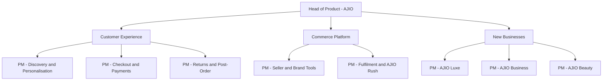

# AJIO Product Manager Interview Guide | Rounds & Cases

- **Source:** https://nextsprints.com/guide/ajio-product-manager-interview-guide

- **Type:** `interview-guide`

- **Updated:** October 31, 2026

---

## Introduction

AJIO is Reliance Retail's fashion and lifestyle e-commerce platform and one of the largest online fashion destinations in India. Launched in 2016, it has grown from a curated fashion store into a family of products: the main AJIO app, AJIO Luxe for premium and luxury brands, AJIOGRAM for homegrown D2C labels, AJIO Business for B2B wholesale to small retailers, AJIO Rush for delivery in hours, and, since July 2026, AJIO Beauty built with Tira. Behind all of these sits Reliance Retail, India's largest retailer, with thousands of physical stores, its own fashion labels and a nationwide supply chain.

For product managers, that combination is the attraction. AJIO PMs work on consumer-scale problems (millions of shoppers, a catalogue reported at about 2.6 million options in Q1 FY26) while also connecting online experiences with stores, private labels and logistics that pure-play rivals like Myntra and Meesho do not have. In 2026 the priorities include faster delivery, better personalisation, beauty cross-sell and making each order more profitable.

| Hiring Metric | Value (estimate) |
| --- | --- |
| PM-family roles open at any time (AJIO and Reliance Retail digital) | 15–40 |
| Typical interview rounds | 4–5 |
| Average time-to-hire | 3–5 weeks |
| Main PM locations | Bengaluru, Mumbai |

> What Candidates Report
> Candidates describe AJIO interviews as business-heavy. Interviewers frequently come from category, supply chain and growth teams, so answers that tie product ideas to margin, returns and conversion land better than pure UX discussions.

## PM Role

> AJIO Product Manager
> An AJIO Product Manager owns a part of Reliance Retail's fashion commerce experience, such as discovery, checkout, returns, seller tools or fulfilment, and is accountable for customer outcomes and business metrics like conversion, repeat purchase and cost per order.

Responsibilities:

- Own a product area (search and discovery, personalisation, checkout and payments, post-order and returns, seller and brand tools, B2B, or fulfilment) end to end.
- Translate business goals from category and marketing teams into product roadmaps.
- Work with engineering, design, data science and operations to ship features weekly or fortnightly.
- Run A/B tests and analyse funnels, especially around sale events such as the Big Bold Sale.
- Coordinate with Reliance store and supply-chain teams on omnichannel features like AJIO Rush.
- Track product health metrics and respond quickly when they move.

The chart is illustrative; team structures change often and some functions sit in shared Reliance Retail technology teams.

| Aspect | AJIO PM | Pure-play startup PM | Big Tech PM |
| --- | --- | --- | --- |
| Focus | Commerce outcomes, margin | Growth at any cost | Platform scale |
| Stakeholders | Category, stores, supply chain | Founders, growth | Engineering, design |
| Pace | Fast, sale-driven cycles | Very fast | Moderate |
| Offline context | High (stores, logistics) | Low | Low |

Example of the kind of work: AJIO Rush, the hours-level delivery service launched in 2025, needed product managers to work with store operations, inventory systems and last-mile partners to show accurate delivery promises in the app, a problem that sits as much in operations as in software.

## Job Requirements

Education:

- Bachelor's degree, often engineering; an MBA from a recognised school is common for PM and APM roles.

Experience:

- APM / Associate PM: 0–2 years, often campus MBA hires or engineers moving into product.
- Product Manager: 2–5 years, ideally in consumer internet or e-commerce.
- Senior PM and above: 5+ years with ownership of a product area.

Skills:

- Strong analytics: SQL, Excel, funnel and cohort analysis.
- E-commerce fundamentals: catalogue, search, pricing, payments, logistics, returns.
- Experimentation and metric design.
- Stakeholder management across business and tech.

| Requirement | Essential | Preferred |
| --- | --- | --- |
| Education | Bachelor's degree | MBA |
| PM experience (PM role) | 2+ years | 4+ years in e-commerce |
| Analytics | SQL, Excel | Python, experimentation tools |
| Domain | Consumer tech | Fashion, retail or marketplace |

> Expert Advice
> Learn AJIO's sub-brands before the interview. Candidates who can explain how AJIO Luxe, AJIOGRAM, AJIO Business and AJIO Rush serve different customers show real preparation.

## Interview Process Breakdown

Reported processes vary by team and level, but a typical PM loop looks like this:

| Stage | Format | Duration | Focus Areas |
| --- | --- | --- | --- |
| Recruiter screen | Phone | 20–30 mins | Background, motivation, compensation |
| Hiring manager | Video | 45–60 mins | Past work, product thinking, fit |
| Product case | Video or in person | 45–60 mins | Product design or improvement on AJIO |
| Analytical / execution | Video | 45–60 mins | Metrics, root cause, SQL or guesstimate |
| Business / leadership | In person or video | 30–45 mins | Strategy, stakeholder handling |
| HR | Phone | 20–30 mins | Offer, notice period |

Detailed Breakdown:

- Hiring manager round:

Expect questions about your past products, metrics you moved and how you worked with business teams. Some candidates report case questions here too.

- Product case rounds:

Typical prompts include improving AJIO's returns, designing for first-time buyers in smaller cities, or growing AJIO Luxe. Interviewers look for clear user segmentation and business awareness.

- Analytical round:

Root cause questions (for example a drop in conversion during a sale), metric definitions for features like AJIO Rush, and guesstimates such as the number of jeans sold online in India.

- Business or leadership round:

Often with a senior product or business leader; candidates report discussions on AJIO versus Myntra, private labels and omnichannel.

Timeline expectations:

- Three to five weeks from first call to offer.
- Engineering-adjacent and category roles reported on Glassdoor and AmbitionBox describe three rounds (manager, department head, HR) over two to four weeks; PM loops usually add one or two case rounds.

## Product Manager Compensation & Levels at AJIO

AJIO PM pay is competitive with mid-to-large Indian consumer internet companies. AmbitionBox reports AJIO Product Manager pay of roughly ₹18.5–45 lakh per year for 2–9 years of experience.

| Level | Total Compensation (INR, 2026 estimate) |
| --- | --- |
| Associate PM / APM | ₹14–24 lakh |
| Product Manager | ₹22–40 lakh |
| Senior PM | ₹35–58 lakh |
| Lead PM / Product Lead | ₹50–85 lakh |
| Head of Product / Director | ₹80 lakh–1.3 crore |

Compensation is mostly fixed pay with an annual performance bonus. Long-term incentives are less common than at venture-funded startups and usually limited to senior roles. See the salary guide for details.

## How to Prepare

Know the business:

1. AJIO's sub-brands and who they serve (Luxe, AJIOGRAM, Business, Rush, Beauty).
2. Reliance Retail's fashion assets: Trends, own labels, store network.
3. Key competitors: Myntra, Meesho, Flipkart, Amazon, Nykaa Fashion, Tata CLiQ, and the Shein India app in Reliance's own portfolio.
4. Fashion e-commerce economics: return rates, COD and RTO, discount dependency, private-label margins.

Tailor your resume: Lead with quantified results. Show conversion, retention or cost metrics you moved. Highlight any e-commerce, retail or marketplace experience. For expert feedback, consider NextSprints' Resume Review service.

Practice product cases:

- Fit and returns problems.
- Tier 2+ and first-time buyer experiences.
- Omnichannel features linking stores and the app.
- Sale-event metrics and root cause analysis.

To practise with AJIO-specific questions, use NextSprints' Product Manager Interview Questions.

Mock interviews: Practise with PMs from e-commerce companies, ideally with fashion experience. Ask them to push you on unit economics.

Use the app: Order something on AJIO, try a return or exchange, browse AJIOGRAM and AJIO Luxe. Note friction points; interviewers often ask what you would change.

## FAQs

### Does AJIO have a formal APM program?

There is no widely publicised standalone APM program for AJIO. Reliance Retail does hire MBA graduates through campus placements into product, category and management trainee roles, and some of these land in AJIO or Reliance Retail digital teams. Off-campus, Associate PM and PM roles appear on LinkedIn, iimjobs and the Reliance careers site.

### How long does the AJIO PM interview process take?

Candidates typically report three to five weeks from the first recruiter call to the offer. Senior roles can take longer because they include meetings with business leaders. Ask the recruiter for the round structure early so you can prepare.

### What kind of case questions are asked?

Expect consumer-commerce cases tied to AJIO's products: improving returns, designing for first-time buyers, measuring AJIO Rush, growing AJIO Luxe, or diagnosing a conversion drop during a sale. Interviewers value answers that consider cost and margin, not only user experience.

### How technical are AJIO PM interviews?

Most rounds are not deeply technical, but expect analytics. Some candidates report SQL or Excel-based questions, and platform PM roles (fulfilment, payments) can include system design discussions at a high level, such as how inventory availability flows from stores to the app.

### Is it better to target AJIO or the wider Reliance Retail product organisation?

Apply broadly. Product roles across Reliance Retail's digital businesses (AJIO, JioMart, Tira, and shared platforms) share technology and sometimes hiring teams. If fashion is your passion, highlight it, but stay open to adjacent teams.

## Related Guides Section

📖 [AJIO Product Strategy Guide](/guide/ajio-product-strategy-guide) – How AJIO is using speed, stores and new categories to compete with Myntra.

📖 [AJIO Product Manager Salary Guide](/guide/ajio-product-manager-salary-guide) – 2026 INR pay bands and negotiation tips.

📖 [AJIO Product Teardown](/guide/ajio-fashion-ecommerce-app-product-teardown) – Deep dive into the AJIO app's features, UX and business model.

Disclaimer: This guide is created for product management interview preparation purposes only. It is based on public information and candidate reports, and figures are estimates.
