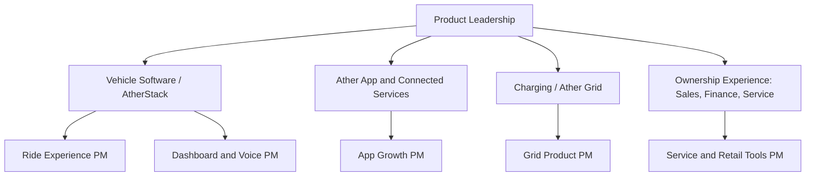

# Ather Energy Product Manager Interview Guide | EV PM

- **Source:** https://nextsprints.com/guide/ather-energy-product-manager-interview-guide

- **Type:** `interview-guide`

- **Updated:** October 31, 2026

---

## Introduction

Ather Energy is one of the few Indian hardware companies where product management sits at the centre of the business. Founded in 2013 by Tarun Mehta and Swapnil Jain in Bengaluru, Ather designs its electric scooters, battery packs, vehicle software (AtherStack), the Ather app and the Ather Grid charging network largely in-house. It listed on the Indian stock exchanges in 2025 and, by mid-2026, was India's third-largest electric two-wheeler maker, with about 15% of registrations in July 2026 and Q1 FY27 revenue of roughly ₹1,217 crore.

For a PM candidate, that mix is unusual. You may work on a touchscreen dashboard used at 60 km/h, an OTA release that reaches every scooter on the road, a charging network, a financing flow in an experience centre, or a mass-market scooter platform (EL) planned for 2026. Ather PMs are expected to think about software, hardware, retail and service at the same time.

| Hiring snapshot (estimates) | Value |
| --- | --- |
| Main PM location | Bengaluru (headquarters and R&D) |
| Common PM titles | Associate PM (Software), PM (Ride Experience), Senior PM (Software) |
| Typical experience for PM roles | 2–10 years, depending on level |
| Reported interview length | 3–5 rounds over 2–5 weeks |
| Company scale | 700+ experience centres, ~500 service centres (2026) |

> Insider Perspective
> Candidates who have interviewed at Ather describe interviewers who care about first-principles reasoning and about the rider's real context: traffic, heat, rain, helmets and Indian roads. Answers that treat the scooter like a phone app tend to fall flat.

## PM Role

> Ather Energy Product Manager
> An Ather Product Manager owns a part of the ownership experience, from in-vehicle software and the Ather app to charging, service or vehicle features, and works with hardware, firmware, design, data and retail teams to ship improvements to riders, often over the air.

Typical responsibilities:

- Define requirements for vehicle software features (dashboard, navigation, ride modes, voice) and app features.
- Plan OTA releases with firmware and QA teams, including staged rollouts and rollback criteria.
- Analyse connected-vehicle data (rides, charging, errors) to find problems and opportunities.
- Work with retail and service operations on journeys such as test rides, financing, delivery and service.
- Partner with hardware teams on new platforms, such as the EL platform and its first scooter.
- Track metrics including activation, feature usage, safety signals, NPS and paid feature attach (for example the Pro Pack).

Product areas candidates report hiring for:

| Aspect | Ather PM | Consumer app PM | Traditional auto PM |
| --- | --- | --- | --- |
| Release cycle | OTA, weeks to months | Days to weeks | Model years |
| Safety stakes | High | Low | High |
| Data | Rich vehicle telemetry | Rich app analytics | Limited |
| Cross-functional span | Software, hardware, retail, service | Software | Hardware, dealers |

Example of PM work: AtherStack 7.0, unveiled at Community Day 2025, added voice interaction and AI-driven rider assistance and was designed to be backward compatible with older 450X and Rizta Z scooters. Delivering a feature like that touches microphones, firmware, cloud services, app onboarding, store demos and OTA rollout planning.

## Job Requirements

Requirements vary by level. Based on public job listings and candidate reports, common expectations include:

| Level | Experience | Typical expectations |
| --- | --- | --- |
| Associate PM (Software) | 2–5 years | Strong analytics, writing specs, working closely with engineers |
| Product Manager | 4–8 years | Owns a feature area end to end; experience with consumer or enterprise software |
| Senior PM | 7–10 years | Owns a product line or platform; leads strategy and multiple squads |
| Lead / Head of Product | 10+ years | Sets portfolio direction; hires and develops PMs |

Skills that stand out:

- Engineering background: many Ather PMs come from engineering degrees (IITs, NITs and other engineering colleges) or from software development roles. A technical foundation helps in conversations about firmware, sensors and OTA constraints.
- Data fluency: SQL and comfort with event and telemetry data.
- Hardware empathy: understanding that hardware cannot be patched like software, and that some decisions are locked years in advance.
- Rider empathy: ideally, experience riding a scooter in Indian traffic. Interviewers notice when candidates have actually test-ridden a Rizta or 450.
- Clear writing: Ather teams rely on detailed specs and written reasoning.

> Common Pitfalls
> Candidates often propose features that need hardware the scooter does not have, ignore safety while riding, or forget offline channels such as experience centres and service centres. Another common miss is not knowing Ather's current lineup (450S, 450X, 450 Apex, Rizta S and Rizta Z) and recent announcements.

> Expert Advice
> Before your interview, take a test ride at an Ather experience centre, install the Ather app, and read recent coverage of Community Day announcements. Bring two or three specific observations into your answers.

## Interview Process Breakdown

Public reports on Ather's PM interviews are limited, so treat the following as a typical pattern assembled from candidate reports, job listings and comparable Bengaluru product companies.

- Initial Application and Screening:

- Applications via Ather's careers page, LinkedIn, referrals and job platforms.
- Recruiter call (20–30 minutes): background, motivation ("Why Ather? Why leave your current role?"), notice period and compensation expectations.

- Product Interviews:

- Hiring manager round (45–60 minutes): deep dive into your past work, how you measured impact, and how you handled trade-offs with engineering.
- Product sense or case round (45–60 minutes): design or improvement questions, often tied to Ather products, such as improving the charging experience or designing a feature for Rizta families.
- Analytical or metrics round: defining success metrics or diagnosing a metric drop, sometimes with a take-home exercise for senior roles.

- Final Rounds:

- Technical or cross-functional round: discussion with engineering or design leaders about system constraints, OTA, data pipelines or hardware dependencies.
- Leadership and culture round: conversation with a senior product or business leader on ownership, ambiguity and long-term motivation.
- HR round: offer discussion.

| Stage | Duration | What's assessed |
| --- | --- | --- |
| Recruiter screen | 20–30 min | Motivation, fit, logistics |
| Hiring manager | 45–60 min | Past impact, depth |
| Product case | 45–60 min | Product sense, user empathy |
| Metrics / analytics | 45–60 min | Data reasoning |
| Technical / cross-functional | 45 min | Working with hardware and software teams |
| Leadership / culture | 30–45 min | Ownership and values |

Some candidates report shorter processes of two or three rounds for specific teams. Total time ranges from about two to five weeks.

## Product Manager Compensation & Levels at Ather Energy

Ather pays competitively for an Indian hardware company, with total compensation made up of fixed salary, a performance bonus and, for many roles, stock-based compensation now that the company is listed. AmbitionBox data puts Product Manager salaries at roughly ₹18–35 lakh per year for 3–13 years of experience. Estimated 2026 ranges by level:

| Level | Experience | Total annual compensation (INR, estimate) |
| --- | --- | --- |
| Associate PM | 2–4 years | ₹14–24 lakh |
| Product Manager | 4–7 years | ₹22–38 lakh |
| Senior PM | 7–10 years | ₹35–55 lakh |
| Lead / Principal PM | 10+ years | ₹50–75 lakh |
| Head of Product / Director | 12+ years | ₹70 lakh–₹1.1 crore |

See the salary guide for more detail on structure and negotiation.

## How to Prepare

1. Know the products: 450S, 450X, 450 Apex, Rizta S and Rizta Z; AtherStack versions; Ather Grid and the LECCS connector; the Pro Pack; the Halo smart helmet; and the EL platform.
2. Ride the scooter: book a test ride and note friction points from booking to the ride itself.
3. Understand the market: TVS iQube, Bajaj Chetak, Ola Electric and Hero Vida; subsidy changes; why most two-wheeler charging happens at home.
4. Practise hardware-aware cases: OTA trade-offs, range estimation, safety guardrails, service journeys and financing.
5. Prepare metrics stories: connected-vehicle metrics (rides per week, range trust, OTA install rate) and business metrics (test-ride conversion, attach rates).
6. Prepare your story: why EVs, why Ather, and examples where you worked across functions with competing priorities.

Practice plan:

| Week | Focus |
| --- | --- |
| 1 | Product research, test ride, app teardown |
| 2 | Product design and improvement cases on Ather products |
| 3 | Metrics and root cause cases using vehicle data |
| 4 | Strategy cases (EL platform, Grid, competition) and mock interviews |

## FAQs

### Do I need an engineering or automotive background to become a PM at Ather Energy?

An automotive background is not required, but an engineering degree or strong technical foundation helps, because PMs work closely with firmware and hardware teams. Candidates from consumer internet companies are hired for app and software roles, provided they show they understand hardware constraints and rider safety.

### What kind of case questions does Ather ask?

Candidates report product sense questions tied to Ather's products, such as improving charging, designing features for family riders or evaluating a new software capability, along with metrics questions. Practising with Ather-specific scenarios, such as OTA rollouts and range anxiety, is the best preparation.

### Does Ather hire freshers or run an APM programme?

Ather hires some graduates into engineering, design and analyst roles, and occasionally into associate product roles, but there is no widely publicised APM programme similar to those at large internet companies. Most PM openings ask for at least two years of experience. Graduates often enter through analyst, engineering or business roles and move into product later.

### Where are Ather's product teams based?

Most product and engineering teams are in Bengaluru, where Ather has its headquarters and R&D. Manufacturing is in Hosur (Tamil Nadu), with a new plant in Chhatrapati Sambhajinagar (Aurangabad), Maharashtra, so vehicle-related PMs may travel to plants.

### How long does the Ather PM interview process take?

Reports suggest two to five weeks from first call to offer, with three to five rounds. Senior roles and roles with a take-home exercise tend to take longer.

## Related Guides Section

- [Ather Energy Product Strategy Guide](/guide/ather-energy-product-strategy-guide): how the EL platform, AtherStack and Ather Grid fit Ather's growth plan.
- [Ather Energy Product Manager Salary Guide](/guide/ather-energy-product-manager-salary-guide): 2026 INR pay bands by level and negotiation tips.
- [Ather Rizta and Ecosystem Product Teardown](/guide/atherenergy-rizta-family-scooter-product-teardown): a deep dive into the Rizta, the Ather app and the charging network.
