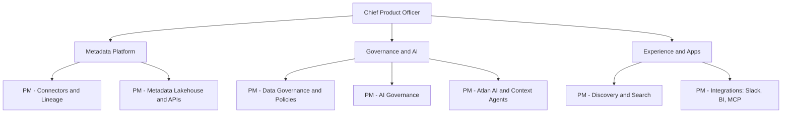

# Atlan Product Manager Interview Guide | Rounds & PRD

- **Source:** https://nextsprints.com/guide/atlan-product-manager-interview-guide

- **Type:** `interview-guide`

- **Updated:** October 31, 2026

---

## Introduction

Atlan builds an active metadata platform: a data catalogue, column-level lineage, data governance, data quality, AI governance and, most recently, a "context layer" that delivers governed business context to AI agents through its MCP server. Founded in 2019 by Prukalpa Sankar and Varun Banka, Atlan grew out of their experience running data teams and has become one of the best-known Indian-founded enterprise SaaS companies selling mainly to large customers in the US and Europe. It raised a $105 million Series C in May 2024 led by GIC and Meritech at a reported $750 million valuation, and in 2026 it was named a Leader in Gartner's Magic Quadrant for Data and Analytics Governance Platforms.

For product managers, Atlan is an unusual opportunity: a deeply technical B2B product, a global customer base, a remote-first culture with much of the team in India, and a front-row seat to how enterprises govern data and AI. PMs work on problems like lineage across dozens of tools, AI-generated documentation, governance workflows and agent integrations, with users ranging from data engineers to chief data officers.

| Hiring Metric | Value (estimate) |
| --- | --- |
| Typical interview rounds (PM) | 5–6 |
| Reported time to complete loop | About 3 weeks |
| Common case format | Product cases plus a written PRD or case study |
| Main PM locations | Remote in India (Bengaluru, Delhi NCR, Pune and others), with US roles |

> What Candidates Report
> Candidates for Senior PM roles describe five to six rounds, including case studies and a full PRD exercise, completed in roughly three weeks. Several mention a short first conversation with a product lead focused on past work. Treat these as indicative: reports are few and vary by role.

## PM Role

> Atlan Product Manager
> An Atlan Product Manager owns a part of Atlan's metadata platform, for example lineage, connectors, governance workflows, data quality, Atlan AI or the MCP server, and is accountable for adoption and customer outcomes among data and AI teams at enterprise customers.

Responsibilities:

- Own a product area end to end: discovery, PRDs, prioritisation, launch and adoption.
- Talk to customers constantly: data engineers, analytics engineers, governance leads, AI platform teams.
- Work closely with engineering on technically deep problems (SQL parsing, connectors, permissions, AI evaluation).
- Partner with customer success and sales on enterprise deals and feedback loops.
- Write clearly: Atlan places strong emphasis on written documents and PRDs.
- Track metrics such as feature adoption, metadata coverage and customer health.

The chart is illustrative; actual team boundaries change as the product evolves. Atlan's public postings have included roles such as Associate Product Manager (data lineage), Staff Product Manager (metadata platform), Senior PM (data quality) and Director of Product Management.

| Aspect | Atlan PM | Consumer tech PM | Large enterprise software PM |
| --- | --- | --- | --- |
| Users | Data and AI teams | Consumers | Varied enterprise users |
| Technical depth | Very high | Moderate | High |
| Customer contact | Frequent, direct | Indirect (data, research) | Through account teams |
| Pace | Fast, startup | Fast | Slower |
| Writing culture | Strong (PRDs) | Varies | Strong |

## Job Requirements

Education:

- Bachelor's degree, often in engineering or computer science; MBA not required.

Experience:

- Associate PM: 1–2 years, often from engineering, data or analytics roles.
- PM and Senior PM: 3–8 years, ideally B2B SaaS, data infrastructure or developer tools.
- Staff and above: 8+ years with platform ownership.

Skills:

- Strong understanding of the modern data stack: warehouses (Snowflake, Databricks, BigQuery), dbt, orchestration, BI tools.
- SQL fluency; comfort reading code and technical specs.
- Familiarity with data governance concepts (lineage, classification, access policies, glossary).
- AI product sense: LLMs, evaluation, agents, MCP.
- Excellent writing and customer discovery skills.

| Requirement | Essential | Preferred |
| --- | --- | --- |
| Education | Bachelor's degree | CS or engineering |
| Domain | B2B SaaS | Data infrastructure, governance, AI |
| Technical | SQL, modern data stack basics | Hands-on data engineering |
| Communication | Clear writing | Published PRDs or product writing |

> Expert Advice
> Use Atlan before your interview. Atlan publishes extensive documentation, product tours and demos. Candidates who can discuss lineage, the glossary and the MCP server concretely stand out.

## Interview Process Breakdown

| Stage | Format | Duration | Focus Areas |
| --- | --- | --- | --- |
| Recruiter call | Video | 20–30 mins | Background, motivation, logistics |
| Product lead screen | Video | ~30 mins | Past work, depth of ownership |
| Product case | Video | 45–60 mins | Product sense on data or AI problems |
| Analytical / execution case | Video | 45–60 mins | Metrics, prioritisation, root cause |
| PRD exercise | Take-home plus review | Several hours plus 60 mins | Written thinking, structure, trade-offs |
| Leadership and culture | Video | 45 mins | Ownership, values, collaboration |

Detailed Breakdown:

- Product lead screen:

A short conversation about your experience. Be ready to explain one product you owned in depth, with metrics.

- Case rounds:

Expect prompts set in Atlan's world: improving lineage for impact analysis, designing for business users, measuring Atlan AI, or responding to bundled catalogues from Snowflake and Databricks.

- PRD exercise:

Candidates report writing a full PRD. Focus on the problem, users, evidence, scope, success metrics and risks. Clarity matters more than length.

- Leadership and culture:

Discussions about ownership, working remotely, handling ambiguity and customer obsession.

Timeline expectations:

- About three weeks for the full loop, based on candidate reports.
- Some candidates report feedback after each round from recruiters.

## Product Manager Compensation & Levels at Atlan

Atlan pays competitively for Indian product roles and at market rates for US roles. Levels.fyi shows Atlan Product Manager total compensation in India of roughly ₹61.5–85.7 lakh per year, and past US postings listed base salaries of about $149,000–199,500 for Product Manager and $155,000–223,100 for Senior PM (Data Quality).

| Level | India total compensation (INR, 2026 estimate) | US base (USD, estimate) |
| --- | --- | --- |
| Associate PM | ₹22–38 lakh | $100,000–140,000 |
| Product Manager | ₹40–65 lakh | $145,000–200,000 |
| Senior PM | ₹60–90 lakh | $155,000–225,000 |
| Staff / Principal PM | ₹85 lakh–1.3 crore | $200,000–260,000 |
| Director of Product | ₹1.2–1.8 crore | $230,000–300,000 |

Equity (stock options) is a meaningful part of the package. See the salary guide for details.

## How to Prepare

Know the domain:

1. Modern data stack: warehouses, dbt, orchestration, BI.
2. Governance basics: lineage, glossary, classification, policies, data products.
3. AI context: MCP, agents, evaluation, AI governance (EU AI Act basics).
4. Competitors: Collibra, Alation, Informatica, Microsoft Purview, Databricks Unity Catalog, Snowflake Horizon.

Tailor your resume: Highlight B2B and technical products, measurable adoption outcomes and customer-facing work. For expert feedback, consider NextSprints' Resume Review service.

Practise product cases:

- Developer and data-engineer workflows.
- Business-user adoption of technical products.
- AI feature metrics and trust.
- Platform bundling and competitive strategy.

Use NextSprints' Product Manager Interview Questions to practise Atlan-specific cases.

Practise writing: Write a two-page PRD on an Atlan feature (for example, PR-based impact reports) and ask a PM to critique it.

Mock interviews: Practise with PMs from data or developer-tools companies. Ask them to push on technical depth.

## FAQs

### Does Atlan hire Associate Product Managers?

Yes. Atlan has posted Associate Product Manager roles in India, including one focused on data lineage. These typically look for one to two years of experience in engineering, data or product, plus strong curiosity about data tooling. Atlan does not appear to run a large formal campus APM programme, so watch its careers page.

### How technical are Atlan PM interviews?

More technical than most PM interviews. Expect to discuss SQL, data pipelines, lineage and APIs at a conceptual level, and to reason about AI features such as evaluation and permissions. You do not need to code, but you must be comfortable with engineers.

### What is the PRD exercise like?

Candidates report a written PRD or case study as part of the loop. Treat it like a real document: define the problem with evidence, choose a target user, scope an MVP, define metrics, and list risks and open questions. Expect a review session where interviewers probe your choices.

### Is Atlan remote?

Atlan has operated as a remote-first company with many roles open across India and some in the US. Specific roles may have location expectations, so check each posting.

### How should I talk about competition with Snowflake and Databricks?

Show balance. Native catalogues are strong inside their platforms; Atlan's case is cross-platform governance, business context and AI context. Interviewers value candidates who can articulate where Atlan should partner rather than compete.

## Related Guides Section

📖 [Atlan Product Strategy Guide](/guide/atlan-product-strategy-guide) – How Atlan is moving from data catalogue to context layer for AI.

📖 [Atlan Product Manager Salary Guide](/guide/atlan-product-manager-salary-guide) – 2026 INR and USD pay bands and negotiation tips.

📖 [Atlan Product Teardown](/guide/atlan-active-metadata-platform-product-teardown) – Deep dive into Atlan's platform, UX and business model.

Disclaimer: This guide is created for product management interview preparation purposes only. It is based on public information and candidate reports, and figures are estimates.
