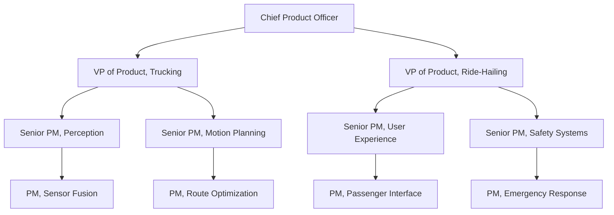
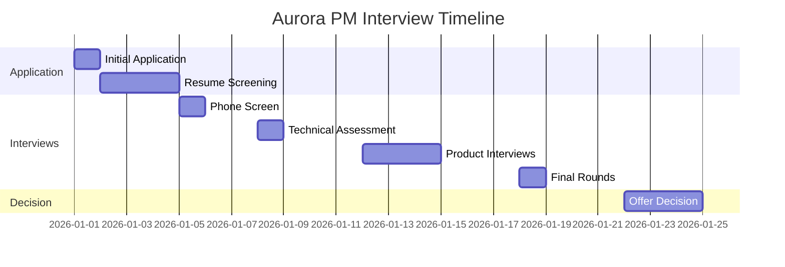

# Aurora Innovation PM Interview Guide | Process & Tips

- **Source:** https://nextsprints.com/guide/aurora-innovation-product-manager-interview-guide

- **Type:** `interview-guide`

- **Updated:** October 31, 2026

---

## Introduction

Aurora Innovation stands at the forefront of autonomous vehicle technology, pioneering a future where transportation is safer, more accessible, and efficient. As a Product Manager at Aurora, you'll be shaping the future of mobility, working on cutting-edge AI and robotics solutions that will revolutionize how we move.

The autonomous vehicle market is projected to reach $556.67 billion by 2026, growing at a CAGR of 39.47% from 2021 to 2026. Aurora's role in this explosive growth is pivotal, making the Product Manager position crucial for driving innovation and market leadership.

| Hiring Metric | Value |
| --- | --- |
| PM Openings (2026) | 15-20 |
| Avg. Time-to-Hire | 6-8 weeks |
| Acceptance Rate | 72% |
| Retention Rate (2 years) | 85% |

> Insider Perspective
> At Aurora, PMs are expected to have a deep understanding of both the technical aspects of autonomous systems and the complex regulatory landscape. Our most successful candidates often have backgrounds in robotics, computer vision, or transportation policy.

## PM Role

> Aurora PM Role
> Aurora Product Managers lead the development of autonomous vehicle technologies, balancing technical innovation with market needs and safety requirements. They collaborate across engineering, data science, and business teams to deliver scalable self-driving solutions.

Key responsibilities include:

1. Defining product strategy for autonomous driving systems
2. Prioritizing features based on safety, performance, and market demand
3. Collaborating with engineering teams on technical roadmaps
4. Analyzing data from vehicle tests to inform product decisions
5. Engaging with regulators and industry partners on AV standards

Aurora's PM team structure:

Comparison with other tech companies:

| Aspect | Aurora | Tesla | Waymo |
| --- | --- | --- | --- |
| Focus | Multi-purpose AV tech | Electric vehicles, AV features | Ride-hailing focused AVs |
| Technical Depth | High (AI, robotics) | High (EV, software) | High (AI, mapping) |
| Regulatory Involvement | Extensive | Moderate | Extensive |
| Go-to-Market | B2B partnerships | Direct to consumer | B2C and partnerships |

Real product example: Aurora's "FirstLight Lidar" system, which uses frequency modulated continuous wave (FMCW) technology to improve long-range object detection, crucial for highway trucking applications.

## Job Requirements

Education:

- Bachelor's degree in Computer Science, Robotics, or related field required
- Master's degree preferred, especially in AI or Autonomous Systems

Experience:

- 5+ years of product management experience in tech or automotive industries
- 2+ years working on autonomous systems or advanced driver-assistance systems (ADAS)

Technical Skills:

- Strong understanding of machine learning and computer vision principles
- Familiarity with sensor technologies (LIDAR, radar, cameras)
- Data analysis and SQL proficiency
- Experience with agile development methodologies

Soft Skills:

- Exceptional problem-solving and analytical thinking
- Strong communication skills, ability to translate complex technical concepts
- Leadership and cross-functional collaboration expertise
- Strategic thinking and ability to navigate ambiguity

| Requirement | Essential | Preferred |
| --- | --- | --- |
| Education | Bachelor's in CS/Robotics | Master's in AI/Autonomous Systems |
| PM Experience | 5+ years | 7+ years in AV/ADAS |
| Technical Knowledge | ML, Computer Vision basics | Deep learning, Sensor fusion |
| Industry Knowledge | Automotive or Tech | Autonomous vehicle regulations |

Success Factors:

1. Ability to balance long-term vision with short-term deliverables
2. Comfort with rapid iteration and data-driven decision making
3. Passion for autonomous technology and its societal impact
4. Skill in stakeholder management across technical and business teams

> Common Pitfalls
> Many candidates underestimate the importance of safety considerations in AV product management. Always prioritize safety in your product decisions and be prepared to discuss how you'd handle ethical dilemmas in autonomous driving scenarios.

> Expert Advice
> Successful Aurora PMs often have hands-on experience with AV systems. Consider contributing to open-source AV projects or participating in AV hackathons to gain practical insights that will set you apart in interviews.

## Interview Process Breakdown

Aurora's PM interview process is rigorous, designed to assess candidates' technical knowledge, product sense, and strategic thinking in the context of autonomous vehicles.

1. Initial Application and Screening Online application submission Resume and cover letter review by HR Initial phone screen with recruiter (30 minutes)
2. Product Interviews Product Sense: Evaluate your ability to design and improve autonomous vehicle features, focusing on user needs and safety considerations. Product Execution: Assess your skills in defining success metrics for AV systems and analyzing root causes of performance issues. Product Strategy: Explore your strategic thinking on AV market expansion, regulatory navigation, and long-term product roadmaps.
3. Final Rounds Leadership and cultural fit interview with senior executives Presentation of a strategic AV product challenge (given 48 hours in advance)

| Interview Round | Focus Areas | Duration |
| --- | --- | --- |
| Phone Screen | Background, motivation, basic AV knowledge | 30 min |
| Technical Assessment | ML concepts, sensor technologies, data analysis | 60 min |
| Product Design | User-centric AV feature design | 45 min |
| Product Execution | AV performance metrics, issue resolution | 45 min |
| Product Strategy | Market analysis, regulatory strategy | 45 min |
| Leadership/Culture | Cross-functional collaboration, Aurora values | 30 min |
| Final Presentation | Strategic thinking, communication skills | 60 min |

Practice Aurora Innovation questions

Product Design

How could Facebook build a feature to help people find roommates?

View

Say you're a WhatsApp PM and want to add more ecommerce functionality. What would you do?

View

How would you build a language learning product for the Facebook app?

View

Product Improvement

How might Aurora Innovation refine its mapping technology to provide more accurate real-time traffic data for its self-driving vehicles?

View

How can Aurora Innovation improve its autonomous trucking software to better handle adverse weather conditions?

View

What features could Aurora Innovation add to its Aurora Driver system to increase safety for pedestrians and cyclists?

View

Product Success Metrics

How would you measure the success of Aurora Innovation's autonomous trucking technology?

View

What metrics would you use to evaluate Aurora Innovation's Aurora Driver software platform?

View

How would you define the success of Aurora Innovation's fleet management system for self-driving vehicles?

View

Product Trade-Off

In developing Aurora Innovation's autonomous driving software, how do we weigh investing in advanced AI capabilities versus ensuring compatibility with current vehicle hardware?

View

How should Aurora Innovation balance safety testing thoroughness versus accelerating autonomous truck deployment timelines?

View

For Aurora Innovation's self-driving technology, should we prioritize expanding to new vehicle types or deepening capabilities on existing platforms?

View

Product Root Cause Analysis

Why has Aurora Innovation's autonomous trucking system seen a 15% increase in disengagements during highway driving over the past month?

View

What factors are contributing to the recent 20% drop in simulation hours run on Aurora's Virtual Testing Suite?

View

Why has Aurora Innovation's Driver Beta program enrollment rate declined by 30% compared to the previous quarter?

View

## Product Manager Compensation & Levels at Aurora

Aurora's PM levels are structured to reflect the complexity and impact of autonomous vehicle product development:

1. Product Manager (L4)
2. Senior Product Manager (L5)
3. Principal Product Manager (L6)
4. Director of Product Management (L7)
5. VP of Product (L8)

Salary ranges based on level.fyi data (as of 2026):

| Level | Title | Base Salary | Stock (4-year) | Annual Bonus |
| --- | --- | --- | --- | --- |
| L4 | Product Manager | $130,000 - $160,000 | $100,000 - $200,000 | 10-15% |
| L5 | Senior PM | $160,000 - $200,000 | $200,000 - $400,000 | 15-20% |
| L6 | Principal PM | $200,000 - $250,000 | $400,000 - $800,000 | 20-25% |
| L7 | Director | $250,000 - $300,000 | $800,000 - $1,500,000 | 25-30% |

Note: Compensation may vary based on location, experience, and performance. Aurora also offers comprehensive benefits including health insurance, 401(k) matching, and professional development opportunities.

## How to Prepare

Aurora's Leadership Principles:

1. Safety First: Prioritize safety in all product decisions and designs.
2. Innovate Boldly: Push the boundaries of what's possible in autonomous technology.
3. Collaborate Openly: Foster cross-functional teamwork and knowledge sharing.
4. Act with Integrity: Make ethical decisions that build trust with users and regulators.

Tailor Your Resume:

- Highlight quantifiable impacts in previous roles, especially related to product launches or improvements.
- Emphasize experience with machine learning, computer vision, or autonomous systems.
- Use the STAR method to showcase problem-solving skills in complex technical environments.
- Consider a [professional resume review](https://nextsprints.com/resume-review) to ensure your application stands out.

Practice Product Cases: Familiarize yourself with Aurora's key products and challenges in the AV industry. Focus on:

- Designing safety features for autonomous trucks
- Improving perception systems for urban environments
- Developing go-to-market strategies for new AV technologies

Utilize [NextSprints' extensive PM interview question database](https://nextsprints.com/product-manager-interview-questions) to practice a wide range of AV-specific scenarios.

Practice Mock Interviews: While self-practice is valuable, getting feedback from experienced PMs is crucial. If you don't have access to industry mentors, consider [NextSprints' PM Coaching](https://nextsprints.com/pm-coaching) for expert-led mock interviews tailored to Aurora's process.

## FAQs

### What sets Aurora apart from other AV companies?

Aurora focuses on developing a universal autonomous driving technology that can be applied to multiple vehicle types and use cases, from trucking to ride-hailing. This versatility, combined with our advanced perception systems like FirstLight Lidar, positions us uniquely in the market.

### How technical do I need to be as a PM at Aurora?

While you don't need to be a deep learning expert, a strong technical foundation is crucial. You should be comfortable discussing machine learning concepts, sensor technologies, and data analysis. Familiarity with robotics or computer vision is a significant plus.

### What's the biggest challenge for PMs at Aurora?

Balancing the need for rapid innovation with stringent safety requirements is often the most significant challenge. PMs must navigate complex regulatory landscapes while pushing the boundaries of AV technology.

### How does Aurora approach testing and validation?

We use a combination of real-world testing and advanced simulation environments. PMs play a crucial role in defining test scenarios, analyzing performance data, and making data-driven decisions to improve our AV systems.

### What opportunities are there for career growth?

Aurora offers substantial growth opportunities as the AV industry expands. PMs can specialize in areas like trucking automation, urban mobility, or AV safety systems, or move into broader strategic roles as the company scales.

## Related Guides Section

📖 [Aurora Innovation Product Strategy Guide](aurora-innovation-product-strategy-guide) – Deep dive into Aurora's product decisions.

📖 [Aurora Innovation Product Manager Salary Guide](aurora-innovation-product-manager-salary-guide) – Salary insights & negotiation tips.

📖 [Aurora Innovation Product Teardown Guide](aurora-innovation-autonomous-driving-teardown-analysis) – Analysis of Aurora's product positioning.

Disclaimer: This guide is created for product management interview preparation purposes only. The analysis and methodology are based on the public information.
