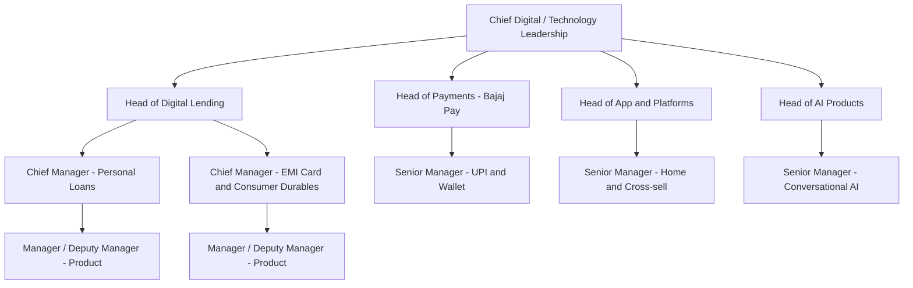

# Bajaj Finserv Product Manager Interview Guide | Lending PM

- **Source:** https://nextsprints.com/guide/bajaj-finserv-product-manager-interview-guide

- **Type:** `interview-guide`

- **Updated:** October 31, 2026

---

## Introduction

Bajaj Finserv is the Pune-headquartered financial services holding company of the Bajaj Group. Its businesses include Bajaj Finance (one of India's largest consumer lenders), Bajaj General Insurance and Bajaj Life Insurance (the former Bajaj Allianz companies, renamed in 2025 after Allianz exited), Bajaj Finserv Health, Bajaj Finserv Direct (which runs the Bajaj Markets marketplace), and asset management and broking arms.

For product managers, the centre of gravity is Bajaj Finance. It reported a customer franchise of about 119 million by March 2026, and its consumer app (branded the Bajaj Finserv app, and referred to as the Bajaj Finance App in FY26 reporting) has crossed 86 million net installs. Products such as the Insta EMI Card, consumer durable loans, Insta Personal Loans, Bajaj Pay, and a growing set of AI-driven service features all need PMs who understand both digital product craft and the economics of lending.

What makes the role distinctive: huge scale, offline and online channels side by side, tight RBI and IRDAI regulation, and a company-wide AI push (FINAI).

| Hiring Metric | Value (estimates) |
| --- | --- |
| Customer franchise (Bajaj Finance, Mar 2026) | ~119 million |
| App net installs (FY26) | ~86 million |
| Typical PM interview rounds | 4–6 |
| Average time-to-hire (lateral) | 3–6 weeks |
| Main product hubs | Pune, Mumbai |

> What Interviewers Look For
> Candidates report that interviewers keep coming back to one theme: can you grow a product without hurting credit quality or compliance? Answers that chase conversion alone, without mentioning delinquency, fraud, or the Key Fact Statement, tend to score poorly.

## PM Role

> Bajaj Finserv Product Manager
> A product manager at Bajaj Finserv or Bajaj Finance owns a digital product or journey (such as the EMI Card experience, personal loan journey, Bajaj Pay, or an insurance purchase flow) and is accountable for business outcomes like disbursals, cross-sell, and cost to serve, within the bounds set by risk and regulation.

One nuance matters for job seekers. At Bajaj Finance, the title "Product Manager" is used for two different jobs:

- Business product managers own a lending product line (for example consumer durables in a region) and work closely with sales, partners, and credit.
- Digital product managers own app and web journeys, work with engineering and design, and are measured on funnel and engagement metrics.

Campus MBA roles can lead to either. Read the job description carefully and tailor your preparation.

Responsibilities of digital PMs typically include:

- Owning end-to-end digital journeys (onboarding, loan application, servicing, payments)
- Working with risk and credit teams on eligibility rules and fraud controls
- Partnering with compliance on disclosures, KFS, and grievance flows
- Running experiments on the Bajaj Finserv app and web properties
- Building cross-sell journeys across loans, cards, insurance, and investments

| Aspect | Bajaj Finserv PM | Bank PM | Consumer Tech PM |
| --- | --- | --- | --- |
| Focus | Lending growth and cross-sell | Deposits, cards, compliance | Engagement and growth |
| Pace | Fast, target-driven | Moderate | Fast |
| Regulatory involvement | High (RBI, IRDAI) | Very high | Low |
| Offline component | Strong (partner stores, field force) | Branches | Minimal |
| Scale | 100M+ customers | Varies | Varies |

## Job Requirements

Education:

- Bachelor's degree, often engineering
- MBA from a top or well-regarded B-school strongly preferred for campus and early-career roles

Experience:

- Campus roles: 0–3 years of prior work experience
- Lateral PM roles: 2–8 years, ideally in fintech, lending, payments, or consumer internet
- Senior roles: 8+ years with ownership of large digital journeys

Technical skills:

- Funnel analytics and SQL (or strong Excel at minimum)
- Understanding of APIs, mobile app releases, and experimentation
- Familiarity with Indian digital rails: UPI, e-mandate, Aadhaar eKYC, DigiLocker, Account Aggregator
- Working knowledge of lending concepts: bureau scores, delinquency buckets, KFS, APR

| Requirement | Essential | Preferred |
| --- | --- | --- |
| Education | Graduate | MBA from a top B-school |
| Experience | 0–3 yrs (campus), 2+ yrs (lateral) | Fintech or lending product experience |
| Analytics | Excel, basic SQL | Strong SQL, experiment design |
| Domain | Basic finance knowledge | Lending, payments, or insurance |
| Soft skills | Communication | Cross-functional leadership |

> Common Pitfalls
> Candidates often design for metro users with premium phones. Many Bajaj Finance customers are in smaller towns, are new to credit, and first met the brand at a store counter. Ignoring this is a common reason for weak case scores.

> Expert Advice
> Learn the basic shape of the business: consumer durable loans, EMI Card, personal loans, and cross-sell to an existing franchise. Being able to explain why products per customer matters to Bajaj Finance signals real preparation.

## Interview Process Breakdown

Processes differ between campus hiring and lateral hiring, and between Bajaj Finance and other group companies, but candidates report a broadly similar structure.

| Stage | Format | Duration | Focus Areas |
| --- | --- | --- | --- |
| Screening | Resume shortlist; some roles add aptitude or Excel tests | 20–45 mins | Fit, basics, analytical ability |
| Product case round | Video or in person | 45–60 mins | Product design or improvement on a Bajaj product |
| Hiring manager round | Video or in person | 45–60 mins | Metrics, funnels, guesstimates, past projects |
| Senior leader round | In person (Pune or Mumbai) | 30–45 mins | Business thinking, ownership, motivation |
| HR | Phone or in person | 20–30 mins | Compensation, location, joining |

Detailed breakdown:

- Screening:

Campus processes start with a shortlist based on CV and sometimes a group discussion or short test. Lateral candidates speak with a recruiter. Some candidates report quick Excel and aptitude checks for deputy-level product roles.

- Product case round:

Typically a design or improvement case on a real product: for example, improving the in-store EMI checkout, designing an onboarding flow for new-to-credit customers, or increasing usage of Bajaj Pay. Interviewers probe trade-offs with risk and compliance.

- Hiring manager round:

Execution focus: define metrics for a feature, diagnose a drop in disbursals or approvals, size a market. Expect to walk through a past project in detail, including the numbers.

- Senior leader round:

A conversation with a business or digital head about how you think about the business, why Bajaj, and how you handle pressure and ambiguity.

Timeline expectations:

- Campus: often compressed into one or two days during placement week
- Lateral: about 3–6 weeks from first call to offer
- Feedback: typically within a week between rounds

Practice Revolut questions

Product Design

How could Facebook build a feature to help people find roommates?

View

Say you're a WhatsApp PM and want to add more ecommerce functionality. What would you do?

View

How would you build a language learning product for the Facebook app?

View

Product Improvement

How can Revolut enhance its budgeting tools to better help users manage their finances?

View

What features could be added to Revolut's cryptocurrency trading platform to attract more experienced traders?

View

In what ways can we improve Revolut's travel insurance offering to provide more value to frequent travelers?

View

Product Success Metrics

how would you define the success of revolut's multi-currency accounts?

View

what metrics would you use to evaluate revolut's premium subscription plan?

View

how would you measure the success of revolut's international money transfer feature?

View

Product Trade-Off

Should Revolut prioritize adding new features or improving existing core functionalities?

View

How can Revolut balance offering free services to attract users versus implementing fees to increase revenue?

View

Is it better for Revolut to focus on expanding to new markets or deepening product offerings in existing markets?

View

Product Root Cause Analysis

Why has the number of new Revolut Metal card sign-ups dropped by 30% this month?

View

Why has customer engagement with Revolut's budgeting tools decreased by 25% over the last month?

View

What's causing the sudden increase in failed international money transfers for Revolut business accounts?

View

## Product Manager Compensation & Levels at Bajaj Finserv

Bajaj Finance uses a banking-style grade structure. Product roles map roughly as follows. Figures are 2026 estimates of total annual compensation in INR, anchored on AmbitionBox and Glassdoor data and adjusted for digital PM roles, which usually pay above business product roles.

Levels:

1. Deputy Manager / Associate Product Manager
2. Manager - Product
3. Senior Manager - Product
4. Chief Manager - Product
5. AVP / Product Head
6. VP / National Head

| Level | Typical Experience | Total Compensation (INR, per year) |
| --- | --- | --- |
| Deputy Manager / APM | 0–2 yrs (campus MBA) | ₹14 – 22 lakh |
| Manager - Product | 2–4 yrs | ₹18 – 28 lakh |
| Senior Manager - Product | 4–7 yrs | ₹26 – 40 lakh |
| Chief Manager - Product | 7–10 yrs | ₹38 – 58 lakh |
| AVP / Product Head | 10–14 yrs | ₹55 – 90 lakh |
| VP / National Head | 14+ yrs | ₹90 lakh – ₹1.6 crore |

Note: Ranges are approximate and vary by business unit, location, and whether the role is digital or business-focused. Compensation typically combines fixed pay with a performance-linked variable component; ESOPs are more common at senior levels.

## How to Prepare

Core themes to show:

1. Customer understanding beyond metros: vernacular, low-end devices, offline-first journeys.
2. Growth with discipline: every growth idea comes with risk and compliance guardrails.
3. Funnel fluency: break disbursals or sales into stages and find the leak.
4. AI awareness: know how Bajaj Finance is using AI in service and operations, and its risks.

Tailor your resume: Lead with measurable outcomes: conversion lifts, cost reductions, revenue influenced. Use the STAR structure. If you have lending, payments, or insurance exposure, make it obvious in the first lines. NextSprints' Resume Review service can help sharpen this for fintech roles.

Practice product cases: Practise cases on real Bajaj products: the Insta EMI Card, consumer durable loans at stores, Bajaj Pay, Bajaj Markets, Bajaj Finserv Health, and insurance journeys. Focus on:

- First-time borrower experiences
- Funnel diagnosis (approvals, mandates, KYC)
- Cross-sell vs customer experience trade-offs
- Fraud and speed trade-offs in instant lending

NextSprints' Product Manager Interview Questions include worked answers on these products.

Mock interviews: Practise with PMs who have worked in Indian fintech or lending. If you don't have access to them, NextSprints PM Coaching connects you with experienced product managers.

## FAQs

### Does Bajaj Finserv hire product managers from campus?

Yes. Bajaj Finance and other group companies recruit MBA graduates through campus placements, with roles that can include product, digital, and business functions. Titles such as Deputy Manager or Manager are common for fresh MBA hires. Check whether the role is a digital product role or a business product role, since the day-to-day work differs.

### Where are product roles based?

Most digital product roles sit in Pune, where Bajaj Finserv and Bajaj Finance are headquartered, and in Mumbai. Some roles in Bajaj Markets and technology teams may be in other cities. Candidates should expect regular in-office work.

### What kind of case questions are asked?

Candidates report product design and improvement cases on Bajaj products, metric definition questions, root cause analysis of funnel drops, and guesstimates such as the market size for consumer durable loans in a city. Interviewers often push on risk and compliance trade-offs.

### How important is finance knowledge?

You don't need to be a credit analyst, but you should understand basic lending concepts: credit scores, EMIs, interest rates, delinquency, KYC, and disclosure rules. Not knowing these is a red flag for a lending company.

### How does Bajaj Finserv's AI push affect PM roles?

Bajaj Finance has made AI a company-wide priority through its FINAI programme, with AI bots in customer service and plans for autonomous agents and a consumer AI platform. PMs are increasingly expected to understand how to design, measure, and govern AI features, especially in a regulated setting.

## Related Guides Section

📖 [Bajaj Finserv Product Strategy Guide](/guide/bajaj-finserv-product-strategy-guide) – How Bajaj Finserv's lending, payments, and insurance businesses fit together.

📖 [Bajaj Finserv Product Manager Salary Guide](/guide/bajaj-finserv-product-manager-salary-guide) – Salary bands by level and negotiation tips.

📖 [Bajaj Finserv Product Teardown](/guide/bajajfinserv-app-product-teardown) – A teardown of the Bajaj Finserv app.

Disclaimer: This guide is created for product management interview preparation purposes only. The analysis and methodology are based on public information and candidate reports, not insider knowledge.
