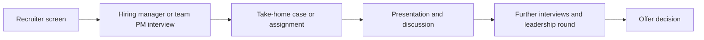

# Bolt Product Manager Interview Guide | 2026 Process & Tips

- **Source:** https://nextsprints.com/guide/bolt-product-manager-interview-guide

- **Type:** `interview-guide`

- **Updated:** October 31, 2026

---

## Introduction

Bolt is a Tallinn, Estonia-headquartered mobility company that runs ride-hailing, food and grocery delivery, scooters and e-bikes, and car rental across Europe and Africa. For a product manager, that means working on a real-world, three-sided marketplace: riders or customers, drivers or couriers, and cities and regulators. Every product decision has to balance supply, demand, price and local rules.

This guide covers what Bolt PM roles typically look for, how candidates describe the interview process, and how to prepare in 2026. It is built from public job postings, candidate reports on Glassdoor and prep sites, and press coverage. It is not an official Bolt process, and it will differ by team, seniority and location. Always check [careers.bolt.eu](https://careers.bolt.eu) for current openings and requirements.

> How to read this guide
> Interview details here reflect candidate reports, which are anonymous, partly dated and cover different teams. Treat them as a likely shape of the process, not a promise of what you will face.

## PM Role

> Bolt PM Role
> A Bolt product manager owns a product area inside the mobility marketplace, such as driver experience, rider growth, delivery, micromobility operations or compliance, and is accountable for its metrics, roadmap and cross-functional delivery.

Public postings show PM roles spread across areas such as:

- Ride-hailing: driver experience and compliance, verification, geolocation, pricing and rider growth
- Micromobility: scooter and e-bike operations, fleet experience, growth, compliance and city expansion
- Delivery and platform: food and grocery delivery, tax and payments, user insights and shared platform tooling

Typical responsibilities include setting priorities with engineering, design, operations and data colleagues, running experiments, working with city and country teams, and tracking marketplace health metrics. Because many launches depend on local licensing and operations, PMs often work closely with regional teams, not only with engineers.

> Office policy
> Bolt announced in October 2024 that staff would work from a Bolt office 12 days a month from January 1, 2025, with a minimum of two days a week. Press coverage found no later change, but confirm the current policy with your recruiter.

## Job Requirements

Requirements differ by posting. Third-party listings for Bolt PM roles commonly mention:

| Area | What postings commonly ask for |
| --- | --- |
| Experience | Mid-level roles around 2 to 5 years of product experience, senior roles around 5 or more years, often in fast-paced consumer tech |
| Product skills | Product sense, customer empathy, building and scaling consumer products, often mobile |
| Analytical skills | Comfort with metrics, experimentation and analytics tools |
| Collaboration | Working with engineers, operations and local teams, and communicating with stakeholders |
| Language and location | English; many roles are based in Tallinn, and some postings mention relocation support |

Some teams also value domain knowledge, for example marketplaces, logistics, compliance or geospatial data. A degree in a technical or business field is common but rarely the deciding factor in postings.

> Tailor your story
> Lead with outcomes you drove on a marketplace, operations-heavy or mobile product. Show how you balanced two sides of a market, not just that you shipped features.

## Interview Process Breakdown

Candidates report that the process varies by team and seniority. A commonly described path looks like this:

| Stage | What candidates report | What it tests |
| --- | --- | --- |
| Recruiter screen | Background, motivation, location and logistics | Fit and basics |
| First interview with a PM or manager | Mix of product and behavioral questions | Product sense, experience depth |
| Take-home assignment | A written or slide-based case, reported as time-consuming but doable | Analysis, structure, attention to detail |
| Presentation | Walking a panel through your case and defending choices | Communication, judgment |
| Further rounds | Reports mention several interviews, including senior or head-of-product conversations | Strategy, leadership, culture fit |

Reported timelines range from about a week for some roles to several months in a few older reviews, so ask your recruiter for the schedule. Recent Glassdoor reviews mention case themes such as a go-to-market plan for autonomous vehicles and exploring new business opportunities such as self-driving cars or coffee delivery, with product exploration, KPIs and an MVP. Treat these as examples of the style, not a script.

> Process may differ
> Some roles, especially analytics-leaning ones, may include a SQL or metrics exercise, and others may skip the take-home. Ask which rounds to expect.

## Product Manager Compensation & Levels at Bolt

Levels.fyi reports a median total compensation of about €68,000 for Bolt (EU) product managers in Estonia, from roughly 20 reports. Its data shows L3 at about €68K and L4 at about €83K; higher levels lack enough data. Bolt is private, so equity is typically stock options or private-company equity rather than liquid shares. Figures vary by location, level and timing, so use them as a rough guide. For levels, negotiation and detail, see the [Bolt PM Salary Guide](bolt-product-manager-salary-guide).

## How to Prepare

### Understand the marketplace

Learn how Bolt's businesses fit together: ride-hailing, delivery, micromobility and car rental, and how supply (drivers, couriers, vehicles) and demand interact in each city. Use the app in your own city, note what you see on pricing, wait times and safety features, and read Bolt's public announcements. The [Bolt Product Strategy Guide](bolt-product-strategy-guide) is a good companion read.

### Know the culture signals

Bolt is known for moving fast and for its in-office expectations. Review the values and principles Bolt states on its careers site and prepare examples of ownership, speed and working through ambiguity. Do not rely on third-party lists of values, since several results online describe a different company called Bolt.

### Practice questions

These are practice questions written for this guide to match Bolt's marketplace. They are not leaked or confirmed interview questions.

| Theme | Practice question |
| --- | --- |
| Supply vs demand | Riders in a city are waiting too long while many drivers report low earnings. How do you diagnose and fix it? |
| Pricing | How would you decide when and how to apply dynamic pricing during an event, and how would you measure fairness and trust? |
| Delivery | Delivery ETAs are often wrong by 10 minutes or more. How would you improve accuracy and the customer experience? |
| Micromobility safety | Scooter injuries are rising in one city. What do you do, and what trade-offs affect growth? |
| New market | Bolt is deciding whether to enter a new city. How do you evaluate it and plan the launch? |
| Metrics | Completed trips fell 8 percent week over week. Walk through your investigation. |
| Strategy | Should Bolt invest in autonomous vehicle partnerships? What would you need to believe? |

For each, structure your answer around users on each side of the market, a clear goal metric, guardrail metrics (such as safety, driver earnings and cost), options, and a proposed experiment or rollout.

### Prepare for the take-home

Practice a short written case in a few hours: state assumptions, size the problem, propose a solution and define success metrics. Rehearse presenting it in 15 to 20 minutes and defending trade-offs, since candidates say the presentation reveals attention to detail.

### Run mock interviews

Practice aloud with a peer or a coach. NextSprints has PM interview question banks and mock practice you can use to diversify your cases.

## FAQs

### How many rounds does the Bolt PM interview have?

It depends on the team. Candidates commonly describe a recruiter screen, a first interview, a take-home case with a presentation, and several further interviews. Ask your recruiter for the exact stages.

### Is there a take-home assignment?

Several candidates report one, followed by a presentation to a panel. It is not guaranteed for every role, so confirm early.

### Do I need SQL?

Postings emphasise analytics and experimentation rather than naming SQL consistently, and analytics-focused teams may test it. Even if you are not tested, be ready to discuss metrics, experiments and data.

### Do I need to live in Tallinn?

Many PM roles are Tallinn-based and some postings mention relocation support, while other offices hire locally. Bolt also expects office attendance of about 12 days a month, so location matters.

### How much do Bolt PMs earn?

Levels.fyi reports a median of about €68,000 total compensation for PMs in Estonia, based on a small sample. See the [Bolt PM Salary Guide](bolt-product-manager-salary-guide) for detail.

## Related Guides Section

📖 [Bolt Product Strategy Guide](bolt-product-strategy-guide) – Deep dive into Bolt's product decisions.

📖 [Bolt PM Salary Guide](bolt-product-manager-salary-guide) – Salary insights and negotiation tips.

Disclaimer: This guide is for interview preparation only. It is based on public information and candidate reports, not on an official Bolt process.
