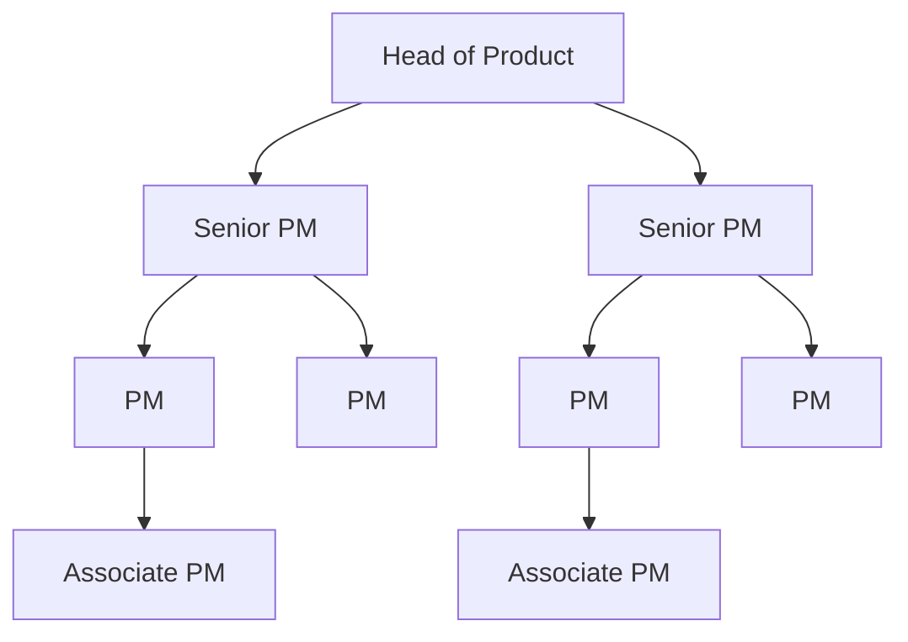
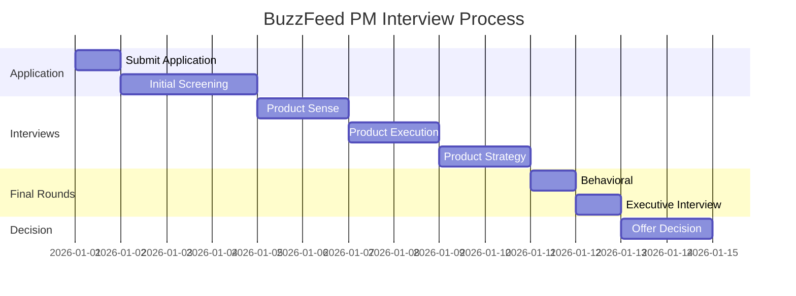

# BuzzFeed Product Manager Interview Guide | Full Process & Tips

- **Source:** https://nextsprints.com/guide/buzzfeed-product-manager-interview-guide

- **Type:** `interview-guide`

- **Updated:** October 31, 2026

---

## Introduction

BuzzFeed's product management culture is a unique blend of data-driven decision-making and creative innovation. As a digital media powerhouse, BuzzFeed's PMs are at the forefront of shaping content consumption trends and driving user engagement across multiple platforms. The role of a Product Manager at BuzzFeed has never been more crucial, as the company navigates the rapidly evolving landscape of digital media and content creation.

In recent years, BuzzFeed has expanded its product offerings beyond its core website, venturing into e-commerce, streaming video, and even AI-powered content creation. This diversification has led to an increased demand for skilled Product Managers who can balance user needs, business objectives, and technological capabilities.

| Key Hiring Statistics | 2025 | 2026 (Projected) |
| --- | --- | --- |
| PM Openings | 15 | 25 |
| Avg. Time-to-Hire | 45 days | 40 days |
| Acceptance Rate | 68% | 72% |

> Expert Insight
> As a Senior Product Leader at BuzzFeed, I've observed that successful PM candidates often demonstrate a deep understanding of content virality and user behavior analytics. The ability to translate data insights into engaging product features is what sets top performers apart in our fast-paced environment.

## PM Role

> BuzzFeed PM Role Definition
> A Product Manager at BuzzFeed is responsible for identifying user needs, defining product vision, and executing strategies that drive engagement and revenue across BuzzFeed's diverse content platforms and products.

Responsibilities breakdown:

1. User Research & Insights: Conduct user studies and analyze data to inform product decisions.
2. Product Strategy: Develop roadmaps aligned with company goals and market trends.
3. Cross-functional Leadership: Collaborate with editorial, tech, and business teams to deliver products.
4. Metrics & Performance: Define and track KPIs to measure product success and guide iterations.
5. Innovation: Identify opportunities for new features or products that enhance the BuzzFeed ecosystem.

Team structure:

Comparison with other tech companies:

| Aspect | BuzzFeed PM | Facebook PM | Google PM |
| --- | --- | --- | --- |
| Focus | Content engagement | User growth | Search & AI |
| Tech Depth | Moderate | High | Very High |
| Business Impact | Direct revenue | Platform growth | Product innovation |

Real examples from BuzzFeed's products:

- Tasty app: PMs led the development of shoppable recipes, integrating content with e-commerce.
- BuzzFeed News: PMs implemented personalized news feeds based on user preferences and reading habits.
- Quizzes: PMs optimized quiz creation tools, leading to a 30% increase in user-generated content.

## Job Requirements

Education:

- Bachelor's degree required, preferably in Computer Science, Business, or related fields.
- MBA or advanced degree is a plus, especially for senior positions.

Experience levels:

- Entry-level: 1-3 years in tech or media industry
- Mid-level: 3-5 years of PM experience
- Senior: 5+ years leading product teams, preferably in digital media

Technical skills:

- Data analysis tools (SQL, Excel, Tableau)
- Basic understanding of web and mobile technologies
- Familiarity with A/B testing methodologies
- Product analytics platforms (e.g., Amplitude, Mixpanel)

Soft skills:

- Strong communication and storytelling abilities
- Leadership and cross-functional collaboration
- Problem-solving and analytical thinking
- Creativity and innovation mindset

| Requirement | Entry-level | Mid-level | Senior |
| --- | --- | --- | --- |
| Years of Experience | 1-3 | 3-5 | 5+ |
| Product Launches | 1-2 | 3-5 | 6+ |
| Team Leadership | N/A | Small teams | Large teams |
| Strategic Impact | Limited | Moderate | Significant |

Success factors:

1. Ability to balance data-driven decisions with creative intuition
2. Strong understanding of content virality and user engagement metrics
3. Adaptability to rapidly changing media landscape and technologies
4. Excellent stakeholder management skills

> Common Pitfalls
> Overlooking the importance of editorial collaboration in product decisions
> Focusing too heavily on metrics without considering qualitative user feedback
> Underestimating the complexity of BuzzFeed's diverse product ecosystem

> Expert Tips
> Immerse yourself in BuzzFeed's content across all platforms before the interview
> Prepare case studies that demonstrate your ability to drive user engagement
> Showcase your understanding of both content creation and technology trends

## Interview Process Breakdown

End-to-end process overview:

1. Initial Application and Screening
2. Product Interviews
3. Final Rounds

Timeline expectations: The entire process typically takes 3-4 weeks from initial application to offer.

Round-by-round breakdown:

- Product Sense: Assess your ability to identify user needs and design intuitive solutions.

- Product Execution: Evaluate your skills in implementing product strategies and measuring success.

- Product Strategy: Test your capacity to develop long-term product visions aligned with business goals.

- Behavioral: Explore your cultural fit and leadership potential within BuzzFeed's unique environment.

Process timeline diagram:

Round-specific tables:

| Round | Focus Areas | Duration |
| --- | --- | --- |
| Product Sense | User needs, design thinking | 45-60 min |
| Product Execution | Metrics, A/B testing, prioritization | 45-60 min |
| Product Strategy | Market analysis, long-term planning | 45-60 min |
| Behavioral | Leadership, collaboration, culture fit | 30-45 min |

Practice BuzzFeed questions

Product Design

How could Facebook build a feature to help people find roommates?

View

Say you're a WhatsApp PM and want to add more ecommerce functionality. What would you do?

View

How would you build a language learning product for the Facebook app?

View

Product Improvement

What features could BuzzFeed add to its mobile app to increase user engagement and time spent in the app?

View

How can BuzzFeed enhance its quiz creation tool to make quizzes more interactive and shareable?

View

How might BuzzFeed improve its trending news section to better compete with traditional news outlets?

View

Product Success Metrics

How would you measure the success of BuzzFeed's viral quizzes?

View

How would you define the success of BuzzFeed's Tasty food brand and its associated content?

View

What metrics would you use to evaluate BuzzFeed's video content on YouTube?

View

Product Trade-Off

How can BuzzFeed balance journalistic integrity with clickbait headlines in its news articles?

View

Should BuzzFeed prioritize viral quizzes for engagement or sponsored content for revenue on its homepage?

View

For BuzzFeed's video content, should we focus on quantity of short-form clips or quality of longer features?

View

Product Root Cause Analysis

What caused the sudden 50% decline in video views on BuzzFeed's Tasty Facebook page last week?

View

Why has BuzzFeed News seen a 25% decrease in newsletter subscribers since implementing the new signup form?

View

Why has BuzzFeed's quiz engagement rate dropped by 30% over the past month?

View

## Product Manager Compensation & Levels at BuzzFeed

BuzzFeed's PM level structure aligns with industry standards while reflecting the company's unique position in the digital media landscape. The levels typically range from Associate Product Manager (APM) to Senior Director of Product.

Level structure:

- APM (Entry-level)
- Product Manager
- Senior Product Manager
- Lead Product Manager
- Director of Product
- Senior Director of Product

Salary ranges (based on level.fyi data and internal insights):

| Level | Base Salary Range | Total Compensation Range |
| --- | --- | --- |
| APM | $80k - $100k | $90k - $120k |
| PM | $100k - $130k | $120k - $160k |
| Senior PM | $130k - $160k | $160k - $200k |
| Lead PM | $160k - $190k | $200k - $250k |
| Director | $180k - $220k | $250k - $350k |

Note that these ranges can vary based on location, experience, and performance. BuzzFeed also offers equity packages, which can significantly impact total compensation, especially at higher levels.

## How to Prepare

Company Leadership Principles:

1. Innovation First: Always seek creative solutions to engage our audience.
2. Data-Driven Decisions: Use analytics to inform and validate product choices.
3. User-Centric Design: Prioritize user experience in every product decision.
4. Collaborative Spirit: Foster cross-functional teamwork to achieve company goals.

Tailor Resume: Focus on quantifiable impacts and use the STAR method to highlight your achievements. Emphasize projects that demonstrate your ability to drive user engagement and content virality. If you need expert guidance on optimizing your PM resume, consider using NextSprints' Resume Review service for personalized feedback.

Practice Product Cases: Develop a structured approach to solving product challenges, focusing on BuzzFeed's unique content ecosystem. Don't just memorize frameworks; practice adapting them to various scenarios. To access a comprehensive database of PM interview questions, check out NextSprints' Product Manager Interview Questions.

Practice Mock Interviews: While self-practice is valuable, getting feedback from experienced PMs is crucial. If you don't have access to senior PMs in your network, consider NextSprints' PM Coaching for expert-led mock interviews tailored to BuzzFeed's interview style.

## FAQs

### What sets BuzzFeed's PM role apart from other tech companies?

BuzzFeed PMs uniquely blend content strategy with traditional product management. You'll need to understand viral content mechanics and user engagement in addition to standard PM skills.

### How technical do I need to be for a BuzzFeed PM role?

While deep coding skills aren't required, you should be comfortable with data analysis, A/B testing, and have a basic understanding of web and mobile technologies.

### Does BuzzFeed prefer PMs with media industry experience?

Media experience is valuable but not mandatory. BuzzFeed values diverse backgrounds that bring fresh perspectives to content and product innovation.

### How does BuzzFeed approach product metrics and success measurement?

BuzzFeed emphasizes engagement metrics like time spent, shares, and content virality alongside traditional product KPIs. You'll need to balance these content-specific metrics with broader business goals.

### What's the career progression like for PMs at BuzzFeed?

BuzzFeed offers growth opportunities both vertically (advancing to senior PM roles) and horizontally (exploring different product areas like news, entertainment, or e-commerce within the company).

## Related Guides Section

📖 [BuzzFeed Product Strategy Guide](buzzfeed-product-strategy-guide) – Deep dive into BuzzFeed's product decisions.

📖 [BuzzFeed Product Manager Salary Guide](buzzfeed-product-manager-salary-guide) – Salary insights & negotiation tips.

📖 [BuzzFeed Product Teardown Guide](buzzfeed-product-teardown-analysis) – Analysis of BuzzFeed's product positioning.

Disclaimer: This guide is created for product management interview preparation purposes only. The analysis and methodology are based on the public information.
