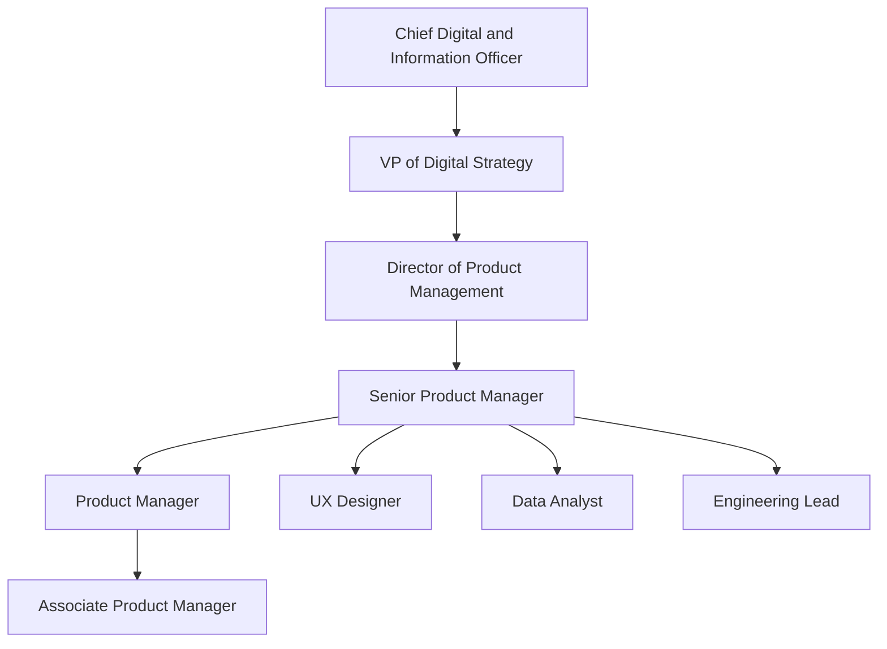
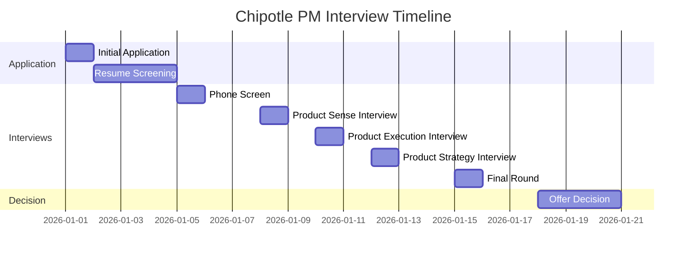

# Chipotle Product Management Interview Guide | 2026 Insights

- **Source:** https://nextsprints.com/guide/chipotle-mexican-grill-product-manager-interview-guide

- **Type:** `interview-guide`

- **Updated:** October 31, 2026

---

## Introduction

Chipotle Mexican Grill's product management culture is as vibrant and diverse as its menu. As a fast-casual restaurant chain revolutionizing the way people think about and eat fast food, Chipotle's product managers play a crucial role in shaping the future of food service and technology integration.

In 2026, the quick-service restaurant industry is at a crossroads of digital transformation and sustainability. Chipotle's PMs are at the forefront, driving innovations in mobile ordering, loyalty programs, and eco-friendly packaging solutions. The significance of the PM role at Chipotle has never been greater, as the company seeks to maintain its position as a leader in food quality while pushing the boundaries of restaurant technology.

| Hiring Metric | Value |
| --- | --- |
| PM Applications Received (2024) | 15,000+ |
| Interview to Offer Ratio | 1:12 |
| Average Time to Hire | 6 weeks |
| YoY Increase in PM Headcount | 15% |

> Expert Insight
> "At Chipotle, product managers aren't just building features – they're crafting experiences that blend culinary excellence with cutting-edge tech. Our PMs need to think beyond the app and consider the entire customer journey, from order to plate."

## PM Role

> Role Definition
> Chipotle Product Managers lead the development and execution of digital products and in-restaurant technologies that enhance customer experience, optimize operations, and drive business growth.

Responsibilities of a Chipotle PM include:

- Developing and maintaining the product roadmap for digital ordering platforms
- Collaborating with culinary teams to integrate new menu items into digital systems
- Analyzing customer data to identify trends and opportunities for personalization
- Overseeing the implementation of in-store technology solutions
- Managing cross-functional teams to deliver projects on time and within budget

Team Structure:

Comparison with other tech companies:

| Aspect | Chipotle PM | Tech Giant PM | Startup PM |
| --- | --- | --- | --- |
| Focus | Food service tech | General software | Niche products |
| Scope | Broad (digital + physical) | Deep technical | Varied |
| Stakeholders | Customers, franchisees, ops | Users, advertisers | Investors, users |
| Metrics | Order volume, efficiency | MAU, engagement | Growth, retention |

Real examples from Chipotle's products:

- Chipotlanes: PMs led the development of the digital order pickup lane system
- Chipotle Rewards: Oversaw the creation and iteration of the loyalty program app
- Real Food Print: Managed the implementation of sustainability impact tracking for digital orders

## Job Requirements

Education:

- Bachelor's degree required, preferably in Computer Science, Business, or related field
- MBA or advanced degree in technology management is a plus

Experience:

- 5+ years of product management experience in fast-paced tech or restaurant environments
- Proven track record of launching successful digital products at scale
- Experience with agile methodologies and product lifecycle management

Technical Skills:

- Proficiency in data analysis tools (SQL, Tableau, etc.)
- Understanding of mobile app development processes
- Familiarity with POS systems and restaurant management software
- Knowledge of API integrations and cloud-based technologies

Soft Skills:

- Strong leadership and cross-functional team management
- Excellent communication and presentation abilities
- Strategic thinking and problem-solving aptitude
- Customer-centric mindset with a passion for food and technology

| Requirement | Must-Have | Nice-to-Have |
| --- | --- | --- |
| Education | Bachelor's Degree | MBA |
| PM Experience | 5+ years | 7+ years |
| Industry Knowledge | Restaurant Tech | Food Supply Chain |
| Technical Skills | Data Analysis | Machine Learning |
| Soft Skills | Leadership | Public Speaking |

Success Factors:

1. Ability to balance technology innovation with operational feasibility
2. Strong understanding of food safety and quality standards
3. Capacity to work in a fast-paced, ever-changing environment
4. Passion for Chipotle's mission of cultivating a better world

> Common Pitfalls
> Overlooking the complexities of food service operations
> Focusing solely on technology without considering the in-restaurant experience
> Underestimating the importance of food safety in product decisions

> Expert Tips
> Immerse yourself in restaurant operations to gain first-hand insights
> Stay updated on food industry trends and emerging technologies
> Develop a deep understanding of Chipotle's supply chain and sustainability initiatives

## Interview Process Breakdown

The Chipotle PM interview process is designed to assess candidates' ability to innovate in the unique space where food service meets technology. Here's a breakdown of what to expect:

Round-by-Round Breakdown:

- Initial Application and Screening:

- Online application submission
- Resume review by HR
- Initial phone screen with recruiter (30 minutes)

- Product Interviews:

a. Product Sense: Focus on understanding user needs and designing solutions within the Chipotle ecosystem.

b. Product Execution: Evaluate ability to implement products and measure success in a restaurant tech environment.

c. Product Strategy: Assess long-term thinking and ability to align product decisions with Chipotle's mission and goals.

- Final Rounds:

- Panel interview with senior leadership
- Culture fit assessment
- Presentation of a mini product challenge (optional)

| Interview Round | Duration | Focus Areas |
| --- | --- | --- |
| Phone Screen | 30 min | Background, motivation, basic skills |
| Product Sense | 45 min | User-centric design, problem-solving |
| Product Execution | 45 min | Metrics, prioritization, launch strategy |
| Product Strategy | 45 min | Vision, market analysis, competitive positioning |
| Final Panel | 60 min | Leadership, cultural alignment, strategic thinking |

Practice Chipotle Mexican Grill questions

Product Design

How could Facebook build a feature to help people find roommates?

View

Say you're a WhatsApp PM and want to add more ecommerce functionality. What would you do?

View

How would you build a language learning product for the Facebook app?

View

Product Improvement

How can Chipotle Mexican Grill enhance its mobile ordering app to reduce wait times during peak hours?

View

How might Chipotle Mexican Grill redesign its restaurant layout to improve the flow of customers through the ordering line?

View

What innovative ingredients could Chipotle Mexican Grill add to its burrito bowls to attract more health-conscious customers?

View

Product Success Metrics

How would you measure the success of Chipotle Mexican Grill's mobile ordering app?

View

How would you define the success of Chipotle Mexican Grill's loyalty rewards program?

View

What metrics would you use to evaluate Chipotle Mexican Grill's Chipotlane drive-thru service?

View

Product Trade-Off

How can Chipotle Mexican Grill balance the desire for larger portion sizes to increase customer satisfaction against the need to maintain profit margins and food cost controls?

View

For Chipotle Mexican Grill's mobile app, should development resources be allocated towards improving order accuracy and speed or adding new features like customizable meal plans and nutritional tracking?

View

Should Chipotle Mexican Grill prioritize expanding its plant-based protein options to attract more vegetarian customers or focus on enhancing its traditional meat offerings to satisfy its core customer base?

View

Product Root Cause Analysis

What factors are contributing to the 20% increase in customer wait times at Chipotle Mexican Grill drive-thru locations since last quarter?

View

Why has Chipotle Mexican Grill's mobile app order completion rate decreased from 98% to 92% in the past two weeks?

View

Why has Chipotle Mexican Grill's guacamole sales volume dropped by 15% over the past month?

View

## Product Manager Compensation & Levels at Chipotle

Chipotle's PM compensation structure is competitive within the restaurant technology sector, reflecting the company's commitment to attracting top talent. While specific numbers can fluctuate, here's an overview based on recent data:

| Level | Title | Total Compensation Range |
| --- | --- | --- |
| L4 | Associate Product Manager | $90,000 - $120,000 |
| L5 | Product Manager | $120,000 - $160,000 |
| L6 | Senior Product Manager | $160,000 - $220,000 |
| L7 | Principal Product Manager | $220,000 - $300,000 |
| L8 | Director of Product | $300,000 - $400,000+ |

Note: These ranges include base salary, bonuses, and stock options. Actual compensation may vary based on experience, performance, and location.

Chipotle offers a unique blend of tech company perks with food industry benefits:

- Competitive base salary
- Performance-based bonuses
- Equity grants (RSUs)
- 401(k) matching
- Free Chipotle meals during shifts
- Health, dental, and vision insurance
- Tuition reimbursement for eligible programs

Career progression at Chipotle is based on impact, with opportunities to move between product lines or into broader strategic roles within the digital and technology organization.

## How to Prepare

Leadership Principles: Chipotle's culture is built on a foundation of values that guide product decisions:

1. Cultivate A Better World: PMs must consider sustainability and ethical sourcing in product development.
2. The Line Is The Front Line: Understanding in-restaurant operations is crucial for effective product management.
3. Continuous Improvement: Embrace a mindset of constant iteration and enhancement of digital products.
4. Authenticity Lives Here: Ensure that technological innovations align with Chipotle's commitment to real, fresh food.

Tailor Your Resume:

- Highlight projects that demonstrate impact on business metrics (e.g., increased order volume, improved customer satisfaction)
- Showcase experience with technologies relevant to restaurant operations (mobile apps, POS systems, inventory management)
- Use the STAR method to describe achievements, focusing on results that align with Chipotle's goals
- Consider a professional resume review to ensure your experience is presented effectively ([https://nextsprints.com/resume-review](https://nextsprints.com/resume-review))

Practice Product Cases:

- Focus on cases that blend digital innovation with physical product experiences
- Prepare to discuss metrics specific to the restaurant industry (average order value, throughput, customer retention)
- Practice adapting standard PM frameworks to Chipotle's unique business model
- Utilize resources like NextSprints' interview question database to cover a wide range of potential scenarios ([https://nextsprints.com/product-manager-interview-questions](https://nextsprints.com/product-manager-interview-questions))

Practice Mock Interviews:

- Seek out individuals with experience in restaurant technology for the most relevant feedback
- Practice explaining technical concepts to both tech-savvy and non-technical stakeholders
- Prepare stories that demonstrate your ability to work cross-functionally with diverse teams
- Consider expert coaching sessions to refine your interview skills and receive targeted feedback ([https://nextsprints.com/pm-coaching](https://nextsprints.com/pm-coaching))

## FAQs

### What sets Chipotle's PM role apart from other tech companies?

Chipotle PMs uniquely blend digital innovation with physical restaurant operations. You'll be working on products that not only exist in the digital realm but have immediate, tangible impacts on food preparation, customer service, and the in-restaurant experience. This role requires a holistic understanding of both technology and food service industries.

### How important is prior restaurant experience for a Chipotle PM?

While prior restaurant experience is not mandatory, a deep understanding of the food service industry is highly valuable. Chipotle provides extensive training on its operations, but candidates who can demonstrate knowledge of restaurant challenges and opportunities will have an advantage. If you lack direct experience, consider spending time in Chipotle restaurants as a customer to observe operations.

### What types of projects do Chipotle PMs typically work on?

Chipotle PMs work on a diverse range of projects, including:

- Mobile app enhancements for ordering and loyalty programs
- In-restaurant kiosk and digital menu board systems
- Back-of-house technology for inventory and food prep management
- Data analytics platforms for personalized marketing and menu optimization
- Sustainability tracking tools for ingredient sourcing and waste reduction

### How does Chipotle balance technology innovation with its commitment to food quality?

This balance is at the core of Chipotle's product strategy. PMs are expected to innovate in ways that enhance, rather than compromise, food quality and the customer experience. For example, digital ordering systems must integrate seamlessly with kitchen operations to ensure food is prepared fresh and to order, even during peak times.

### What growth opportunities exist for PMs at Chipotle?

Chipotle offers significant growth potential for PMs. As the company continues to invest in digital transformation, there are opportunities to take on larger projects, lead cross-functional initiatives, and move into senior leadership roles. PMs can also expand their skills across different areas of the business, from supply chain technology to customer-facing innovations.

## Related Guides Section

📖 [Chipotle Product Strategy Guide](chipotle-mexican-grill-product-strategy-guide) – Deep dive into Chipotle's product decisions.

📖 [Chipotle Product Manager Salary Guide](chipotle-mexican-grill-product-manager-salary-guide) – Salary insights & negotiation tips.

📖 [Chipotle Product Teardown Guide](chipotle-mexican-grill-mobile-app-product-teardown-analysis) – Analysis of Chipotle's product positioning.

Disclaimer: This guide is created for product management interview preparation purposes only. The analysis and methodology are based on the public information.
