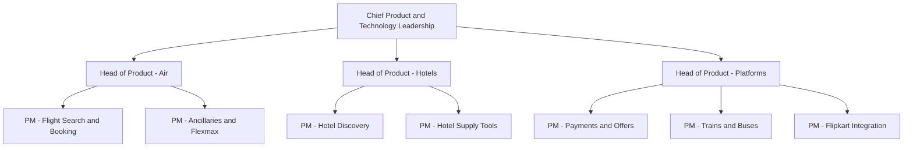

# Cleartrip Product Manager Interview Guide | Travel PM

- **Source:** https://nextsprints.com/guide/cleartrip-product-manager-interview-guide

- **Type:** `interview-guide`

- **Updated:** October 31, 2026

---

## Introduction

Cleartrip is one of India's best-known online travel brands. Founded in 2006 and acquired by Flipkart in 2021, it now sells flights, hotels, trains, buses and holiday packages through its own app and website and through the Cleartrip travel tab inside the Flipkart app. Company leaders describe it as India's second-largest player in online air bookings. It also runs Cleartrip for Business for company travel and has a presence in the Middle East.

Product managers at Cleartrip work on a business at an interesting moment. Flights still bring roughly 80% of revenue, the company spends heavily on discounts, and it has publicly targeted operational breakeven by the end of FY27. That means PMs are expected to grow hotels, trains, buses and ancillaries (such as CT Flexmax), make discounts more efficient, and use Flipkart's ecosystem better. Recent launches show where the work is: train booking through IRCTC (April 2026), Live Flight Status, Price Trends for flights, Explore Hotels by Vibe and Book@0 pay-later hotel holds.

| Hiring Metric | Value (estimate) |
| --- | --- |
| Product team size | 60–90 PMs and product leaders |
| Typical PM openings per year | 15–25 |
| Interview success rate | 3–5% of screened applicants |
| Average time to hire | 4–6 weeks |
| Main location | Bengaluru |

> Insider Perspective
> Candidates who have interviewed with Cleartrip report that interviewers push hard on unit economics. A good product answer that ignores discount cost, take rate or contribution margin is often marked down, because profitability is now a company-wide priority.

## PM Role

> Cleartrip Product Manager
> A Cleartrip Product Manager owns a part of the travel journey (search, booking, post-booking, a category such as hotels or trains, or a platform such as payments or offers) and is accountable for conversion, customer experience and the margin that part of the business earns.

Responsibilities:

- Own the roadmap for a category or journey stage, such as flight search, hotel discovery, trains or post-booking servicing
- Improve funnel conversion and reduce drop-offs using data and experiments
- Grow ancillary and cross-sell revenue (CT Flexmax, seats, insurance, hotel attach)
- Work with supply teams on airline and hotel partnerships
- Coordinate with Flipkart teams on the travel tab, SuperCoins and payments
- Define and track metrics, run A/B tests and share learnings
- Work closely with engineering, design, data science, marketing and customer support

(The structure above is illustrative. Actual team names change with reorganisations.)

| Aspect | Cleartrip PM | Flipkart Marketplace PM | Airline Digital PM |
| --- | --- | --- | --- |
| Focus | Travel conversion, margin, cross-sell | Shopping conversion, seller tools | Direct bookings, loyalty |
| Pace | Fast, experiment-heavy | Fast, large scale | Moderate |
| Partner dependence | High (airlines, hotels, IRCTC, Flipkart) | High (sellers, logistics) | Lower |
| Key metrics | Conversion, take rate, contribution margin | GMV, conversion, retention | Direct share, ancillary revenue |

Real-world example: Book@0, launched in 2026, lets travellers reserve hotels without paying upfront or entering card details. A feature like this needs a PM to balance user value (flexibility), hotel partner concerns (empty holds) and business goals (more hotel bookings), which is typical of the cross-functional trade-offs Cleartrip PMs handle.

## Job Requirements

Education:

- Bachelor's degree, often in engineering, computer science or business
- MBA from a leading school is common for APM and PM roles, though not mandatory

Experience:

- APM: 0–2 years, often campus MBA hires or engineers moving into product
- PM: 2–5 years, with consumer internet or e-commerce experience preferred
- Senior PM: 5–8 years, with ownership of a P&L-relevant area

Technical Skills:

- SQL and comfort with analytics tools for funnel and cohort analysis
- Experiment design and A/B testing
- Understanding of APIs and integrations (airline GDS and NDC, hotel channel managers, payment gateways)
- Basic understanding of pricing and recommendation systems

Soft Skills:

- Clear structured communication
- Stakeholder management across business, supply and Flipkart teams
- Comfort with ambiguity and fast decisions
- Commercial thinking: knowing how each feature affects revenue and cost

| Requirement | Essential | Preferred |
| --- | --- | --- |
| Education | Bachelor's degree | MBA or engineering degree |
| PM Experience (PM level) | 2+ years | 3–5 years in consumer internet |
| Domain | Interest in travel or e-commerce | Experience at an OTA, airline or marketplace |
| Technical | SQL, analytics | Experimentation platforms, ranking or pricing |
| Commercial | Basic unit economics | P&L ownership |

Success Factors:

1. Strong funnel thinking: search, select, pay, travel, return
2. Ability to balance user experience with margin
3. Comfort working with partners who control key parts of the experience
4. Bias for experiments over opinions

> Common Pitfalls
> Candidates often design travel features as if they were standalone apps. Cleartrip interviewers expect you to consider airline and hotel partners, Flipkart, and the cost of any discount or promise you introduce.

> Expert Advice
> Use Cleartrip and its main competitors (MakeMyTrip, ixigo, EaseMyTrip) for a real booking before your interview. Note differences in fare display, add-ons, cancellation flows and hotel discovery. Specific observations make answers stand out.

## Interview Process Breakdown

Public, PM-specific reports on Cleartrip interviews are limited. The process below is based on candidate reports, Cleartrip and Flipkart engineering and managerial loops, and typical Indian consumer internet PM hiring. Expect variations by team and level.

| Stage | Format | Duration | Focus Areas |
| --- | --- | --- | --- |
| Recruiter screen | Phone or video | 20–30 mins | Background, motivation, notice period, compensation |
| Hiring manager round | Video | 45–60 mins | Past projects, product thinking, team fit |
| Product case rounds (1–2) | Video or on-site | 45–60 mins each | Product design, improvement, strategy |
| Analytical round | Video | 45–60 mins | Metrics, root cause analysis, sometimes SQL or estimation |
| Leadership round | On-site or video | 45 mins | Ownership, cross-functional influence, judgement |
| HR round | Video | 30 mins | Culture, expectations, offer discussion |

Detailed Breakdown:

- Hiring Manager Round:

Expect a deep dive on one or two past projects. Interviewers probe what you owned, how you measured success, and what you would do differently. For APMs, internships and college projects are fair game.

- Product Case Rounds:

Questions are usually grounded in travel: improve hotel discovery, design a feature for first-time flyers, improve train booking, or decide how to grow a new category. Interviewers often add constraints mid-way, such as a discount budget limit.

- Analytical Round:

Common prompts include defining success metrics for an ancillary like CT Flexmax, or diagnosing a drop in bookings. Some candidates report a short SQL or data interpretation exercise.

- Leadership and HR:

Focus on stakeholder management, handling conflict with business teams, and why Cleartrip. Some candidates report a take-home assignment for senior roles, typically a product teardown or strategy note.

Timeline Expectations:

- Application to offer: 4–6 weeks
- Rounds usually scheduled within a week of each other
- Offers often discussed alongside Flipkart group compensation norms

## Product Manager Compensation & Levels at Cleartrip

Cleartrip's levels broadly follow Flipkart group conventions, though titles vary.

Levels:

1. Associate Product Manager (APM)
2. Product Manager 1
3. Product Manager 2 / Senior Product Manager
4. Lead or Group Product Manager
5. Director of Product / Head of Product

| Level | Total Compensation Range (INR, 2026 estimate) |
| --- | --- |
| APM | ₹18–28 lakh |
| PM 1 | ₹26–42 lakh |
| PM 2 / Senior PM | ₹40–60 lakh |
| Lead / Group PM | ₹60–90 lakh |
| Director / Head of Product | ₹90 lakh–₹1.6 crore |

Note: Ranges are estimates based on AmbitionBox data for Cleartrip PMs (roughly ₹22–40 lakh for PM roles) and Levels.fyi data for Flipkart, adjusted for 2026. Compensation usually includes base pay, a performance bonus and, at some levels, long-term incentives. Confirm structure in your offer letter. See the salary guide for details.

## How to Prepare

Core principles Cleartrip interviewers look for:

1. **Customer clarity:** Travel is stressful; simple, honest experiences win.
2. **Commercial sense:** Every feature has a cost and a margin effect.
3. **Experimentation:** Decisions backed by tests and data.
4. **Ecosystem thinking:** Use Flipkart's strengths without depending on them.

Tailor Your Resume: Show quantified impact on conversion, revenue or cost. Highlight experience with marketplaces, payments, pricing or partner integrations. For APM applicants, internships with measurable results matter more than long lists of responsibilities.

Practice Product Cases: Focus on travel-specific scenarios:

- Flight search and booking conversion
- Hotel discovery, ranking and cross-sell
- Ancillaries and flexibility products
- Train and bus booking for price-sensitive users
- Discount efficiency and loyalty with SuperCoins

NextSprints' question bank includes Cleartrip-specific cases on CT Flexmax, Book@0, Price Trends and Cleartrip for Business.

Mock Interviews: Practise with peers or mentors who have worked in travel or e-commerce. Ask them to push on unit economics and partner constraints, because that is where many candidates struggle.

## FAQs

### Does Cleartrip hire APMs from campus?

Cleartrip has hired product talent from business and engineering schools, and Flipkart group's campus hiring sometimes includes Cleartrip roles. Campus intake for product is small and varies by year, so most APM-level hires come through referrals, internships converting to full-time offers, or lateral moves from analyst and engineering roles.

### Where are Cleartrip PM roles based?

Most product roles are in Bengaluru, where Cleartrip's main tech and product teams sit alongside Flipkart. Some roles connected to the Middle East business or business travel may involve working with teams in other locations.

### What kinds of case questions are common?

Expect travel-grounded product sense questions (improve hotel discovery, design for first-time flyers), metrics questions (measure CT Flexmax or a new feature), root cause analysis (a drop in bookings from the Flipkart channel), and strategy questions (how Cleartrip reaches breakeven or competes with MakeMyTrip).

### Do I need travel industry experience?

It helps but is not required for APM and PM roles. What matters more is understanding how online travel agencies make money (commissions, convenience fees, ancillaries, hotel margins) and showing you have used the products critically.

### How does being part of Flipkart affect the PM role?

Cleartrip PMs often work with Flipkart teams on the travel tab, SuperCoins, payments and sale events like Big Billion Days. This brings scale but also dependencies, so interviewers value candidates who can influence partners they don't control.

## Related Guides Section

📖 [Cleartrip Product Strategy Guide](/guide/cleartrip-product-strategy-guide) – How Cleartrip plans to move beyond flights and reach breakeven.

📖 [Cleartrip Product Manager Salary Guide](/guide/cleartrip-product-manager-salary-guide) – 2026 PM salary bands by level in INR and negotiation tips.

📖 [Cleartrip Product Teardown](/guide/cleartrip-travel-app-product-teardown) – A teardown of the Cleartrip app across flights, hotels, trains and Flipkart.

Disclaimer: This guide is created for product management interview preparation purposes only. The analysis is based on public information and candidate reports, not insider knowledge.
