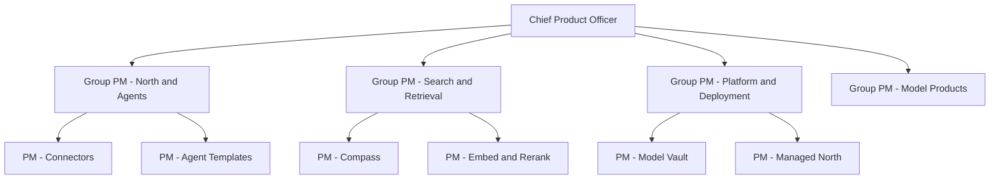

# Cohere Product Manager Interview Guide | Enterprise AI

- **Source:** https://nextsprints.com/guide/cohere-product-manager-interview-guide

- **Type:** `interview-guide`

- **Updated:** October 31, 2026

---

## Introduction

Cohere is one of the few independent foundation-model companies built entirely around enterprise customers. Founded in Toronto in 2019 by Aidan Gomez, Ivan Zhang and Nick Frosst, it builds the Command family of language models, the Embed and Rerank retrieval models, and North, an agentic AI workspace that companies run inside their own cloud or data centre. Its customers include banks, telecoms, governments and large software companies, and its pitch is simple: frontier-grade AI that stays under the customer's control.

Product managers at Cohere sit at an unusual intersection. They work with researchers who train models, engineers who build a developer platform, and enterprise buyers who care about security reviews, data residency and return on investment. In 2026 the company is growing quickly: reports put its annualised revenue above USD 200 million at the end of 2025, it agreed a combination with Germany's Aleph Alpha, and it released Command A+ as an open-weight model. That growth means more PM roles, but each one is expected to own ambiguous, high-stakes problems.

| Hiring Metric (estimates) | Value |
| --- | --- |
| Employees (mid-2026, reported) | About 1,000 |
| Main PM hubs | Toronto, San Francisco, New York, London |
| Typical PM process length | 3-5 weeks |
| Formal APM programme | None publicly advertised |
| Share of PM openings at senior level or above | Roughly two-thirds |

> Candidate Perspective
> Candidates who have gone through the process report that interviewers care less about AI buzzwords and more about whether you understand enterprise buying: who signs, who blocks, and how to prove value inside a customer's environment.

## PM Role

> Cohere Product Manager
> A Cohere Product Manager owns a model, platform or application product end to end, turning research progress and enterprise customer needs into secure, measurable products that customers can deploy privately.

Typical PM teams (based on public job postings):

- North and agents: the workspace employees use, agent templates, connectors and workflows.
- Search and retrieval: Compass, Embed and Rerank.
- Model products: Command models, fine-tuning, evaluation and model releases.
- Platform and deployment: Model Vault, private deployments, Managed North, developer platform and API.
- Growth and native experience: onboarding, activation and self-serve funnels.

Responsibilities:

- Define product strategy and roadmap with research and engineering leads.
- Work directly with enterprise customers and solutions engineers on design-partner programmes.
- Write clear product requirements, including evaluation criteria for model quality.
- Decide trade-offs between quality, latency, cost and security.
- Partner with go-to-market teams on launches, pricing and positioning.

| Aspect | Cohere PM | Big Tech AI PM | Enterprise SaaS PM |
| --- | --- | --- | --- |
| Primary customer | Enterprises and governments | Consumers and developers | Business users |
| Technical depth | High (models, retrieval, infrastructure) | High | Moderate |
| Customer contact | Very high, often on-site | Low to moderate | High |
| Pace | Fast, startup | Moderate | Moderate |
| Security and compliance focus | Very high | Moderate | High |

Real-world example: The Bell partnership announced in 2025 made North available to Canadian organisations through a sovereign AI offering. PMs on such programmes balance a partner's requirements, a shared roadmap and the needs of end customers at the same time.

## Job Requirements

Education:

- Bachelor's degree in computer science, engineering, mathematics or a related field is common.
- An MBA is not required; technical fluency matters more.

Experience:

- Product Manager roles typically ask for 3-5 years of PM experience, often in developer tools, infrastructure, search or enterprise SaaS.
- Senior and Staff roles ask for 6+ years and evidence of launching products to large enterprises.
- Early-career candidates usually enter through adjacent roles (solutions engineering, ML engineering, developer relations) rather than a dedicated APM track.

Technical skills:

- Working understanding of large language models, retrieval-augmented generation, embeddings and evaluation.
- Comfort with APIs, cloud infrastructure (AWS, Azure, Google Cloud, Oracle) and Kubernetes concepts.
- Data analysis with SQL or Python.

Soft skills:

- Clear writing; Cohere teams rely on written product specs.
- Ability to influence researchers and engineers without authority.
- Customer empathy with security-conscious buyers.

| Requirement | Essential | Preferred |
| --- | --- | --- |
| Education | Bachelor's degree | Technical degree |
| PM experience | 3+ years | 5+ years in AI, search or infrastructure |
| Technical | LLM and RAG fundamentals | Hands-on prototyping with APIs |
| Domain | Enterprise software | Financial services, public sector or telecom |
| Soft skills | Writing, stakeholder management | Experience with design partners |

> Common Pitfalls
> Candidates often design consumer chatbots in enterprise questions. Cohere interviewers expect you to consider admins, security reviewers, data permissions and procurement, not just the end user.

> Expert Advice
> Build something small with Cohere's API before your interviews, such as a retrieval demo with Embed and Rerank. Being able to describe what worked and what didn't is a strong signal.

## Interview Process Breakdown

Candidates report a process of roughly four stages, though details vary by team and level.

| Stage | Format | Duration | Focus Areas |
| --- | --- | --- | --- |
| Recruiter screen | Video call | 30 minutes | Background, motivation for enterprise AI, location and level |
| Hiring manager | Video call | 45-60 minutes | Past products, technical depth, team fit |
| Product case | Live case or take-home with presentation | 60-90 minutes | Product sense for an AI product, prioritisation, metrics |
| Loop | 3-5 interviews | Half day | Cross-functional collaboration, technical deep dive, strategy, behavioural |
| Leadership chat | Video call | 30-45 minutes | Senior roles: vision and judgement |

Common question themes:

- Product design: "Design an agent in North for a specific role, such as an insurance claims handler."
- Metrics: "How would you measure the success of Rerank?"
- Trade-offs: "Should North default to a reasoning model?"
- Strategy: "How should Cohere compete with Microsoft Copilot inside large enterprises?"
- Technical: "Explain how retrieval quality affects answer quality, and how you'd evaluate it."
- Behavioural: "Tell me about a time you disagreed with an engineering or research lead."

Timeline expectations:

- Application to offer: 3-5 weeks for most candidates.
- Feedback typically within a week of each stage.

## Product Manager Compensation & Levels at Cohere

Cohere uses a fairly flat ladder. Typical titles are:

1. Product Manager (early-career entry is rare)
2. Senior Product Manager
3. Staff or Principal Product Manager
4. Group Product Manager or Director of Product

| Level | Base Salary (USD, US offices) | Base Salary (CAD, Toronto) | Estimated total with equity (USD) |
| --- | --- | --- | --- |
| Product Manager | 150,000 - 200,000 | 140,000 - 180,000 | 175,000 - 250,000 |
| Senior PM | 190,000 - 250,000 | 175,000 - 225,000 | 230,000 - 330,000 |
| Staff / Principal PM | 240,000 - 290,000 | 215,000 - 265,000 | 300,000 - 430,000 |
| Group PM / Director | 270,000 - 340,000 | 250,000 - 310,000 | 380,000 - 550,000+ |

Note: These are 2026 estimates anchored on public job postings (for example, ranges of USD 140,000-210,000 and 160,000-285,000 for recent PM listings) and Levels.fyi data, which shows a median Toronto PM total compensation of around CAD 156,000. Equity is in private-company stock options, so its value depends on future liquidity. See the [Cohere Product Manager Salary Guide](/guide/cohere-product-manager-salary-guide) for details.

## How to Prepare

Cohere-style principles to show in interviews:

1. Customer proof over demos: show how you'd validate value on the customer's own data.
2. Security by default: permissions, auditability and private deployment are product features.
3. Quality, latency and cost together: every AI decision trades these off.
4. Bias to ship with design partners: launch early with a few customers, measure, then scale.

Tailor your resume: Highlight enterprise launches, measurable adoption, and technical products such as APIs, search or infrastructure. Quantify outcomes like "reduced time to production from 8 to 3 weeks" or "grew API usage 4x." For expert feedback, NextSprints' Resume Review service can help.

Practice product cases: Focus on enterprise AI scenarios: agents for specific job roles, retrieval quality problems, deployment trade-offs and metrics for usage-priced APIs. NextSprints' Product Manager Interview Questions include Cohere-specific cases.

Learn the products: Read Cohere's documentation for Command, Embed and Rerank, its North product pages and recent announcements on Command A+, Model Vault and the Aleph Alpha combination. Try the playground and the API.

Mock interviews: Practise with PMs who have worked on developer platforms or enterprise AI. NextSprints offers PM Coaching with experienced interviewers.

## FAQs

### Does Cohere hire new graduates or APMs into product roles?

Cohere does not advertise a formal APM programme. Most PM openings ask for several years of product experience. Students and recent graduates more often join through engineering, solutions engineering, research or developer relations roles and move into product later. Internships occasionally appear on the careers page, so check it regularly.

### How technical do Cohere PM interviews get?

More technical than at most enterprise software companies. Expect to explain retrieval-augmented generation, how embeddings and rerankers work at a conceptual level, how you would evaluate model quality, and what affects latency and cost. You won't be asked to write production code, but you should be comfortable reading API documentation and reasoning about infrastructure.

### Where are Cohere PM roles located?

Most PM roles are listed in Toronto, San Francisco and New York, with some in London and other European offices. Many postings are hybrid. After the planned combination with Aleph Alpha, Berlin is expected to become a larger hub, especially for public-sector and European products.

### What makes a strong answer in a Cohere product case?

Strong answers identify both the buyer and the user, address security and permissions explicitly, propose a design-partner rollout, and define metrics that can be measured even when Cohere has limited visibility into customer data. Weak answers focus only on model capabilities or consumer-style engagement.

### How does Cohere compare with OpenAI or Anthropic for PM candidates?

Cohere is smaller and fully focused on enterprise and government customers, so PMs typically have broader scope and more direct customer contact. Pay is competitive but generally below the very top frontier labs, and equity is in a private company whose value depends on future funding or a public listing.

## Related Guides Section

📖 [Cohere Product Strategy Guide](/guide/cohere-product-strategy-guide) – How Cohere plans to win enterprise and sovereign AI.

📖 [Cohere Product Manager Salary Guide](/guide/cohere-product-manager-salary-guide) – USD and CAD salary bands by level and negotiation tips.

📖 [Cohere North Product Teardown](/guide/cohere-north-ai-workspace-product-teardown) – A teardown of Cohere's agentic AI workspace.

Disclaimer: This guide is created for product management interview preparation purposes only. The analysis and methodology are based on public information and candidate reports, not insider knowledge.
