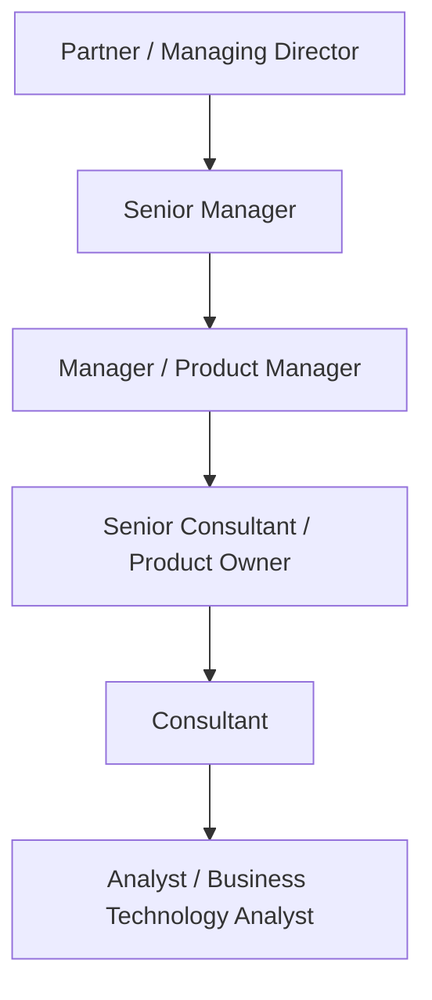

# Deloitte Product Manager Interview Guide | USI & Product

- **Source:** https://nextsprints.com/guide/deloitte-product-manager-interview-guide

- **Type:** `interview-guide`

- **Updated:** October 31, 2026

---

## Introduction

Deloitte is the world's largest professional services firm, with US$74.5 billion in revenue for the fiscal year ended May 2026 and close to 500,000 people. Most students know it as a Big Four audit and consulting firm, but it is also a major employer of product managers and product owners. Those roles sit in three places: inside consulting teams that run product and digital transformation programmes for clients (including Deloitte Digital), inside teams building Deloitte's own software products such as Zora AI (its agentic AI platform), Omnia (its audit platform) and Ascend (a delivery platform), and in Deloitte USI, the India-based offices in Hyderabad, Bengaluru, Mumbai, Pune and other cities that serve US clients.

For students, Deloitte is one of the most accessible routes into product work. USI hires thousands of campus graduates every year as Analysts, Business Technology Analysts and Consultants, and many of these roles involve requirements, backlogs and agile delivery, which are the building blocks of a product owner career. This guide explains the roles, requirements, interview process, pay and preparation, with a focus on what students and early-career candidates can realistically target.

| Hiring Metric | Value |
| --- | --- |
| Global workforce | ~500,000 |
| Common entry roles | Analyst, Business Technology Analyst, Consultant |
| PM / PO titles | Product Owner, Product Specialist, Product Manager (Senior Consultant to Manager) |
| Typical interview rounds | 3–5 |
| Typical time to offer | 3–6 weeks (experienced); fixed schedule on campus |
| Key locations (India) | Hyderabad, Bengaluru, Mumbai, Pune, Gurugram, Chennai |

> Insider Perspective
> Candidates report that the strongest signal in Deloitte product interviews is structured thinking under ambiguity: framing a client's problem, prioritising a backlog and explaining trade-offs clearly to non-technical stakeholders.

## PM Role

> Deloitte Product Manager / Product Owner
> At Deloitte, a product manager or product owner shapes and delivers digital products, either for clients as part of a consulting engagement or for Deloitte's own platforms. The role combines product skills (discovery, prioritisation, metrics) with consulting skills (stakeholder management, communication and structured problem solving).

Three main flavours of the role:

1. **Product owner on client engagements:** Owns the backlog for a client's product or platform (for example a banking app, an ERP rollout or a Salesforce implementation), writes user stories and acceptance criteria, runs sprint ceremonies with the team, and represents the client's priorities. Common in Technology Strategy & Transformation and Engineering, AI & Data practices, and in Deloitte Digital.
2. **Product manager for Deloitte's own products:** Works on Zora AI agents (for example the "Zora AI – Product Manager, Sourcing & Procurement" role), GenAI product experiences, Omnia or Ascend. Responsible for roadmaps, requirements, adoption and value. Titles include "Manager – Product Management – GenAI Innovation".
3. **Product management consulting:** Helps clients build product operating models, move from projects to products, set up product metrics and train product teams.

| Aspect | Deloitte PM/PO | Product company PM | Traditional consulting role |
| --- | --- | --- | --- |
| Who is the customer | Client or internal Deloitte users | End users of one product | Client executives |
| Ownership horizon | Engagement length or product lifecycle | Long-term | Project length |
| Agile depth | High (Scrum, SAFe common) | High | Medium |
| Stakeholder complexity | Very high | Medium | High |
| Technical depth | Medium | Medium to high | Low to medium |

Example: USI job posts describe a Senior Consultant serving as Product Owner within Ascend who supports product strategy execution, feature definition and delivery of scalable capabilities, working virtually with US stakeholders.

## Job Requirements

Education:

- B.Tech/B.E., B.Com, BBA, BCA or similar for Analyst roles; MBA for Consultant roles on campus
- Degrees in computer science, information systems, business or economics are common

Experience:

- Freshers: internships, projects or case competitions showing problem solving
- Product Owner (Senior Consultant): typically 4–7 years, with agile product ownership
- Product Owner (Assistant Manager, USI): 6–8 years in some enabling functions
- Product Manager (Manager): 7+ years, often with enterprise software, SaaS or AI product experience

Technical skills:

- Agile and Scrum practices; backlog tools such as Jira and Azure DevOps
- Writing user stories, acceptance criteria and process maps
- Basic SQL and data analysis; familiarity with dashboards (Power BI, Tableau)
- Understanding of enterprise platforms (SAP, Salesforce, Workday, ServiceNow) and AI/GenAI concepts

Soft skills:

- Clear written and verbal communication, including with US stakeholders
- Structured problem solving and case skills
- Stakeholder management and facilitation
- Comfort with ambiguity and changing client priorities

| Requirement | Essential | Preferred |
| --- | --- | --- |
| Education | Bachelor's degree | MBA for consulting tracks |
| Agile knowledge | Scrum basics | CSPO, PSPO or SAFe certification |
| Experience (PO roles) | 4+ years | Product ownership on enterprise platforms |
| Technical skills | Requirements, Jira | SQL, AI/ML product delivery |
| Communication | Strong English | Experience with US clients |

> Common Pitfalls
> Many candidates describe themselves only as "project managers" or "business analysts". Show product thinking too: why a feature matters, how you prioritised it and how you measured its success.

> Expert Advice
> For students: an Analyst or Business Technology Analyst role on a product-delivery engagement is a realistic first step. Within two to three years, many move into product owner roles as Senior Consultants.

## Interview Process Breakdown

The process differs between campus and experienced hiring.

| Stage | Format | Duration | Focus Areas |
| --- | --- | --- | --- |
| Online assessment (campus) | Online test | 60–90 mins | Aptitude, logical reasoning, verbal ability; English test for some roles |
| Group discussion (some campuses) | In person or video | 15–20 mins | Communication, structure, teamwork |
| Recruiter screen (experienced) | Phone or video | 20–30 mins | Background, motivation, notice period |
| Case / product round | Video or in person | 45–60 mins | Business case, product improvement, MVP scoping, guesstimates |
| Technical / domain round | Video | 45–60 mins | Agile, user stories, backlog prioritisation, platform knowledge |
| Partner / director / HR round | Video or in person | 30–45 mins | Fit, client presence, motivation, compensation |

Detailed breakdown:

- Online assessment and screening:

Campus candidates take aptitude, reasoning and verbal tests; some roles add an English communication test. Experienced candidates usually start with a recruiter call.

- Case and product interviews:

Candidates report business cases such as customer attrition for a client, building an MVP for a new digital product, improving an existing product, and estimating market size. Product owner roles add questions on writing user stories, prioritising a backlog with MoSCoW or WSJF, handling scope changes and running sprint reviews.

- Final rounds:

A partner, director or senior manager assesses client readiness, communication and motivation. Glassdoor reviewers often describe the business case as the hardest part, and some report up to five rounds.

Timeline expectations:

- Campus: a fixed schedule over one or two days during placement season
- Experienced: typically 3–6 weeks from application to offer
- Results: often shared within one to two weeks after the final round

## Product Manager Compensation & Levels at Deloitte

Deloitte pays fixed salary plus a performance bonus. As a partnership, it does not offer stock.

| Level | USI (INR per year, total) | US (USD base) |
| --- | --- | --- |
| Analyst / BTA | ₹6.5–9 LPA | $80,000–$100,000 |
| Consultant | ₹14–18 LPA | $100,000–$125,000 |
| Senior Consultant / Product Owner | ₹22–30 LPA | $135,000–$155,000 |
| Manager / Product Manager | ₹32–45 LPA | $165,000–$195,000 |
| Senior Manager | ₹50–70 LPA | $200,000–$245,000 |

These are 2026 estimates based on AmbitionBox, Levels.fyi and job-post data. Bonuses typically add around 5–15%. See the salary guide for details.

## How to Prepare

Values to show:

1. **Client focus:** frame every answer around the client's or user's outcome.
2. **Structured thinking:** use clear frameworks and summarise before diving in.
3. **Collaboration:** show how you work with engineers, designers and client stakeholders.
4. **Integrity and quality:** especially with AI, show that you check facts and own your work.

Tailor your resume: Highlight product-related work: user stories written, backlogs managed, features shipped, metrics improved. Use numbers and the STAR method. For students, highlight internships, hackathons and case competitions. NextSprints' Resume Review service can help tailor it for consulting product roles.

Practice product cases: Prepare for product improvement, MVP design, metrics and root cause questions, often set in a client context (bank, retailer, manufacturer). Practise questions on Deloitte's own products, such as Zora AI, Omnia and Ascend. NextSprints' Product Manager Interview Questions include Deloitte-specific cases.

Learn agile deeply: Know Scrum roles, ceremonies and artefacts, how to write good user stories with acceptance criteria, and prioritisation methods. A CSPO or PSPO certification helps for product owner roles.

Mock interviews: Practise cases and guesstimates with peers, alumni at Deloitte USI, or experienced PMs. NextSprints PM Coaching offers mock interviews focused on consulting-style product cases.

## FAQs

### Does Deloitte have an associate product manager program?

There is no widely advertised APM program. Students usually join as Analysts, Business Technology Analysts or Consultants and move into product owner or product manager roles after two to four years, often on product-delivery engagements or Deloitte's own platforms.

### What kind of case questions does Deloitte ask product candidates?

Candidates report business cases (for example a client losing customers), MVP design for a new digital product, product improvement questions, guesstimates and agile scenarios such as prioritising a backlog or handling a change request mid-sprint.

### Is a certification like CSPO necessary?

It is not mandatory, but many product owner postings list Scrum or SAFe product owner experience as preferred. A certification helps experienced candidates without formal product owner titles show their knowledge.

### What is the difference between Deloitte USI and Deloitte India?

Deloitte USI serves US member firm clients from offices in India. Deloitte South Asia (often called Deloitte India) serves clients in India. Both hire product roles, but USI roles usually involve working with US teams and time zones.

### Can I work on Deloitte's AI products like Zora AI from India?

USI hires engineers, product specialists and product owners for Deloitte's products, including roles linked to Zora AI and Ascend. Availability changes, so check the USI careers portal for current openings.

## Related Guides Section

📖 [Deloitte Product Strategy Guide](/guide/deloitte-product-strategy-guide) – How Deloitte is moving from services to AI products and platforms.

📖 [Deloitte Product Manager Salary Guide](/guide/deloitte-product-manager-salary-guide) – USI and US pay by level and negotiation tips.

📖 [Deloitte Product Teardown Guide](/guide/deloitte-zora-ai-agentic-platform-product-teardown) – Analysis of Zora AI, Deloitte's agentic AI platform.

Disclaimer: This guide is created for product management interview preparation purposes only. The analysis is based on public information, job postings and candidate reports, and is not affiliated with or endorsed by Deloitte.
