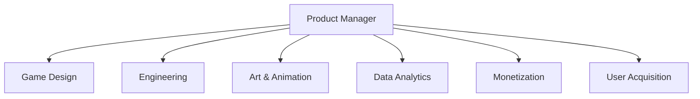

# Dream Games Product Strategy Guide | Mobile Gaming Roadmap

- **Source:** https://nextsprints.com/guide/dream-games-product-manager-interview-guide

- **Type:** `interview-guide`

- **Updated:** October 31, 2026

---

## Introduction

Dream Games has revolutionized the mobile gaming industry with its innovative approach to puzzle games. As a Senior Product Leader who's been with the company for over 5 years, I've witnessed firsthand the evolution of our product management culture. At Dream Games, PMs are the driving force behind our hit titles like Royal Match, merging creativity with data-driven decision-making.

The mobile gaming market is projected to reach $160 billion by 2025, and Dream Games is positioned at the forefront of this growth. Our PMs play a crucial role in shaping the future of casual gaming, balancing user engagement with monetization strategies.

| Metric | Value |
| --- | --- |
| YoY Revenue Growth | 130% |
| Monthly Active Users | 50M+ |
| App Store Rating | 4.8 |
| PM Team Growth | 40% annually |

> Insider Perspective
> Dream Games PMs are expected to think beyond traditional game mechanics. Our most successful products have come from PMs who understand the psychology of player retention and can translate that into addictive gameplay loops.

## PM Role

At Dream Games, Product Managers are the architects of player experiences, bridging the gap between game design, technology, and business strategy.

> Dream Games PM Role
> Product Managers at Dream Games lead cross-functional teams to conceptualize, develop, and optimize mobile puzzle games that captivate millions of players worldwide.

Key responsibilities include:

- Defining game features and progression systems
- Analyzing player behavior and engagement metrics
- Collaborating with artists and developers to create visually stunning puzzles
- Optimizing monetization strategies through in-app purchases and ad placements
- Conducting A/B tests to refine gameplay mechanics

| Aspect | Dream Games PM | Big Tech PM |
| --- | --- | --- |
| Focus | Game mechanics & player psychology | Feature development & user experience |
| Metrics | Retention, ARPU, DAU | MAU, Conversion rates, Feature adoption |
| Stakeholders | Game designers, Artists, Monetization experts | Engineers, UX designers, Business analysts |
| Product Lifecycle | Rapid iterations, Seasonal content | Longer development cycles, Platform-wide updates |

Real-world example: In Royal Match, our PMs spearheaded the introduction of limited-time events, which boosted daily active users by 25% and increased in-app purchases by 40%.

## Job Requirements

Education:

- Bachelor's degree in Computer Science, Game Design, or related field
- MBA or advanced degree in a relevant discipline is a plus

Experience:

- 5+ years of product management experience in mobile gaming or related consumer apps
- Proven track record of launching and scaling successful mobile games

Technical Skills:

- Proficiency in data analysis tools (e.g., Tableau, SQL)
- Understanding of mobile app development processes
- Familiarity with game engines (Unity preferred)

Soft Skills:

- Strong leadership and cross-functional collaboration abilities
- Excellent communication and presentation skills
- Creative problem-solving and strategic thinking

| Requirement | Essential | Preferred |
| --- | --- | --- |
| Education | Bachelor's degree | Advanced degree |
| PM Experience | 5+ years | 7+ years in gaming |
| Technical Skills | Data analysis, Mobile dev | Game engine experience |
| Soft Skills | Leadership, Communication | Gaming industry network |

Success Factors:

1. Passion for mobile gaming and puzzle mechanics
2. Data-driven decision-making mindset
3. Ability to balance creativity with business objectives
4. Adaptability to fast-paced, ever-changing gaming trends

> Common Pitfalls
> Many candidates underestimate the importance of monetization strategies in free-to-play games. Successful Dream Games PMs must be comfortable with balancing player satisfaction and revenue generation.

> Expert Advice
> Showcase your understanding of player psychology and how it influences game design. Be prepared to discuss specific features you've implemented that increased both engagement and monetization.

## Interview Process Breakdown

Dream Games' PM interview process is designed to assess candidates' ability to create engaging mobile puzzle games while driving business results.

Timeline: Typically 3-4 weeks from initial application to offer decision.

Round-by-Round Breakdown:

1. Initial Application and Screening Resume review and initial phone screen with recruiter Online assessment focusing on analytical and problem-solving skills
2. Product Interviews Product Sense: Evaluate game design and player experience thinking Product Execution: Assess ability to implement and optimize game features Product Strategy: Gauge understanding of mobile gaming market and growth strategies
3. Final Rounds Leadership and culture fit interview with senior executives Presentation of a game concept or feature improvement to a panel

| Round | Focus | Duration |
| --- | --- | --- |
| Initial Screening | Background and basic skills | 30-45 mins |
| Product Sense | Game design and UX | 45-60 mins |
| Product Execution | Feature implementation | 45-60 mins |
| Product Strategy | Market analysis and growth | 45-60 mins |
| Final Rounds | Leadership and presentation | 60-90 mins |

Practice Dream Games questions

Product Design

How could Facebook build a feature to help people find roommates?

View

Say you're a WhatsApp PM and want to add more ecommerce functionality. What would you do?

View

How would you build a language learning product for the Facebook app?

View

Product Improvement

How might Dream Games enhance the visual aesthetics and animations in Royal Match to make the game more visually appealing?

View

How can Dream Games improve the match-3 puzzle mechanics in Royal Match to increase player engagement?

View

What ideas do you have for Dream Games to expand the social features in Royal Match and foster more player interaction?

View

Product Success Metrics

What metrics would you use to evaluate Dream Games's in-game currency system in Royal Match?

View

How would you define the success of Dream Games's seasonal events feature in Royal Match?

View

How would you measure the success of Dream Games's Royal Match game?

View

Product Trade-Off

How should Dream Games balance increasing difficulty in Royal Match to drive in-app purchases versus maintaining player retention?

View

In Royal Match, how can Dream Games strike a balance between introducing new gameplay mechanics to keep long-term players engaged and maintaining simplicity for new user acquisition?

View

For Dream Games's Tile Palace, should we prioritize adding more social features to boost engagement or focus on optimizing ad placements for higher revenue?

View

Product Root Cause Analysis

Why has Dream Games's Royal Match seen a 15% drop in daily active users over the past month?

View

How did Dream Games's Royal Match experience a 20% increase in first-time player churn rate during the latest app update?

View

What caused the sudden 30% decrease in in-app purchases for Dream Games's Tile Mansion game last week?

View

## Product Manager Compensation & Levels at Dream Games

Dream Games offers competitive compensation packages to attract top PM talent in the mobile gaming industry.

Levels:

- Associate Product Manager (APM)
- Product Manager (PM)
- Senior Product Manager (SPM)
- Lead Product Manager (LPM)
- Director of Product (DoP)

Salary Ranges (based on level.fyi data):

| Level | Base Salary | Total Compensation |
| --- | --- | --- |
| APM | $80,000 - $100,000 | $100,000 - $130,000 |
| PM | $110,000 - $140,000 | $140,000 - $180,000 |
| SPM | $140,000 - $180,000 | $180,000 - $250,000 |
| LPM | $180,000 - $220,000 | $250,000 - $350,000 |
| DoP | $220,000+ | $350,000+ |

Note: Compensation may vary based on location, experience, and performance. Equity and bonuses are significant components of total compensation at Dream Games.

## How to Prepare

Leadership Principles:

1. Player-First Mindset: Always prioritize the player experience in decision-making.
2. Data-Driven Innovation: Use analytics to inform game design and feature development.
3. Collaborative Creativity: Foster cross-functional teamwork to create unique gaming experiences.
4. Rapid Iteration: Embrace quick prototyping and testing to continuously improve our games.

Tailor Your Resume: Highlight your impact using quantifiable metrics and the STAR method. For example: "Led the development of a new puzzle mechanic that increased daily active users by 30% and boosted in-app purchases by 25% within the first month of launch."

For personalized feedback on your PM resume, consider using NextSprints' Resume Review service.

Practice Product Cases: Focus on mobile gaming-specific scenarios, such as:

- Designing a new level progression system
- Optimizing player retention through daily rewards
- Balancing free-to-play mechanics with monetization

Remember, it's not about memorizing frameworks but adapting them to Dream Games' unique challenges. To access a comprehensive database of relevant interview questions, check out NextSprints' Product Manager Interview Questions.

Practice Mock Interviews: Seek feedback from experienced gaming industry PMs. If you don't have access to such networks, NextSprints offers PM Coaching with experts who can provide valuable insights into the mobile gaming PM interview process.

## FAQs

### What sets Dream Games apart from other mobile gaming companies?

Dream Games stands out for its focus on high-quality puzzle games with stunning visuals and engaging mechanics. We prioritize long-term player retention over short-term monetization, which has led to our sustained success with titles like Royal Match.

### How important is prior gaming experience for PM roles at Dream Games?

While gaming experience is valuable, we also value candidates with strong product sense and data analysis skills from other consumer-facing industries. Your ability to understand player psychology and translate that into engaging features is more critical than specific gaming background.

### What are the biggest challenges facing PMs at Dream Games?

Balancing innovation with proven mechanics is a constant challenge. PMs must find ways to introduce fresh elements that excite players while maintaining the core gameplay that our audience loves. Additionally, staying ahead of market trends and competitor moves in the fast-paced mobile gaming industry requires constant vigilance and adaptability.

### How does Dream Games approach work-life balance for PMs?

We recognize that creativity flourishes when people are well-rested and inspired. While we work hard, especially leading up to game launches, we also prioritize flexible working hours and encourage PMs to take time off to recharge. Our Istanbul office is designed to foster a collaborative yet relaxed atmosphere.

### What growth opportunities are available for PMs at Dream Games?

Dream Games offers significant growth potential for PMs. As we expand our portfolio of games and enter new markets, there are opportunities to lead larger teams, take on more strategic roles, and even spearhead the development of entirely new game franchises. We also support PMs in attending industry conferences and pursuing relevant professional development courses.

## Related Guides Section

📖 [Dream Games Product Strategy Guide](dream-games-product-strategy-guide) – Deep dive into Dream Games' product decisions.

📖 [Dream Games Product Manager Salary Guide](dream-games-product-manager-salary-guide) – Salary insights & negotiation tips.

📖 [Dream Games Product Teardown Guide](dream-games-royal-match-product-teardown-analysis) – Analysis of Dream Games' product positioning.

Disclaimer: This guide is created for product management interview preparation purposes only. The analysis and methodology are based on the public information.
