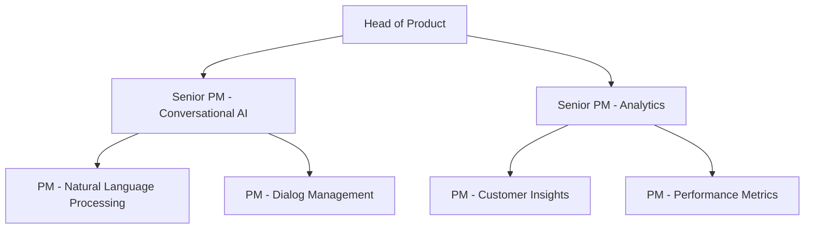
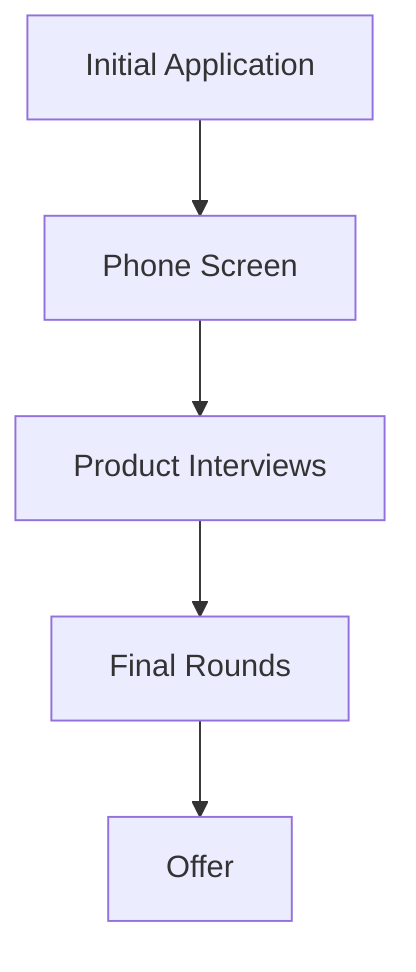

# EliseAI Product Manager Interview Guide | Full Process & Tips

- **Source:** https://nextsprints.com/guide/eliseai-product-manager-interview-guide

- **Type:** `interview-guide`

- **Updated:** October 31, 2026

---

## Introduction

EliseAI is revolutionizing the product management landscape with its unique AI-driven approach to customer service automation. As a leader in conversational AI, EliseAI's product managers play a pivotal role in shaping the future of intelligent customer interactions. The company's PM culture emphasizes innovation, data-driven decision-making, and a deep understanding of both AI technology and customer service dynamics.

In 2026, the demand for skilled product managers in the AI sector is at an all-time high. EliseAI stands at the forefront of this trend, offering exciting opportunities for PMs to work on cutting-edge AI products that are transforming how businesses engage with their customers.

| EliseAI PM Hiring Stats 2026 |  |
| --- | --- |
| Open PM Positions | 15 |
| Avg. Time-to-Hire | 45 days |
| Applicants per Position | 200+ |
| Interview Success Rate | 2.5% |

> Insider Perspective
> At EliseAI, we're not just looking for traditional product managers. We seek individuals who can bridge the gap between complex AI technologies and real-world customer service challenges. Our most successful PMs have a unique blend of technical acumen, customer empathy, and strategic vision.

## PM Role

> EliseAI Product Manager Role
> EliseAI Product Managers lead the development and optimization of AI-powered customer service solutions, balancing technological innovation with practical business applications to enhance customer experiences across various industries.

Responsibilities at EliseAI extend beyond traditional PM duties, encompassing:

1. AI Strategy Development: Crafting long-term visions for AI products in customer service.
2. Data-Driven Product Optimization: Utilizing machine learning insights to continuously improve product performance.
3. Cross-Functional Leadership: Collaborating with AI researchers, engineers, and customer success teams.
4. Ethical AI Governance: Ensuring responsible AI development and deployment.

Team Structure:

Comparison with Other Tech Companies:

| Aspect | EliseAI PM | Google PM | Amazon PM |
| --- | --- | --- | --- |
| AI Focus | High (Specialized) | Moderate (Varied) | Moderate (Varied) |
| Technical Depth | Deep in AI/ML | Broad Tech Knowledge | Broad Tech Knowledge |
| Industry Specialization | Customer Service | Diverse | E-commerce Focus |
| Product Lifecycle | Rapid Iteration | Long-Term Projects | Mix of Both |

Real-world example: EliseAI PMs recently led the development of an advanced sentiment analysis feature, enabling real-time emotional intelligence in customer interactions across multiple languages and cultural contexts.

## Job Requirements

Education:

- Bachelor's degree required, preferably in Computer Science, AI, or related field
- Master's degree in AI, Machine Learning, or MBA with tech focus highly valued

Experience:

- Minimum 5 years of product management experience
- At least 2 years working on AI or machine learning products
- Proven track record in customer-facing software products

Technical Skills:

- Strong understanding of AI and machine learning concepts
- Familiarity with NLP and conversational AI technologies
- Data analysis and SQL proficiency
- Basic understanding of programming (Python preferred)

Soft Skills:

- Exceptional problem-solving and analytical thinking
- Strong communication skills, ability to translate complex tech concepts
- Leadership and cross-functional team management
- Customer-centric mindset and empathy

| Requirement Category | Must-Have | Nice-to-Have |
| --- | --- | --- |
| Education | Bachelor's in tech-related field | Master's in AI/ML or MBA |
| Experience | 5+ years in PM, 2+ in AI products | Experience in customer service tech |
| Technical Skills | AI/ML understanding, data analysis | NLP expertise, coding skills |
| Soft Skills | Problem-solving, communication | Design thinking, agile methodologies |

Success Factors:

1. Ability to balance AI innovation with practical business outcomes
2. Strong product vision aligned with EliseAI's mission
3. Adaptability in a fast-paced, evolving AI landscape
4. Collaborative approach to working with diverse teams

> Common Pitfalls
> Overemphasis on technical skills without business acumen
> Neglecting ethical considerations in AI development
> Inability to translate complex AI concepts to stakeholders

> Expert Advice
> Focus on demonstrating how you've used AI to solve real customer problems. EliseAI values PMs who can show tangible impact and a deep understanding of both the technology and its practical applications in customer service.

## Interview Process Breakdown

EliseAI's PM interview process is designed to thoroughly assess candidates' abilities in AI product management, strategic thinking, and cultural fit. Here's a detailed breakdown:

Timeline Expectations:

- Total process duration: 3-4 weeks
- 1-2 days between stages for feedback and decisions

Round-by-Round Breakdown:

1. Initial Application and Screening

- Resume review and potential take-home assignment
- 30-minute phone screen with recruiter

1. Product Interviews (3-4 rounds)

- Product Sense: Evaluate product design skills and improvement strategies for AI-driven customer service solutions.
- Product Execution: Assess ability to define success metrics and analyze root causes in AI product performance.
- Product Strategy: Explore candidates' vision for AI product growth, launch strategies, and technical understanding of AI/ML concepts.

1. Final Rounds

- Leadership and Cultural Fit: Interview with senior leadership to assess alignment with EliseAI's values and vision.
- Optional: Presentation of a strategic AI product proposal to a panel of executives.

| Interview Stage | Duration | Focus Areas |
| --- | --- | --- |
| Phone Screen | 30 min | Background, motivation, basic qualifications |
| Product Sense | 45 min | AI product design, customer service improvements |
| Product Execution | 45 min | AI metrics, performance analysis |
| Product Strategy | 60 min | AI growth strategies, technical AI knowledge |
| Leadership Round | 45 min | Cultural fit, leadership potential |

Practice EliseAI questions

Product Design

How could Facebook build a feature to help people find roommates?

View

Say you're a WhatsApp PM and want to add more ecommerce functionality. What would you do?

View

How would you build a language learning product for the Facebook app?

View

Product Improvement

What features could EliseAI add to its automated leasing platform to streamline the application process for potential tenants?

View

How can EliseAI improve its AI-powered chatbot to better handle complex customer inquiries in the real estate industry?

View

How might EliseAI enhance its data analytics capabilities to provide more actionable insights for property managers using its software?

View

Product Success Metrics

How would you measure the success of EliseAI's AI-powered chatbot for property management?

View

What metrics would you use to evaluate EliseAI's automated tenant screening feature?

View

How would you define the success of EliseAI's lease renewal prediction tool?

View

Product Trade-Off

How can EliseAI balance the accuracy of its automated document processing against the speed of processing for enterprise clients?

View

For EliseAI's virtual assistant platform, should we emphasize adding new features or improving the user interface for easier adoption by non-technical users?

View

Should EliseAI prioritize expanding its AI chatbot's language capabilities or focus on deepening its understanding of existing supported languages?

View

Product Root Cause Analysis

Why has EliseAI's AI-powered chatbot seen a 15% drop in customer satisfaction scores over the past month?

View

What caused the sudden 30% decrease in new user signups for EliseAI's virtual assistant platform last week?

View

Why has the average response time for EliseAI's automated email classification system increased by 2 seconds in the past 48 hours?

View

## Product Manager Compensation & Levels at EliseAI

EliseAI offers competitive compensation packages to attract top PM talent in the AI industry. The company's level structure for Product Managers is as follows:

1. Associate Product Manager (APM)
2. Product Manager (PM)
3. Senior Product Manager (SPM)
4. Principal Product Manager (PPM)
5. Director of Product Management

Salary ranges based on level.fyi data for EliseAI in 2026:

| Level | Title | Base Salary Range | Total Compensation Range |
| --- | --- | --- | --- |
| L3 | APM | $90k - $120k | $110k - $150k |
| L4 | PM | $120k - $160k | $150k - $220k |
| L5 | SPM | $150k - $200k | $200k - $300k |
| L6 | PPM | $180k - $250k | $250k - $400k |
| L7 | Director | $220k - $300k | $350k - $600k |

Note: These ranges are approximate and may vary based on location, experience, and performance. EliseAI also offers equity packages, which can significantly increase total compensation, especially at higher levels.

## How to Prepare

Leadership Principles: EliseAI's core principles guide product decisions and team dynamics:

1. AI Ethics First: Prioritize responsible AI development and deployment.
2. Customer Empathy: Deeply understand and anticipate customer needs in service interactions.
3. Data-Driven Innovation: Use insights to continuously improve AI products.
4. Collaborative Intelligence: Foster synergy between human expertise and AI capabilities.

Tailor Your Resume: Optimize your resume to showcase your AI product management experience:

- Highlight specific AI or machine learning projects you've led
- Quantify the impact of your products on customer service metrics
- Demonstrate cross-functional leadership in AI-driven environments
- Use the STAR method to structure your achievements

For expert resume review tailored to EliseAI's expectations, consider using NextSprints' Resume Review service ([https://nextsprints.com/resume-review](https://nextsprints.com/resume-review)).

Practice Product Cases: EliseAI's product cases often focus on AI applications in customer service. To prepare:

- Study conversational AI and NLP technologies
- Practice designing AI-driven solutions for common customer service challenges
- Develop frameworks for measuring AI product success

Enhance your case practice with NextSprints' comprehensive Product Manager Interview Questions database ([https://nextsprints.com/product-manager-interview-questions](https://nextsprints.com/product-manager-interview-questions)).

Mock Interviews: Simulating EliseAI's unique interview process is crucial:

- Focus on AI-specific product scenarios
- Practice explaining complex AI concepts in simple terms
- Prepare to discuss ethical implications of AI in customer service

For tailored mock interviews with AI product management experts, explore NextSprints' PM Coaching sessions ([https://nextsprints.com/pm-coaching](https://nextsprints.com/pm-coaching)).

## FAQs

### What sets EliseAI's PM role apart from other tech companies?

EliseAI PMs focus specifically on AI-driven customer service solutions, requiring a unique blend of AI technical knowledge, customer service expertise, and product management skills. The role involves more direct engagement with cutting-edge AI technologies compared to generalist PM roles at other companies.

### How technical do I need to be to succeed as a PM at EliseAI?

While you don't need to be a machine learning engineer, a strong technical foundation in AI concepts is crucial. You should be comfortable discussing NLP algorithms, machine learning models, and data analysis. The ability to collaborate effectively with AI researchers and engineers is key.

### What's the career progression like for PMs at EliseAI?

EliseAI offers a clear growth path from APM to Director level. PMs can specialize in specific AI domains (e.g., NLP, sentiment analysis) or take on broader strategic roles. The company also supports transitions into AI product leadership positions as the industry evolves.

### How does EliseAI approach work-life balance for PMs?

EliseAI recognizes the intense nature of AI product development and strives for a balanced approach. While the work can be demanding, the company offers flexible work arrangements and emphasizes outcome-based performance over hours worked. Regular hackathons and innovation days provide creative outlets.

### What's the biggest challenge facing PMs at EliseAI?

Balancing rapid AI innovation with practical, ethical implementation in customer service environments is an ongoing challenge. PMs must navigate complex technical landscapes while ensuring products deliver real-world value and adhere to responsible AI principles.

## Related Guides Section

📖 [EliseAI Product Strategy Guide](eliseai-product-strategy-guide) – Deep dive into EliseAI's AI-driven product decisions.

📖 [EliseAI Product Manager Salary Guide](eliseai-product-manager-salary-guide) – Detailed salary insights & negotiation tips for AI-focused PMs.

📖 [EliseAI Product Teardown Guide](eliseai-customer-service-automation-product-teardown) – Analysis of EliseAI's AI product positioning in the customer service market.

Disclaimer: This guide is created for product management interview preparation purposes only. The analysis and methodology are based on the public information.
