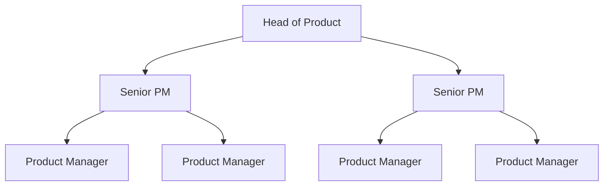
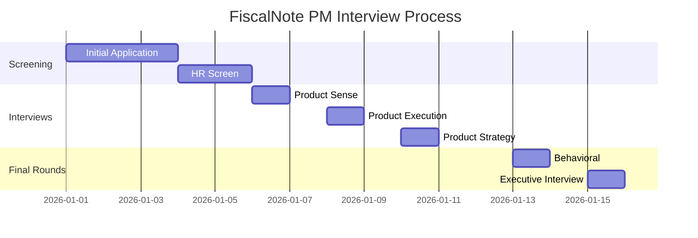

# FiscalNote Product Manager Interview Guide | Full Process

- **Source:** https://nextsprints.com/guide/fiscalnote-holdings-product-manager-interview-guide

- **Type:** `interview-guide`

- **Updated:** October 31, 2026

---

## Introduction

FiscalNote Holdings stands at the forefront of AI-driven policy and global intelligence solutions, revolutionizing how organizations navigate complex regulatory landscapes. As a Product Manager at FiscalNote, you'll be at the helm of innovation, shaping products that empower decision-makers worldwide.

The product management landscape is evolving rapidly, with AI and machine learning reshaping how we approach policy analysis and risk management. FiscalNote's unique position at the intersection of technology and government affairs makes the PM role here particularly exciting and impactful.

| Key Hiring Statistics | Value |
| --- | --- |
| YoY PM hiring growth | 15% |
| Avg. time to hire | 45 days |
| Retention rate | 92% |

> Expert Insight
> FiscalNote's PM culture is deeply rooted in data-driven decision making and a keen understanding of global policy trends. Successful candidates often demonstrate a passion for both technology and public affairs.

## PM Role

> Role Definition
> FiscalNote Product Managers lead the development of AI-powered solutions that transform how organizations interact with government affairs, combining technical expertise with policy acumen.

Responsibilities:

- Define product vision and strategy aligned with FiscalNote's mission
- Collaborate with data scientists to leverage AI in policy analysis tools
- Prioritize features based on market demands and regulatory changes
- Work closely with engineering teams to deliver high-quality products
- Analyze user data to drive product improvements and innovation

Team Structure:

| Aspect | FiscalNote PM | Google PM | Amazon PM |
| --- | --- | --- | --- |
| Focus | Policy tech | Consumer tech | E-commerce |
| AI Integration | High | High | Medium |
| Regulatory Knowledge | Critical | Moderate | Moderate |

Real Example: FiscalNote's PMs recently led the development of the "Global Issues Management" feature, integrating natural language processing to track and analyze policy trends across multiple jurisdictions.

## Job Requirements

Education:

- Bachelor's degree required, preferably in Computer Science, Political Science, or related fields
- MBA or advanced degree in Public Policy is a plus

Experience:

- 3-5 years of product management experience in SaaS or policy tech
- Proven track record of launching successful data-driven products

Technical Skills:

- Strong understanding of AI and machine learning applications
- Proficiency in data analysis and SQL
- Familiarity with agile development methodologies

Soft Skills:

- Excellent communication and stakeholder management
- Strategic thinking and problem-solving abilities
- Adaptability to rapidly changing policy environments

| Requirement | Essential | Preferred |
| --- | --- | --- |
| SaaS PM Experience | ✓ |  |
| AI/ML Knowledge | ✓ |  |
| Policy Background |  | ✓ |
| Data Analysis | ✓ |  |

Success Factors:

1. Ability to bridge technical and policy domains
2. Strong analytical skills for complex problem-solving
3. Passion for innovation in government affairs technology

> Common Pitfalls
> Don't underestimate the importance of regulatory knowledge. FiscalNote PMs must navigate complex policy landscapes while driving technical innovation.

> Expert Tips
> Showcase projects where you've applied data analysis to solve real-world policy challenges. This demonstrates your ability to merge technical skills with domain expertise.

## Interview Process Breakdown

End-to-end Process Overview:

1. Initial Application and Screening
2. Product Interviews
3. Final Rounds

Timeline Expectations: 3-4 weeks from initial application to offer

Round-by-round Breakdown:

- Product Sense: Evaluate your ability to design and improve products that solve complex policy challenges.

- Product Execution: Assess your skills in defining metrics, analyzing data, and making trade-offs in a policy tech context.

- Product Strategy: Test your strategic thinking on product growth, launches, and long-term vision in the government affairs space.

- Behavioral: Explore your leadership potential and cultural fit within FiscalNote's innovative environment.

Process Timeline:

| Round | Focus | Duration |
| --- | --- | --- |
| Product Sense | Design & Improvement | 45 min |
| Product Execution | Metrics & Analysis | 45 min |
| Product Strategy | Growth & Vision | 45 min |
| Behavioral | Leadership & Culture | 30 min |

Practice FiscalNote Holdings questions

Product Design

How could Facebook build a feature to help people find roommates?

View

Say you're a WhatsApp PM and want to add more ecommerce functionality. What would you do?

View

How would you build a language learning product for the Facebook app?

View

Product Improvement

How can FiscalNote Holdings enhance its CQ Roll Call news service to provide more personalized legislative updates for subscribers?

View

What improvements could FiscalNote Holdings make to its EU Issue Tracker to streamline policy monitoring across European Union member states?

View

How might FiscalNote Holdings expand the capabilities of its VoterVoice advocacy platform to increase constituent engagement for nonprofit organizations?

View

Product Success Metrics

What metrics would you use to evaluate FiscalNote Holdings's EU Issue Tracker service?

View

How would you measure the success of FiscalNote Holdings's CQ Federal legislative tracking platform?

View

How would you define the success of FiscalNote Holdings's VoterVoice advocacy software?

View

Product Trade-Off

How should FiscalNote Holdings balance expanding its CQ Roll Call news coverage to attract more subscribers versus maintaining focused legislative reporting for existing clients?

View

For FiscalNote Holdings's EU Issue Tracker product, how can we balance providing comprehensive regulatory information with keeping the platform simple and easy to navigate?

View

Should FiscalNote Holdings prioritize developing new AI-driven features for its FiscalNote platform or focus on improving the user interface and experience of existing tools?

View

Product Root Cause Analysis

What factors are contributing to the decreased usage of FiscalNote Holdings's FiscalNote platform among government affairs professionals in the last month?

View

Why has FiscalNote Holdings's CQ Roll Call subscription service seen a 15% drop in renewals over the past quarter?

View

Why has FiscalNote Holdings's Curate local government monitoring tool experienced a 30% decline in new customer signups compared to the same period last year?

View

## Product Manager Compensation & Levels at FiscalNote

FiscalNote's PM levels typically follow this structure:

- Associate Product Manager (APM)
- Product Manager (PM)
- Senior Product Manager (SPM)
- Principal Product Manager
- Director of Product

Salary ranges based on level.fyi data:

| Level | Total Compensation Range |
| --- | --- |
| APM | $90,000 - $120,000 |
| PM | $120,000 - $180,000 |
| SPM | $160,000 - $250,000 |
| Principal | $200,000 - $300,000 |
| Director | $250,000 - $400,000+ |

Note: These ranges are estimates and can vary based on experience, location, and performance. FiscalNote's unique position in the policy tech space may also influence compensation structures.

## How to Prepare

Company Leadership Principles:

1. Data-Driven Innovation: Leverage AI and analytics to drive product decisions
2. Global Impact: Focus on solutions that affect policy and decision-making worldwide
3. Ethical Technology: Ensure responsible use of AI in policy analysis
4. Continuous Learning: Stay ahead in a rapidly evolving regulatory landscape

Tailor Resume: Highlight projects where you've used data to drive product decisions, especially in complex or regulated environments. Use the STAR method to showcase your impact, focusing on metrics that demonstrate your ability to navigate policy-related challenges. Consider having your resume reviewed by experts who understand the nuances of policy tech roles.

Practice Product Cases: Focus on cases that blend technical innovation with policy considerations. Practice adapting your product frameworks to scenarios involving regulatory changes or global policy trends. Utilize resources like NextSprints' comprehensive database of product manager interview questions to cover a wide range of potential case types.

Practice Mock Interviews: Seek out mock interview partners with experience in policy tech or government affairs. If you don't have access to such individuals, consider expert coaching services that can provide targeted feedback on your approach to FiscalNote-style cases. NextSprints offers specialized PM coaching that can help you refine your responses to policy-oriented product challenges.

## FAQs

### What sets FiscalNote's PM role apart from other tech companies?

FiscalNote PMs uniquely blend technical product management with deep policy expertise. You'll be working on AI-driven solutions that directly impact how organizations navigate complex regulatory environments globally.

### How important is prior experience in government or policy for this role?

While not strictly required, a background in policy or government affairs can be a significant advantage. However, FiscalNote values candidates who can quickly learn and adapt to the policy landscape, even if they come from different industries.

### What types of projects might I work on as a PM at FiscalNote?

You could lead projects ranging from AI-powered legislative tracking tools to predictive analytics platforms for policy outcomes. The key is leveraging technology to make sense of vast amounts of global policy data.

### How does FiscalNote support PM career growth?

FiscalNote offers robust professional development opportunities, including mentorship programs, conference attendance, and the chance to work on cutting-edge AI applications in the policy space.

### What's the work culture like for PMs at FiscalNote?

The culture is fast-paced and innovative, with a strong emphasis on impact. PMs are expected to be thought leaders, combining technical acumen with a deep understanding of global policy trends.

## Related Guides Section

📖 [FiscalNote Product Strategy Guide](fiscalnote-holdings-product-strategy-guide) – Deep dive into FiscalNote's product decisions.

📖 [FiscalNote Product Manager Salary Guide](fiscalnote-holdings-product-manager-salary-guide) – Salary insights & negotiation tips.

📖 [FiscalNote Product Teardown Guide](fiscalnote-ai-policy-intelligence-platform-teardown-analysis) – Analysis of FiscalNote's product positioning.

Disclaimer: This guide is created for product management interview preparation purposes only. The analysis and methodology are based on the public information.
