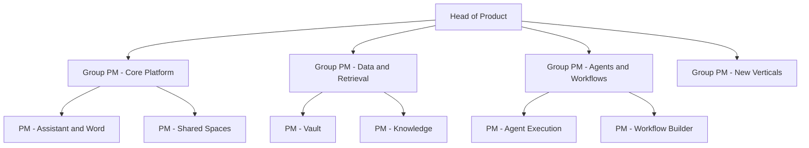

# Harvey Product Manager Interview Guide | Legal AI PM

- **Source:** https://nextsprints.com/guide/harvey-product-manager-interview-guide

- **Type:** `interview-guide`

- **Updated:** October 31, 2026

---

## Introduction

Harvey is the leading AI platform built specifically for legal and professional services. Founded in 2022 by Winston Weinberg, a former litigator, and Gabe Pereyra, a former research scientist, it grew from an early partnership with Allen & Overy into a platform used by large law firms, corporate legal departments and professional services firms worldwide. Its products include Assistant (AI chat for legal work), Vault (secure bulk document analysis), Knowledge (legal, regulatory and tax research), Workflows (pre-built and custom multi-step processes) and Agents that execute legal tasks end to end.

Product management at Harvey is unusual because the users are experts who are personally accountable for every output. A PM must understand how lawyers actually work, how law firms make money, and how to build AI that a partner will trust in front of a client or a court. In 2026 Harvey reported more than 100,000 lawyers across over 1,300 organisations and raised funding at a reported USD 11 billion valuation in March, with later reports of a higher round. That growth has created many PM openings, mostly for experienced candidates.

| Hiring Metric (estimates) | Value |
| --- | --- |
| Main PM hubs | San Francisco, New York, with roles in London and Toronto |
| Typical PM process length | 3-6 weeks |
| Formal APM programme | None publicly advertised |
| PM titles seen in postings | Product Manager, Senior PM, Staff PM, Agent PM, New Verticals PM |
| Share of PMs with legal or professional services background | Significant minority (estimate) |

> Candidate Perspective
> Candidates report that Harvey interviewers probe deeply into why you want to build for lawyers. A thoughtful answer about the legal industry's economics and pain points matters more than general AI enthusiasm.

## PM Role

> Harvey Product Manager
> A Harvey Product Manager turns the work of lawyers and other professionals into reliable AI products, balancing speed and capability with the accuracy, confidentiality and supervision that legal work demands.

Typical PM areas (based on public job postings):

- Core platform: Assistant, the Word add-in and Microsoft 365 integrations.
- Data and retrieval: Vault, document processing, connectors and search quality.
- Knowledge: research content, citations and partnerships such as the LexisNexis alliance.
- Workflows and Agents: Workflow Builder, agent execution and human review design.
- Collaboration: Shared Spaces between firms and clients.
- New verticals: adjacent professional services such as tax.

Responsibilities:

- Work closely with lawyers on Harvey's legal team, who act as domain experts.
- Define evaluation criteria for quality with engineers and researchers.
- Work directly with customers' innovation and knowledge management teams.
- Prioritise features across very different customers: global firms, mid-size firms and in-house teams.
- Partner with go-to-market teams on launches and pricing.

| Aspect | Harvey PM | Big Tech AI PM | Traditional Legal Tech PM |
| --- | --- | --- | --- |
| Users | Lawyers, accountable experts | Consumers, developers | Lawyers, legal ops |
| Pace | Very fast | Moderate | Slow to moderate |
| AI depth | High | High | Low to moderate |
| Domain knowledge needed | High | Low | High |
| Customer contact | Very high | Low | High |

## Job Requirements

Education:

- Bachelor's degree required; computer science, engineering or economics common.
- A JD or legal background is valued but not required for most roles.

Experience:

- Product Manager: typically 3-5 years in product, often at B2B or AI companies.
- Senior and Staff: 6+ years, with experience shipping enterprise or AI products at scale.
- Some roles prefer experience in legal tech or professional services.

Technical skills:

- Understanding of large language models, retrieval-augmented generation, evaluation and agents.
- Ability to read data and define metrics (SQL is helpful).
- Comfort with enterprise security and permission models.

Soft skills:

- Earning trust with demanding expert users.
- Clear, concise writing.
- Comfort with ambiguity and fast iteration.

| Requirement | Essential | Preferred |
| --- | --- | --- |
| Education | Bachelor's | JD or technical degree |
| PM experience | 3+ years | 5+ years in AI or B2B SaaS |
| Domain | Interest in legal work | Practising lawyer or legal tech experience |
| Technical | LLM product fundamentals | Evaluation design, agent workflows |
| Soft skills | Stakeholder management | Experience selling to professional services |

> Common Pitfalls
> Proposing features that remove lawyers from the loop entirely is a common mistake. Lawyers have professional duties to supervise work. Strong candidates design for speed with supervision, not instead of it.

> Expert Advice
> Talk to a lawyer before your interviews. Ask what a typical day looks like, which tasks they dread, and how they check AI output. Specific stories set you apart.

## Interview Process Breakdown

Candidates and third-party guides describe a process like this, though it varies by team and level.

| Stage | Format | Duration | Focus Areas |
| --- | --- | --- | --- |
| Recruiter screen | Call | 30 minutes | Background, motivation for legal AI |
| Hiring manager | Video call | 45 minutes | Product experience, role fit, why Harvey |
| Product case | Live or take-home | 60-90 minutes | Designing or improving a legal AI feature |
| Virtual onsite | 4-5 interviews | Half day | Product sense, metrics, technical depth, collaboration with lawyers, behavioural |
| Leadership | Video call | 30-45 minutes | Senior roles: vision and judgement |

Common question themes:

- Product design: "Design an agent for M&A due diligence in Vault."
- Metrics: "How would you measure the success of Harvey Workflows?"
- Quality: "How would you evaluate legal AI output without lawyers reviewing every answer?"
- Strategy: "Should Harvey expand beyond legal?"
- Trade-offs: "How much autonomy should agents have?"
- Behavioural: "Tell me about a time you earned the trust of a sceptical expert user."

Timeline expectations: 3-6 weeks from application to offer.

## Product Manager Compensation & Levels at Harvey

Typical levels:

1. Product Manager
2. Senior Product Manager
3. Staff Product Manager
4. Group Product Manager / Head of Product area

| Level | Base Salary (USD) | Estimated Total Compensation (USD) |
| --- | --- | --- |
| Product Manager | 150,000 - 190,000 | 190,000 - 260,000 |
| Senior PM | 178,500 - 241,500 | 250,000 - 380,000 |
| Staff PM | 215,000 - 300,000 | 350,000 - 550,000 |
| Group PM / Head | 270,000 - 340,000 | 450,000 - 750,000+ |

These 2026 estimates are anchored on public job postings (for example, Senior PM and Agent PM ranges of USD 178,500-241,500 and Staff PM ranges of USD 215,000-300,000 in New York) and Levels.fyi data. Equity is in a private, fast-growing company. See the [Harvey Product Manager Salary Guide](/guide/harvey-product-manager-salary-guide) for details.

## How to Prepare

Principles to show:

1. Lawyer-first empathy: understand billable hours, supervision duties and risk.
2. Quality is the product: evaluation, citations and accuracy matter more than flashy demos.
3. Security and confidentiality by default.
4. Speed: Harvey ships quickly, so show bias to action with good judgement.

Tailor your resume: Highlight enterprise AI or B2B products with expert users and measurable outcomes. If you have legal or professional services experience, make it prominent. NextSprints' Resume Review service can help.

Practice product cases: Practise designing for lawyers: contract review, research with citations, document review at scale, collaboration with clients and agent supervision. NextSprints' Product Manager Interview Questions include Harvey-specific cases.

Learn the products: Read Harvey's blog and newsroom on Assistant, Vault, Knowledge, Workflows, Agents and Shared Spaces, and follow announcements such as the LexisNexis alliance and Microsoft 365 integrations.

Mock interviews: Practise with PMs from legal tech or enterprise AI. NextSprints offers PM Coaching.

## FAQs

### Do I need a law degree to be a PM at Harvey?

No. Many Harvey PMs come from technology backgrounds. A legal background helps, especially for workflows and knowledge products, but what matters most is understanding how lawyers work and showing genuine interest in the legal industry. Harvey also employs lawyers who work alongside PMs as domain experts.

### Does Harvey hire new graduates as PMs?

Harvey doesn't advertise a formal APM programme, and most PM postings ask for several years of experience. Recent graduates can consider roles in operations, solutions or customer success, or legal engineering if they have a law degree, and move into product later.

### What makes a strong answer in a Harvey product case?

Strong answers identify the accountable lawyer and the buyer (a firm's innovation leader or general counsel), design clear review steps, address confidentiality, and define quality metrics such as citation accuracy and audited error rates. They also consider how law firms make money, since faster work can reduce billable hours.

### How technical are Harvey PM interviews?

Expect questions about how retrieval, evaluation and agents work, and how you'd measure output quality. You won't write production code, but you should discuss trade-offs like latency, cost, context limits and hallucination risks clearly.

### Where are Harvey PM roles based?

Most PM roles are in San Francisco and New York, with some in London and Toronto. Roles are typically in-office or hybrid; check each posting.

## Related Guides Section

📖 [Harvey Product Strategy Guide](/guide/harvey-product-strategy-guide) – How Harvey plans to lead legal AI and expand.

📖 [Harvey Product Manager Salary Guide](/guide/harvey-product-manager-salary-guide) – USD salary bands by level and negotiation tips.

📖 [Harvey Platform Product Teardown](/guide/harvey-legal-ai-platform-product-teardown) – A teardown of Harvey's legal AI platform.

Disclaimer: This guide is created for product management interview preparation purposes only. The analysis and methodology are based on public information and candidate reports, not insider knowledge.
