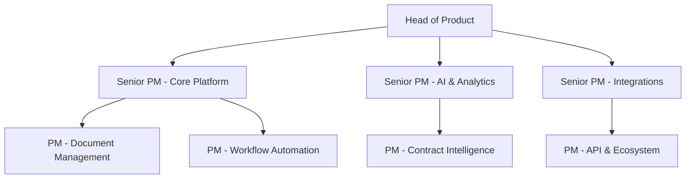
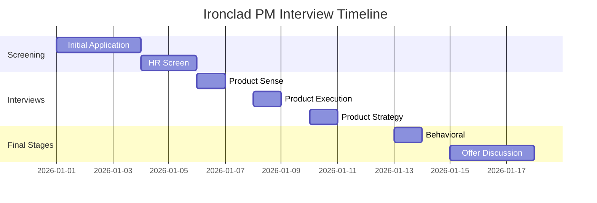

# Ironclad Product Management Culture Guide | CLM Insights

- **Source:** https://nextsprints.com/guide/ironclad-product-manager-interview-guide

- **Type:** `interview-guide`

- **Updated:** October 31, 2026

---

## Introduction

Ironclad's product management culture is a unique blend of legal expertise and cutting-edge technology. As a leader in contract lifecycle management (CLM) software, Ironclad seeks PMs who can navigate the complexities of legal workflows while driving innovation in AI and automation.

The CLM market is experiencing rapid growth, with Gartner projecting a 20% CAGR through 2025. This makes the PM role at Ironclad particularly crucial, as the company aims to maintain its competitive edge in a dynamic landscape.

| Hiring Metric | Value |
| --- | --- |
| YoY PM Headcount Growth | 35% |
| Avg. Time-to-Hire | 45 days |
| Retention Rate | 92% |

> Insider Perspective
> At Ironclad, PMs are expected to become subject matter experts in legal processes. This deep domain knowledge, combined with technical acumen, is what sets our product leaders apart in the CLM space.

## PM Role

> Ironclad PM Role
> Ironclad Product Managers drive the development of innovative CLM solutions, balancing legal compliance with user-centric design and leveraging AI to streamline contract processes.

Responsibilities:

- Define product vision and strategy for specific CLM modules
- Collaborate with legal experts to ensure product compliance
- Lead cross-functional teams in agile development cycles
- Analyze market trends and competitor offerings in the CLM space
- Prioritize features based on customer needs and business impact
- Drive adoption of AI-powered contract analysis tools

Team Structure:

Comparison with Other Tech Companies:

| Aspect | Ironclad | Salesforce | DocuSign |
| --- | --- | --- | --- |
| Focus | CLM-specific | CRM-centric | E-signature primary |
| Tech Stack | AI-driven | Cloud-based | Blockchain integration |
| User Base | Legal & Business | Sales & Marketing | Cross-industry |

Real Product Example: Ironclad's "Workflow Designer" allows PMs to create complex, conditional contract routing based on legal requirements—a feature that demands both technical understanding and legal process knowledge.

## Job Requirements

Education:

- Bachelor's degree required, preferably in Computer Science, Business, or Law
- MBA or JD is a strong plus, given Ironclad's focus on legal tech

Experience:

- 5+ years of product management experience
- Prior experience in legal tech, enterprise software, or SaaS platforms
- Demonstrated success in launching and scaling B2B products

Technical Skills:

- Proficiency in data analysis and SQL
- Understanding of AI and machine learning applications in software
- Familiarity with API integrations and enterprise software ecosystems

Soft Skills:

- Strong communication skills to bridge technical and legal concepts
- Ability to influence without authority across diverse teams
- Strategic thinking and problem-solving in complex regulatory environments

| Requirement | Must-Have | Nice-to-Have |
| --- | --- | --- |
| Legal Background | ✓ |  |
| AI/ML Knowledge | ✓ |  |
| CLM Experience |  | ✓ |
| API Expertise | ✓ |  |

Success Factors:

1. Ability to translate legal requirements into user-friendly features
2. Data-driven approach to product decisions
3. Collaborative mindset for cross-functional teamwork
4. Adaptability to rapidly changing legal tech landscape

> Common Pitfalls
> Candidates often underestimate the importance of legal domain knowledge. At Ironclad, understanding the intricacies of contract law is as crucial as technical product skills.

> Expert Advice
> Showcase projects where you've successfully balanced regulatory compliance with user experience. Ironclad values PMs who can navigate these complex trade-offs.

## Interview Process Breakdown

End-to-end Process Overview:

1. Initial Application and Screening
2. Product Interviews
3. Final Rounds

Timeline Expectations: The entire process typically takes 3-4 weeks from initial application to offer.

Round-by-Round Breakdown:

- Product Sense: Evaluate your ability to design intuitive solutions for complex legal workflows.

- Product Execution: Assess how you measure success and analyze product performance in the CLM context.

- Product Strategy: Explore your vision for Ironclad's growth in the evolving legal tech landscape.

- Behavioral: Gauge your cultural fit and leadership potential within Ironclad's collaborative environment.

Process Timeline:

Round-Specific Details:

| Round | Focus Areas | Duration |
| --- | --- | --- |
| Product Sense | CLM UX Design, Legal Workflow Optimization | 60 min |
| Product Execution | CLM Metrics, Contract Analytics | 60 min |
| Product Strategy | AI in CLM, Market Expansion | 60 min |
| Behavioral | Leadership, Cross-functional Collaboration | 45 min |

Practice Ironclad questions

Product Design

How could Facebook build a feature to help people find roommates?

View

Say you're a WhatsApp PM and want to add more ecommerce functionality. What would you do?

View

How would you build a language learning product for the Facebook app?

View

Product Improvement

What features could Ironclad add to its AI-powered contract review tool to improve accuracy in identifying high-risk clauses?

View

How might Ironclad improve its Workflow Designer to make it more user-friendly for legal teams with limited technical expertise?

View

How can Ironclad enhance its Contract Lifecycle Management software to streamline the approval process for complex agreements?

View

Product Success Metrics

What metrics would you use to evaluate Ironclad's AI-powered contract review feature?

View

How would you measure the success of Ironclad's Contract Lifecycle Management platform?

View

How would you define the success of Ironclad's Workflow Designer tool?

View

Product Trade-Off

Should Ironclad prioritize adding more complex contract automation features to its platform or focus on simplifying the user interface for better adoption among non-legal users?

View

How can Ironclad balance the need for robust security measures in its contract management system against the desire for seamless integration with third-party tools?

View

For Ironclad's workflow designer, should we emphasize flexibility for custom processes or standardization to promote best practices across different clients?

View

Product Root Cause Analysis

What factors are contributing to the recent 20% increase in contract approval times for Ironclad's Workflow Designer feature?

View

Why has Ironclad's Repository search functionality experienced a 30% decline in usage rates among enterprise customers since the latest update?

View

Why has Ironclad's Contract Lifecycle Management platform seen a 15% drop in new user signups over the past month?

View

## Product Manager Compensation & Levels at Ironclad

Ironclad's PM level structure aligns with industry standards while reflecting the specialized nature of legal tech:

1. Associate Product Manager (APM)
2. Product Manager (PM)
3. Senior Product Manager (SPM)
4. Principal Product Manager (PPM)
5. Director of Product
6. VP of Product

Salary Ranges (based on level.fyi data):

| Level | Total Compensation Range |
| --- | --- |
| APM | $120,000 - $150,000 |
| PM | $150,000 - $200,000 |
| SPM | $200,000 - $280,000 |
| PPM | $280,000 - $350,000 |
| Director | $350,000 - $500,000 |
| VP | $500,000+ |

Note: These ranges include base salary, bonuses, and equity. Actual compensation may vary based on experience, location, and performance.

## How to Prepare

Company Leadership Principles:

1. Customer Obsession: Deeply understand legal professionals' needs
2. Innovation at Scale: Push boundaries in AI-driven contract management
3. Bias for Action: Move quickly while maintaining legal compliance
4. Ownership: Take responsibility for product outcomes and legal implications

Tailor Resume: Focus on quantifiable impacts in your previous roles, especially those related to enterprise software or legal tech. Use the STAR method to highlight achievements:

Example: "Led development of AI-powered contract analysis feature, reducing review time by 40% and increasing user adoption by 25%."

For personalized feedback on your PM resume, consider NextSprints' Resume Review service ([https://nextsprints.com/resume-review](https://nextsprints.com/resume-review)).

Practice Product Cases: Ironclad's cases often involve balancing legal requirements with user experience. Practice adapting frameworks to address unique CLM challenges. Familiarize yourself with common legal workflows and contract types.

To access a comprehensive database of PM interview questions, including CLM-specific scenarios, visit NextSprints' question bank ([https://nextsprints.com/product-manager-interview-questions](https://nextsprints.com/product-manager-interview-questions)).

Practice Mock Interviews: While self-practice is valuable, getting feedback from experienced PMs in the legal tech space is crucial. If you don't have access to such mentors, consider NextSprints' PM Coaching service for expert-led mock interviews tailored to Ironclad's process ([https://nextsprints.com/pm-coaching](https://nextsprints.com/pm-coaching)).

## FAQs

### What sets Ironclad's PM role apart from other tech companies?

Ironclad PMs need a unique blend of technical product skills and legal domain knowledge. You'll be working at the intersection of law and technology, requiring a deep understanding of contract processes and the ability to innovate within regulatory constraints.

### How important is prior legal experience for Ironclad PM candidates?

While not strictly required, prior legal experience or education is highly valued. Candidates without a legal background should demonstrate a strong interest in legal tech and a willingness to quickly learn complex legal concepts.

### What types of projects do Ironclad PMs typically work on?

Projects often involve enhancing AI-driven contract analysis, improving workflow automation for legal teams, and developing integrations with other enterprise systems. You might work on features like intelligent clause detection or risk assessment tools.

### How does Ironclad approach product development in a regulated industry?

Ironclad employs a "compliance by design" approach, where legal requirements are considered from the earliest stages of product development. PMs work closely with legal experts to ensure features meet regulatory standards while still delivering value to users.

### What growth opportunities are available for PMs at Ironclad?

As a rapidly growing company in the CLM space, Ironclad offers significant opportunities for career advancement. PMs can specialize in areas like AI/ML applications in legal tech, move into strategic roles, or take on leadership positions as the company expands.

## Related Guides Section

📖 [Ironclad Product Strategy Guide](ironclad-product-strategy-guide) – Deep dive into Ironclad's product decisions.

📖 [Ironclad Product Manager Salary Guide](ironclad-product-manager-salary-guide) – Salary insights & negotiation tips.

📖 [Ironclad Product Teardown Guide](ironclad-contract-lifecycle-management-product-teardown) – Analysis of Ironclad's product positioning.

Disclaimer: This guide is created for product management interview preparation purposes only. The analysis and methodology are based on the public information.
