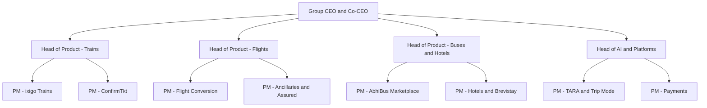
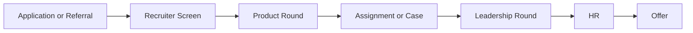

# Ixigo Product Manager Interview Guide | AI Travel PM

- **Source:** https://nextsprints.com/guide/ixigo-product-manager-interview-guide

- **Type:** `interview-guide`

- **Updated:** October 31, 2026

---

## Introduction

ixigo, run by Le Travenues Technology and listed on Indian stock exchanges since 2024, is one of India's largest travel platforms for the "next billion" traveller. It started as a travel search engine and grew into a booking company across trains (ixigo Trains and ConfirmTkt), flights, buses (AbhiBus) and, more recently, hotels (including Brevistay). Unlike many travel startups, ixigo is profitable. In Q1 FY27 it reported gross transaction value (GTV) of about ₹5,524 crore, up 19% year on year, and a record profit after tax of about ₹34 crore. In Q2 FY27, GTV grew 22% and profit after tax reached about ₹63 crore, helped by a one-time gain.

For product managers, ixigo is an AI-first, data-heavy environment. In May 2026 it relaunched its app as "AI-native", built around TARA, a multimodal assistant that understands English, Hindi and Hinglish, plus Trip Mode and agentic travel flows. Prosus invested about ₹1,296 crore for a 10.1% stake in 2025, with part of the money earmarked for AI and product. PMs work on high-scale problems: waitlist predictions, Tatkal speed, bus marketplace quality, flight conversion and new categories like hotels.

| Hiring Metric | Value (estimate) |
| --- | --- |
| Product team size | 50–80 PMs and product leaders across the group |
| Typical PM openings per year | 10–20 |
| Interview success rate | 3–5% of screened applicants |
| Average time to hire | 3–6 weeks |
| Main location | Gurugram |

> Insider Perspective
> Candidates who have interviewed at ixigo report that interviewers care a lot about frugal, data-led thinking. ixigo has grown profitably, so ideas that depend on heavy discounting or large marketing budgets tend to get pushed back.

## PM Role

> ixigo Product Manager
> An ixigo Product Manager owns a travel category, journey or platform (for example train booking, flight conversion, bus marketplace, hotels, payments or AI experiences) and is accountable for user outcomes, conversion and contribution margin in that area.

Responsibilities:

- Own the roadmap for a vertical such as trains, flights, buses or hotels, or a platform like payments or TARA
- Improve funnels and reduce drop-off using experiments and data
- Build prediction-led features (waitlist confirmation, delay alerts, pricing)
- Design for value-conscious, mobile-first users in Tier-2 and Tier-3 India
- Work with supply partners: IRCTC, airlines, bus operators and hotels
- Define metrics, run A/B tests and share learnings
- Collaborate with engineering, data science, design, marketing and support

(The structure above is illustrative. Actual team names and reporting lines vary.)

| Aspect | ixigo PM | Large OTA PM | Big Tech PM |
| --- | --- | --- | --- |
| Focus | Value travellers, trains-to-flights, AI | Full-service travel, hotels | Platform scale |
| Pace | Fast, lean teams | Fast | Fast, process-heavy |
| Partner dependence | High (IRCTC, airlines, bus operators) | High | Low to medium |
| Key metrics | GTV, conversion, contribution margin | GMV, take rate | Engagement, revenue |

Real-world example: ixigo Assured, the free-cancellation add-on, turns a common pain (Railways cancellation charges) into a high-margin product on a low-margin category. PMs on products like this must balance attach rate, claim cost, clarity and consumer protection rules.

## Job Requirements

Education:

- Bachelor's degree, often engineering
- MBA is common for APM and PM roles but not essential

Experience:

- APM: 0–2 years, including campus hires and engineers or analysts moving into product
- PM: 2–5 years in consumer internet, ideally with funnel or marketplace ownership
- Senior PM: 5–8 years with ownership of a significant product line

Technical Skills:

- SQL and analytics tools; comfort with cohort and funnel analysis
- Experiment design
- Understanding of APIs and partner integrations
- Familiarity with machine learning and LLM-based products (increasingly important after the AI-native relaunch)

Soft Skills:

- Structured problem-solving
- Clear communication with engineering and business
- Ownership and bias for action
- Empathy for users in smaller cities and on budget devices

| Requirement | Essential | Preferred |
| --- | --- | --- |
| Education | Bachelor's degree | Engineering degree or MBA |
| PM Experience (PM level) | 2+ years | 3–5 years in consumer internet |
| Domain | Interest in travel | OTA, mobility or marketplace experience |
| Technical | SQL, analytics | ML or AI product experience |
| User understanding | Mobile-first users | Vernacular and Tier-2 design experience |

Success Factors:

1. Data-led decisions with frugal thinking
2. Deep empathy for value-conscious travellers
3. Comfort with AI and prediction products
4. Ability to work around partner constraints, especially IRCTC rules

> Common Pitfalls
> Many candidates design for metro users on flagship phones. ixigo's core audience is often on budget Android devices and slow networks, and prefers Hindi or Hinglish. Solutions that ignore this are a red flag.

> Expert Advice
> Use ixigo Trains, ConfirmTkt and AbhiBus before your interview. Check a PNR, look at a waitlist prediction, try TARA in Hindi, and note what you would improve. Specific observations stand out.

## Interview Process Breakdown

Public, PM-specific interview reports for ixigo are limited. AmbitionBox describes ixigo's general process as two to three rounds (technical, one-on-one and HR). The PM process below is reconstructed from candidate reports and job posts and may vary by team and level.

| Stage | Format | Duration | Focus Areas |
| --- | --- | --- | --- |
| Recruiter screen | Phone or video | 20–30 mins | Background, motivation, expectations |
| Product round | Video | 45–60 mins | Product sense, past work, metrics |
| Assignment or case | Take-home or live | 2–3 days or 60 mins | Product improvement, teardown or RCA |
| Leadership round | Video or on-site | 45–60 mins | Strategy, judgement, ownership |
| HR round | Video | 30 mins | Culture, compensation |

Detailed Breakdown:

- Product Round:

Expect questions on a product you've built, plus a short case grounded in travel: improve train booking for waitlisted users, design a feature for bus travellers, or measure a feature like Trip Mode.

- Assignment or Case:

Candidates report take-home tasks such as a teardown of an ixigo product or a plan to improve a metric. Strong submissions include clear metrics, prioritisation and awareness of constraints like IRCTC rules.

- Leadership Round:

Senior leaders probe strategic thinking: hotels as a growth area, AI's role in travel, competition with MakeMyTrip and Cleartrip. ixigo is founder-led, and senior candidates may meet group leadership.

Timeline Expectations:

- Application to offer: 3–6 weeks
- Feedback usually within a week of each round

## Product Manager Compensation & Levels at ixigo

Levels:

1. Associate Product Manager (APM)
2. Product Manager
3. Senior Product Manager
4. Lead Product Manager / AVP Product
5. Director / VP Product

| Level | Total Compensation Range (INR, 2026 estimate) |
| --- | --- |
| APM | ₹12–20 lakh |
| PM | ₹20–34 lakh |
| Senior PM | ₹32–50 lakh |
| Lead PM / AVP | ₹48–75 lakh |
| Director / VP | ₹75 lakh–₹1.4 crore |

Note: Ranges are estimates anchored on AmbitionBox data for ixigo PMs (roughly ₹14.5–43 lakh for 1–6 years of experience) and adjusted for 2026. As a listed company, ixigo may offer stock options at PM levels and above. See the salary guide for details.

## How to Prepare

Core principles ixigo interviewers look for:

1. **User empathy for Bharat:** Design for budget phones, slow networks and vernacular users.
2. **Frugality:** Achieve impact without heavy discounts.
3. **Data and prediction:** Use data to reduce uncertainty for travellers.
4. **AI fluency:** Understand how TARA and agentic flows change the product.

Tailor Your Resume: Show measurable impact on conversion, retention or cost. Highlight experience with marketplaces, prediction features, vernacular products or AI.

Practice Product Cases:

- Train waitlists, Tatkal and IRCTC constraints
- Bus marketplace quality and safety
- Flight conversion and ancillaries like ixigo Assured
- Hotels as a new category
- AI assistants and agentic flows

NextSprints' question bank includes ixigo-specific cases on TARA, Trip Mode, ixigo Assured, AbhiBus and ConfirmTkt.

Mock Interviews: Practise with peers who know consumer internet in India. Ask them to challenge you on constraints: IRCTC rules, low-end devices and profitability.

## FAQs

### Does ixigo hire APMs from campus?

ixigo hires a small number of associate PMs, including some from campuses and from internal analyst or engineering roles. Openings vary by year, so watch ixigo's careers page and LinkedIn for APM postings, and use referrals where possible.

### Where are ixigo PM roles based?

Most product roles are based in Gurugram, where ixigo is headquartered. Some roles in group companies, such as AbhiBus or ConfirmTkt teams, may sit in other cities like Hyderabad or Bengaluru.

### What kinds of case questions are common?

Expect travel-specific product sense (waitlisted passengers, bus safety, hotel cross-sell), metrics (ixigo Assured, Trip Mode), root cause analysis (Tatkal bookings drop, conversion drop after a redesign), and strategy (hotels, train-to-flight upgrades, AI).

### How important is AI knowledge for ixigo PMs?

Increasingly important. After the 2026 AI-native relaunch, many teams work with TARA, personalisation or agentic flows. You don't need to be an ML engineer, but you should understand how LLM products are evaluated, where they fail, and how to design guardrails.

### How does ixigo differ from MakeMyTrip or Cleartrip as an employer?

ixigo is smaller, profitable and founder-led, with a strong focus on trains, buses and value travellers. Teams are lean, so PMs often own broad areas early. MakeMyTrip is larger and more hotel-focused; Cleartrip is part of Flipkart.

## Related Guides Section

📖 [ixigo Product Strategy Guide](/guide/ixigo-product-strategy-guide) – How ixigo plans to grow with AI, flights, buses and hotels.

📖 [ixigo Product Manager Salary Guide](/guide/ixigo-product-manager-salary-guide) – 2026 PM salary bands by level in INR and negotiation tips.

📖 [ixigo Product Teardown](/guide/ixigo-travel-app-product-teardown) – A teardown of the ixigo app, TARA and its business model.

Disclaimer: This guide is created for product management interview preparation purposes only. The analysis is based on public information and candidate reports, not insider knowledge.
