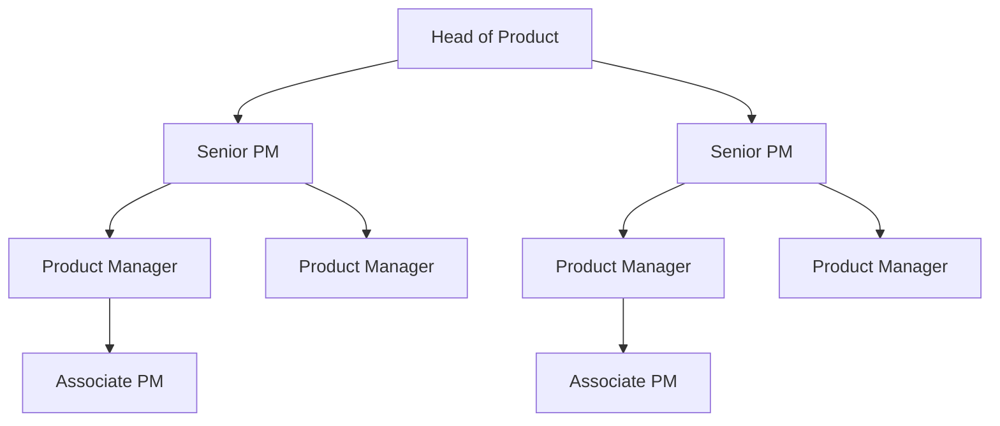

# Justworks Product Management Interview Guide | Insights & Trends

- **Source:** https://nextsprints.com/guide/justworks-product-manager-interview-guide

- **Type:** `interview-guide`

- **Updated:** October 31, 2026

---

## Introduction

Justworks has cultivated a unique product management culture that emphasizes empowerment, innovation, and a deep understanding of small business needs. As the HR tech landscape evolves rapidly, the role of Product Managers at Justworks has become increasingly crucial in shaping solutions that simplify payroll, benefits, and compliance for growing companies.

The demand for skilled PMs at Justworks has surged, reflecting broader industry trends:

| Metric | Value |
| --- | --- |
| YoY increase in PM openings | 35% |
| Average time-to-hire | 45 days |
| Applicants per position | 200+ |

> Insider Perspective
> At Justworks, we're not just looking for feature builders. We seek product leaders who can navigate complex regulatory landscapes while delivering intuitive experiences for small business owners and their employees.

Our PMs are at the forefront of revolutionizing how small businesses manage their most critical operations. This guide will provide you with an in-depth understanding of what it takes to join our team and make a significant impact in the HR tech space.

## PM Role

At Justworks, Product Managers are the driving force behind our mission to help entrepreneurs and businesses grow with confidence. They sit at the intersection of technology, business, and user experience, orchestrating the development of solutions that simplify complex HR processes.

> Justworks PM Role
> A Justworks Product Manager leads cross-functional teams to identify, prioritize, and deliver innovative HR tech solutions that address the evolving needs of small businesses and their employees.

Key Responsibilities:

- Conduct market research and user interviews to identify pain points and opportunities
- Develop and maintain product roadmaps aligned with company strategy
- Collaborate with engineering, design, and compliance teams to bring products to life
- Define and track key performance indicators (KPIs) for product success
- Manage stakeholder relationships, including executive leadership and key clients

Team Structure:

Comparison with Other Tech Companies:

| Aspect | Justworks | Gusto | Zenefits |
| --- | --- | --- | --- |
| Focus | All-in-one HR platform | Payroll-centric | HR software suite |
| Target Market | SMBs (< 500 employees) | Small businesses | SMBs and mid-market |
| Regulatory Complexity | High (PEO model) | Medium | Medium |
| Product Scope | Broad (payroll, benefits, compliance) | Narrow (payroll-focused) | Broad (HR, benefits, payroll) |

Real Product Example: Justworks' Time & Attendance feature exemplifies our PM approach. We identified that manual time tracking was a significant pain point for hourly workers and their employers. Our PMs led the development of an intuitive mobile app that integrates seamlessly with payroll, reducing errors and saving time for both employees and HR administrators.

## Job Requirements

Education:

- Bachelor's degree required, preferably in Computer Science, Business, or related field
- MBA or advanced degree in a relevant discipline is a plus

Experience:

- 3-5 years of product management experience in B2B SaaS, preferably in HR tech or fintech
- Proven track record of launching and scaling successful products

Technical Skills:

- Proficiency in data analysis and SQL
- Understanding of API integrations and web technologies
- Familiarity with agile development methodologies

Soft Skills:

- Exceptional communication and stakeholder management abilities
- Strong analytical and problem-solving skills
- Ability to thrive in a fast-paced, ambiguous environment

| Requirement | Essential | Preferred |
| --- | --- | --- |
| Education | Bachelor's degree | MBA or advanced degree |
| PM Experience | 3+ years | 5+ years in HR tech |
| Technical Skills | Data analysis, SQL | API knowledge, coding ability |
| Industry Knowledge | B2B SaaS | HR compliance, payroll systems |

Success Factors:

1. Customer-centric mindset with a passion for small business challenges
2. Ability to balance regulatory compliance with user experience
3. Data-driven decision-making skills
4. Collaborative approach to cross-functional leadership

> Common Pitfalls
> Candidates often underestimate the complexity of the HR tech regulatory landscape. Successful Justworks PMs must be adept at navigating compliance issues while maintaining a focus on user needs.

> Expert Advice
> Showcase your ability to simplify complex processes. Justworks values PMs who can translate intricate HR requirements into intuitive product experiences.

## Interview Process Breakdown

Justworks' PM interview process is designed to assess candidates' product sense, execution skills, and strategic thinking. Here's a comprehensive breakdown:

Timeline Expectations:

- Application to offer: 4-6 weeks
- 1-2 weeks between interview stages

Round-by-Round Breakdown:

1. Initial Application and Screening Resume review and potential take-home assignment 30-minute phone screen with recruiter
2. Product Interviews (3-4 rounds) Product Sense: Evaluate product design and improvement skills Product Execution: Assess metrics definition and trade-off analysis Product Strategy: Explore growth strategies and launch planning
3. Final Rounds Leadership and cultural fit assessment Executive interview

| Round | Focus | Duration |
| --- | --- | --- |
| Phone Screen | Background and motivation | 30 minutes |
| Product Sense | Design and improvement | 45-60 minutes |
| Product Execution | Metrics and analysis | 45-60 minutes |
| Product Strategy | Growth and planning | 45-60 minutes |
| Leadership | Cultural fit | 45 minutes |
| Executive | Strategic alignment | 30 minutes |

Practice Justworks questions

Product Design

How could Facebook build a feature to help people find roommates?

View

Say you're a WhatsApp PM and want to add more ecommerce functionality. What would you do?

View

How would you build a language learning product for the Facebook app?

View

Product Improvement

What new features could Justworks add to its benefits administration platform to simplify open enrollment for small businesses?

View

How might Justworks enhance its payroll processing system to provide more detailed financial insights for business owners?

View

How can Justworks improve its time tracking feature to better accommodate remote and hybrid work schedules?

View

Product Success Metrics

How would you define the success of Justworks's compliance management tools?

View

What metrics would you use to evaluate Justworks's benefits administration platform?

View

How would you measure the success of Justworks's payroll automation feature?

View

Product Trade-Off

Should Justworks prioritize expanding its HR compliance features or focus on enhancing its payroll automation tools to better serve small businesses?

View

How can Justworks balance simplifying its user interface for easier onboarding against maintaining comprehensive functionality for experienced users?

View

In Justworks's benefits administration platform, should we emphasize offering a wider variety of health insurance options or streamline the selection process for faster employee enrollment?

View

Product Root Cause Analysis

Why has Justworks's Benefits enrollment feature seen a 15% drop in completion rates over the past month?

View

How can we explain the 20% decline in new customer sign-ups for Justworks's HR compliance tools compared to the same period last year?

View

What factors are contributing to the sudden 30% increase in support tickets related to Justworks's payroll processing system this quarter?

View

## Product Manager Compensation & Levels at Justworks

Justworks offers competitive compensation packages to attract top PM talent. While exact figures can vary based on experience and performance, here's a general overview of our PM levels and compensation structure:

| Level | Title | Total Compensation Range |
| --- | --- | --- |
| L3 | Associate Product Manager | $100,000 - $130,000 |
| L4 | Product Manager | $130,000 - $180,000 |
| L5 | Senior Product Manager | $180,000 - $250,000 |
| L6 | Group Product Manager | $250,000 - $350,000 |

Note: Total compensation includes base salary, bonuses, and equity. Ranges are based on data from level.fyi and may vary.

Justworks emphasizes a balanced approach to compensation, offering competitive salaries along with equity to align PM interests with the company's long-term success. As you progress through the levels, the equity component typically increases, reflecting the greater strategic impact of senior roles.

## How to Prepare

Leadership Principles: At Justworks, we're guided by core principles that shape our product decisions:

1. Simplify the Complex: We strive to make HR processes intuitive and accessible.
2. Data-Driven Empathy: We use data to understand and address customer pain points.
3. Compliance as an Advantage: We turn regulatory challenges into opportunities for innovation.
4. Scale with Care: We build solutions that grow with our customers' businesses.

Tailor Your Resume: Highlight experiences that demonstrate your ability to navigate complex regulatory environments while delivering user-friendly solutions. Use the STAR method to showcase impactful projects, emphasizing metrics and outcomes. For expert feedback on your PM resume, consider NextSprints' Resume Review service ([https://nextsprints.com/resume-review](https://nextsprints.com/resume-review)).

Practice Product Cases: Focus on cases that involve balancing compliance requirements with user experience. Develop a framework for approaching HR tech challenges, but be prepared to adapt it on the fly. Justworks cases often involve multi-stakeholder scenarios, so practice considering the needs of both employers and employees. To access a comprehensive database of relevant PM interview questions, check out NextSprints' question bank ([https://nextsprints.com/product-manager-interview-questions](https://nextsprints.com/product-manager-interview-questions)).

Practice Mock Interviews: While self-practice is valuable, getting feedback from experienced PMs is crucial. Seek out mentors in the HR tech space or consider professional coaching. NextSprints offers PM Coaching sessions ([https://nextsprints.com/pm-coaching](https://nextsprints.com/pm-coaching)) with industry veterans who can provide targeted feedback on your interview performance.

## FAQs

### What sets Justworks' PM role apart from other tech companies?

Justworks PMs navigate a unique intersection of HR, finance, and technology. You'll be solving complex compliance challenges while delivering intuitive experiences for small businesses. This role requires a blend of regulatory knowledge, user empathy, and technical acumen that's rare in the tech industry.

### How important is prior HR tech experience for Justworks PM candidates?

While HR tech experience is valuable, it's not a strict requirement. We value candidates who demonstrate strong product sense, analytical skills, and the ability to quickly learn complex domains. If you have experience in fintech, B2B SaaS, or other regulated industries, you may find many transferable skills.

### What types of projects do Justworks PMs typically work on?

Our PMs lead diverse projects, from enhancing core payroll and benefits features to developing new products that address emerging small business needs. Recent projects have included improving our time tracking system, expanding benefits offerings, and creating tools to simplify compliance reporting.

### How does Justworks support PM career growth?

We offer a structured career path with clear progression from APM to senior leadership roles. PMs have opportunities to rotate across different product areas, lead cross-functional initiatives, and participate in mentorship programs. We also provide education stipends and encourage attendance at industry conferences.

### What's the most challenging aspect of being a PM at Justworks?

Balancing regulatory compliance with user experience is often the biggest challenge. Our PMs must stay ahead of changing labor laws and HR regulations while ensuring our products remain intuitive and efficient for small business owners who may not have HR expertise.

## Related Guides Section

📖 [Justworks Product Strategy Guide](justworks-product-strategy-guide) – Deep dive into Justworks' product decisions.

📖 [Justworks Product Manager Salary Guide](justworks-product-manager-salary-guide) – Salary insights & negotiation tips.

📖 [Justworks Product Teardown Guide](justworks-product-manager-teardown-analysis) – Analysis of Justworks' product positioning.

Disclaimer: This guide is created for product management interview preparation purposes only. The analysis and methodology are based on the public information.
