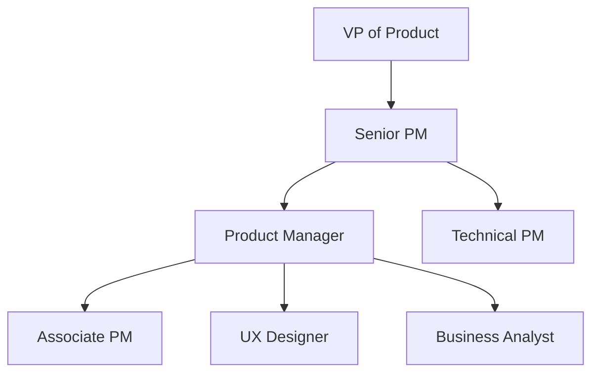

# L3Harris Product Manager Interview Guide | Full Process & Tips

- **Source:** https://nextsprints.com/guide/l3harris-product-manager-interview-guide

- **Type:** `interview-guide`

- **Updated:** October 31, 2026

---

## Introduction

L3Harris Technologies stands at the forefront of innovation in the defense and aerospace industry, with a unique product management culture that blends cutting-edge technology with mission-critical applications. As global defense spending continues to rise and the demand for advanced communication systems grows, the role of Product Managers at L3Harris has never been more crucial.

In 2026, L3Harris is actively expanding its product management team to drive forward key initiatives in areas like tactical communications, electronic warfare, and space systems. The company's commitment to innovation is reflected in its aggressive hiring targets for experienced PMs.

| Hiring Metric | 2025 | 2026 (Projected) |
| --- | --- | --- |
| PM Openings | 75 | 120 |
| Avg. Time to Hire | 45 days | 30 days |
| Acceptance Rate | 68% | 75% |

> Insider Perspective
> As a senior product leader at L3Harris, I've witnessed firsthand how our PMs are increasingly expected to bridge the gap between commercial best practices and defense industry requirements. The most successful candidates demonstrate both technical depth and an ability to navigate complex stakeholder environments.

## PM Role

At L3Harris, Product Managers play a pivotal role in shaping the future of defense technology. They are the driving force behind innovative solutions that protect and connect warfighters, first responders, and civilians alike.

> L3Harris PM Role
> L3Harris Product Managers lead cross-functional teams to develop and deliver mission-critical communication systems, electronic warfare solutions, and space technologies that address complex national security challenges.

Key responsibilities include:

1. Strategic product planning aligned with defense market trends
2. Collaboration with engineering teams to define technical requirements
3. Stakeholder management across military, government, and industry partners
4. Overseeing product development from concept to deployment
5. Analyzing competitor offerings and maintaining market leadership

Team structure at L3Harris:

Comparison with other tech companies:

| Aspect | L3Harris PM | Big Tech PM |
| --- | --- | --- |
| Focus | Defense & Aerospace | Consumer/Enterprise |
| Stakeholders | Military, Government | Consumers, Businesses |
| Product Lifecycle | 5-10 years | 1-3 years |
| Technical Depth | Very High | Moderate to High |

Real product examples:

- Falcon IV® AN/PRC-167 Multiband Manpack Radio
- Symphony™ Counter-UAS System
- RapidFire™ RF-7850A Airborne Networking Mission Module

## Job Requirements

Education:

- Bachelor's degree in Engineering, Computer Science, or related technical field required
- MBA or Master's degree in a technical discipline highly preferred

Experience:

- Minimum 5-7 years of product management experience in defense, aerospace, or related high-tech industries
- Proven track record of successfully launching complex technical products

Technical Skills:

- Strong understanding of RF communications, electronic warfare, or space systems
- Familiarity with DoD acquisition processes and military standards
- Proficiency in agile methodologies and product lifecycle management tools

Soft Skills:

- Exceptional leadership and cross-functional team management
- Strong analytical and problem-solving abilities
- Excellent communication skills, both written and verbal
- Ability to obtain and maintain required security clearances

| Requirement | Essential | Preferred |
| --- | --- | --- |
| Technical Degree | ✓ |  |
| MBA/Master's |  | ✓ |
| 5+ Years PM Experience | ✓ |  |
| Defense Industry Knowledge | ✓ |  |
| Security Clearance Eligible | ✓ |  |

Success Factors:

1. Ability to translate complex military requirements into actionable product features
2. Strong systems thinking and integration mindset
3. Comfort with ambiguity and rapidly changing priorities
4. Passion for national security and defense technology

> Common Pitfalls
> Many candidates underestimate the importance of understanding the defense acquisition process and the unique constraints of developing products for military use. Familiarize yourself with DoD standards and procurement cycles.

> Expert Advice
> Highlight any experience with classified programs or government contracting in your application. Even if you can't share specifics, the familiarity with these processes is highly valued at L3Harris.

## Interview Process Breakdown

L3Harris employs a rigorous multi-stage interview process to identify top PM talent:

Timeline: Typically 4-6 weeks from initial application to offer

Round-by-Round Breakdown:

- Initial Application and Screening:

- Resume review by HR and hiring manager
- 30-minute phone screen with recruiter

- Product Interviews:
- Product Sense: Assess candidate's ability to design products and improve existing ones for defense applications.
- Product Execution: Evaluate skills in defining success metrics and analyzing trade-offs in complex defense systems.
- Product Strategy: Test ability to develop growth strategies and launch plans for military technology products.

- Final Rounds:

- Leadership Panel: Cross-functional interview with senior leaders
- Security Clearance Discussion: Eligibility assessment for required clearances

| Round | Focus | Duration |
| --- | --- | --- |
| Phone Screen | Background & Motivation | 30 min |
| Technical Assessment | Defense Tech Knowledge | 60 min |
| Product Design | User-Centric Solutions | 45 min |
| Product Strategy | Market Analysis & Roadmapping | 45 min |
| Leadership Panel | Executive Presence & Vision | 60 min |

Practice L3Harris questions

Product Design

How could Facebook build a feature to help people find roommates?

View

Say you're a WhatsApp PM and want to add more ecommerce functionality. What would you do?

View

How would you build a language learning product for the Facebook app?

View

Product Improvement

What innovative features could L3Harris add to its Falcon III tactical radios to increase battery life and reduce weight for field operators?

View

How can L3Harris enhance its WESCAM MX-Series electro-optical and infrared imaging systems to improve target detection in low-light conditions?

View

How might L3Harris improve the user interface of its Symphony RMS-DS radar management system to streamline air traffic control operations?

View

Product Success Metrics

How would you measure the success of L3Harris's WESCAM MX-Series electro-optical and infrared imaging systems?

View

How would you define the success of L3Harris's Symphony suite of maritime domain awareness solutions?

View

What metrics would you use to evaluate L3Harris's Falcon III AN/PRC-152A handheld tactical radio?

View

Product Trade-Off

Should L3Harris prioritize increased range or improved battery life for its SINCGARS combat net radios?

View

How can L3Harris balance ruggedization and weight reduction in its tactical radio systems?

View

For L3Harris's night vision goggles, how should we trade off enhanced image quality against reduced power consumption?

View

Product Root Cause Analysis

How did L3Harris's TALON tactical robot sales drop by 25% in the European market this quarter compared to last year?

View

Why has L3Harris's AN/PRC-163 handheld radio experienced a 15% decrease in battery life over the past 3 months?

View

What factors led to the 30% increase in software bugs for L3Harris's WESCAM MX-20 imaging system during the latest firmware update?

View

## Product Manager Compensation & Levels at L3Harris

L3Harris offers competitive compensation packages to attract top PM talent in the defense industry. While exact figures can vary based on location and experience, here's an overview of the PM level structure and salary ranges based on industry data:

| Level | Title | Total Compensation Range |
| --- | --- | --- |
| L1 | Associate Product Manager | $90,000 - $120,000 |
| L2 | Product Manager | $120,000 - $160,000 |
| L3 | Senior Product Manager | $160,000 - $220,000 |
| L4 | Principal Product Manager | $220,000 - $300,000 |
| L5 | Director of Product | $300,000+ |

Note: These ranges include base salary, bonuses, and stock options where applicable. L3Harris may offer additional benefits such as clearance pay differentials and defense industry-specific perks.

For the most up-to-date and detailed compensation information, candidates are encouraged to consult resources like level.fyi or Glassdoor, as well as discuss specifics with their L3Harris recruiter during the interview process.

## How to Prepare

Company Leadership Principles:

1. Integrity: Uphold the highest ethical standards in all decisions and actions.
2. Excellence: Strive for superior performance and continuous improvement.
3. Innovation: Push boundaries to create cutting-edge solutions for complex challenges.
4. Customer Focus: Prioritize the needs of warfighters and national security stakeholders.

Tailor Your Resume: Highlight your impact using quantifiable metrics and the STAR method (Situation, Task, Action, Result). Focus on projects relevant to defense technology or complex systems integration. If you need expert guidance on optimizing your PM resume for L3Harris, consider using NextSprints' Resume Review service.

Practice Product Cases: L3Harris product cases often involve complex technical systems and unique defense industry constraints. Practice adapting standard frameworks to these scenarios. Don't just memorize—learn to think critically about defense applications. NextSprints offers a comprehensive database of Product Manager Interview Questions to help you prepare.

Mock Interviews: While self-practice is valuable, getting feedback from experienced defense industry PMs is crucial. If you don't have access to L3Harris employees, consider NextSprints' PM Coaching service for expert-led mock interviews tailored to defense sector product management.

## FAQs

### What security clearance is required for L3Harris PM roles?

Most L3Harris PM positions require at least a Secret clearance, with some roles needing Top Secret or higher. You don't need to have an active clearance to apply, but you must be eligible to obtain one.

### How does L3Harris PM work differ from commercial tech companies?

L3Harris PMs work on longer product lifecycles, navigate complex government regulations, and focus on mission-critical systems where reliability and security are paramount. The stakeholder landscape is also more complex, often involving military, government, and industry partners.

### What technical skills are most valued for L3Harris PMs?

Strong systems engineering knowledge, familiarity with RF communications or electronic warfare concepts, and understanding of military operational environments are highly valued. Software development experience, particularly in embedded systems, is also beneficial.

### How does L3Harris support PM career growth?

L3Harris offers robust career development programs, including rotational assignments across different business units, mentorship from senior leaders, and opportunities to work on classified programs that push the boundaries of defense technology.

### Can I apply if I don't have prior defense industry experience?

Yes, L3Harris values diverse perspectives and hires PMs from various backgrounds. However, you should demonstrate a strong interest in defense technology and be prepared to quickly learn industry-specific processes and regulations.

## Related Guides Section

📖 [L3Harris Product Strategy Guide](l3harris-product-strategy-guide) – Deep dive into L3Harris's product decisions.

📖 [L3Harris Product Manager Salary Guide](l3harris-product-manager-salary-guide) – Salary insights & negotiation tips.

📖 [L3Harris Product Teardown Guide](l3harris-wescam-mx-series-product-teardown-analysis) – Analysis of L3Harris's product positioning.

Disclaimer: This guide is created for product management interview preparation purposes only. The analysis and methodology are based on the public information.
