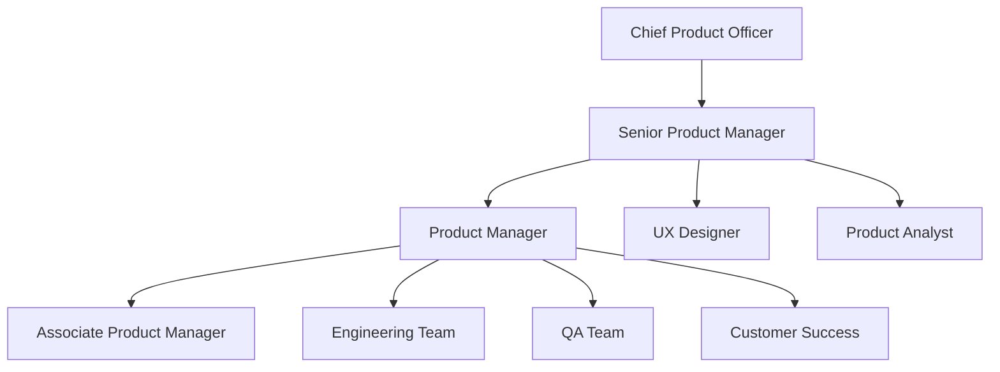

# LeadSquared Product Manager Interview Guide | 2026 Insights

- **Source:** https://nextsprints.com/guide/leadsquared-product-manager-interview-guide

- **Type:** `interview-guide`

- **Updated:** October 31, 2026

---

## Introduction

LeadSquared's product management culture is a unique blend of innovation, customer-centricity, and data-driven decision-making. As a fast-growing CRM and marketing automation platform, LeadSquared places immense value on product managers who can navigate the complex B2B SaaS landscape while driving user-centric solutions.

In 2026, the role of a product manager at LeadSquared is more crucial than ever. With the increasing demand for intelligent, integrated sales and marketing solutions, PMs are at the forefront of shaping the future of customer engagement technologies. The market for CRM software is projected to reach $96.5 billion by 2028, with a CAGR of 11.1% from 2023 to 2028, highlighting the immense potential and responsibility that comes with this role.

| LeadSquared PM Hiring Statistics 2026 |  |
| --- | --- |
| Open PM Positions | 15 |
| Average Time-to-Hire | 45 days |
| Applicants per Position | 200+ |
| Interview Success Rate | 2.5% |

> Expert Insight
> At LeadSquared, we're not just looking for product managers; we're seeking visionaries who can transform complex business challenges into elegant, scalable solutions. The ideal candidate combines deep technical knowledge with a keen understanding of sales and marketing dynamics in the B2B space.

## PM Role

> LeadSquared Product Manager Role
> A LeadSquared Product Manager is responsible for driving the vision, strategy, and execution of product initiatives that enhance the company's CRM and marketing automation platform, focusing on user experience, feature innovation, and business impact.

Key responsibilities of a LeadSquared PM include:

1. Defining product vision and strategy aligned with company goals
2. Conducting market research and competitive analysis
3. Gathering and prioritizing product requirements
4. Collaborating with engineering, design, and sales teams
5. Managing the product roadmap and release planning
6. Analyzing product metrics and user feedback for continuous improvement
7. Presenting product updates to stakeholders and leadership

Team structure at LeadSquared:

Comparison with other top tech companies:

| Aspect | LeadSquared PM | Salesforce PM | HubSpot PM |
| --- | --- | --- | --- |
| Focus | CRM & Marketing Auto | CRM Ecosystem | Inbound Marketing |
| Technical Depth | High | Moderate | Moderate |
| Customer Interaction | Frequent | Occasional | Regular |
| Product Scope | Focused | Broad | Moderate |
| Agile Methodology | Scrum/Kanban Hybrid | SAFe | Scrum |

Real examples from LeadSquared's products:

- Developing AI-powered lead scoring algorithms
- Implementing multi-channel campaign automation features
- Creating customizable sales pipeline management tools
- Integrating third-party apps and APIs for enhanced functionality

## Job Requirements

Education and Experience:

- Bachelor's degree in Computer Science, Engineering, or related field (MBA preferred)
- 5+ years of product management experience in B2B SaaS, preferably in CRM or marketing automation
- Proven track record of successful product launches and feature implementations

Technical Skills:

- Strong understanding of CRM systems and marketing automation technologies
- Proficiency in data analysis and SQL
- Familiarity with agile development methodologies
- Experience with product management tools (e.g., Jira, Aha!, Productboard)

Soft Skills:

- Excellent communication and presentation abilities
- Strong leadership and stakeholder management skills
- Analytical thinking and problem-solving aptitude
- User-centric mindset with a passion for great UX

| Requirement Category | Must-Have | Nice-to-Have |
| --- | --- | --- |
| Education | Bachelor's in CS/Engineering | MBA |
| Experience | 5+ years in B2B SaaS PM | CRM/Marketing Automation background |
| Technical Skills | Data Analysis, SQL, Agile | Machine Learning, API Development |
| Soft Skills | Communication, Leadership, Analytics | Public Speaking, Design Thinking |

Success Factors:

1. Ability to balance technical depth with business acumen
2. Proactive approach to identifying market opportunities
3. Strong execution skills to drive projects from concept to launch
4. Collaborative mindset to work effectively across teams

> Common Pitfalls
> Overlooking the importance of sales and marketing domain knowledge
> Underestimating the complexity of B2B user needs
> Focusing too much on features without considering overall user experience
> Neglecting data-driven decision making in favor of intuition

> Expert Tips
> To stand out in the LeadSquared PM interview process:
> Demonstrate a deep understanding of the B2B sales and marketing landscape
> Prepare case studies showcasing your ability to drive product growth
> Highlight your experience with data-driven product decisions
> Show your passion for solving complex business problems through technology

## Interview Process Breakdown

LeadSquared's product manager interview process is designed to thoroughly assess candidates' skills, experience, and cultural fit. Here's a detailed breakdown of what to expect:

Timeline Expectations:

- Total process duration: 3-4 weeks
- Initial screening: 1-2 days
- Product interviews: 1-2 weeks
- Final rounds: 1 week
- Offer decision: 3-5 days

Round-by-Round Breakdown:

1. Initial Application and Screening

- Resume review by HR
- Brief phone screen with recruiter (30 minutes)

1. Product Interviews

- Product Sense: Evaluate product design skills and ability to improve existing products.
- Product Execution: Assess metrics definition, problem-solving, and decision-making capabilities.
- Product Strategy: Gauge strategic thinking, growth planning, and market understanding.

1. Final Rounds

- Leadership interview with senior product executives
- Cultural fit assessment
- Possible take-home assignment presentation

| Interview Round | Duration | Focus Areas |
| --- | --- | --- |
| Initial Screen | 30 min | Experience, motivation, role fit |
| Product Sense | 60 min | Product design, user empathy, innovation |
| Product Execution | 60 min | Metrics, prioritization, problem-solving |
| Product Strategy | 60 min | Vision, market analysis, growth strategies |
| Leadership | 45 min | Cross-functional collaboration, mentorship |
| Cultural Fit | 30 min | Values alignment, team dynamics |

Practice LeadSquared questions

Product Design

How could Facebook build a feature to help people find roommates?

View

Say you're a WhatsApp PM and want to add more ecommerce functionality. What would you do?

View

How would you build a language learning product for the Facebook app?

View

Product Improvement

How might LeadSquared improve its email marketing automation tool to increase open rates and click-through rates?

View

What features could LeadSquared add to its lead scoring system to better predict customer conversion likelihood?

View

How can LeadSquared enhance its mobile CRM app to improve offline functionality for field sales teams?

View

Product Success Metrics

What metrics would you use to evaluate LeadSquared's Lead Scoring system?

View

How would you measure the success of LeadSquared's Marketing Automation feature?

View

How would you define the success of LeadSquared's Mobile CRM app?

View

Product Trade-Off

For LeadSquared's marketing automation tool, should we emphasize creating more industry-specific templates or improving the customization options for existing templates?

View

How can LeadSquared balance the need for comprehensive lead capture forms with the goal of reducing friction in the lead generation process?

View

Should LeadSquared prioritize adding more advanced analytics features to its CRM platform or focus on simplifying the user interface for better adoption rates?

View

Product Root Cause Analysis

What factors contributed to the sudden 30% decrease in new user signups for LeadSquared's CRM platform last quarter?

View

Why has LeadSquared's email marketing automation tool seen a 15% drop in open rates over the past month?

View

How can we explain the unexpected 20% decline in usage of LeadSquared's lead scoring feature among enterprise clients in the past two weeks?

View

## Product Manager Compensation & Levels at LeadSquared

LeadSquared's product management career ladder is designed to provide clear growth paths and competitive compensation. Here's an overview of the levels and corresponding salary ranges:

| Level | Title | Experience | Total Compensation Range (USD) |
| --- | --- | --- | --- |
| L3 | Associate Product Manager | 0-3 years | $70,000 - $90,000 |
| L4 | Product Manager | 3-5 years | $90,000 - $120,000 |
| L5 | Senior Product Manager | 5-8 years | $120,000 - $160,000 |
| L6 | Principal Product Manager | 8+ years | $160,000 - $200,000 |
| L7 | Director of Product | 10+ years | $200,000 - $250,000 |

Note: These ranges are approximate and may vary based on location, performance, and other factors. LeadSquared typically offers a mix of base salary, equity, and performance bonuses.

Factors influencing compensation:

- Prior experience in CRM or marketing automation
- Track record of successful product launches
- Leadership and mentorship abilities
- Technical expertise in relevant domains
- Impact on company revenue and growth metrics

LeadSquared regularly reviews its compensation structure to remain competitive in the talent market, especially for senior product roles.

## How to Prepare

To excel in LeadSquared's product manager interview process, focus on the following key areas:

Company Leadership Principles:

1. Customer Obsession: Deeply understand and anticipate customer needs
2. Data-Driven Decision Making: Use metrics and analytics to guide product strategy
3. Innovation at Scale: Think big while delivering incremental value
4. Ownership Mentality: Take responsibility for product success beyond your immediate role

Tailor Your Resume: Highlight your impact using quantifiable metrics and the STAR method (Situation, Task, Action, Result). Focus on experiences relevant to CRM, marketing automation, and B2B SaaS. Showcase projects where you've driven significant user adoption or revenue growth. For expert feedback on your PM resume, consider using NextSprints' resume review service.

Practice Product Cases: Develop a structured approach to product design, metrics, and strategy questions. Focus on LeadSquared's domain by familiarizing yourself with CRM and marketing automation concepts. Remember, it's not about memorizing frameworks but adapting them to specific scenarios. To access a comprehensive database of relevant interview questions, check out NextSprints' product manager interview question collection.

Practice Mock Interviews: While self-practice is valuable, getting feedback from experienced product managers is crucial. If you don't have access to senior PMs in your network, consider NextSprints' PM coaching service for expert-led mock interviews tailored to LeadSquared's interview style.

Additional Preparation Tips:

- Study LeadSquared's product offerings and recent feature launches
- Analyze competitors like Salesforce, HubSpot, and Zoho CRM
- Stay updated on B2B SaaS and martech industry trends
- Practice presenting complex ideas clearly and concisely
- Prepare thoughtful questions about LeadSquared's product strategy and culture

## FAQs

### What makes LeadSquared's PM role unique compared to other tech companies?

LeadSquared PMs have a unique opportunity to work on cutting-edge CRM and marketing automation solutions in the rapidly evolving B2B SaaS space. The role combines deep technical challenges with a strong focus on sales and marketing domain expertise, offering a diverse and impactful experience.

### How important is prior experience in CRM or marketing automation?

While not strictly required, experience in CRM or marketing automation is highly valued. However, candidates with strong product management skills in other B2B SaaS domains can also succeed by demonstrating their ability to quickly learn and adapt to LeadSquared's specific market.

### What are the growth opportunities for PMs at LeadSquared?

LeadSquared offers clear career progression from Associate PM to Director level. PMs can grow by taking on larger product areas, mentoring junior team members, and driving strategic initiatives. There are also opportunities to transition into related roles like Product Marketing or Strategy.

### How does LeadSquared approach product development and innovation?

LeadSquared follows a customer-centric, data-driven approach to product development. We use a mix of agile methodologies, emphasizing rapid iteration and continuous feedback. Innovation is encouraged through regular hackathons, cross-functional collaboration, and dedicated time for exploring new ideas.

### What resources does LeadSquared provide for ongoing PM skill development?

LeadSquared invests heavily in PM skill development through internal workshops, conference attendance, online course subscriptions, and a mentorship program. PMs are encouraged to stay updated on industry trends and are given opportunities to contribute to thought leadership content.

## Related Guides Section

📖 [LeadSquared Product Strategy Guide](leadsquared-product-strategy-guide) – Deep dive into LeadSquared's product decisions.

📖 [LeadSquared Product Manager Salary Guide](leadsquared-product-manager-salary-guide) – Salary insights & negotiation tips.

📖 [LeadSquared Product Teardown Guide](leadsquared-crm-marketing-automation-product-teardown-analysis) – Analysis of LeadSquared's product positioning.

Disclaimer: This guide is created for product management interview preparation purposes only. The analysis and methodology are based on the public information.
