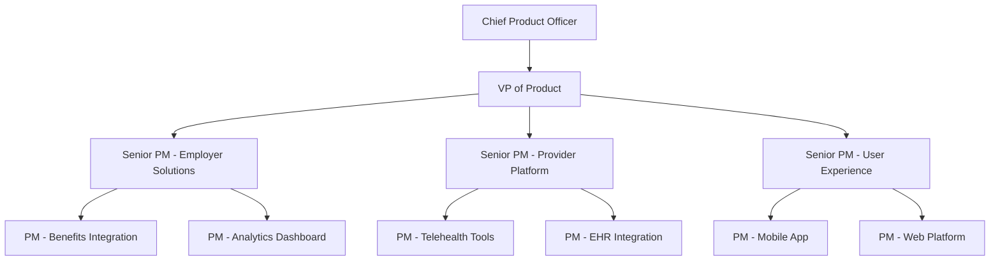
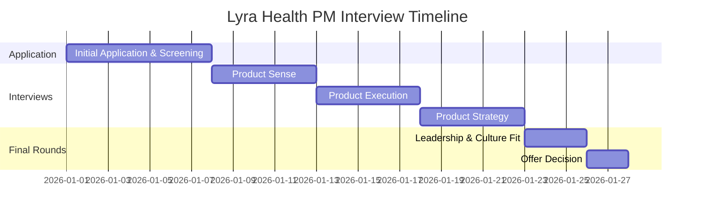

# Lyra Health Product Management Culture Guide | 2026 Insights

- **Source:** https://nextsprints.com/guide/lyra-health-product-manager-interview-guide

- **Type:** `interview-guide`

- **Updated:** October 31, 2026

---

## Introduction

Lyra Health's product management culture is at the forefront of revolutionizing mental health care delivery. As a leader in digital mental health solutions, Lyra's PMs play a crucial role in developing innovative products that bridge the gap between patients and providers. The mental health tech market is experiencing unprecedented growth, with Lyra at the epicenter of this transformation.

In 2026, the demand for skilled product managers at Lyra Health has never been higher. The company's rapid expansion and focus on data-driven, personalized mental health solutions have created a competitive landscape for top PM talent.

| Hiring Metric | Value |
| --- | --- |
| PM Applications Received (2024) | 15,000+ |
| Interview to Offer Ratio | 1:50 |
| YoY PM Team Growth | 30% |

> Insider Perspective
> As a senior product leader at Lyra, I've witnessed firsthand how our PMs drive innovation in mental health technology. The most successful candidates demonstrate a unique blend of empathy, data analysis skills, and a passion for improving mental health outcomes.

## PM Role

At Lyra Health, product managers are the architects of mental wellness solutions, bridging clinical expertise with cutting-edge technology.

> Lyra Health PM Role
> Product Managers at Lyra Health lead cross-functional teams to develop and optimize digital mental health platforms, focusing on user engagement, clinical efficacy, and scalable solutions for employers and healthcare providers.

Key responsibilities include:

- Defining product strategy aligned with Lyra's mission of improving access to mental health care
- Collaborating with clinical experts to ensure evidence-based approach in product development
- Analyzing user data to drive personalization and improve treatment outcomes
- Managing the product lifecycle from conception to launch and post-launch optimization
- Prioritizing features based on user needs, business goals, and technological feasibility

Team structure at Lyra Health:

Comparison with other tech companies:

| Aspect | Lyra Health PM | Big Tech PM | Healthcare Tech PM |
| --- | --- | --- | --- |
| Focus | Mental health solutions | General consumer/enterprise products | Broad healthcare technology |
| Clinical Knowledge | High importance | Not typically required | Moderate importance |
| Data Privacy Expertise | Critical (HIPAA) | Important | Critical (HIPAA) |
| User Base | Patients, providers, employers | General consumers/businesses | Patients, providers, hospitals |
| Innovation Pace | Rapid, with clinical validation | Very rapid | Moderate, with regulatory considerations |

Real-world example: Lyra's Blended Care platform, which combines video therapy sessions with digital lessons and exercises, required PMs to work closely with therapists to create an engaging, clinically effective digital experience that complements in-person treatment.

## Job Requirements

Education:

- Bachelor's degree required, preferably in Computer Science, Psychology, or related fields
- MBA or Master's in Health Informatics is a strong plus

Experience:

- 5+ years of product management experience
- 2+ years in healthcare or mental health technology preferred
- Demonstrated success in launching and scaling digital health products

Technical Skills:

- Proficiency in data analysis and SQL
- Understanding of machine learning applications in healthcare
- Familiarity with EHR systems and healthcare interoperability standards
- Experience with agile development methodologies

Soft Skills:

- Strong empathy and understanding of mental health challenges
- Excellent communication skills to bridge clinical and technical teams
- Strategic thinking and ability to navigate complex healthcare ecosystems
- Leadership and stakeholder management across diverse groups

| Requirement | Essential | Preferred |
| --- | --- | --- |
| Education | Bachelor's degree | Master's in relevant field |
| PM Experience | 5+ years | 7+ years |
| Healthcare Tech | 2+ years | 4+ years |
| Data Analysis | Proficient | Expert |
| Clinical Knowledge | Basic understanding | In-depth knowledge |

Success Factors:

1. Ability to translate clinical needs into technical requirements
2. Track record of data-driven decision making in product development
3. Experience in scaling products while maintaining quality and efficacy
4. Proven ability to navigate regulatory landscapes in healthcare

> Common Pitfalls
> Underestimating the complexity of healthcare regulations
> Focusing on technology without sufficient consideration for clinical outcomes
> Neglecting the importance of provider adoption in product success

> Expert Advice
> Successful PMs at Lyra Health excel at balancing innovation with clinical rigor. Showcase projects where you've improved mental health outcomes through technology, and be prepared to discuss how you measure the impact of your products on patient well-being.

## Interview Process Breakdown

Lyra Health's PM interview process is designed to assess candidates' ability to drive innovation in mental health technology while maintaining clinical efficacy and user empathy.

Round-by-round breakdown:

- Initial Application and Screening

- Resume review and initial phone screen with recruiter
- Assessment of background fit and motivation for joining Lyra Health

- Product Interviews

a. Product Sense

- Evaluates ability to design user-centric mental health solutions
- Focuses on empathy, user research, and innovative problem-solving

b. Product Execution

- Assesses candidates' ability to define success metrics for mental health products
- Explores experience with data-driven decision making and product optimization

c. Product Strategy

- Examines strategic thinking in the context of mental health technology
- Evaluates understanding of market trends, competitive landscape, and growth opportunities

- Final Rounds

- Leadership and culture fit interviews with senior executives
- Deep dive into past experiences and alignment with Lyra's mission

| Interview Round | Focus Areas | Duration |
| --- | --- | --- |
| Product Sense | User-centric design, Mental health empathy | 60 minutes |
| Product Execution | Success metrics, Data analysis | 60 minutes |
| Product Strategy | Market analysis, Growth strategies | 60 minutes |
| Leadership & Culture | Team collaboration, Mission alignment | 45 minutes |

Practice Lyra Health questions

Product Design

How could Facebook build a feature to help people find roommates?

View

Say you're a WhatsApp PM and want to add more ecommerce functionality. What would you do?

View

How would you build a language learning product for the Facebook app?

View

Product Improvement

How can Lyra Health improve its digital self-care tools to better support users between therapy sessions?

View

What innovative features could Lyra Health add to its mobile app to increase user engagement and treatment adherence?

View

How might Lyra Health enhance its provider matching algorithm to ensure more precise therapist-client pairings?

View

Product Success Metrics

How would you measure the success of Lyra Health's digital self-care tools?

View

What metrics would you use to evaluate Lyra Health's teletherapy platform?

View

How would you define the success of Lyra Health's mental health screening assessments?

View

Product Trade-Off

How can Lyra Health balance the need for comprehensive mental health assessments with the desire for quick, user-friendly onboarding in its digital platform?

View

Should Lyra Health prioritize expanding its provider network to improve appointment availability or focus on enhancing the quality and specialization of existing providers?

View

For Lyra Health's teletherapy services, should we emphasize increasing session frequency to drive engagement or limit sessions to manage costs and prevent over-reliance on therapy?

View

Product Root Cause Analysis

What factors are contributing to the recent 20% increase in wait times for Lyra Health's mental health coaching sessions?

View

Why has the utilization rate of Lyra Health's digital self-care tools decreased by 30% among enterprise clients in the last month?

View

Why has Lyra Health's Blended Care therapy program seen a 15% drop in member engagement over the past quarter?

View

## Product Manager Compensation & Levels at Lyra Health

Lyra Health offers competitive compensation packages to attract top PM talent in the mental health tech space. The company's level structure for product managers typically follows this pattern:

1. Associate Product Manager (APM)
2. Product Manager
3. Senior Product Manager
4. Principal Product Manager
5. Director of Product
6. VP of Product

Salary ranges based on level.fyi data and internal insights:

| Level | Title | Total Compensation Range |
| --- | --- | --- |
| L3 | Associate PM | $120,000 - $150,000 |
| L4 | Product Manager | $150,000 - $200,000 |
| L5 | Senior PM | $200,000 - $280,000 |
| L6 | Principal PM | $280,000 - $350,000 |
| L7 | Director of Product | $350,000 - $500,000 |
| L8 | VP of Product | $500,000+ |

Note that these ranges include base salary, bonuses, and equity. Lyra Health's compensation philosophy emphasizes equity, reflecting the company's growth potential in the mental health tech market. The exact package depends on experience, performance, and market conditions.

Lyra also offers comprehensive benefits, including mental health support (naturally), flexible work arrangements, and professional development opportunities tailored to the mental health sector.

## How to Prepare

Company Leadership Principles:

1. Empathy First: Every product decision starts with understanding the user's mental health journey.
2. Evidence-Based Innovation: Blend clinical research with technological advancements.
3. Scalable Impact: Design solutions that can reach and help millions.
4. Continuous Learning: Stay at the forefront of mental health and technology trends.

Tailor Your Resume: Focus on quantifiable impacts in previous roles, especially those related to healthcare or mental health technology. Use the STAR method to highlight key achievements:

- Situation: Context of the challenge
- Task: Your specific responsibility
- Action: Steps you took to address the challenge
- Result: Quantifiable outcome and impact

Example: "Led the development of a cognitive behavioral therapy (CBT) feature, resulting in a 40% increase in user engagement and a 25% improvement in reported symptom reduction."

For expert resume review tailored to Lyra Health's expectations, consider using NextSprints' resume review service.

Practice Product Cases: Lyra's product cases often focus on mental health scenarios. Practice structuring your thoughts around:

- User research for sensitive topics
- Designing for both patients and providers
- Measuring success in mental health outcomes
- Balancing privacy concerns with personalization

Memorizing frameworks isn't enough; focus on adapting your approach to Lyra's unique challenges. NextSprints offers a comprehensive database of product manager interview questions, including mental health tech scenarios.

Practice Mock Interviews: While self-practice is valuable, getting feedback from experienced PMs in the mental health tech space is crucial. If you don't have access to such professionals, NextSprints provides expert PM coaching with individuals who have deep knowledge of the digital health sector.

## FAQs

### What sets Lyra Health's PM role apart from other tech companies?

Lyra's PM role uniquely combines technology product management with mental health expertise. You'll be working on products that directly impact people's well-being, requiring a deep understanding of both user experience design and clinical efficacy.

### How important is prior healthcare experience for PM candidates?

While healthcare experience is valuable, Lyra also values candidates with strong product skills and a passion for mental health. Demonstrating your ability to quickly learn and apply healthcare concepts can compensate for lack of direct experience.

### What types of projects do PMs typically work on at Lyra Health?

PMs at Lyra work on a variety of projects, including:

- Developing AI-powered mental health assessments
- Creating engagement tools for therapy between sessions
- Designing analytics dashboards for employers to track program effectiveness
- Optimizing the therapist-patient matching algorithm

### How does Lyra balance rapid product innovation with clinical requirements?

Lyra employs a "clinically-informed agile" approach, where product teams work closely with mental health professionals throughout the development process. This ensures that innovations are grounded in clinical best practices while maintaining a rapid iteration cycle.

### What growth opportunities are available for PMs at Lyra Health?

Lyra offers significant growth potential as the company expands. PMs can progress to senior roles, specialize in areas like AI in mental health, or move into strategic positions shaping the company's overall direction in the mental health tech space.

## Related Guides Section

📖 [Lyra Health Product Strategy Guide](lyra-health-product-strategy-guide) – Deep dive into Lyra Health's product decisions.

📖 [Lyra Health Product Manager Salary Guide](lyra-health-product-manager-salary-guide) – Salary insights & negotiation tips.

📖 [Lyra Health Product Teardown Guide](lyra-health-product-teardown-analysis) – Analysis of Lyra Health's product positioning.

Disclaimer: This guide is created for product management interview preparation purposes only. The analysis and methodology are based on the public information.
