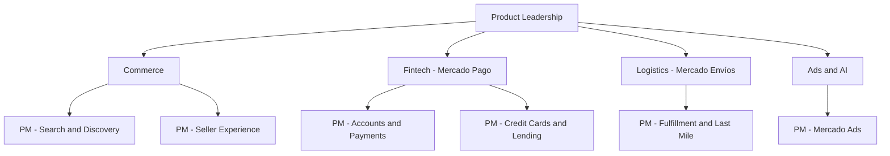

# MercadoLibre Product Manager Interview Guide | 2026 Prep

- **Source:** https://nextsprints.com/guide/mercadolibre-product-manager-interview-guide

- **Type:** `interview-guide`

- **Updated:** October 31, 2026

---

## Introduction

MercadoLibre is Latin America's largest technology company and one of the most interesting places in the world to work as a product manager. It runs two giant businesses side by side: Mercado Libre (Mercado Livre in Brazil), the region's leading e-commerce marketplace, and Mercado Pago, a fintech that has grown from a checkout wallet into a digital bank offering accounts, credit cards, loans, and investments. Around them sit Mercado Envíos (logistics), Mercado Ads (retail media), and the Meli+ loyalty subscription. In Q2 2026 the company reported net revenue of $10.2 billion, up 50% year over year, and in June 2026 reporting it announced plans to seek a banking licence in Mexico to make Mercado Pago the country's leading digital bank.

For students and early-career candidates, MercadoLibre offers rare scale: millions of buyers and sellers across seven-plus countries, and problems spanning commerce, payments, credit, logistics, and AI. It is also a culture-first employer: candidates report that a strong case can still end in rejection if the culture conversation goes poorly.

| Hiring Metric | Value (estimate) |
| --- | --- |
| Primary PM hubs | São Paulo/Osasco, Buenos Aires, Mexico City, Montevideo, Bogotá, Santiago |
| Typical PM process length | 3–6 weeks |
| Interview steps | 4–6, varying by country and business unit |
| Formal APM rotational program | Not publicly advertised as of 2026 |
| Common entry points | Product Analyst, internships (pasantía/estágio), Pioneers Program |

> Candidate Perspective
> Candidates who received offers often say interviewers wanted structured thinking anchored in Latin American realities (informal sellers, installments, long delivery distances, high interest rates) rather than frameworks copied from US tech.

## PM Role

> MercadoLibre Product Manager
> A MercadoLibre Product Manager owns a product area within the commerce or fintech ecosystem (for example, search, seller tools, Envíos, Ads, Mercado Pago credit, or Meli+), working with engineering, UX, data, and business teams to ship experiments quickly and move metrics such as GMV, conversion, delivery speed, TPV, or credit portfolio quality.

Responsibilities:

- Own a problem area end to end, from discovery with buyers or sellers to launch and iteration
- Run frequent A/B tests; candidates often cite the Beta mindset and continuous experimentation as core to the job
- Partner with engineering, UX, data, operations, risk, and legal teams
- Adapt solutions across countries with different regulations and payment habits
- Define success metrics tied to business outcomes: GMV, take rate, delivery promise, NPL, MAU

This chart is an illustrative grouping based on public job postings and product areas, not an official org chart.

Real-world example: The Seller Assistant shows the role in action. MercadoLibre's GenAI assistant helps sellers write listings, answer questions, and manage their stores, and the company reports it is now used by sellers representing nearly half of GMV. PMs had to decide which tasks to automate and how to keep sellers in control.

## Job Requirements

MercadoLibre posts PM roles under titles such as Product Manager, Sr Product Manager, Product Owner, Technical Product Manager, Product Lead, and Expert PM. Entry-level candidates usually start as Product Analysts, interns, or trainees and move into PM after one to three years.

Education:

- Bachelor's degree typical; engineering, computer science, economics, business, and industrial engineering are common
- MBA not required; strong analytical skills matter more

Experience:

- For PM roles: commonly 2–5 years in product, consulting, analytics, or engineering
- For analyst roles and internships: strong data skills and evidence of building something real
- E-commerce, fintech, or logistics exposure is a plus

Technical Skills:

- SQL and data analysis; comfort with dashboards and experiment results
- Understanding of APIs, mobile apps, and platform architecture
- A/B testing and, increasingly, practical GenAI fluency

Soft Skills:

- Clear communication in Portuguese or Spanish, with workable English
- Entrepreneurial ownership and comfort with ambiguity

> Common Pitfalls
> Candidates often design for a well-banked, urban buyer with a credit card and forget the millions of MercadoLibre users who pay in installments, with cash vouchers, or through Mercado Pago credit. Answers that ignore installments (parcelas/meses sin intereses), trust, and delivery distance tend to fall flat.

> Expert Advice
> Learn how the ecosystem makes money: marketplace commissions and shipping fees, advertising, payment processing fees, and interest income from Mercado Pago credit. Linking a feature to these levers signals business judgment.

## Interview Process Breakdown

Candidates report four to six steps over three to six weeks, varying by country and unit. One Glassdoor review from Brazil lists an HR assessment, a case interview, a senior manager conversation, and a stakeholder conversation.

- Initial Application and Screening:

- Talent screen (30 minutes): career story, motivation, language check, salary expectations.
- Hiring manager (45–60 minutes): products you shipped, metrics you moved, why this team.

- Product Interviews:

- Product case (60 minutes): a structured case, sometimes prepared in advance and presented. Examples include improving checkout conversion, designing a seller feature, or growing Mercado Pago usage. For Mercado Envíos roles, candidates report analytical cases on last-mile cost, hub planning, or returns.
- Technical-functional deep dive: data, experiment design, and engineering trade-offs.

- Final Rounds:

- Values and behavioral panel: questions built around MELI's cultural principles, such as creating value for users, entrepreneurial spirit, Beta mindset, executing with excellence, and competing as a team. Candidates report that the process can stop here if fit is weak.
- Peers panel, then a final conversation with a Director or VP on judgment and ambition.

| Stage | Duration | Focus | Tip |
| --- | --- | --- | --- |
| Talent screen | 30 min | Fit, language | Tie "why MELI" to a product you use |
| Hiring manager | 45–60 min | Past impact | Quantify outcomes |
| Product case | 60 min | Structure, user insight | Start with buyer or seller pain in a specific country |
| Technical-functional | 45–60 min | Data, experiments | Test before scaling |
| Culture / peers | 45 min | Values, collaboration | Real stories of ownership |
| Director / VP | 30–45 min | Judgment, ambition | Bring a point of view on the ecosystem |

## Product Manager Compensation & Levels at MercadoLibre

MercadoLibre does not publish a PM ladder. Commonly reported levels run from Product Analyst or Junior PM through PM (semi-senior), Senior PM, Expert PM or Product Lead, and Director. Levels.fyi data shows an average Product Manager total compensation in Brazil of roughly R$367,000 per year, with Senior PMs around R$516,000, and lists MercadoLibre among the top-paying PM employers in São Paulo.

| Level (approximate) | Brazil (BRL/yr TC, 2026 est.) | Mexico (MXN/yr TC, 2026 est.) | USD equivalent |
| --- | --- | --- | --- |
| Product Analyst / Jr PM | R$140K – R$210K | MXN 480K – 720K | ~$26K – $39K |
| Product Manager | R$240K – R$360K | MXN 800K – 1.15M | ~$43K – $67K |
| Senior PM | R$380K – R$560K | MXN 1.25M – 1.8M | ~$68K – $104K |
| Expert PM / Product Lead | R$520K – R$800K | MXN 1.7M – 2.6M | ~$92K – $148K |
| Director | R$900K – R$1.5M | MXN 3M – 4.8M | ~$162K – $278K |

Ranges are estimates (FX assumption: USD 1 = BRL 5.40 = MXN 18.5). Total compensation combines base, annual bonus, and for many roles a long-term retention plan linked to MELI's share price. See the [MercadoLibre Product Manager Salary Guide](/guide/mercadolibre-product-manager-salary-guide) for country detail.

## How to Prepare

MercadoLibre-specific principles to internalize:

1. **Ecosystem thinking:** Commerce drives payments, payments enable credit, credit boosts commerce, and logistics makes the promise real. Strong answers connect at least two of these.
2. **Country context:** Brazil, Mexico, and Argentina differ in payment habits, inflation, regulation, and logistics. Name the market you are designing for.
3. **Beta mindset:** Propose a small, testable version first, with a clear experiment and metric.
4. **Users on both sides:** Balance buyers and sellers, and in fintech, balance growth with credit risk.

Tailor your resume: Lead with measurable outcomes and data skills, and prepare a version in Portuguese or Spanish. For a resume review tailored to MercadoLibre, consider NextSprints' Resume Review service.

Practice product cases: Practice cases across the marketplace, Mercado Pago, Envíos, Ads, and Meli+, focusing on:

- Conversion for first-time online buyers and tools for small sellers
- Credit metrics that balance growth against NPL
- Root cause analysis for delivery or checkout metrics

NextSprints' Product Manager Interview Questions include MercadoLibre-specific cases to practice.

Mock interviews: Practice in the interview language; NextSprints offers PM Coaching for structured mocks.

## FAQs

### Does MercadoLibre have an Associate Product Manager (APM) program for new grads?

As of 2026, MercadoLibre does not publicly advertise a formal APM rotational program. Students usually enter through internships (pasantías in Spanish-speaking countries, estágio in Brazil), Product Analyst or trainee roles, or the Pioneers Program, which secondary sources describe as aimed at advanced students and recent graduates in engineering, data, and product. Many PMs move into product after one to three years in analyst roles.

### How long does the MercadoLibre PM interview process take?

Candidates generally report three to six weeks from the first screen to a decision, with four to six steps. Timelines stretch when a prepared case presentation or a Director or VP conversation needs scheduling.

### Do I need to speak Portuguese or Spanish?

For most PM roles, yes. Interviews are typically held in Portuguese in Brazil and Spanish elsewhere, and daily work happens in those languages. English is often checked as well, but it rarely replaces the local language.

### How important is culture fit in MercadoLibre interviews?

Very important. Candidates report that the values panel can end the process even after a strong case. Interviewers look for entrepreneurial spirit, ownership, teamwork, and the Beta mindset: launching, measuring, and iterating. Prepare specific stories.

### What kinds of product questions does MercadoLibre ask?

Expect cases grounded in the ecosystem: increasing checkout conversion, designing tools for small sellers, growing Mercado Pago credit card adoption without raising defaults, improving same-day delivery in Mexico, or measuring Mercado Ads success.

## Related Guides Section

📖 [MercadoLibre Product Strategy Guide](/guide/mercadolibre-product-strategy-guide) – Deep dive into MercadoLibre's ecosystem strategy across commerce, fintech, and AI.

📖 [MercadoLibre Product Manager Salary Guide](/guide/mercadolibre-product-manager-salary-guide) – Salary bands by level in BRL, MXN, and ARS.

📖 [MercadoLibre Product Teardown Guide](/guide/mercadolibre-marketplace-mercado-pago-product-teardown) – Analysis of the Mercado Libre marketplace and Mercado Pago ecosystem.

Disclaimer: This guide is for PM interview preparation only. It is based on public information and candidate reports and is not affiliated with or endorsed by MercadoLibre.
