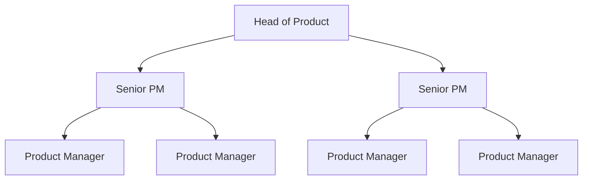
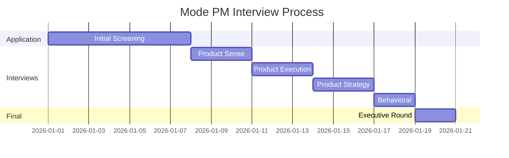

# Mode Product Manager Interview Guide | Full Process & Tips

- **Source:** https://nextsprints.com/guide/mode-product-manager-interview-guide

- **Type:** `interview-guide`

- **Updated:** October 31, 2026

---

## Introduction

Mode's product management culture is uniquely data-driven, reflecting our mission to help every company put their data to work. As a PM at Mode, you'll be at the forefront of analytics innovation, shaping tools that empower data scientists and analysts worldwide. The role of product managers at Mode has never been more crucial, as businesses increasingly rely on data-informed decision-making.

Recent market trends show a surge in demand for advanced analytics platforms, with Mode positioned as a leader in this space. Our PMs play a pivotal role in translating complex data needs into intuitive, powerful features that drive business value for our customers.

| Key Hiring Statistics | Value |
| --- | --- |
| YoY PM team growth | 30% |
| Avg. time-to-hire | 45 days |
| Retention rate | 92% |

> Expert Insight
> Mode's PM interview process is designed to identify candidates who can balance technical depth with business acumen. We look for individuals who can navigate the complexities of data analytics while maintaining a user-centric approach to product development.

## PM Role

> Role Definition
> A Product Manager at Mode leads the development of data analytics features, collaborating with data scientists, engineers, and designers to create innovative solutions that empower data-driven decision-making across industries.

Responsibilities breakdown:

1. Feature conceptualization and roadmap planning
2. Cross-functional team leadership
3. User research and feedback incorporation
4. Data-driven decision making and A/B testing
5. Product strategy alignment with company goals
6. Competitive analysis and market positioning

Team structure:

Comparison with other tech companies:

| Aspect | Mode | Tableau | Looker |
| --- | --- | --- | --- |
| Focus | Data science collaboration | Data visualization | Business intelligence |
| Technical depth | High (SQL, Python) | Medium | Medium |
| User base | Data scientists, analysts | Business users, analysts | Business users |
| Product cycle | Rapid iterations | Longer release cycles | Mixed |

Real examples from Mode's products:

- Developing the Visual Explorer feature for intuitive data exploration
- Enhancing the Python Notebook environment for advanced analytics
- Implementing the Report Builder for customizable dashboards

## Job Requirements

Education:

- Bachelor's degree in Computer Science, Data Science, or related field
- MBA or advanced degree preferred but not required

Experience levels:

- 3+ years of product management experience
- Background in data analytics, business intelligence, or related fields

Technical skills:

- Proficiency in SQL and basic Python
- Understanding of data visualization principles
- Familiarity with machine learning concepts

Soft skills:

- Strong analytical and problem-solving abilities
- Excellent communication and stakeholder management
- User empathy and design thinking

| Requirement | Essential | Preferred |
| --- | --- | --- |
| SQL proficiency | ✓ |  |
| Python knowledge | ✓ |  |
| Data viz experience | ✓ |  |
| ML understanding |  | ✓ |
| PM experience | 3+ years | 5+ years |
| Analytics background | ✓ |  |

Success factors:

1. Ability to translate complex data concepts into user-friendly features
2. Strong prioritization skills in a fast-paced environment
3. Collaborative approach to cross-functional teamwork
4. Data-driven decision making and experimentation mindset

> Common Pitfalls
> Overlooking the technical depth required for Mode's PM role
> Focusing solely on UI/UX without considering underlying data complexities
> Underestimating the importance of SQL proficiency in daily work

> Expert Tips
> Showcase projects where you've worked closely with data scientists or analysts
> Prepare to discuss how you've used data to drive product decisions
> Be ready to demonstrate your SQL skills with practical examples

## Interview Process Breakdown

End-to-end process overview:

1. Initial Application and Screening
2. Product Interviews
3. Final Rounds

Timeline expectations: 3-4 weeks from initial application to offer

Round-by-round breakdown:

- Product Sense: Evaluate your ability to design and improve data analytics features.
- Product Execution: Assess how you measure success and handle trade-offs in product development.
- Product Strategy: Explore your approach to product growth, launches, and long-term vision.
- Behavioral: Gauge cultural fit and leadership potential within Mode's collaborative environment.

Process timeline:

Round-specific details:

| Round | Focus Areas | Duration |
| --- | --- | --- |
| Product Sense | Feature design, user empathy | 60 min |
| Product Execution | Metrics, prioritization | 60 min |
| Product Strategy | Market analysis, roadmap planning | 60 min |
| Behavioral | Leadership, collaboration | 45 min |
| Executive | Vision alignment, culture fit | 30 min |

Practice Mode questions

Product Design

How could Facebook build a feature to help people find roommates?

View

Say you're a WhatsApp PM and want to add more ecommerce functionality. What would you do?

View

How would you build a language learning product for the Facebook app?

View

Product Improvement

How can Mode improve its SQL Editor to streamline complex query writing?

View

How might Mode enhance its collaborative features to facilitate better communication between data teams and stakeholders?

View

What features could Mode add to its data visualization tools to make insights more accessible to non-technical users?

View

Product Success Metrics

What metrics would you use to evaluate Mode's Notebooks for Python and R?

View

How would you define the success of Mode's Visual Explorer for data visualization?

View

How would you measure the success of Mode's SQL Editor feature?

View

Product Trade-Off

For Mode's data visualization tools, how can we optimize for faster rendering speeds without compromising the depth of interactive features?

View

How should Mode balance adding advanced SQL features to its query editor versus maintaining simplicity for less technical users?

View

Should Mode prioritize developing more pre-built report templates or focus on enhancing customization options for existing dashboards?

View

Product Root Cause Analysis

Why has Mode's SQL Editor seen a 20% drop in daily active users over the past month?

View

Why has the adoption rate of Mode's Visual Explorer declined by 15% among enterprise customers this quarter?

View

What caused the sudden spike in error rates for Mode's Python Notebooks feature last week?

View

## Product Manager Compensation & Levels at Mode

Mode's PM level structure aligns with industry standards while reflecting our unique focus on data analytics:

1. Associate Product Manager (APM)
2. Product Manager (PM)
3. Senior Product Manager (SPM)
4. Principal Product Manager
5. Director of Product
6. VP of Product

Salary ranges (based on level.fyi data):

| Level | Total Compensation Range |
| --- | --- |
| APM | $120,000 - $150,000 |
| PM | $150,000 - $200,000 |
| SPM | $200,000 - $280,000 |
| Principal | $280,000 - $350,000 |
| Director | $350,000 - $450,000 |

Note: Compensation includes base salary, bonuses, and equity. Actual figures may vary based on experience, performance, and market conditions.

## How to Prepare

Company Leadership Principles:

1. Data-Driven Decision Making: Use quantitative and qualitative data to inform product choices.
2. User Empathy: Deeply understand the needs of data scientists and analysts.
3. Continuous Innovation: Push boundaries in analytics technology and user experience.
4. Collaborative Problem-Solving: Work across teams to tackle complex data challenges.

Tailor Resume: Focus on quantifiable impacts in your previous roles, especially those related to data products or analytics. Use the STAR method (Situation, Task, Action, Result) to structure your achievements. Highlight any experience with SQL, Python, or data visualization tools. Consider a professional resume review to ensure your application stands out.

Practice Product Cases: Prepare for Mode-specific scenarios involving data analytics features, SQL optimization, or visualization enhancements. Don't just memorize frameworks; practice adapting them to various data-centric problems. Utilize resources like NextSprints' comprehensive database of product manager interview questions to cover a wide range of potential case types.

Practice Mock Interviews: While self-practice is valuable, getting feedback from experienced PMs is crucial. If you don't have access to Mode PMs, consider expert coaching services. NextSprints offers PM coaching with industry veterans who can provide targeted feedback on your interview performance and help you refine your approach to data-centric product cases.

## FAQs

### What sets Mode's PM role apart from other tech companies?

Mode PMs need a unique blend of technical data skills and product intuition. You'll be working closely with data scientists and analysts, so a deep understanding of their workflows and challenges is crucial. Unlike PMs at more general tech companies, you'll need to be comfortable with SQL, basic Python, and data visualization concepts.

### How technical do I need to be to succeed as a PM at Mode?

While you don't need to be a data scientist, a strong technical foundation is essential. Proficiency in SQL is a must, and familiarity with Python is highly valuable. You should be comfortable discussing data models, query optimization, and analytics concepts with both technical and non-technical stakeholders.

### What's the most challenging aspect of the Mode PM interview process?

Candidates often find the product execution round challenging, as it requires balancing technical data considerations with user experience and business goals. Be prepared to discuss how you'd measure the success of a new analytics feature and handle trade-offs between performance and functionality.

### How does Mode approach product development and iteration?

We follow a data-driven, iterative approach. PMs work closely with data scientists to analyze user behavior and feature adoption. We run frequent A/B tests and rely heavily on user feedback. Be prepared to discuss how you've used data to inform product decisions in your past experiences.

### What growth opportunities are available for PMs at Mode?

Mode offers significant growth potential for PMs. As you progress, you can take on larger, more complex features or entire product areas. There's also opportunity to develop leadership skills by mentoring junior PMs and collaborating with executive stakeholders on strategic initiatives.

## Related Guides Section

📖 [Mode Product Strategy Guide](mode-product-strategy-guide) – Deep dive into Mode's product decisions.

📖 [Mode Product Manager Salary Guide](mode-product-manager-salary-guide) – Salary insights & negotiation tips.

📖 [Mode Product Teardown Guide](mode-analytics-product-teardown-analysis) – Analysis of Mode's product positioning.

Disclaimer: This guide is created for product management interview preparation purposes only. The analysis and methodology are based on the public information.
