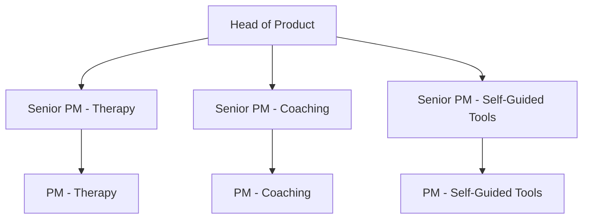
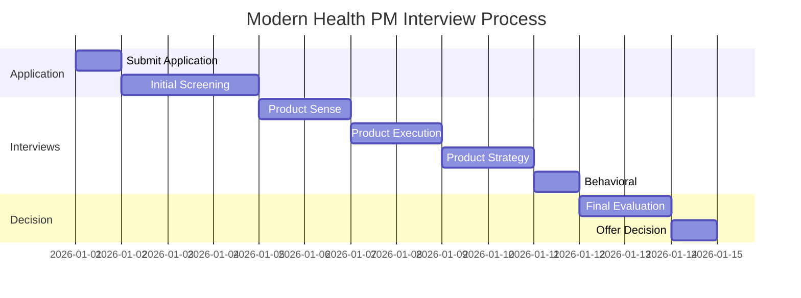

# Modern Health PM Interview Guide | Process & Tips

- **Source:** https://nextsprints.com/guide/modern-health-product-manager-interview-guide

- **Type:** `interview-guide`

- **Updated:** October 31, 2026

---

## Introduction

Modern Health is revolutionizing the mental health landscape with its innovative approach to employee well-being. As a Product Manager at Modern Health, you'll be at the forefront of shaping digital solutions that make a real difference in people's lives. The company's unique PM culture emphasizes empathy, data-driven decision-making, and a deep understanding of mental health challenges.

In 2025, the mental health tech market is projected to reach $30 billion, making the role of Product Managers at Modern Health more crucial than ever. PMs here don't just build features; they craft experiences that support mental wellness and drive positive outcomes for millions of users.

| Key Hiring Statistics | Value |
| --- | --- |
| YoY PM hiring growth | 35% |
| Avg. time to hire | 45 days |
| Retention rate | 92% |

> Expert Insight
> At Modern Health, PMs are expected to be mental health advocates first, technologists second. Your ability to empathize with users' struggles and translate them into impactful digital solutions is what sets our PMs apart.

## PM Role

> Role Definition
> A Product Manager at Modern Health leads the development of digital mental health solutions, balancing user needs, business objectives, and clinical efficacy to create innovative products that improve mental well-being at scale.

Responsibilities:

- Conduct user research to identify mental health needs and pain points
- Collaborate with clinical experts to ensure product efficacy and safety
- Define product strategy and roadmap aligned with company goals
- Work cross-functionally with engineering, design, and data science teams
- Analyze product metrics and user feedback to drive continuous improvement
- Stay updated on mental health trends and emerging technologies

Team Structure:

Comparison with Other Tech Companies:

| Aspect | Modern Health | Google | Facebook |
| --- | --- | --- | --- |
| Focus | Mental health | General tech | Social media |
| User Impact | Direct well-being | Indirect utility | Social connection |
| Domain Expertise | Clinical knowledge | Technical depth | User engagement |

Real Examples:

- Developing an AI-powered mood tracking feature that provides personalized insights
- Creating a seamless therapist-matching algorithm to improve user satisfaction
- Designing a gamified meditation experience to increase user engagement and retention

## Job Requirements

Education:

- Bachelor's degree required, preferably in Psychology, Human-Computer Interaction, or related field
- Master's degree in Business Administration or Public Health is a plus

Experience:

- 5+ years of product management experience in health tech or related industries
- Proven track record of launching and scaling digital health products
- Experience working with mental health professionals or in clinical settings

Technical Skills:

- Proficiency in data analysis and A/B testing methodologies
- Understanding of HIPAA compliance and healthcare data security
- Familiarity with machine learning applications in mental health

Soft Skills:

- Strong empathy and ability to understand diverse mental health needs
- Excellent communication skills to bridge clinical and technical teams
- Strategic thinking and ability to navigate complex healthcare ecosystems

| Requirement | Essential | Preferred |
| --- | --- | --- |
| Health Tech Experience | ✓ |  |
| Clinical Knowledge |  | ✓ |
| Data Analysis | ✓ |  |
| HIPAA Familiarity | ✓ |  |
| ML Understanding |  | ✓ |

Success Factors:

1. Passion for mental health and well-being
2. Ability to translate clinical insights into user-friendly features
3. Data-driven approach to product development
4. Collaborative mindset to work with diverse stakeholders

> Common Pitfalls
> Don't underestimate the importance of clinical validation in product development. Features that seem innovative must always be grounded in mental health best practices and evidence-based approaches.

> Expert Tips
> Immerse yourself in the mental health space. Read clinical journals, attend therapy sessions (if comfortable), and engage with mental health professionals to gain deeper insights into user needs and challenges.

## Interview Process Breakdown

End-to-end Process Overview:

1. Initial Application and Screening
2. Product Interviews
3. Final Rounds

Timeline Expectations: 3-4 weeks from initial application to offer

Round-by-round Breakdown:

- Product Sense: Evaluate your ability to design user-centric mental health solutions and improve existing features for better outcomes.

- Product Execution: Assess your skills in defining success metrics for mental health products and analyzing root causes of user engagement issues.

- Product Strategy: Test your ability to develop growth strategies for mental health platforms and plan successful product launches in the healthcare space.

- Behavioral: Explore your leadership potential, cultural fit, and alignment with Modern Health's mission and values.

Process Timeline:

Round-specific Details:

| Round | Focus | Duration | Interviewer |
| --- | --- | --- | --- |
| Product Sense | Mental health UX design | 60 min | Senior PM |
| Product Execution | Metrics & analysis | 60 min | Director of Product |
| Product Strategy | Growth & launch planning | 60 min | VP of Product |
| Behavioral | Leadership & culture fit | 45 min | People Ops |

Practice Modern Health questions

Product Design

How could Facebook build a feature to help people find roommates?

View

Say you're a WhatsApp PM and want to add more ecommerce functionality. What would you do?

View

How would you build a language learning product for the Facebook app?

View

Product Improvement

How can Modern Health improve its digital therapy sessions to better support clients with social anxiety?

View

What innovative features could Modern Health add to its mobile app to increase daily engagement with mental wellness activities?

View

How might Modern Health expand its corporate wellness programs to address burnout more effectively in high-stress industries?

View

Product Success Metrics

How would you define the success of Modern Health's employer-focused mental health programs?

View

How would you measure the success of Modern Health's digital therapy sessions?

View

What metrics would you use to evaluate Modern Health's personalized wellness plans?

View

Product Trade-Off

How can Modern Health balance the desire for personalized user experiences with the need to maintain data privacy and security in its digital mental health platform?

View

Should Modern Health prioritize expanding its coaching network to offer more diverse expertise or focus on deepening relationships with existing coaches to improve service quality?

View

For Modern Health's self-guided content, should we emphasize producing a wider variety of topics or invest in creating more in-depth resources for core mental health issues?

View

Product Root Cause Analysis

Why has Modern Health's digital therapy program seen a 15% drop in user engagement over the past month?

View

What caused the sudden 30% decrease in new client sign-ups for Modern Health's coaching services last quarter?

View

Why has Modern Health's mobile app rating declined from 4.5 to 3.8 stars in the past two weeks?

View

## Product Manager Compensation & Levels at Modern Health

Modern Health's PM level structure aligns with industry standards while reflecting the company's focus on mental health expertise:

1. Associate Product Manager (APM)
2. Product Manager (PM)
3. Senior Product Manager (SPM)
4. Principal Product Manager (PPM)
5. Director of Product
6. VP of Product

Salary Ranges (based on level.fyi data):

| Level | Total Compensation Range |
| --- | --- |
| APM | $120,000 - $150,000 |
| PM | $150,000 - $200,000 |
| SPM | $200,000 - $280,000 |
| PPM | $280,000 - $350,000 |
| Director | $350,000 - $500,000 |
| VP | $500,000+ |

Note: Compensation includes base salary, bonuses, and equity. Actual figures may vary based on experience, location, and performance.

## How to Prepare

Company Leadership Principles:

1. User Empathy: Deeply understand and advocate for mental health needs
2. Evidence-Based Innovation: Ground product decisions in clinical research
3. Inclusive Well-being: Design for diverse mental health experiences
4. Measurable Impact: Focus on outcomes that improve users' lives

Tailor Resume: Highlight your impact on user well-being and mental health outcomes. Use the STAR method to showcase how you've improved mental health products or services. Quantify your achievements with metrics like user engagement, clinical efficacy, or business growth. Our team at NextSprints can provide expert feedback on your PM resume to ensure it stands out.

Practice Product Cases: Focus on mental health-specific scenarios. Adapt frameworks to address unique challenges in the mental health space, such as user privacy, clinical efficacy, and engagement in sensitive topics. Practice balancing business goals with ethical considerations and user well-being. NextSprints offers a comprehensive database of product manager interview questions, including mental health tech scenarios, to help you prepare effectively.

Practice Mock Interviews: Seek feedback from professionals with mental health product experience. Role-play scenarios that combine product skills with mental health domain knowledge. If you don't have access to mental health tech PMs, NextSprints provides expert PM coaching tailored to mental health product roles, offering invaluable insights and live feedback.

## FAQs

### What makes a successful PM at Modern Health?

Successful PMs at Modern Health combine strong product skills with a deep passion for mental health. They excel at translating clinical insights into user-friendly features, are data-driven in their approach, and can navigate the complexities of the healthcare industry while maintaining a focus on user well-being.

### How technical do I need to be for this role?

While you don't need to be a developer, a solid understanding of technology is crucial. Familiarity with data analysis, A/B testing, and basic machine learning concepts is important. More critical is your ability to understand the technical implications of mental health product decisions and communicate effectively with engineering teams.

### How does Modern Health approach product development differently from other tech companies?

Modern Health's product development process is deeply rooted in clinical research and mental health best practices. We prioritize evidence-based features and often collaborate with mental health professionals in the design process. User privacy and data security are paramount, given the sensitive nature of mental health information.

### What kind of growth opportunities are there for PMs at Modern Health?

Modern Health offers significant growth opportunities as the mental health tech space expands. PMs can progress from managing individual features to overseeing entire product lines or specializing in areas like AI-driven therapy or corporate wellness programs. There's also potential to move into strategic roles focusing on partnerships with healthcare providers or expanding into new markets.

### How does Modern Health measure the success of its products?

Success at Modern Health is measured through a combination of user engagement metrics, clinical outcomes, and business growth. We track traditional product metrics like user retention and satisfaction, but also unique measures like improvements in mental health assessments, therapy completion rates, and overall well-being scores for our user base.

## Related Guides Section

📖 [Modern Health Product Strategy Guide](modern-health-product-strategy-guide) – Deep dive into Modern Health's product decisions.

📖 [Modern Health Product Manager Salary Guide](modern-health-product-manager-salary-guide) – Salary insights & negotiation tips.

📖 [Modern Health Product Teardown Guide](modern-health-product-teardown-analysis) – Analysis of Modern Health's product positioning.

Disclaimer: This guide is created for product management interview preparation purposes only. The analysis and methodology are based on the public information.
