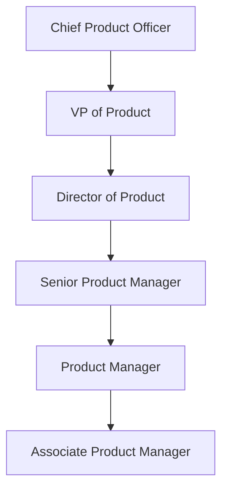

# MongoDB Product Manager Interview Guide | Full Process & Tips

- **Source:** https://nextsprints.com/guide/mongodb-product-manager-interview-guide

- **Type:** `interview-guide`

- **Updated:** October 31, 2026

---

## Introduction

MongoDB's product management culture is uniquely positioned at the intersection of database technology and developer experience. As a PM at MongoDB, you'll be at the forefront of shaping how developers interact with data, driving innovation in cloud services, and expanding the reach of document databases across industries.

The database market is experiencing rapid growth, with cloud-native solutions leading the charge. MongoDB's role in this landscape is pivotal, making the PM position crucial for steering product strategy and execution. In 2026, we're seeing an increased focus on AI integration, edge computing capabilities, and enhanced security features – all areas where strong product leadership is essential.

| Hiring Metric | Value |
| --- | --- |
| YoY PM Hiring Growth | 25% |
| Average Time-to-Hire | 45 days |
| Retention Rate | 92% |

> Expert Insight
> MongoDB's PM team is known for its deep technical expertise combined with a keen understanding of developer needs. Our most successful PMs often come from engineering backgrounds but have developed a strong product sense through hands-on experience.

## PM Role

> MongoDB PM Role
> A Product Manager at MongoDB leads the vision, strategy, and execution of database products and cloud services that empower developers to build innovative applications quickly and efficiently.

Responsibilities breakdown:

- Define product vision and strategy aligned with MongoDB's overall mission
- Collaborate with engineering to prioritize features and manage the product backlog
- Conduct market research and competitive analysis to inform product decisions
- Work closely with sales and marketing to drive product adoption and revenue growth
- Analyze product metrics and user feedback to continuously improve offerings

| Aspect | MongoDB PM | Google PM | Amazon PM |
| --- | --- | --- | --- |
| Technical Depth | High (Database expertise) | Moderate | Moderate to High |
| User Focus | Developers | Consumers/Enterprises | Consumers/Businesses |
| Product Type | B2B SaaS/Database | Various (Search, Ads, Cloud) | E-commerce, Cloud, Devices |

Real examples from MongoDB's products:

- Atlas: Our cloud database service required PMs to balance ease of use with powerful features for scaling and security.
- Realm: PMs worked on integrating this mobile database solution seamlessly with our core offerings, focusing on offline-first capabilities.
- Data API: Product managers drove the development of RESTful APIs to simplify database interactions for developers across various programming languages.

## Job Requirements

Education:

- Bachelor's degree in Computer Science, Engineering, or related technical field
- MBA or advanced degree preferred but not required

Experience:

- 5+ years of product management experience in the database, cloud services, or developer tools space
- Proven track record of shipping successful B2B software products

Technical skills:

- Strong understanding of database technologies and cloud architecture
- Familiarity with multiple programming languages and development frameworks
- Experience with agile methodologies and project management tools

Soft skills:

- Excellent communication and presentation abilities
- Strong analytical and problem-solving skills
- Leadership and cross-functional collaboration expertise

| Requirement | Essential | Preferred |
| --- | --- | --- |
| Technical Background | ✓ |  |
| PM Experience | ✓ |  |
| Database Knowledge | ✓ |  |
| MBA |  | ✓ |
| Cloud Expertise |  | ✓ |

Success factors:

1. Ability to translate complex technical concepts into clear value propositions
2. Data-driven decision-making skills
3. Empathy for developer needs and pain points
4. Strategic thinking with a focus on long-term product vision

> Common Pitfalls
> Underestimating the technical depth required for MongoDB PM roles
> Focusing too much on features without considering the broader ecosystem impact
> Neglecting the importance of community engagement in the open-source aspects of our products

> Expert Tips
> Contribute to open-source projects to demonstrate your understanding of developer workflows
> Stay updated on emerging database technologies and cloud computing trends
> Develop a strong network within the developer community through meetups and conferences

## Interview Process Breakdown

MongoDB's PM interview process is designed to assess candidates' technical knowledge, product sense, and cultural fit. Here's an overview of what to expect:

| Stage | Duration | Focus Areas |
| --- | --- | --- |
| Phone Screen | 30-45 min | Resume review, basic technical questions |
| Product Interviews | 3-4 hours | Product sense, execution, strategy |
| Final Rounds | 2-3 hours | Leadership, cultural fit |

Detailed breakdown:

- Initial Application and Screening:

- Resume review by HR
- 30-minute phone screen with a recruiter

- Product Interviews:
- Product Sense: Evaluate your ability to design and improve products that meet user needs and business objectives.
- Product Execution: Assess your skills in defining metrics, analyzing data, and making trade-off decisions.
- Product Strategy: Test your strategic thinking, market understanding, and ability to drive product growth.

- Final Rounds:

- Leadership interview with a senior product executive
- Cultural fit assessment

Timeline expectations:

- From application to offer: 4-6 weeks
- Each interview round is typically scheduled within 1-2 weeks of the previous one

Practice MongoDB questions

Product Design

How could Facebook build a feature to help people find roommates?

View

Say you're a WhatsApp PM and want to add more ecommerce functionality. What would you do?

View

How would you build a language learning product for the Facebook app?

View

Product Improvement

In what ways can we improve MongoDB's aggregation framework to handle more complex data transformations efficiently?

View

How can we enhance MongoDB Atlas's data visualization capabilities for non-technical users?

View

What innovative features could be added to MongoDB Compass to streamline database management?

View

Product Success Metrics

how would you measure the success of mongodb's document-based data model?

View

how would you measure the success of mongodb's atlas search feature?

View

how would you define the success of mongodb's data api service?

View

Product Trade-Off

Is expanding cloud services worth the potential cannibalization of MongoDB's on-premises deployments?

View

Should MongoDB prioritize ease of use for developers or advanced features for power users?

View

How can MongoDB balance data consistency with system performance?

View

Product Root Cause Analysis

Why are we seeing a 25% decrease in document writes per second for MongoDB's time-series collections over the past 48 hours?

View

What's causing the sudden 50% increase in query latency for sharded collections in MongoDB 6.0?

View

Why has the number of new MongoDB Atlas cluster creations dropped by 30% this week compared to the previous month's average?

View

## Product Manager Compensation & Levels at MongoDB

MongoDB's PM career ladder is designed to reward both individual contribution and leadership skills:

1. Associate Product Manager (APM)
2. Product Manager (PM)
3. Senior Product Manager (SPM)
4. Principal Product Manager
5. Director of Product Management
6. VP of Product

Salary ranges (based on level.fyi data for 2026):

| Level | Total Compensation Range |
| --- | --- |
| APM | $120,000 - $150,000 |
| PM | $150,000 - $220,000 |
| SPM | $220,000 - $350,000 |
| Principal | $350,000 - $500,000 |
| Director | $500,000 - $700,000 |

Note that these ranges include base salary, bonuses, and stock options. Actual compensation may vary based on location, experience, and performance.

## How to Prepare

Leadership Principles: At MongoDB, we value:

1. Think Big, Go Far: We encourage bold ideas that can transform the database industry.
2. Make It Matter: Focus on high-impact work that drives meaningful outcomes for our users.
3. Embrace the Power of Differences: Diversity in thought and background leads to better products.
4. Build Together: Collaboration is key in our complex technical environment.

Tailor Your Resume:

- Highlight projects where you've driven significant impact, using clear metrics (e.g., "Increased user adoption by 40% through redesign of onboarding flow").
- Showcase your technical depth, especially in areas relevant to MongoDB's products.
- Use the STAR method to structure your achievements, focusing on challenges you've overcome in product development.

For personalized feedback on your PM resume, consider using NextSprints' Resume Review service.

Practice Product Cases: Develop a structured approach to product cases, focusing on:

- User-centric design thinking
- Data-driven decision making
- Technical feasibility considerations
- Business impact analysis

Don't just memorize frameworks – practice adapting them to different scenarios. NextSprints offers a comprehensive database of Product Manager Interview Questions to help you prepare.

Practice Mock Interviews: While self-practice is valuable, getting feedback from experienced PMs is crucial. If you don't have access to senior PMs in your network, consider NextSprints' PM Coaching for expert-led mock interviews and personalized feedback.

## FAQs

### How technical do I need to be for a MongoDB PM role?

While you don't need to be a database expert, a strong technical foundation is crucial. You should be comfortable discussing database concepts, cloud architecture, and have some coding knowledge. Your ability to communicate effectively with engineers and understand the technical implications of product decisions is key.

### What's the typical career progression for a PM at MongoDB?

Most PMs start at the PM or Senior PM level, depending on experience. From there, progression often follows: Senior PM → Principal PM → Director → VP. The timeline varies, but expect to spend 2-3 years at each level before advancement.

### How does MongoDB's PM team collaborate with open-source contributors?

Our PMs play a crucial role in bridging the open-source community with our commercial products. This involves participating in community forums, considering community contributions for product roadmaps, and ensuring our open-source offerings align with our overall strategy.

### What sets MongoDB's PM interview process apart from other tech companies?

MongoDB's process places a heavier emphasis on technical understanding of database concepts and cloud infrastructure. We also look for PMs who can think strategically about developer experience and enterprise needs simultaneously.

### How important is prior experience in the database industry for PM candidates?

While database experience is valuable, it's not always necessary. We value candidates with strong product sense, technical aptitude, and the ability to learn quickly. Experience in adjacent fields like cloud services, developer tools, or enterprise software can be equally relevant.

## Related Guides Section

📖 [MongoDB Product Strategy Guide](mongodb-product-strategy-guide) – Deep dive into MongoDB's product decisions.

📖 [MongoDB Product Manager Salary Guide](mongodb-product-manager-salary-guide) – Salary insights & negotiation tips.

📖 [MongoDB Product Teardown Guide](mongodb-product-manager-teardown-analysis) – Analysis of MongoDB's product positioning.

Disclaimer: This guide is created for product management interview preparation purposes only. The analysis and methodology are based on the public information.
