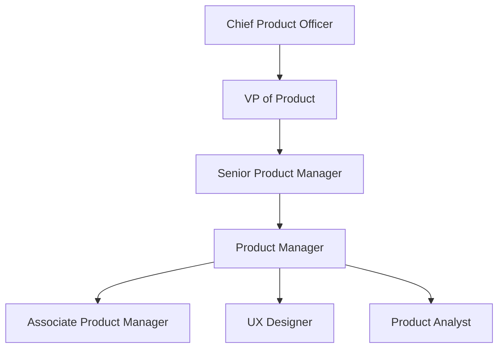

# Paylocity Product Manager Interview Guide | 2026 Insights

- **Source:** https://nextsprints.com/guide/paylocity-product-manager-interview-guide

- **Type:** `interview-guide`

- **Updated:** October 31, 2026

---

## Introduction

Paylocity's product management culture is a unique blend of innovation and employee-centric solutions. As a leader in cloud-based HR and payroll software, our PMs are at the forefront of revolutionizing workforce management. The role of a Product Manager at Paylocity is more crucial than ever, given the rapid evolution of workplace technologies and the increasing demand for seamless, integrated HR solutions.

In 2026, we're seeing a significant shift towards AI-driven HR tools and predictive analytics in payroll systems. Paylocity's product managers are key drivers in this transformation, balancing cutting-edge technology with user-friendly interfaces that cater to diverse workforce needs.

| Hiring Metric | Value |
| --- | --- |
| YoY PM hiring growth | 15% |
| Average time-to-hire | 45 days |
| Retention rate | 92% |

> Insider Perspective
> At Paylocity, we value PMs who can navigate the complexities of HR tech while maintaining a strong focus on user experience. Our most successful candidates demonstrate a deep understanding of both technology trends and human resource challenges.

## PM Role

> Paylocity PM Role
> A Product Manager at Paylocity leads the development and optimization of HR and payroll software solutions, balancing technological innovation with practical business needs and user experience.

Responsibilities:

- Define product vision and strategy aligned with Paylocity's mission
- Conduct market research and competitor analysis
- Collaborate with engineering, design, and sales teams
- Prioritize features and manage product roadmap
- Analyze user data and feedback for continuous improvement
- Ensure compliance with HR and payroll regulations

Team Structure:

Comparison with other tech companies:

| Aspect | Paylocity | Workday | ADP |
| --- | --- | --- | --- |
| Focus | Mid-market HR tech | Enterprise HR solutions | Broad payroll services |
| Tech Stack | Cloud-native, AI-driven | Cloud-based, legacy integration | Mix of cloud and on-premise |
| PM Autonomy | High | Moderate | Varies by division |

Real Example: Our PMs recently led the development of Paylocity's AI-powered performance review tool, which uses natural language processing to provide actionable insights from employee feedback.

## Job Requirements

Education:

- Bachelor's degree in Computer Science, Business, or related field
- MBA or advanced degree preferred

Experience:

- 5+ years in product management, preferably in HR tech or SaaS
- Proven track record of successful product launches

Technical Skills:

- Proficiency in data analysis and SQL
- Understanding of cloud technologies and API integrations
- Familiarity with Agile methodologies

Soft Skills:

- Strong leadership and communication abilities
- Strategic thinking and problem-solving aptitude
- Empathy and user-centric mindset

| Requirement | Essential | Preferred |
| --- | --- | --- |
| Education | Bachelor's | MBA |
| Experience | 5+ years | 7+ years in HR tech |
| Technical | Data analysis, SQL | Machine learning, AI |
| Soft Skills | Leadership, communication | Change management |

Success Factors:

1. Ability to balance technical depth with business acumen
2. Proactive approach to regulatory compliance in HR tech
3. Skill in translating complex HR processes into user-friendly solutions

> Common Pitfalls
> Avoid focusing solely on technical aspects without considering the human element of HR solutions. Paylocity values PMs who understand the end-user's daily challenges.

> Expert Advice
> Showcase your ability to simplify complex HR workflows through your past projects. Highlight any experience with AI or predictive analytics in your applications.

## Interview Process Breakdown

Paylocity's PM interview process is designed to thoroughly assess candidates' skills, cultural fit, and potential for growth within our innovative HR tech environment.

Timeline: Typically 3-4 weeks from initial application to offer.

Round-by-Round Breakdown:

1. Initial Application and Screening Resume review and initial phone screen with recruiter Basic technical and cultural fit assessment
2. Product Interviews Product Sense: Evaluate product design and improvement skills Product Execution: Assess metrics analysis and trade-off decision making Product Strategy: Gauge strategic thinking and market understanding
3. Final Rounds Leadership interview with senior product executives Cross-functional panel with engineering and design leads

| Round | Focus | Duration |
| --- | --- | --- |
| Phone Screen | Initial fit | 30 min |
| Product Sense | Design thinking | 60 min |
| Product Execution | Analytical skills | 60 min |
| Product Strategy | Strategic vision | 60 min |
| Leadership | Cultural alignment | 45 min |
| Panel | Cross-functional collaboration | 60 min |

Practice Paylocity questions

Product Design

How could Facebook build a feature to help people find roommates?

View

Say you're a WhatsApp PM and want to add more ecommerce functionality. What would you do?

View

How would you build a language learning product for the Facebook app?

View

Product Improvement

How can Paylocity enhance its mobile app to streamline employee time tracking and approval processes?

View

In what ways can Paylocity improve its payroll tax filing services to reduce complexity for multi-state employers?

View

What features could Paylocity add to its performance management tools to better support continuous feedback and goal alignment?

View

Product Success Metrics

How would you measure the success of Paylocity's Employee Self-Service Portal?

View

What metrics would you use to evaluate Paylocity's Payroll Tax Management solution?

View

How would you define the success of Paylocity's Time and Attendance tracking feature?

View

Product Trade-Off

How can Paylocity balance the customization options in its payroll system to meet diverse client needs while maintaining ease of use and system stability?

View

For Paylocity's mobile app, should development efforts focus on expanding self-service capabilities for employees or enhancing manager-specific functions like time-off approvals and scheduling?

View

Should Paylocity prioritize adding more advanced analytics features to its Workforce Intelligence tool or focus on simplifying the user interface for easier adoption by HR managers?

View

Product Root Cause Analysis

How can we explain the sudden decline in adoption rates for Paylocity's mobile time tracking app among new clients this quarter?

View

What factors are causing the increased error rate in Paylocity's payroll processing module during the latest tax season?

View

Why has Paylocity's employee self-service portal seen a 15% drop in active users over the past month?

View

## Product Manager Compensation & Levels at Paylocity

Paylocity's PM career ladder reflects our commitment to growth and innovation:

1. Associate Product Manager (APM)
2. Product Manager (PM)
3. Senior Product Manager (SPM)
4. Principal Product Manager
5. Director of Product Management

Salary ranges (based on level.fyi data, adjusted for 2026 projections):

| Level | Base Salary Range | Total Compensation Range |
| --- | --- | --- |
| APM | $80,000 - $100,000 | $90,000 - $120,000 |
| PM | $110,000 - $140,000 | $130,000 - $180,000 |
| SPM | $140,000 - $180,000 | $170,000 - $240,000 |
| Principal | $180,000 - $220,000 | $220,000 - $300,000 |
| Director | $200,000 - $250,000 | $250,000 - $350,000 |

Note: Compensation varies based on experience, location, and performance. Equity and bonuses are significant components of total compensation, especially at higher levels.

## How to Prepare

Leadership Principles:

1. Customer Obsession: Prioritize client needs in all product decisions
2. Innovation at Scale: Push boundaries while ensuring scalability
3. Data-Driven Decision Making: Leverage analytics for informed choices
4. Collaborative Excellence: Foster cross-functional teamwork

Tailor Resume:

- Highlight projects that demonstrate impact on user engagement or revenue
- Use metrics to quantify achievements (e.g., "Increased user adoption by 30%")
- Showcase experience with HR tech or related SaaS products
- Emphasize skills in data analysis and strategic planning

For expert resume review tailored to Paylocity's expectations, consider using NextSprints' Resume Review service ([https://nextsprints.com/resume-review](https://nextsprints.com/resume-review)).

Practice Product Cases: Focus on cases that reflect Paylocity's challenges:

- Designing intuitive interfaces for complex HR processes
- Implementing AI for predictive analytics in payroll systems
- Strategizing product launches in competitive HR tech markets

Adapt your approach dynamically based on the specific scenario. For a comprehensive database of relevant practice questions, check out NextSprints' Product Manager Interview Questions ([https://nextsprints.com/product-manager-interview-questions](https://nextsprints.com/product-manager-interview-questions)).

Practice Mock Interviews: Engage in mock interviews that simulate Paylocity's process:

- Product sense rounds focusing on HR tech user experiences
- Execution scenarios involving payroll system optimizations
- Strategy discussions on expanding Paylocity's market share

For expert-led mock interviews with personalized feedback, consider NextSprints' PM Coaching sessions ([https://nextsprints.com/pm-coaching](https://nextsprints.com/pm-coaching)).

## FAQs

### What sets Paylocity's PM role apart from other tech companies?

Paylocity PMs uniquely blend HR domain expertise with cutting-edge tech skills. We focus on creating intuitive solutions for complex workforce management challenges, requiring a deep understanding of both human resources processes and emerging technologies like AI and predictive analytics.

### How important is prior HR tech experience for Paylocity PM candidates?

While HR tech experience is valuable, it's not mandatory. We value candidates with strong product sense, analytical skills, and the ability to quickly grasp and simplify complex business processes. Demonstrating these skills, even from different industries, can make you a strong candidate.

### What's the career progression like for PMs at Paylocity?

Paylocity offers a clear growth path from Associate PM to Director level. We emphasize both vertical progression and horizontal expansion of responsibilities. PMs often have opportunities to lead larger product lines or explore new market segments as they advance.

### How does Paylocity approach work-life balance for PMs?

We prioritize a healthy work-life balance, offering flexible work arrangements and focusing on outcomes rather than hours worked. Our culture encourages efficiency and innovation during work hours, allowing PMs to maintain a fulfilling life outside of work.

### What's the most challenging aspect of being a PM at Paylocity?

The most challenging aspect is often balancing innovation with regulatory compliance in the HR space. PMs must navigate complex labor laws and data privacy regulations while pushing the boundaries of what's possible in HR tech. This requires constant learning and adaptability.

## Related Guides Section

📖 [Paylocity Product Strategy Guide](paylocity-product-strategy-guide) – Deep dive into Paylocity's product decisions.

📖 [Paylocity Product Manager Salary Guide](paylocity-product-manager-salary-guide) – Salary insights & negotiation tips.

📖 [Paylocity Product Teardown Guide](paylocity-hcm-product-teardown-analysis) – Analysis of Paylocity's product positioning.

Disclaimer: This guide is created for product management interview preparation purposes only. The analysis and methodology are based on the public information.
