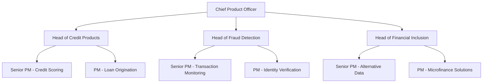
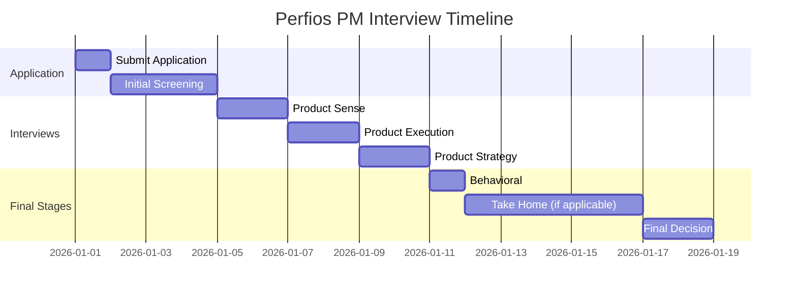

# Perfios Product Manager Interview Guide | Fintech Innovation

- **Source:** https://nextsprints.com/guide/perfios-software-solutions-pvt-product-manager-interview-guide

- **Type:** `interview-guide`

- **Updated:** October 31, 2026

---

## Introduction

Perfios Software Solutions Pvt has cultivated a unique product management culture that blends innovation with data-driven decision-making. As a fintech leader, our PMs are at the forefront of revolutionizing financial services through cutting-edge technology. The role of a Product Manager at Perfios is more critical than ever, as we navigate the complex landscape of financial data analytics and automation.

In recent years, the demand for skilled PMs in the fintech sector has skyrocketed. Perfios has been at the center of this growth, expanding our product team to meet the evolving needs of financial institutions and consumers alike. Our PMs are instrumental in shaping the future of credit decisioning, fraud detection, and financial inclusion.

| Hiring Metric | Value |
| --- | --- |
| YoY PM team growth | 35% |
| Avg. time to hire | 45 days |
| Retention rate | 92% |

> Expert Insight
> At Perfios, we look for PMs who can balance technical acumen with a deep understanding of financial services. The ability to translate complex financial processes into user-friendly products is what sets our top performers apart.

## PM Role

> Role Definition
> A Product Manager at Perfios is responsible for driving the development and success of our financial technology solutions, from ideation to market launch and beyond.

Responsibilities of a Perfios PM include:

- Conducting market research to identify opportunities in the fintech space
- Defining product vision and strategy aligned with Perfios' goals
- Collaborating with engineering, data science, and design teams
- Managing the product roadmap and prioritizing features
- Analyzing product performance metrics and user feedback
- Ensuring compliance with financial regulations and data security standards

Team structure:

Comparison with other tech companies:

| Aspect | Perfios | Google | Amazon |
| --- | --- | --- | --- |
| Focus | Financial technology | Diverse tech products | E-commerce & cloud |
| Technical depth | High (finance + tech) | Varies by product | High |
| User base | B2B (financial institutions) | B2C & B2B | Primarily B2C |
| Regulatory considerations | Extensive | Moderate | Moderate |

Real examples from Perfios products:

- Our PMs led the development of PerfiosX, an end-to-end credit decisioning platform that reduced loan processing times by 70% for our banking clients.
- The fraud detection team recently launched an AI-powered system that increased fraud prevention rates by 40% while reducing false positives by 25%.

## Job Requirements

Education:

- Bachelor's degree in Computer Science, Engineering, or related field required
- MBA or Master's in a relevant field preferred

Experience:

- Minimum 5 years of product management experience
- At least 2 years in fintech or financial services

Technical skills:

- Strong understanding of data analytics and machine learning concepts
- Familiarity with financial processes (credit scoring, underwriting, etc.)
- Proficiency in SQL and data visualization tools
- Experience with Agile methodologies

Soft skills:

- Excellent communication and stakeholder management
- Strategic thinking and problem-solving abilities
- Strong leadership and team collaboration

| Requirement | Essential | Preferred |
| --- | --- | --- |
| Education | Bachelor's in CS/Engineering | MBA/Master's |
| Experience | 5+ years in PM | 2+ years in fintech |
| Technical skills | Data analytics, SQL | Machine learning |
| Soft skills | Communication, leadership | Financial domain expertise |

Success factors:

1. Ability to translate complex financial concepts into user-friendly products
2. Data-driven decision-making skills
3. Adaptability to rapidly changing fintech landscape
4. Strong product vision aligned with market needs

> Common Pitfalls
> Overlooking regulatory requirements in product development
> Focusing solely on features without considering scalability
> Neglecting the importance of data security in financial products

> Expert Tips
> Develop a deep understanding of Perfios' target market (banks, NBFCs, etc.)
> Stay updated on fintech trends and emerging technologies
> Build relationships across engineering, data science, and business teams

## Interview Process Breakdown

End-to-end process overview:

1. Initial Application and Screening
2. Product Interviews
3. Final Rounds

Timeline expectations: 3-4 weeks from initial application to offer

Round-by-round breakdown:

- Product Sense: Assess your ability to design and improve financial products that meet user needs and business objectives.

- Product Execution: Evaluate your skills in defining success metrics, analyzing product performance, and making data-driven decisions.

- Product Strategy: Test your strategic thinking in areas like product growth, market expansion, and competitive positioning within the fintech space.

- Behavioral: Assess cultural fit and leadership potential through situational and experience-based questions.

- Take Home Assignment: Some candidates may be asked to complete a product case study related to Perfios' core offerings.

Process timeline:

Round-specific details:

| Round | Focus Areas | Duration |
| --- | --- | --- |
| Product Sense | UX design, product improvement | 60 min |
| Product Execution | Metrics, analysis, trade-offs | 60 min |
| Product Strategy | Growth, launch strategy | 60 min |
| Behavioral | Leadership, collaboration | 45 min |
| Take Home | End-to-end product case | 3-5 days |

Practice Perfios Software Solutions Pvt questions

Product Design

How could Facebook build a feature to help people find roommates?

View

Say you're a WhatsApp PM and want to add more ecommerce functionality. What would you do?

View

How would you build a language learning product for the Facebook app?

View

Product Improvement

What improvements could Perfios Software Solutions Pvt make to its income verification system to increase accuracy and reduce processing time?

View

How can Perfios Software Solutions Pvt enhance its bank statement analysis tool to provide more actionable insights for lenders?

View

In what ways can Perfios Software Solutions Pvt expand the capabilities of its fraud detection algorithms within its credit underwriting platform?

View

Product Success Metrics

How would you measure the success of Perfios Software Solutions Pvt's automated bank statement analysis tool?

View

What metrics would you use to evaluate Perfios Software Solutions Pvt's credit decisioning engine?

View

How would you define the success of Perfios Software Solutions Pvt's digital lending platform?

View

Product Trade-Off

How can Perfios Software Solutions Pvt balance data security measures with the need for seamless integration of its bank statement analysis tool into clients' existing systems?

View

For Perfios Software Solutions Pvt's fraud detection solution, should development efforts focus on improving accuracy or reducing false positives to minimize customer friction?

View

Should Perfios Software Solutions Pvt prioritize adding more advanced features to its credit decisioning platform or focus on simplifying the user interface for wider adoption?

View

Product Root Cause Analysis

Why has Perfios Software Solutions Pvt's credit decisioning engine seen a 15% drop in accuracy rates over the past month?

View

What factors are contributing to the 30% increase in processing time for Perfios Software Solutions Pvt's bank statement analysis tool in the last quarter?

View

Why has customer adoption of Perfios Software Solutions Pvt's digital onboarding solution decreased by 25% among small business clients since the latest update?

View

## Product Manager Compensation & Levels at Perfios

Perfios follows a structured leveling system for Product Managers, reflecting the company's growth and the increasing responsibilities of the role.

Level structure:

- Associate Product Manager (APM)
- Product Manager (PM)
- Senior Product Manager (SPM)
- Principal Product Manager (PPM)
- Director of Product Management

Salary ranges (based on level.fyi data and internal insights):

| Level | Total Compensation Range (INR) |
| --- | --- |
| APM | 15 - 25 Lakhs |
| PM | 25 - 40 Lakhs |
| SPM | 40 - 60 Lakhs |
| PPM | 60 - 90 Lakhs |
| Director | 90+ Lakhs |

Note: These ranges include base salary, bonuses, and stock options. Actual compensation may vary based on experience, performance, and market conditions.

## How to Prepare

Company Leadership Principles:

1. Customer-Centric Innovation: Always prioritize solving real customer problems in the financial sector.
2. Data-Driven Decision Making: Leverage analytics to inform product strategy and execution.
3. Regulatory Compliance: Ensure all products meet the highest standards of financial regulations and data security.
4. Continuous Learning: Stay ahead in the fast-paced fintech landscape through constant upskilling.

Tailor Resume: Focus on quantifiable impacts in your previous roles. Use the STAR method to highlight your achievements in product management, especially those related to fintech or financial services. Emphasize any experience with data analytics, machine learning, or financial products. Our resume review service can help you optimize your application for Perfios' specific requirements.

Practice Product Cases: Perfios' product cases often involve complex financial scenarios. Practice structuring your thoughts around credit decisioning, fraud detection, and financial inclusion challenges. Familiarize yourself with key fintech metrics and regulatory considerations. Our comprehensive database of product manager interview questions includes fintech-specific scenarios to help you prepare effectively.

Practice Mock Interviews: Nothing beats real-time feedback from experienced PMs. If you don't have access to fintech PMs in your network, consider our PM coaching service. Our coaches, with experience in leading fintech companies, can provide tailored feedback on your responses to Perfios-style interview questions.

## FAQs

### What sets Perfios apart from other fintech companies?

Perfios specializes in providing advanced data analytics and decisioning solutions for financial institutions. Our focus on automating and optimizing credit decisions, fraud detection, and financial inclusion sets us apart in the fintech landscape.

### How important is financial domain knowledge for PM roles at Perfios?

While not always a strict requirement, strong financial domain knowledge is highly valued. PMs who understand banking processes, credit scoring, and financial regulations have a significant advantage in designing and executing successful products at Perfios.

### Does Perfios offer relocation assistance for PM roles?

Yes, Perfios offers relocation assistance for select PM roles, especially for senior positions or candidates with specialized expertise. The specifics depend on the role and the candidate's current location.

### What are the growth opportunities for PMs at Perfios?

Perfios offers excellent growth opportunities for PMs. As the company expands its product offerings and enters new markets, PMs have the chance to take on larger portfolios, lead cross-functional teams, and potentially move into leadership roles overseeing entire product lines.

### How does Perfios support ongoing learning and development for PMs?

Perfios invests heavily in the professional development of its PMs. This includes access to industry conferences, workshops on emerging fintech technologies, and partnerships with leading financial institutions for knowledge exchange. We also have an internal mentorship program pairing junior PMs with senior leaders.

## Related Guides Section

📖 [Perfios Product Strategy Guide](perfios-software-solutions-pvt-product-strategy-guide) – Deep dive into Perfios' product decisions.

📖 [Perfios Product Manager Salary Guide](perfios-software-solutions-pvt-product-manager-salary-guide) – Salary insights & negotiation tips.

📖 [Perfios Product Teardown Guide](perfios-software-solutions-product-teardown-analysis) – Analysis of Perfios' product positioning.

Disclaimer: This guide is created for product management interview preparation purposes only. The analysis and methodology are based on the public information.
