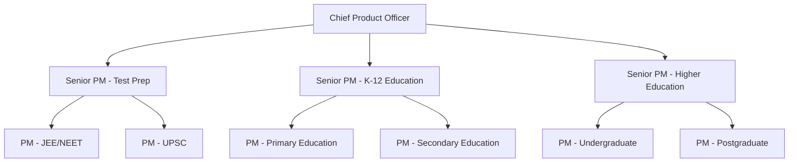
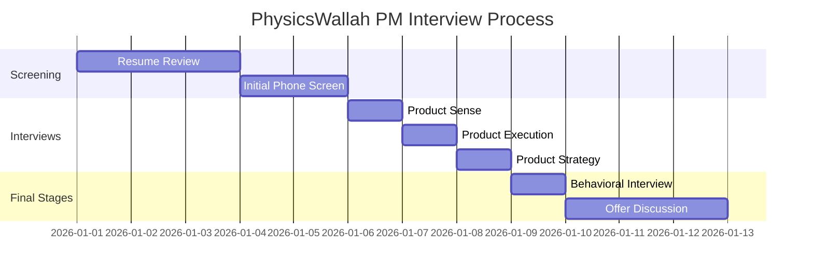

# PhysicsWallah Product Management Culture Guide | EdTech Insights

- **Source:** https://nextsprints.com/guide/physicswallah-product-manager-interview-guide

- **Type:** `interview-guide`

- **Updated:** October 31, 2026

---

## Introduction

PhysicsWallah's product management culture is a unique blend of educational innovation and technological prowess. As India's leading EdTech unicorn, we're revolutionizing how students learn and prepare for competitive exams. Our PMs are at the forefront of this educational revolution, crafting digital solutions that make quality education accessible to millions.

The EdTech market in India is booming, projected to reach $10.4 billion by 2025. In this landscape, PhysicsWallah's product managers play a crucial role in shaping the future of education technology. We're not just building products; we're transforming lives through affordable, high-quality learning experiences.

| Hiring Metric | Value |
| --- | --- |
| YoY PM team growth | 40% |
| Avg. time to hire | 45 days |
| Retention rate | 92% |

> Expert Insight
> At PhysicsWallah, PMs need to balance educational expertise with tech-savviness. Our most successful product managers often have a background in education or a deep understanding of the Indian academic system, coupled with strong product development skills.

## PM Role

> Role Definition
> PhysicsWallah Product Managers are visionaries who blend educational insights with technological innovation to create impactful learning solutions for millions of students across India.

Responsibilities:

- Develop and execute product strategies aligned with PhysicsWallah's mission
- Conduct market research to identify student needs and educational trends
- Collaborate with educators to ensure pedagogical effectiveness
- Work closely with engineering and design teams to build intuitive learning platforms
- Analyze user data to continuously improve product performance and engagement
- Manage product lifecycles from conception to launch and beyond
- Coordinate with marketing teams to drive user acquisition and retention

Team Structure:

Comparison with Other Tech Companies:

| Aspect | PhysicsWallah | Byju's | Unacademy |
| --- | --- | --- | --- |
| Focus | Affordable mass education | Premium learning | Diverse course offerings |
| Target audience | Tier 2/3 cities | Urban centers | Pan-India |
| Product approach | Video-first, mobile-optimized | Interactive, gamified | Live classes, community-driven |

Real Examples:

- PW Vidyapeeth: Our flagship mobile app offering comprehensive test prep courses
- PW Books: Digital and physical study materials integrated with our online platform
- PW Live: Real-time interactive classes with top educators

## Job Requirements

Education:

- Bachelor's degree required, preferably in Computer Science, Engineering, or Education
- MBA or equivalent advanced degree is a plus

Experience:

- 3-5 years of product management experience in EdTech or related fields
- Proven track record of launching successful digital products
- Experience with educational content development or e-learning platforms

Technical Skills:

- Proficiency in data analysis and SQL
- Understanding of mobile app development processes
- Familiarity with A/B testing and user research methodologies
- Basic knowledge of machine learning concepts, especially in personalized learning

Soft Skills:

- Strong communication and stakeholder management abilities
- Empathy for students and educators
- Adaptability to rapidly changing EdTech landscape
- Problem-solving and critical thinking skills

| Requirement | Junior PM | Senior PM |
| --- | --- | --- |
| Years of Experience | 2-3 | 5+ |
| Product Launches | 1-2 | 3+ |
| Team Leadership | No | Yes |
| Strategic Planning | Limited | Extensive |

Success Factors:

1. Deep understanding of the Indian education system
2. Ability to balance educational goals with business objectives
3. Innovation in creating engaging learning experiences
4. Data-driven decision-making skills

> Common Pitfalls
> Overlooking the needs of students from diverse socioeconomic backgrounds
> Focusing too much on features without considering pedagogical impact
> Underestimating the importance of offline integration in the Indian market

> Expert Tips
> Successful PMs at PhysicsWallah often spend time understanding our student base by visiting coaching centers and schools across India. This firsthand experience is invaluable in creating products that truly resonate with our users.

## Interview Process Breakdown

End-to-end Process Overview:

1. Initial Application and Screening
2. Product Interviews
3. Final Rounds

Timeline Expectations: The entire process typically takes 3-4 weeks from initial application to offer.

Round-by-Round Breakdown:

- Product Sense: Assesses your ability to design and improve educational products that meet user needs.

- Product Execution: Evaluates your skills in implementing product strategies and measuring success.

- Product Strategy: Tests your capacity to develop long-term product visions aligned with PhysicsWallah's mission.

- Behavioral: Explores your cultural fit and leadership potential within the PhysicsWallah ecosystem.

Process Timeline:

Round-Specific Details:

| Round | Focus Areas | Duration |
| --- | --- | --- |
| Product Sense | User-centric design, Educational impact | 60 mins |
| Product Execution | Metrics definition, A/B testing | 60 mins |
| Product Strategy | Market analysis, Growth planning | 60 mins |
| Behavioral | Leadership, Culture fit | 45 mins |

Practice PhysicsWallah questions

Product Design

How could Facebook build a feature to help people find roommates?

View

Say you're a WhatsApp PM and want to add more ecommerce functionality. What would you do?

View

How would you build a language learning product for the Facebook app?

View

Product Improvement

How can PhysicsWallah improve its live doubt-solving sessions to make them more interactive and engaging for students?

View

What features could PhysicsWallah add to its mobile app to help students better track their progress and stay motivated?

View

How might PhysicsWallah enhance its video lecture content to cater to different learning styles and preferences?

View

Product Success Metrics

What metrics would you use to evaluate PhysicsWallah's mobile app for JEE preparation?

View

How would you define the success of PhysicsWallah's doubt-solving feature?

View

How would you measure the success of PhysicsWallah's live online classes?

View

Product Trade-Off

For PhysicsWallah's mobile app, should we emphasize adding more interactive features to boost engagement or streamline the interface for easier navigation?

View

Should PhysicsWallah prioritize expanding its free YouTube content to reach more students or focus on paid courses to increase revenue?

View

How can PhysicsWallah balance the quality of personalized mentoring in its premium packages with the need to scale and serve more students?

View

Product Root Cause Analysis

Why has PhysicsWallah's live online class attendance dropped by 30% for JEE Advanced courses over the past month?

View

Why has the average watch time for PhysicsWallah's recorded video lectures on NEET preparation declined from 45 minutes to 25 minutes per session in the last quarter?

View

What factors are causing the sudden 50% decrease in new user signups for PhysicsWallah's mobile app in the past week?

View

## Product Manager Compensation & Levels at PhysicsWallah

PhysicsWallah's PM career ladder reflects our commitment to growth and innovation:

1. Associate Product Manager (APM)
2. Product Manager
3. Senior Product Manager
4. Lead Product Manager
5. Director of Product

Salary Ranges (Annual, in INR):

| Level | Min | Max |
| --- | --- | --- |
| APM | 8 LPA | 15 LPA |
| PM | 15 LPA | 25 LPA |
| Senior PM | 25 LPA | 40 LPA |
| Lead PM | 40 LPA | 60 LPA |
| Director | 60 LPA | 1 Cr+ |

Note: These ranges are approximate and may vary based on experience, performance, and market conditions. PhysicsWallah also offers equity options and performance bonuses, which can significantly increase total compensation.

## How to Prepare

Company Leadership Principles:

1. Student-First Approach: Every decision should prioritize the learner's needs and success.
2. Innovation in Education: Constantly seek new ways to make learning more effective and engaging.
3. Accessibility for All: Strive to make quality education available to every student, regardless of background.
4. Data-Driven Improvement: Use analytics to continuously enhance our products and teaching methods.

Tailor Your Resume: Focus on quantifiable achievements that demonstrate your impact in previous roles. Use the STAR method (Situation, Task, Action, Result) to structure your bullet points. Highlight any experience with educational technology or projects that improved user engagement and learning outcomes. For a professional review of your PM resume, consider using [NextSprints' Resume Review service](https://nextsprints.com/resume-review).

Practice Product Cases: Develop a structured approach to solving product challenges, particularly those related to EdTech. Focus on understanding user needs, defining clear metrics for success, and proposing innovative solutions that align with PhysicsWallah's mission. Remember, it's not about memorizing frameworks but adapting them to our unique educational context. To practice with real PM interview questions, check out [NextSprints' extensive question database](https://nextsprints.com/product-manager-interview-questions).

Practice Mock Interviews: While self-practice is valuable, getting feedback from experienced PMs is crucial. Seek out mentors in the EdTech space or consider professional coaching services. [NextSprints offers PM coaching](https://nextsprints.com/pm-coaching) with experts who can provide tailored feedback and help you refine your interview skills specifically for roles like those at PhysicsWallah.

## FAQs

### What sets PhysicsWallah's PM role apart from other EdTech companies?

At PhysicsWallah, PMs have a unique opportunity to impact millions of students across India, focusing on accessibility and affordability. Our PMs need to balance technological innovation with deep educational insights, often working on products that blend online and offline learning experiences.

### How important is prior EdTech experience for PM candidates?

While EdTech experience is valuable, it's not mandatory. We value candidates with strong product skills who demonstrate a passion for education and a quick learning ability. Experience in consumer tech or other relevant fields, combined with a deep understanding of the Indian education system, can be equally valuable.

### What are the growth opportunities for PMs at PhysicsWallah?

PhysicsWallah offers rapid growth opportunities due to our expanding product portfolio. PMs can progress from managing individual features to overseeing entire product lines or entering leadership roles that shape our overall product strategy.

### How does PhysicsWallah approach product development differently?

Our approach is deeply rooted in understanding the diverse needs of Indian students. We emphasize creating products that work across various devices and internet speeds, often incorporating vernacular languages and culturally relevant content.

### What technical skills are most valued for PMs at PhysicsWallah?

While PMs aren't expected to code, a strong understanding of data analysis, basic SQL, and familiarity with machine learning concepts (especially in personalized learning) are highly valued. Experience with mobile app development processes is also beneficial.

## Related Guides Section

📖 [PhysicsWallah Product Strategy Guide](physicswallah-product-strategy-guide) – Deep dive into PhysicsWallah's product decisions.

📖 [PhysicsWallah Product Manager Salary Guide](physicswallah-product-manager-salary-guide) – Salary insights & negotiation tips.

📖 [PhysicsWallah Product Teardown Guide](physicswallah-product-teardown-analysis) – Analysis of PhysicsWallah's product positioning.

Disclaimer: This guide is created for product management interview preparation purposes only. The analysis and methodology are based on the public information.
