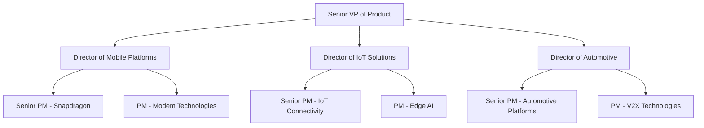
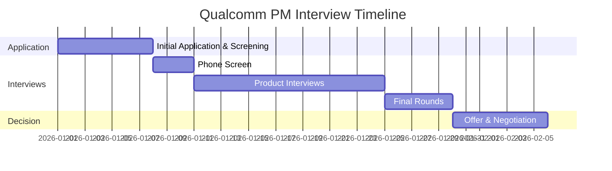

# Qualcomm Product Manager Interview Guide | 2026 Insights

- **Source:** https://nextsprints.com/guide/qualcomm-product-manager-interview-guide

- **Type:** `interview-guide`

- **Updated:** October 31, 2026

---

## Introduction

Qualcomm's product management culture is a unique blend of innovation, technical expertise, and strategic thinking. As a global leader in wireless technology, Qualcomm's PMs are at the forefront of shaping the future of connectivity, from 5G to IoT and beyond. The role of a Product Manager at Qualcomm is more critical than ever as we navigate the rapidly evolving landscape of semiconductor technology and mobile communications.

In 2026, the demand for skilled PMs at Qualcomm is expected to surge, driven by the company's expansion into new markets and the increasing complexity of its product portfolio. The convergence of AI, edge computing, and advanced wireless technologies has created a need for PMs who can bridge the gap between cutting-edge engineering and market-driven product development.

| Hiring Metric | Value |
| --- | --- |
| PM Openings (2026) | 150+ |
| YoY Growth in PM Roles | 15% |
| Avg. Time-to-Hire | 8 weeks |
| Acceptance Rate | 72% |

> Insider Perspective
> As a senior product leader at Qualcomm, I've observed that the most successful PM candidates demonstrate not only a deep understanding of wireless technology but also a keen ability to anticipate market trends and translate complex technical capabilities into compelling user experiences. Our interview process is designed to identify these multifaceted talents.

## PM Role

At Qualcomm, Product Managers play a pivotal role in driving innovation and shaping the future of wireless technology. They are the linchpin between engineering teams, market demands, and strategic business objectives.

> Qualcomm PM Role
> A Product Manager at Qualcomm is responsible for defining, developing, and delivering cutting-edge wireless technology solutions that power the connected world. They lead cross-functional teams to create products that push the boundaries of what's possible in mobile computing, IoT, and beyond.

Key responsibilities include:

1. Product Strategy: Developing long-term roadmaps for Qualcomm's chipset solutions and wireless technologies.
2. Market Analysis: Identifying emerging trends and opportunities in the wireless ecosystem.
3. Technical Leadership: Collaborating with engineering teams to translate market needs into technical requirements.
4. Stakeholder Management: Aligning diverse teams, from R&D to sales, around a unified product vision.
5. Go-to-Market Planning: Orchestrating product launches and driving adoption among OEM partners.

Team Structure:

Comparison with Other Tech Giants:

| Aspect | Qualcomm PM | Google PM | Apple PM |
| --- | --- | --- | --- |
| Technical Depth | Very High | Moderate | High |
| User Focus | B2B & B2B2C | B2C | B2C |
| Product Cycle | Long (1-3 years) | Medium | Medium to Long |
| Industry Impact | Foundational | Application-level | Ecosystem |

Real-world example: Qualcomm PMs were instrumental in developing the Snapdragon 8 Gen 3 platform, balancing performance improvements, power efficiency, and AI capabilities to meet the demands of next-generation smartphones and extended reality (XR) devices.

## Job Requirements

Education:

- Bachelor's degree in Engineering, Computer Science, or related technical field required
- MBA or Master's degree in a technical discipline preferred

Experience:

- Minimum 5-7 years of product management experience in the semiconductor or wireless technology industry
- Proven track record of successful product launches in the mobile or IoT space

Technical Skills:

- Deep understanding of wireless technologies (5G, Wi-Fi, Bluetooth)
- Familiarity with semiconductor design and manufacturing processes
- Knowledge of mobile SoC architecture and performance optimization
- Experience with AI/ML applications in mobile and edge computing
- Proficiency in data analysis and market research tools

Soft Skills:

- Strong leadership and cross-functional team management
- Excellent communication and presentation skills
- Strategic thinking and problem-solving abilities
- Adaptability to rapidly changing technology landscapes

| Requirement | Essential | Preferred |
| --- | --- | --- |
| Technical Degree | ✓ |  |
| MBA |  | ✓ |
| Wireless Tech Experience | ✓ |  |
| Product Launch Experience | ✓ |  |
| AI/ML Knowledge |  | ✓ |
| Leadership Skills | ✓ |  |

Success Factors:

1. Ability to translate complex technical concepts into market-driven products
2. Proactive approach to identifying and solving industry challenges
3. Strong relationships with OEM partners and industry stakeholders
4. Track record of driving innovation in wireless technologies

> Common Pitfalls
> Many candidates underestimate the technical depth required for Qualcomm PM roles. While strategic thinking is crucial, a solid foundation in wireless technology and semiconductor design is essential for success.

> Expert Advice
> To stand out, demonstrate how you've leveraged emerging technologies to create innovative products. Showcase your ability to balance technical feasibility with market demands, and be prepared to discuss the future of wireless connectivity beyond just smartphones.

## Interview Process Breakdown

Qualcomm's PM interview process is rigorous and comprehensive, designed to assess candidates' technical knowledge, strategic thinking, and leadership potential.

Process Timeline:

Round-by-Round Breakdown:

| Stage | Format | Focus Areas |
| --- | --- | --- |
| Initial Screen | Phone/Video | Resume review, basic qualifications |
| Technical Screen | Video Interview | Wireless technology knowledge, problem-solving |
| Product Sense | In-person/Video | Product design, market understanding |
| Product Execution | In-person/Video | Metrics, analysis, trade-offs |
| Product Strategy | In-person/Video | Long-term vision, industry trends |
| Leadership | In-person | Cross-functional collaboration, stakeholder management |

- Product Sense: Candidates are evaluated on their ability to design innovative wireless solutions and improve existing products within Qualcomm's ecosystem.

- Product Execution: This round focuses on the candidate's analytical skills, ability to define and track key metrics, and make data-driven decisions in complex technical environments.

- Product Strategy: Assesses the candidate's vision for the future of wireless technology and their ability to develop long-term product roadmaps aligned with Qualcomm's strategic goals.

The interview process typically spans 4-6 weeks, with 3-5 rounds of product interviews. While Qualcomm doesn't have a standardized take-home assignment, candidates may be asked to present a case study or product critique during the final rounds.

Practice Qualcomm questions

Product Design

How could Facebook build a feature to help people find roommates?

View

Say you're a WhatsApp PM and want to add more ecommerce functionality. What would you do?

View

How would you build a language learning product for the Facebook app?

View

Product Improvement

What features could be added to Qualcomm's 5G modems to improve connectivity in rural areas?

View

How might we redesign Qualcomm's Quick Charge technology to support a wider range of devices?

View

How can Qualcomm enhance the power efficiency of its Snapdragon mobile processors?

View

Product Success Metrics

how would you define the success of qualcomm's ai engine within their mobile chipsets?

View

how would you measure the success of qualcomm's snapdragon processors?

View

how would you measure the success of qualcomm's snapdragon mobile platform?

View

Product Trade-Off

Should Qualcomm prioritize 5G speed or battery life in its next-gen modems?

View

How can Qualcomm balance power efficiency with performance in its mobile chipsets?

View

Should Qualcomm focus on improving AI capabilities or reducing chip size in its latest SoC design?

View

Product Root Cause Analysis

Why has there been a 25% increase in reported overheating issues for smartphones using Qualcomm's new RF front-end modules?

View

What caused the sudden 30% drop in 5G network connectivity for Qualcomm-powered devices in the European market last month?

View

Why has the battery life of Qualcomm's latest Snapdragon 8 Gen 2 chipset decreased by 15

View

## Product Manager Compensation & Levels at Qualcomm

Qualcomm offers competitive compensation packages to attract top PM talent. The company's level structure for Product Managers is as follows:

1. Associate Product Manager (APM)
2. Product Manager
3. Senior Product Manager
4. Principal Product Manager
5. Director of Product Management

Salary ranges based on data from level.fyi (as of 2026):

| Level | Base Salary | Stock (Annual) | Bonus | Total Compensation |
| --- | --- | --- | --- | --- |
| APM | $110,000 - $130,000 | $20,000 - $40,000 | $10,000 - $20,000 | $140,000 - $190,000 |
| PM | $140,000 - $180,000 | $40,000 - $80,000 | $20,000 - $40,000 | $200,000 - $300,000 |
| Senior PM | $180,000 - $220,000 | $80,000 - $150,000 | $40,000 - $60,000 | $300,000 - $430,000 |
| Principal PM | $220,000 - $280,000 | $150,000 - $250,000 | $60,000 - $100,000 | $430,000 - $630,000 |
| Director | $280,000+ | $250,000+ | $100,000+ | $630,000+ |

Note that these figures can vary based on location, experience, and performance. Qualcomm also offers additional benefits such as health insurance, 401(k) matching, and professional development opportunities.

## How to Prepare

Company Leadership Principles: While Qualcomm doesn't publicly list specific leadership principles, the company culture emphasizes:

1. Innovation Leadership: Driving technological advancements in wireless communication.
2. Collaborative Problem-Solving: Working across teams to tackle complex challenges.
3. Customer-Centric Approach: Focusing on OEM and end-user needs in product development.
4. Ethical Technology Development: Ensuring responsible innovation and sustainable practices.

Tailor Your Resume: To make your resume stand out for a Qualcomm PM role:

- Highlight specific wireless technology projects or products you've worked on
- Quantify your impact using metrics (e.g., "Increased modem efficiency by 15%, resulting in 20% longer battery life")
- Showcase cross-functional leadership experiences
- Demonstrate your understanding of the semiconductor industry and mobile ecosystem

For expert feedback on your PM resume, consider using NextSprints' Resume Review service ([https://nextsprints.com/resume-review](https://nextsprints.com/resume-review)).

Practice Product Cases: Qualcomm's product cases often focus on wireless technology applications. To prepare:

- Study Qualcomm's product portfolio and understand the key features of their chipsets
- Practice designing products that leverage 5G, Wi-Fi 6, and emerging wireless standards
- Develop frameworks for analyzing semiconductor market trends and competitive landscapes
- Be prepared to discuss trade-offs between performance, power efficiency, and cost in chip design

For a comprehensive database of PM interview questions, including Qualcomm-specific cases, check out NextSprints' Product Manager Interview Questions ([https://nextsprints.com/product-manager-interview-questions](https://nextsprints.com/product-manager-interview-questions)).

Practice Mock Interviews: To truly excel in Qualcomm's PM interviews, it's crucial to get feedback from experienced professionals. Consider the following:

- Reach out to current Qualcomm PMs in your network for insights
- Practice explaining complex technical concepts in simple terms
- Prepare stories that demonstrate your leadership in driving innovation
- If you don't have access to industry insiders, NextSprints offers PM Coaching with ex-FAANG product leaders ([https://nextsprints.com/pm-coaching](https://nextsprints.com/pm-coaching))

Remember, Qualcomm values both technical depth and strategic vision. Your preparation should reflect a balance of these skills, demonstrating your ability to drive the future of wireless technology.

## FAQs

### What sets Qualcomm's PM role apart from other tech companies?

Qualcomm PMs need a deeper technical understanding of wireless technologies and semiconductor design. The role involves working on foundational technologies that enable countless consumer products, rather than directly consumer-facing applications. This requires a unique blend of technical expertise, strategic foresight, and the ability to influence the entire mobile ecosystem.

### How important is a technical background for Qualcomm PM roles?

A strong technical background is crucial. While not all PMs need to be engineers, a solid understanding of wireless technologies, semiconductor processes, and mobile architectures is essential. Qualcomm values PMs who can effectively bridge the gap between complex technical capabilities and market needs.

### What are the biggest challenges facing Qualcomm PMs in 2026?

Key challenges include navigating the rapidly evolving 5G and 6G landscapes, addressing increasing power efficiency demands, integrating AI capabilities into mobile platforms, and expanding Qualcomm's presence in emerging markets like automotive and IoT. PMs must also balance long development cycles with fast-changing market demands.

### How does Qualcomm evaluate PM candidates' strategic thinking?

Candidates are often presented with scenarios involving future wireless technologies or market shifts. Interviewers assess the candidate's ability to analyze complex ecosystems, identify key trends, and develop long-term product strategies that align with Qualcomm's strengths and market opportunities.

### Can you transition to a Qualcomm PM role from a non-tech background?

While challenging, it's possible with the right preparation. Candidates from non-tech backgrounds should focus on building a strong understanding of wireless technologies and semiconductor basics. Emphasize transferable skills like strategic thinking, stakeholder management, and data-driven decision-making. Consider pursuing relevant certifications or projects to demonstrate your commitment to the field.

## Related Guides Section

📖 [Qualcomm Product Strategy Guide](qualcomm-product-strategy-guide) – Deep dive into Qualcomm's product decisions.

📖 [Qualcomm Product Manager Salary Guide](qualcomm-product-manager-salary-guide) – Salary insights & negotiation tips.

📖 [Qualcomm Product Teardown Guide](qualcomm-snapdragon-8-gen-3-product-teardown-analysis) – Analysis of Qualcomm's product positioning.

Disclaimer: This guide is created for product management interview preparation purposes only. The analysis and methodology are based on the public information.
