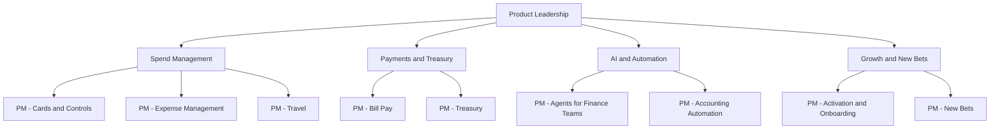

# Ramp Product Manager Interview Guide | 2026 Prep

- **Source:** https://nextsprints.com/guide/ramp-product-manager-interview-guide

- **Type:** `interview-guide`

- **Updated:** October 31, 2026

---

## Introduction

Ramp has become one of the most closely watched fintech companies in the United States. Founded in 2019 by Eric Glyman and Karim Atiyeh, it started with a corporate card for startups and has grown into a finance operations platform covering cards, expense management, Bill Pay, procurement, travel, Ramp Treasury, and a growing set of AI agents. In 2026 the company reported more than $1 billion in annualized revenue, raised a $750 million Series F at a $44 billion valuation in June, and was reported in October to have raised about $1.85 billion at roughly $60 billion. Ramp serves tens of thousands of businesses, with public figures ranging from more than 50,000 earlier in 2026 to a reported 85,000 by October.

For students and early-career candidates, Ramp is attractive for three reasons: product managers own meaningful surface area quickly, the company is famous for shipping speed, and the work sits at the intersection of fintech, B2B software, and applied AI. It is also a demanding place to interview. Candidates report that Ramp screens hard for ownership, speed, and the ability to reason about money flows, not just user flows.

| Hiring Metric | Value (estimate) |
| --- | --- |
| Primary PM hubs | New York (HQ), San Francisco |
| Typical PM process length | 2–4 weeks |
| Interview rounds | 4–6 including recruiter screen |
| Formal APM rotational program | Not publicly advertised as of 2026 |
| Common entry posting | Product Manager, Generalist (All Levels) |

> Candidate Perspective
> Candidates who received offers often describe the same pattern: interviewers pushed past frameworks to ask what they would ship this week, how they would know it worked, and what it would do to a customer's month-end close. Concrete, fast, finance-literate answers stand out.

## PM Role

> Ramp Product Manager
> A Ramp Product Manager owns a product area within the finance operations platform (for example, card controls, expense review agents, Bill Pay, procurement, travel, or Treasury), working with a small engineering and design team to ship quickly, measure impact in time and money saved for finance teams, and grow adoption across Ramp's customer base.

Responsibilities:

- Own a problem area end to end, from discovery with finance teams to launch and iteration
- Write crisp specs and prototypes, often using AI tools to move from idea to working demo quickly
- Partner with engineering, design, data, risk, compliance, and go-to-market teams
- Define success metrics that reflect customer outcomes such as hours saved, faster close, or dollars saved
- Talk to controllers, CFOs, AP specialists, and employees regularly
- Balance speed with the reliability expected of a product that moves money

This chart is an illustrative grouping based on public job postings and product areas, not an official org chart.

| Aspect | Ramp PM | Traditional Bank PM | Big Tech PM |
| --- | --- | --- | --- |
| Customer | Finance teams and employees at businesses | Retail and commercial banking clients | Consumers or developers |
| Pace | Very fast; frequent weekly releases | Moderate to slow | Fast but process-heavy |
| Scope per PM | Broad, high ownership | Narrow | Narrow to medium |
| Technical depth | High; AI and data fluency expected | Moderate | High |
| Success metrics | Time and money saved, adoption, volume | Revenue, risk, compliance | Engagement, growth |

Real-world example: Ramp's agent rollout shows the role in action. Agents for Controllers launched in July 2025, followed by agents for accounts payable and, in 2026, procurement. Each required PMs to define where the agent acts autonomously, where humans approve, and how to measure trust, not just usage.

## Job Requirements

Ramp's PM postings are often labeled "all levels," which means the bar is defined by demonstrated impact rather than years alone. Posted requirements for specialized PM roles commonly ask for about three or more years of product experience, but early-career candidates with strong building track records do get interviews.

Education:

- Bachelor's degree typical; computer science, engineering, economics, math, or finance backgrounds are common
- No MBA requirement

Experience:

- Evidence of shipping: products, startups, side projects, or internships with measurable outcomes
- For experienced roles: product management at a fast-moving B2B, fintech, or AI company
- Exposure to finance, accounting, or payments is a plus, not a requirement

Technical skills:

- SQL and comfort with data to define and track metrics
- Understanding of APIs, integrations, and how ERPs and payment rails work at a high level
- Hands-on AI fluency: prompting, evaluating model outputs, and prototyping with AI tools

Soft skills:

- Clear, concise writing
- High ownership and urgency
- Ability to earn trust with engineers and with demanding finance customers

> Common Pitfalls
> Candidates often design for the employee swiping the card and forget the controller who must close the books. At Ramp, the buyer is usually finance, so answers that ignore accounting, approvals, and audit trails tend to fall flat.

> Expert Advice
> Learn the basics of how Ramp makes money: interchange on card spend, paid plans such as Ramp Plus, and revenue tied to payments and Treasury balances. Being able to connect a feature to these levers signals business judgment.

## Interview Process Breakdown

Reports from candidates and interview prep sites describe a process of four to six conversations, usually completed within two to four weeks. Formats vary by team and level.

- Initial Application and Screening:

- Recruiter call (30 minutes): motivation for Ramp, career story, logistics, and compensation expectations.
- Hiring manager screen (45 minutes): deep dive on a product you shipped, your role, the metrics, and what you would do differently. Candidates report questions such as "what would you do if your plan failed?"

- Product Interviews:

- Product sense case: design or improve a Ramp product, for example expense review, Bill Pay, or travel booking.
- Execution and metrics: define success for a feature, diagnose a metric drop, or prioritize a backlog.
- Take-home or presentation (team-dependent): a short written product proposal or analysis, presented to the team.

- Final Rounds:

- Cross-functional interview with engineering or design partners: collaboration, technical judgment, trade-offs.
- Leadership conversation: ambition, ownership, and how you think about Ramp's mission of saving customers time and money.

| Stage | Duration | Focus | Tip |
| --- | --- | --- | --- |
| Recruiter | 30 min | Fit, motivation | Have a crisp "why Ramp" tied to a product you've used or studied |
| Hiring manager | 45 min | Past impact | Quantify outcomes; own mistakes |
| Product case | 45–60 min | Product sense | Start with the finance team's job to be done |
| Take-home | 2–4 hours of work | Written thinking | Keep it short; one recommendation, clear metrics |
| Loop | 3–4 × 45 min | Execution, metrics, collaboration | Show speed and structure together |
| Leadership | 30–45 min | Values and ambition | Bring specific ideas for Ramp |

## Product Manager Compensation & Levels at Ramp

Ramp does not publish a public level ladder for PMs, and data is thinner than for public tech companies. Levels.fyi shows a Product Manager median total compensation of roughly $296K as of October 2026, and Ramp's postings for generalist PM roles list base salary ranges of roughly $170K–$325K depending on level and location.

| Level (approximate) | Total Compensation Range (USD, 2026) |
| --- | --- |
| Early-career / Associate PM | $180,000 – $250,000 |
| Product Manager | $250,000 – $330,000 |
| Senior PM | $300,000 – $420,000 |
| Staff / Lead PM | $360,000 – $520,000 |
| Director / Head of Product | $450,000 – $750,000+ |

Ranges are estimates based on public data and postings. Equity is in a private company, so its value depends on future valuation and liquidity events such as tender offers. See the [Ramp Product Manager Salary Guide](/guide/ramp-product-manager-salary-guide) for detail.

## How to Prepare

Ramp-specific principles to internalize:

1. **Customer outcomes in time and money:** Every answer should end with how many hours or dollars a finance team saves.
2. **Velocity:** Show you can ship a narrow first version quickly and iterate.
3. **Control before spend:** Ramp's philosophy is to enforce policy at the point of purchase rather than audit afterward.
4. **AI as a teammate:** Be ready to discuss where agents should act alone and where humans stay in the loop.

Tailor your resume: Lead with shipped outcomes and numbers. If you are a student, highlight projects where you built and launched something real, especially in fintech, B2B tools, or AI. For a resume review tailored to Ramp, consider NextSprints' Resume Review service.

Practice product cases: Practice questions on expense management, AP automation, procurement, travel, and treasury. Focus on:

- Designing for multiple stakeholders (employee, manager, controller, CFO, vendor)
- Metrics for automation products, where less time in the product can be success
- Trade-offs between revenue (interchange) and adoption
- Root cause analysis for payment and accounting metrics

NextSprints' Product Manager Interview Questions include Ramp-specific cases to practice.

Mock interviews: Practice with PMs who have B2B or fintech experience. NextSprints offers PM Coaching for structured mock interviews and feedback.

## FAQs

### Does Ramp have an Associate Product Manager (APM) program for new grads?

As of 2026, Ramp does not publicly advertise a formal rotational APM program like those at Google or Meta. Early-career candidates typically apply to PM postings labeled for all levels, or join through adjacent roles such as product operations, strategy and operations, analytics, or engineering and move into product later. Check Ramp's careers page regularly, since early-career openings change through the year.

### How long does the Ramp PM interview process take?

Candidates generally report two to four weeks from recruiter screen to decision. Ramp is known for moving quickly, but timelines stretch when a take-home or presentation is involved or when scheduling the final leadership conversation.

### What kinds of product questions does Ramp ask?

Expect questions grounded in Ramp's products: improving expense review or receipt capture, designing AI agents for finance teams, measuring success for Bill Pay or Treasury, and diagnosing drops in metrics such as card activation or accounting automation. Interviewers often probe how your solution affects the controller and the month-end close.

### How technical do Ramp PMs need to be?

You do not need to code in interviews, but SQL comfort, understanding of APIs and integrations, and hands-on AI fluency are expected. Being able to prototype an idea quickly with AI tools is increasingly valued, especially on agent and automation teams.

### What makes a candidate stand out at Ramp?

Candidates who stand out show urgency and ownership, speak fluently about how businesses manage money, and make concrete recommendations instead of listing options. Bringing a specific, well-reasoned idea for a Ramp product, along with how you would measure it, is a strong signal.

## Related Guides Section

📖 [Ramp Product Strategy Guide](/guide/ramp-product-strategy-guide) – Deep dive into Ramp's product direction and AI strategy.

📖 [Ramp Product Manager Salary Guide](/guide/ramp-product-manager-salary-guide) – Salary bands by level and negotiation tips.

📖 [Ramp Product Teardown Guide](/guide/ramp-spend-management-platform-product-teardown) – Analysis of Ramp's spend management platform.

Disclaimer: This guide is created for product management interview preparation purposes only. The analysis is based on public information and candidate reports and is not affiliated with or endorsed by Ramp.
