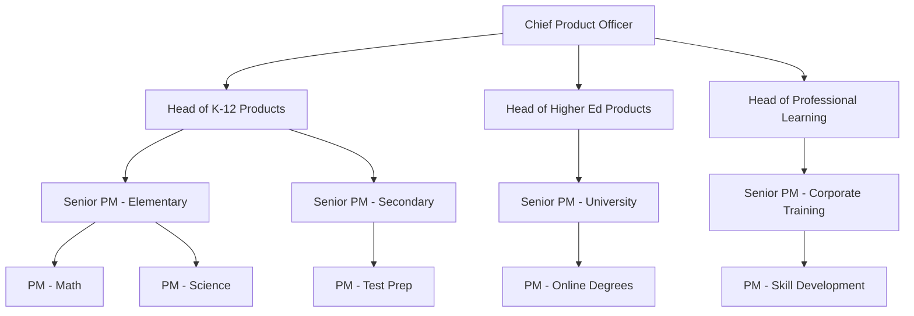
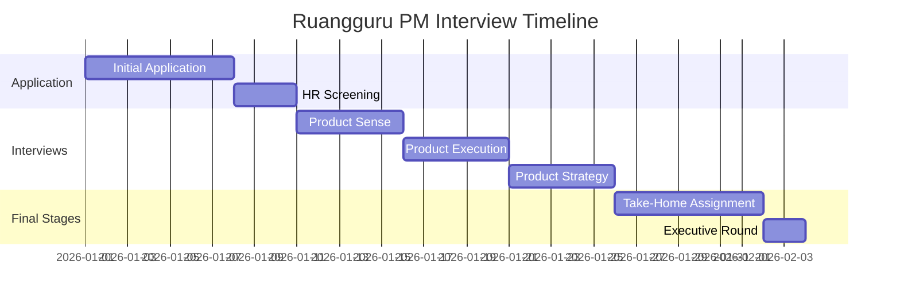

# Ruangguru Product Management Interview Guide | Edtech Insights

- **Source:** https://nextsprints.com/guide/ruangguru-product-manager-interview-guide

- **Type:** `interview-guide`

- **Updated:** October 31, 2026

---

## Introduction

Ruangguru's product management culture is at the forefront of Indonesia's edtech revolution. As the country's leading education technology platform, Ruangguru seeks product managers who can navigate the complexities of digital learning while driving innovation in a rapidly evolving market.

The Indonesian edtech sector is experiencing unprecedented growth, with Ruangguru leading the charge. Product managers play a pivotal role in shaping the future of education, balancing technological advancements with pedagogical best practices. The demand for skilled PMs who understand both education and technology has never been higher.

| Metric | Value |
| --- | --- |
| YoY Growth in PM Hires | 35% |
| Avg. Time-to-Hire | 45 days |
| Retention Rate | 92% |

> Insider Perspective
> At Ruangguru, we look for PMs who can think beyond features. The most successful candidates demonstrate a deep understanding of the Indonesian education landscape and can articulate how technology can address systemic challenges.

## PM Role

> Ruangguru PM Role
> A Ruangguru Product Manager leads the development of innovative educational products, balancing user needs, business goals, and technological capabilities to improve learning outcomes across Indonesia.

Responsibilities:

- Define product vision and strategy aligned with Ruangguru's mission
- Conduct market research to identify opportunities in the Indonesian education sector
- Collaborate with educators to ensure pedagogical soundness of products
- Manage the product development lifecycle from ideation to launch
- Analyze product performance metrics and user feedback for continuous improvement
- Work cross-functionally with engineering, design, and content teams
- Stay updated on edtech trends and competitors in Southeast Asia

| Aspect | Ruangguru | Gojek | Tokopedia |
| --- | --- | --- | --- |
| Focus | Education | Transportation & Delivery | E-commerce |
| User Base | Students & Educators | Consumers & Drivers | Buyers & Sellers |
| Key Metrics | Learning Outcomes, Engagement | Ride Completion, Driver Earnings | GMV, Conversion Rate |
| Tech Stack | EdTech, AI for Learning | Mapping, Logistics | Marketplace, Fintech |

Real-world example: Ruangguru's "Brain Academy" product, which combines AI-powered personalized learning with live online classes, showcases how PMs must balance cutting-edge technology with effective teaching methodologies.

## Job Requirements

Education:

- Bachelor's degree required, preferably in Computer Science, Education, or Business
- Master's degree in Education Technology or MBA is a plus

Experience:

- Minimum 3-5 years of product management experience
- Prior experience in education or edtech sector highly valued
- Demonstrated success in launching and scaling digital products

Technical Skills:

- Proficiency in data analysis and SQL
- Understanding of agile development methodologies
- Familiarity with UX/UI design principles
- Knowledge of educational assessment and learning management systems

Soft Skills:

- Strong leadership and cross-functional collaboration abilities
- Excellent communication skills in both Bahasa Indonesia and English
- Analytical thinking and problem-solving aptitude
- Empathy for student and teacher user personas

| Requirement | Junior PM | Senior PM |
| --- | --- | --- |
| Years of Experience | 2-3 | 5+ |
| Product Launches | 1-2 | 3+ |
| Team Leadership | None required | Experience managing junior PMs |
| Market Knowledge | Basic understanding | Deep insights into SEA edtech landscape |

Success Factors:

1. Passion for education and technology
2. Ability to translate complex educational concepts into user-friendly products
3. Data-driven decision-making skills
4. Adaptability to rapid market changes

> Common Pitfalls
> Avoid focusing solely on technology without considering pedagogical impact. Successful Ruangguru PMs balance innovation with proven educational practices.

> Expert Advice
> Immerse yourself in the Indonesian education system. Understand the pain points of students, teachers, and parents to create truly impactful products.

## Interview Process Breakdown

The Ruangguru PM interview process is designed to assess candidates' ability to innovate in the edtech space while addressing real-world educational challenges.

Round-by-Round Breakdown:

- Product Sense: Assess candidate's ability to design intuitive learning experiences and improve existing educational products.

- Product Execution: Evaluate skills in defining success metrics for edtech products and analyzing root causes of performance issues.

- Product Strategy: Gauge strategic thinking in areas like product growth, launch strategies, and navigating the competitive edtech landscape.

- Behavioral: Assess cultural fit and leadership potential within Ruangguru's mission-driven environment.

- Take-Home Assignment: Typically involves creating a product proposal addressing a specific challenge in the Indonesian education system.

| Round | Focus Areas | Duration |
| --- | --- | --- |
| Product Sense | UX Design, Product Improvement | 60 minutes |
| Product Execution | Metrics, Root Cause Analysis | 60 minutes |
| Product Strategy | Growth, Launch, Competitive Analysis | 60 minutes |
| Behavioral | Leadership, Culture Fit | 45 minutes |
| Take-Home | Strategic Thinking, Presentation Skills | 3-5 days |

Practice Ruangguru questions

Product Design

How could Facebook build a feature to help people find roommates?

View

Say you're a WhatsApp PM and want to add more ecommerce functionality. What would you do?

View

How would you build a language learning product for the Facebook app?

View

Product Improvement

How can we make Ruangguru's live tutoring sessions more engaging for students?

View

In what ways can we improve the gamification elements in Ruangguru's online quizzes?

View

What features could be added to Ruangguru's mobile app to enhance personalized learning?

View

Product Success Metrics

what metrics would you use to evaluate ruangguru's personalized learning paths?

View

how would you define the success of ruangguru's live tutoring sessions?

View

how would you define the success of ruangguru's adaptive learning system?

View

Product Trade-Off

Is it better for Ruangguru to invest in improving our mobile app experience or enhancing our web-based platform for a wider reach?

View

How can Ruangguru balance personalized learning paths with standardized curriculum alignment to meet both individual needs and educational benchmarks?

View

Should Ruangguru prioritize expanding our free content library to increase user acquisition or focus on premium features to boost revenue?

View

Product Root Cause Analysis

What's causing the sudden 30% decrease in daily active users for Ruangguru's mobile app?

View

Why has student engagement with Ruangguru's live tutoring sessions declined by 25% since last quarter?

View

Why has the completion rate for Ruangguru's Math Mastery course dropped by 15% over the past month?

View

## Product Manager Compensation & Levels at Ruangguru

Ruangguru's PM career ladder reflects the company's growth and the increasing complexity of its product offerings.

| Level | Title | Experience | Salary Range (IDR/year) |
| --- | --- | --- | --- |
| L3 | Associate PM | 0-2 years | 180M - 250M |
| L4 | Product Manager | 2-5 years | 250M - 400M |
| L5 | Senior PM | 5-8 years | 400M - 600M |
| L6 | Principal PM | 8+ years | 600M - 900M |
| L7 | Director of Product | 10+ years | 900M - 1.2B |

Note: Compensation packages often include equity and performance bonuses, which can significantly increase total compensation.

> Compensation Trends
> Ruangguru's compensation is competitive within the Indonesian tech market, with a focus on attracting top talent from both local and international backgrounds.

## How to Prepare

Leadership Principles:

1. Student-First Mindset: Every decision should prioritize learner outcomes.
2. Data-Driven Innovation: Use analytics to inform product decisions and measure impact.
3. Scalable Impact: Design solutions that can reach millions of Indonesian students.
4. Continuous Learning: Embrace a growth mindset and stay updated on edtech trends.

Tailor Your Resume: Highlight experiences that demonstrate your impact on educational outcomes or technology-driven learning solutions. Use the STAR method to showcase your achievements, focusing on metrics that matter in edtech, such as user engagement, learning efficacy, and scalability of solutions.

Practice Product Cases: Familiarize yourself with Ruangguru's product suite and the broader Indonesian education landscape. When practicing cases, focus on balancing technological innovation with educational best practices. Our database of edtech-specific interview questions can help you prepare effectively.

Mock Interviews: Engage in practice sessions that simulate Ruangguru's unique interview style. Focus on articulating your thoughts clearly in both Bahasa Indonesia and English. If you're looking for expert feedback, consider booking a session with one of our coaches who have experience with Southeast Asian edtech companies.

## FAQs

### What sets Ruangguru's PM role apart from other tech companies?

Ruangguru PMs must have a deep understanding of the education sector, combining technological innovation with pedagogical expertise. The role requires a unique blend of product thinking and educational impact assessment.

### How important is knowledge of the Indonesian education system?

It's crucial. Successful candidates demonstrate a strong grasp of local educational challenges and opportunities. While international experience is valued, understanding the nuances of the Indonesian market is essential.

### Does Ruangguru prefer candidates with teaching experience?

While not mandatory, teaching experience can be a significant advantage. It provides valuable insights into user needs and helps in creating more effective learning solutions.

### How does Ruangguru approach product localization?

Localization is key to Ruangguru's success. PMs often work on adapting global best practices to fit the Indonesian context, considering factors like language, cultural nuances, and local curriculum requirements.

### What growth opportunities exist for PMs at Ruangguru?

Ruangguru offers a clear career progression path for PMs, with opportunities to lead larger teams, take on more complex products, and potentially expand into new markets across Southeast Asia.

## Related Guides Section

📖 [Ruangguru Product Strategy Guide](ruangguru-product-strategy-guide) – Deep dive into Ruangguru's product decisions.

📖 [Ruangguru Product Manager Salary Guide](ruangguru-product-manager-salary-guide) – Salary insights & negotiation tips.

📖 [Ruangguru Product Teardown Guide](ruangguru-product-teardown-analysis-strategy-ux) – Analysis of Ruangguru's product positioning.

Disclaimer: This guide is created for product management interview preparation purposes only. The analysis and methodology are based on the public information.
