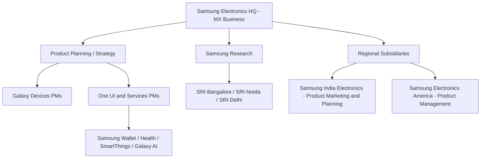

# Samsung Product Manager Interview Guide | SRI & Galaxy

- **Source:** https://nextsprints.com/guide/samsung-product-manager-interview-guide

- **Type:** `interview-guide`

- **Updated:** October 31, 2026

---

## Introduction

Samsung is one of the few companies where a product manager can shape software used by over a billion people and the hardware it runs on. Galaxy phones, One UI, Samsung Wallet, SmartThings, Samsung Health, Samsung TV Plus and Galaxy AI all need PMs who can balance user needs, partner ecosystems (Google, Qualcomm, Perplexity, banks, carriers) and tight hardware launch cycles. For students and early-career candidates, the most common routes in are Samsung R&D Institute India (SRI-Bangalore, SRI-Noida, SRI-Delhi), Samsung India Electronics in Gurugram, and Samsung Electronics America and Samsung Research America in the US.

Product work follows the hardware calendar (Galaxy S early in the year, foldables in July), and PMs work closely with HQ teams in Suwon and Seoul, so clear writing matters as much as product sense.

| Hiring Metric | Value (estimate) |
| --- | --- |
| PM-titled roles at Samsung entities in India (open at any time) | 40–80 |
| Typical interview rounds | 3–5 |
| Average time-to-hire | 4–8 weeks |
| Interview difficulty (Glassdoor, Samsung Electronics PM) | ~2.7 / 5 |

> Insider Perspective
> Candidates who have cleared Samsung PM loops often report that interviewers care less about textbook frameworks and more about whether you understand how a feature reaches a device: who owns it in Korea, how it ships in a One UI release, and how it performs on a ₹15,000 Galaxy A phone as well as on a Galaxy S26 Ultra.

## PM Role

> Samsung Product Manager
> A Samsung Product Manager defines and drives products and features across Galaxy devices, One UI and Samsung services, aligning user needs with hardware roadmaps, partner ecosystems and regional market requirements.

Responsibilities:

- Define requirements for One UI features, Samsung apps (Wallet, Health, Notes, SmartThings) or device line-ups
- Translate regional insights (for example, India's UPI and regional-language needs) into global product requirements
- Work with R&D engineers at SRI and in Korea to scope, build and test features
- Coordinate with partners such as Google, Qualcomm, banks, carriers and content providers
- Analyse usage data, reviews and Samsung Members feedback to prioritise improvements
- Support launch planning with marketing, retail and service teams

| Aspect | Samsung PM | Big Tech Software PM | Indian Startup PM |
| --- | --- | --- | --- |
| Focus | Devices + software + services | Software and platforms | App features and growth |
| Pace | Tied to hardware launch calendar | Continuous release | Very fast |
| Technical depth | High (devices, OS, AI on-device) | High | Moderate |
| Stakeholders | HQ Korea, R&D, partners, retail | Mostly internal | Founders, small teams |
| Global perspective | Essential | Varies | Usually India-only |

Real-world example: in late 2025, Samsung India added UPI registration during device setup, PIN-free biometric UPI payments and Tap & Pay with FOREX cards to Samsung Wallet. Shipping it meant coordinating NPCI rules, partner banks, One UI setup and HQ platform teams.

## Job Requirements

Education:

- B.Tech/B.E. (often required for SRI roles), MBA preferred for Samsung India product planning and marketing roles
- For US roles, a bachelor's degree with MBA or technical master's as a plus

Experience:

- Campus and associate roles: 0–2 years, internships in product, analytics or engineering
- PM roles: 3–7 years in product management, consumer electronics, mobile software or platforms
- Senior roles: 8+ years with experience leading cross-regional launches

Technical Skills:

- Understanding of Android, mobile app architecture and on-device vs. cloud trade-offs
- Data analysis (SQL, Excel, dashboards), A/B testing basics
- Familiarity with AI/ML product concepts, increasingly important for Galaxy AI roles
- Ability to write clear PRDs and specifications that engineers in India and Korea can work from

Soft Skills:

- Stakeholder management across time zones and cultures
- Structured written communication
- Comfort with ambiguity and matrix organisations
- Customer empathy across very different user segments

> Common Pitfalls
> Many candidates answer Samsung questions as if Samsung were a pure software company. Ignoring hardware constraints, launch calendars, carrier and retail channels, or the mid-range Galaxy A series makes answers feel generic.

> Expert Advice
> Use Samsung's own products in your answers. Know the latest Galaxy S and Z launches, One UI version, Galaxy AI features, and at least two services (Wallet, Health, SmartThings, TV Plus) in depth.

## Interview Process Breakdown

The process varies by entity. SRI roles lean technical; Samsung India product planning and marketing roles lean business and case-based; US roles look like a standard tech PM loop.

| Stage | Format | Duration | Focus Areas |
| --- | --- | --- | --- |
| Application / Campus | Online or campus placement cell | N/A | Resume, academics, projects |
| Online test / Screen | Aptitude test (campus) or recruiter call | 30–90 mins | Basics, motivation |
| Hiring Manager | Video or in-person | 45–60 mins | Experience, product sense |
| Product / Case Rounds | 1–3 interviews | 45–60 mins each | Design, improvement, metrics, strategy, technical depth |
| Senior Leader + HR | In-person or video | 30–45 mins each | Leadership, culture, compensation |

Detailed Breakdown:

- Initial Application and Screening:

Campus candidates are usually shortlisted by academics and resume, then take an online test (aptitude and, for SRI, coding or technical MCQs). Lateral candidates apply via the Samsung careers site, LinkedIn or referrals and have a recruiter call.

- Product Interviews:

a. Product Sense: "How would you improve a Samsung product you use?" is one of the most commonly reported questions. Expect design questions around One UI, Wallet, Health or SmartThings.

b. Metrics and Execution: defining success for a feature, diagnosing a drop in a metric, and prioritising a backlog.

c. Strategy and Technical: Galaxy AI build-vs-partner, competing with vivo and Xiaomi in India, or on-device vs. cloud trade-offs. SRI interviewers often probe technical understanding of Android and AI.

- Final Rounds:

A senior leader or director round evaluates ownership, communication and long-term fit, followed by HR discussion of level and compensation.

Timeline Expectations:

- Campus processes: often completed within one to two days on campus
- Lateral roles: 4–8 weeks from application to offer
- Feedback typically within one week of each round, though Korean HQ approvals can add time

## Product Manager Compensation & Levels at Samsung

Samsung's titles vary by entity. In India, SRI uses engineering-style grades (Engineer, Senior, Lead, Chief, Staff) with product roles mapped to them, while Samsung India Electronics uses manager grades. In the US, Levels.fyi tracks Samsung PM levels from roughly L2 to L6.

Levels (simplified):

1. Associate Product Manager / Product Planning Associate
2. Product Manager
3. Senior Product Manager / Chief Product Manager
4. Principal / Group Product Manager
5. Director / Head of Product

| Level | India Total Compensation (₹ LPA, est. 2026) | US Total Compensation (USD, est. 2026) |
| --- | --- | --- |
| Associate PM | 14 – 22 | 125,000 – 160,000 |
| PM | 22 – 35 | 165,000 – 215,000 |
| Senior / Chief PM | 35 – 52 | 200,000 – 260,000 |
| Principal / Group PM | 50 – 75 | 250,000 – 320,000 |
| Director / Head of Product | 75 – 120 | 300,000 – 400,000+ |

Note: India figures are anchored on AmbitionBox (₹15L–₹49L for Samsung PMs with 1–12 years) and US figures on Levels.fyi (about $179K at L2 to $300K at L6). Samsung pays mostly in fixed salary plus performance bonus; equity is limited compared with US big tech. See the salary guide for details.

## How to Prepare

Samsung's values to know:

1. People: respect and growth for employees
2. Excellence: high standards in every product
3. Change: constant innovation, illustrated by foldables and Galaxy AI
4. Integrity: doing the right thing, critical for payments and health products
5. Co-prosperity: growing with partners and society

Tailor Your Resume: Highlight measurable impact, cross-functional work and any experience with devices, Android, payments, IoT, health tech or AI. Use the STAR format and show collaboration with engineering teams. For SRI roles, show technical depth; for Samsung India product planning roles, show market and consumer insight.

For expert resume review tailored to Samsung's expectations, consider using NextSprints' Resume Review service.

Practice Product Cases: Focus on Samsung-specific scenarios: designing for Galaxy A-series users in India, improving One UI features like Now Brief, metrics for Samsung Wallet or Galaxy AI, root cause analysis for Samsung TV Plus, and strategy questions on Galaxy AI partnerships.

To access a database of Samsung-focused questions, check out NextSprints' Product Manager Interview Questions.

Mock Interviews: Practise with PMs from consumer electronics or Android backgrounds, and time yourself: Samsung case rounds reward concise answers.

If you don't have access to device PMs in your network, NextSprints offers PM Coaching with experts familiar with Samsung-style interviews.

## FAQs

### Does Samsung hire product managers directly from campus in India?

Yes, but not always with a "PM" title. Samsung R&D Institute India hires engineers from IITs, NITs and IIITs, and some move into product roles; Samsung India Electronics recruits from B-schools for product planning and product marketing roles that involve PM-style work. Samsung's PRISM industry-academia programme, which expanded to around 70 engineering colleges, is a good way for students to get noticed by SRI teams before placements.

### What is the difference between a PM role at SRI and at Samsung India Electronics?

SRI roles sit within R&D and focus on building features and platforms (One UI, Galaxy AI, Bixby, camera, SmartThings) often for global release. Samsung India Electronics roles focus on the Indian market: line-up planning, pricing, India-specific features like Wallet UPI, and launch execution. SRI interviews are more technical; Samsung India interviews more business-focused.

### What kind of questions are asked in Samsung PM interviews?

Candidates commonly report "improve a Samsung product you use", metrics questions, prioritisation, and behavioural questions around leadership and stakeholder management. For technical teams, expect questions on Android, on-device AI and system constraints. Strategy questions often involve competition with Apple, Google, vivo and Xiaomi.

### How important is knowledge of Galaxy AI for interviews in 2026?

Very important. Galaxy AI is central to Samsung's flagship marketing, with Gemini and Perplexity now integrated on the Galaxy S26. Be ready to discuss features like Now Brief, Circle to Search and Live Translate, and the on-device vs. cloud trade-off.

### Do I need to know Korean to work as a Samsung PM?

No. English is the working language with HQ teams for most roles in India and the US. However, candidates report that clear, precise writing and patience with time-zone differences are important, and basic familiarity with Korean business culture helps.

## Related Guides Section

📖 [Samsung Product Strategy Guide](/guide/samsung-product-strategy-guide) – Deep dive into Samsung's Galaxy, AI and ecosystem strategy.

📖 [Samsung Product Manager Salary Guide](/guide/samsung-product-manager-salary-guide) – Salary insights in INR and USD and negotiation tips.

📖 [Samsung Product Teardown Guide](/guide/samsung-galaxy-ecosystem-product-teardown) – Analysis of the Galaxy ecosystem.

Disclaimer: This guide is created for product management interview preparation purposes only. The analysis and methodology are based on public information and candidate reports, and figures are estimates.
