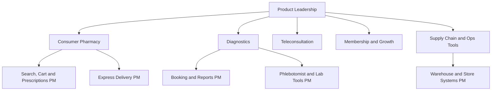

# Tata 1mg Product Manager Interview Guide | Health-Tech PM

- **Source:** https://nextsprints.com/guide/tata-1mg-product-manager-interview-guide

- **Type:** `interview-guide`

- **Updated:** October 31, 2026

---

## Introduction

Tata 1mg is one of India's leading digital health platforms. Founded in 2015 by Prashant Tandon, Gaurav Agarwal and Vikas Chauhan and majority-owned by Tata Digital since 2021, it combines an online pharmacy, diagnostics with home sample collection and its own labs, doctor teleconsultation and health products. In FY26 it reported consolidated revenue of about ₹2,936 crore, up 23%, and said its core businesses turned EBITDA positive from December 2025. Diagnostics crossed ₹600 crore in annualised revenue, growing more than 40% a year.

For PM candidates, Tata 1mg is a rare mix: a consumer internet product with high-frequency usage, a regulated healthcare business where prescriptions and clinical quality matter, a logistics operation racing quick-commerce rivals, and a Tata Group company integrated with Tata Neu. PMs at 1mg are reported to own charters with direct top-line or bottom-line impact.

| Hiring snapshot (estimates) | Value |
| --- | --- |
| Main PM location | Gurugram (headquarters) |
| Common titles | Associate PM, Product Manager, Senior PM, Lead PM, Director of Product |
| Typical experience for PM roles | 2–5 years (PM), more for senior roles |
| Reported interview length | 3–5 rounds over 2–4 weeks |
| Business scale | About ₹2,936 crore FY26 revenue |

> Insider Perspective
> Candidates who interview at Tata 1mg say interviewers probe how they balance growth with compliance and patient safety. Answers that treat medicines like any other e-commerce product, or ignore pharmacists and doctors, tend to score poorly.

## PM Role

> Tata 1mg Product Manager
> A Tata 1mg Product Manager owns a charter within the health platform, such as pharmacy ordering, diagnostics, teleconsultation, memberships or supply chain tools, and works with engineering, design, pharmacy, medical, operations and business teams to improve outcomes for patients and the company.

Typical responsibilities:

- Own a charter with clear business metrics (orders, retention, margin, turnaround time).
- Write specs and work with engineering and design to ship features.
- Analyse funnels and cohorts, often with SQL.
- Work with pharmacists and compliance on prescription flows.
- Partner with operations on delivery, sample collection and lab processes.
- Coordinate with Tata Neu and other Tata Digital teams on integrations and loyalty.

Product areas candidates report hiring for:

| Aspect | Tata 1mg PM | Generic e-commerce PM | Hospital tech PM |
| --- | --- | --- | --- |
| Regulation | High (pharmacy, telemedicine) | Low | High |
| Purchase frequency | High (chronic) | Medium | Low |
| Operations intensity | High (delivery, labs) | High | Medium |
| Clinical stakeholders | Pharmacists, doctors | None | Doctors |
| Data | Orders, prescriptions, lab results | Orders | Clinical records |

Example of PM work: making diagnostics reliable at scale involves slot capacity planning, phlebotomist routing, lab turnaround and report design — product decisions that directly affect the business with the highest margins.

## Job Requirements

| Level | Experience | Typical expectations |
| --- | --- | --- |
| Associate PM | 0–3 years | Analytics, specs, execution under a senior PM |
| Product Manager | 2–5 years | Owns a charter end to end |
| Senior PM | 4–8 years | Leads multiple squads or a business line |
| Lead PM | 7–10 years | Sets direction across charters |
| Director of Product | 10+ years | Portfolio leadership and team building |

Skills that stand out:

- Analytical depth: SQL, funnel and cohort analysis, experiment design.
- Operations empathy: understanding warehouses, riders, phlebotomists and labs.
- Compliance awareness: prescription rules, telemedicine guidelines, data privacy.
- Consumer product sense: search, checkout and retention for a high-frequency product.
- Communication: working with doctors, pharmacists and business teams.

Backgrounds: engineering graduates, MBAs from leading business schools, and PMs from consumer internet companies. Healthcare experience helps but is not required.

> Common Pitfalls
> Common mistakes include proposing features that bypass prescription verification, ignoring the cost of fast delivery, overlooking caregivers who buy for parents, and not knowing 1mg's businesses beyond medicine delivery.

> Expert Advice
> Before interviewing, order a medicine, book a lab test and try a teleconsultation on 1mg (or review each flow carefully). Note friction points and bring them up with specific ideas.

## Interview Process Breakdown

Public PM-specific reports for Tata 1mg are limited. AmbitionBox lists two to three rounds for many roles, most commonly resume shortlist, technical and HR rounds. The pattern below combines those reports with typical PM processes at Indian consumer internet companies.

- Initial Application and Screening:

- Applications via careers page, LinkedIn, referrals and job portals such as IIMjobs.
- Recruiter or HR call: background, motivation, notice period and compensation.

- Product Interviews:

- Hiring manager round: deep dive into past work, metrics and decisions.
- Product case round: design or improvement questions, often on pharmacy, diagnostics or consult flows.
- Analytical round: metric definition, root cause analysis or a SQL or data exercise.

- Final Rounds:

- Cross-functional or leadership round: with a senior product or business leader, on strategy and stakeholder management.
- HR round: compensation and joining details.

| Stage | Duration | Focus |
| --- | --- | --- |
| Recruiter screen | 20–30 min | Fit and logistics |
| Hiring manager | 45–60 min | Past impact |
| Product case | 45–60 min | Product sense, user empathy |
| Analytics | 45–60 min | Metrics, RCA, SQL |
| Leadership | 30–45 min | Strategy, ownership |
| HR | 20–30 min | Offer |

Some candidates report a take-home assignment for senior roles, such as a product teardown or a written strategy note.

## Product Manager Compensation & Levels at Tata 1mg

AmbitionBox data lists Tata 1mg Product Manager pay at roughly ₹13–47 lakh for 3–6 years of experience, with many reports around ₹30 lakh fixed. Senior PM pay is reported at about ₹30–55 lakh, and Associate PM at about ₹11–28 lakh. Estimated 2026 ranges:

| Level | Experience | Total annual compensation (INR, estimate) |
| --- | --- | --- |
| Associate PM | 0–3 years | ₹12–26 lakh |
| Product Manager | 2–5 years | ₹24–45 lakh |
| Senior PM | 4–8 years | ₹35–58 lakh |
| Lead PM | 7–10 years | ₹45–70 lakh |
| Director of Product | 10+ years | ₹70 lakh–₹1.2 crore |

See the salary guide for structure and negotiation advice.

## How to Prepare

1. Learn the businesses: ePharmacy, diagnostics (own labs, home collection), teleconsultation, health products (DTC), Specialty Pharma, memberships, express delivery, offline stores and Tata Neu integration.
2. Know the competition: PharmEasy, Apollo 24/7, Netmeds, MedPlus, Truemeds, quick-commerce pharmacies (Zepto, Blinkit, Swiggy with PharmEasy) and local chemists.
3. Understand regulation: prescription requirements, Telemedicine Practice Guidelines, data privacy (DPDP Act).
4. Practise cases: chronic refills, prescription upload, lab slot reliability, consult quality metrics, express delivery economics.
5. Prepare data skills: SQL, funnel analysis and experiment design.
6. Prepare your story: why health, why 1mg, and examples of balancing growth with constraints.

| Week | Focus |
| --- | --- |
| 1 | Use the product; research business and competitors |
| 2 | Product design and improvement cases |
| 3 | Metrics, RCA and SQL practice |
| 4 | Strategy cases and mock interviews |

## FAQs

### Do I need a healthcare background to become a PM at Tata 1mg?

No. Many PMs come from consumer internet, e-commerce and fintech companies. What matters is showing respect for clinical and regulatory constraints and an understanding of patients, caregivers, pharmacists and doctors.

### What kind of case questions does Tata 1mg ask?

Candidates report product sense and analytical questions tied to 1mg's flows: improving medicine reorders, prescription verification, lab test booking, teleconsultation, and metrics for delivery or membership. Expect follow-ups on how your idea handles compliance and operations.

### Does Tata 1mg hire freshers as product managers?

Tata 1mg has hired associate PMs, including through campus channels at times, and AmbitionBox lists Associate PM and Product Management Intern roles. Most PM openings ask for two or more years of experience, so freshers often start as APMs, analysts or interns.

### Where are Tata 1mg's product teams based?

The headquarters and most product teams are in Gurugram. Some roles may involve travel to warehouses, labs and stores in other cities.

### How is working at Tata 1mg different from working at Tata Neu or Tata Digital?

Tata 1mg operates as its own company within Tata Digital, with its own product, technology and operations teams. PMs work on health-specific problems but collaborate with Tata Neu teams on loyalty, payments and cross-brand integration.

## Related Guides Section

- [Tata 1mg Product Strategy Guide](/guide/tata-1mg-product-strategy-guide): how 1mg balances express delivery, diagnostics, chronic care and offline stores.
- [Tata 1mg Product Manager Salary Guide](/guide/tata-1mg-product-manager-salary-guide): 2026 INR pay bands by level and negotiation tips.
- [Tata 1mg Product Teardown](/guide/tata1mg-digital-health-app-product-teardown): a deep dive into the 1mg app across pharmacy, labs and consults.
