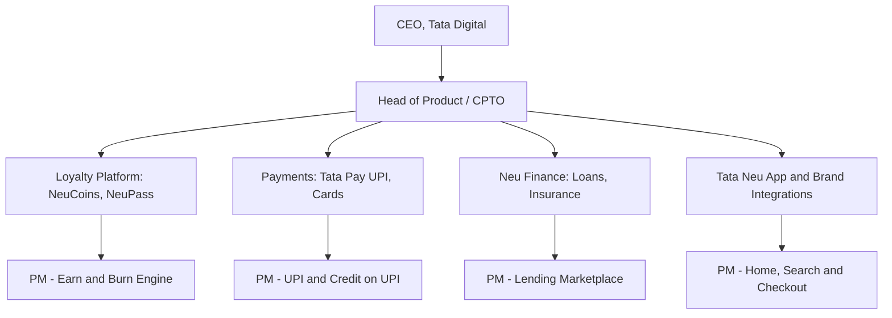
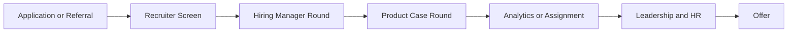

# Tata Digital Product Manager Interview Guide | Tata Neu

- **Source:** https://nextsprints.com/guide/tata-digital-product-manager-interview-guide

- **Type:** `interview-guide`

- **Updated:** October 31, 2026

---

## Introduction

Tata Digital is the Tata Group's consumer technology arm and the company behind Tata Neu, the group's super app launched in April 2022. Its portfolio covers BigBasket (groceries and BB Now quick commerce), Tata 1mg (pharmacy and diagnostics), Croma (electronics), Tata CLiQ (fashion and lifestyle), Tata Pay UPI, Neu Finance (personal loans, insurance and investments through partners), and the NeuCoins and NeuPass loyalty program used across Tata brands such as Air India, IHCL, Westside and Titan. The Tata Neu HDFC Bank and Tata Neu SBI co-branded credit cards sit on top of that loyalty layer.

Product management at Tata Digital is shaped by a clear strategic reset. In FY26, the digital group reported revenue of about ₹35,990 crore and a net loss of about ₹4,974 crore, with BigBasket the largest drag. Since CEO Sajith Sivanandan took charge in September 2025, Tata Digital has moved away from GMV-led growth toward loyalty, financial services and monetisation across the group. For PM candidates, this means interviews lean heavily on unit economics, loyalty design, payments and credit, and making trade-offs between growth and profitability.

| Hiring Metric | Value (estimated) |
| --- | --- |
| Typical PM interview rounds | 3–5 (AmbitionBox reports 2–3 for many roles) |
| Reported interview difficulty | About 3 out of 5 (Glassdoor) |
| Typical time from first call to offer | 2–4 weeks for lateral hires |
| Main PM locations | Bengaluru and Mumbai (1mg teams in Gurugram) |
| Campus PM intake | Small; mostly via MBA internships converting to PPOs |

> What Candidates Report
> Candidates report that interviewers care less about textbook frameworks and more about whether you understand how money flows in the ecosystem: who funds a NeuCoin, what a UPI payment earns, and why BigBasket's dark-store density matters.

## PM Role

> Tata Digital Product Manager
> A Tata Digital Product Manager owns a part of the Tata Neu ecosystem (such as loyalty, payments, lending, a brand integration or a commerce vertical) and balances customer experience, partner economics (banks, lenders, Tata brands) and regulatory constraints to grow engagement and profitable revenue.

Responsibilities:

- Define roadmaps for areas such as NeuCoins and NeuPass, Tata Pay UPI, Neu Finance, or the Tata Neu home and checkout
- Work with Tata brand teams (BigBasket, Croma, 1mg, CLiQ) on shared loyalty and identity
- Partner with banks and lenders (HDFC Bank, SBI Card, Tata Capital and others) on card, credit and insurance journeys
- Write PRDs, define metrics, and run experiments with engineering, design and analytics
- Model unit economics: reward cost, interchange, distribution fees, contribution margin
- Ensure compliance with RBI, NPCI and consumer-protection rules in collaboration with legal and risk teams

The chart is illustrative; portfolio companies such as BigBasket and Tata 1mg run their own product organisations with separate hiring.

| Aspect | Tata Digital PM | Consumer Startup PM | Big Tech PM in India |
| --- | --- | --- | --- |
| Focus | Ecosystem, loyalty, fintech | Single product growth | Platform scale |
| Pace | Fast, with group governance | Very fast | Fast |
| Partner management | Very high (banks, brands) | Moderate | Moderate |
| Regulatory involvement | High in finance and payments | Varies | Moderate |
| Business acumen expected | Very high (P&L pressure) | High | Moderate |

Real-world example: when Tata Neu introduced 12-month validity for NeuCoins from August 2025 and tightened some UPI earn rules on co-branded cards, PMs had to balance loyalty cost against user trust, coordinate with bank partners, and redesign expiry communication in the app.

## Job Requirements

Common titles: Associate Product Manager, Product Manager, Senior Product Manager, Lead/Principal Product Manager, and Director of Product. Some roles are posted as Product Owner or Product Lead.

Typical requirements by level:

- APM / campus hire: MBA from a top B-school (IIMs, ISB, FMS, XLRI, SPJIMR) or engineering degree from IITs/NITs with a strong internship; 0–2 years of experience
- PM: 2–5 years in product, ideally in consumer internet, e-commerce, payments or fintech
- Senior PM: 5–8 years with ownership of a live product and measurable outcomes
- Lead PM and above: 8+ years, team leadership, partner negotiation experience

Skills interviewers look for:

- Product sense for Indian consumers across metros and Tier-2 cities
- Analytical ability: SQL, funnel analysis, cohort retention, A/B testing
- Business and unit economics, especially for loyalty, quick commerce and lending
- Understanding of UPI, credit cards, RBI digital lending rules and NPCI frameworks for fintech roles
- Stakeholder management across Tata brands and external partners
- Clear written communication (PRDs, one-pagers)

> Expert Advice
> Quantify impact in your resume with business outcomes (conversion, retention, cost per order) rather than features shipped. Tata Digital interviewers often ask how a feature affected the P&L.

## Interview Process Breakdown

Lateral PM process as reported by candidates:

| Stage | Format | Duration | Focus Areas |
| --- | --- | --- | --- |
| Recruiter Screen | Phone | 20–30 mins | Background, motivation, notice period, expectations |
| Hiring Manager | Video | 45–60 mins | Past products, depth of ownership, domain fit |
| Product Case | Video or in person | 45–60 mins | Product design or improvement on a Tata Neu product |
| Analytics / Assignment | Video or take-home | 45 mins or 2–3 days | Metrics, RCA, SQL-style reasoning, or a written PRD |
| Leadership + HR | In person or video | 30–45 mins each | Strategy, culture fit, compensation |

Detailed Breakdown:

- Recruiter Screen:

Basic fit check covering your experience, why Tata Digital, and compensation expectations. Expect questions on why you want to work in a conglomerate-backed company versus a startup.

- Product Case Round:

Typical prompts include designing a feature for NeuPass, improving Tata 1mg's refill journey, or making Croma's online-to-store experience better. Interviewers expect clear segmentation, prioritisation and metrics.

- Analytics or Assignment:

Root cause analysis (for example, a drop in BB Now repeat orders) or a metrics question (how to measure NeuCoins' success). Some teams give a take-home case with a short presentation.

- Leadership Round:

Strategy questions about Tata Neu's direction, quick-commerce competition, or financial services. Candidates report questions such as "Should Tata Neu remain a super app?"

Campus process (MBA and engineering): pre-placement talk, CV shortlist, sometimes a case or group discussion, then two interview rounds on placement day covering a product case and a personal/HR discussion. Many campus PM hires come through summer internships converting to pre-placement offers.

Timeline Expectations:

- Lateral hires: 2–4 weeks from first call to offer
- Campus: decisions on the same day or within a week of interviews
- Feedback is usually shared through the recruiter within a few days

## Product Manager Compensation & Levels at Tata Digital

Levels:

1. Associate Product Manager (APM)
2. Product Manager
3. Senior Product Manager
4. Lead / Principal Product Manager
5. Director of Product
6. VP / Head of Product

| Level | Total Annual Compensation (INR, 2026 estimate) |
| --- | --- |
| APM (campus MBA) | ₹24–32 lakh |
| APM (engineering graduate) | ₹14–22 lakh |
| Product Manager | ₹28–42 lakh |
| Senior PM | ₹40–60 lakh |
| Lead / Principal PM | ₹55–80 lakh |
| Director of Product | ₹80 lakh–1.3 crore |
| VP / Head of Product | ₹1.3 crore+ |

These ranges are anchored on AmbitionBox data (Product Manager ₹23–55 lakh for 2–9 years' experience; Senior PM ₹24.5–60.5 lakh in Mumbai) and extrapolated for other levels. Compensation is mainly fixed salary plus an annual performance bonus; equity-like long-term incentives are less common than at venture-backed startups. See our salary guide for detail.

## How to Prepare

Principles that matter at Tata Digital:

1. Trust first: the Tata brand carries high trust, especially in financial products. Show you won't trade it for short-term growth.
2. Ecosystem thinking: solutions should help more than one Tata brand.
3. Unit economics: know what a NeuCoin costs, what UPI earns, and why dark-store density matters.
4. Partner empathy: banks, lenders and Tata brands have their own goals.

Tailor Your Resume: Highlight measurable results, partner management, and any fintech, e-commerce or loyalty experience. Use the STAR method for achievements. For a review tailored to Tata Digital roles, consider NextSprints' Resume Review service.

Practice Product Cases:

- Loyalty design: NeuCoins, NeuPass, household rewards
- Payments: Tata Pay UPI, credit on UPI, reward economics
- Commerce: BigBasket quick commerce, Croma omnichannel, 1mg refills, CLiQ pricing
- Strategy: super app versus loyalty layer; competing with Reliance, Amazon and Flipkart

NextSprints' Product Manager Interview Questions include Tata Digital-specific cases on each of these.

Mock Interviews: Practise with PMs from Indian consumer internet or fintech companies who can push you on numbers. If you need one, NextSprints offers PM Coaching with experienced interviewers.

## FAQs

### Does Tata Digital have a formal APM program?

There is no widely publicised, branded APM program like those at some global tech companies. Candidates report that Tata Digital hires associate PMs through MBA campus placements and summer internships that convert to pre-placement offers, plus occasional off-campus hiring of engineers with 0–2 years of experience. Check placement reports from your institute and Tata Digital's careers page for current openings.

### How long does the Tata Digital PM interview process take?

For lateral hires, candidates typically report two to four weeks from the first recruiter call to an offer, with three to five rounds. AmbitionBox data for Tata Digital overall suggests many processes finish within about two weeks. Campus processes usually conclude on placement day or within a week.

### What kind of case questions are asked?

Expect product cases grounded in Tata's portfolio: improving NeuPass, measuring NeuCoins, diagnosing a drop in BigBasket orders, deciding on UPI reward rules, or planning Tata Neu's strategy. Interviewers value structured thinking, realistic Indian user personas and clear metrics.

### How technical do Tata Digital PM interviews get?

Most PM roles don't require coding, but you should be comfortable with APIs, data pipelines and basic SQL logic. Fintech roles expect familiarity with UPI flows, card networks, KYC, and RBI digital lending guidelines. Platform roles (loyalty engine, identity) may involve system design discussions at a high level.

### How should I talk about Tata Digital's losses in an interview?

Treat it as context, not criticism. Show you understand why the group is shifting toward loyalty and financial services, and how your work would improve unit economics. Interviewers appreciate candidates who can propose growth that pays for itself.

## Related Guides Section

📖 [Tata Digital Product Strategy Guide](/guide/tata-digital-product-strategy-guide) – How Tata Neu is shifting from super app to loyalty and financial services.

📖 [Tata Digital Product Manager Salary Guide](/guide/tata-digital-product-manager-salary-guide) – 2026 INR pay bands and negotiation tips.

📖 [Tata Neu Product Teardown](/guide/tata-neu-loyalty-super-app-product-teardown) – Deep dive into Tata Neu's features, UX and business model.

Disclaimer: This guide is created for product management interview preparation purposes only. The analysis and methodology are based on public information, and figures are estimates.
