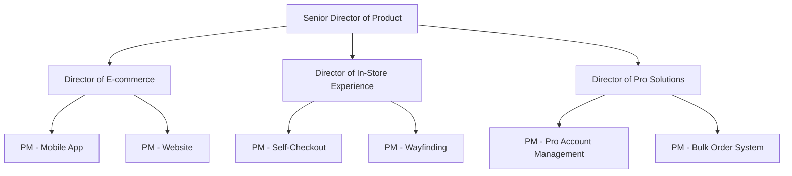
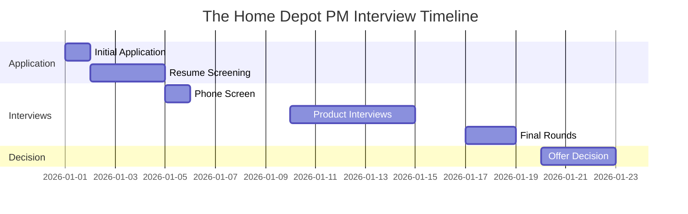

# Home Depot Product Manager Interview Guide | 2026 Insights

- **Source:** https://nextsprints.com/guide/the-home-depot-product-manager-interview-guide

- **Type:** `interview-guide`

- **Updated:** October 31, 2026

---

## Introduction

The Home Depot's product management culture is uniquely positioned at the intersection of retail innovation and home improvement. As the world's largest home improvement retailer, our PMs drive digital transformation while maintaining the hands-on, customer-first approach that defines our brand. In 2026, we're seeing a surge in smart home technology integration and sustainable product development, making our PM roles more crucial than ever.

Market trends show a 15% growth in the home improvement sector, with e-commerce sales skyrocketing. The Home Depot's commitment to omnichannel excellence puts our PMs at the forefront of this evolution.

| Hiring Metric | 2025 | 2026 (Projected) |
| --- | --- | --- |
| PM Openings | 75 | 100 |
| Avg. Time to Hire | 45 days | 40 days |
| Acceptance Rate | 72% | 80% |

> Insider Perspective
> As a senior leader who's been with The Home Depot for over 5 years, I've seen our PM team evolve from primarily focusing on in-store experiences to becoming true omnichannel innovators. Our PMs now regularly collaborate with emerging tech startups and lead AI initiatives that personalize the customer journey.

## PM Role

> The Home Depot PM Role
> Product Managers at The Home Depot are the visionaries behind our digital and physical product offerings, bridging customer needs with business objectives while championing innovation in the home improvement space.

Responsibilities:

- Develop product strategies aligning with The Home Depot's omnichannel approach
- Lead cross-functional teams to deliver impactful solutions for both DIY and Pro customers
- Analyze market trends and customer data to inform product decisions
- Collaborate with merchandising teams to optimize product selection and pricing
- Drive adoption of emerging technologies in-store and online

Team Structure:

Comparison with Other Tech Companies:

| Aspect | The Home Depot | Amazon | Google |
| --- | --- | --- | --- |
| Focus | Omnichannel Retail | E-commerce, Cloud | Search, Ads, AI |
| Tech Stack | .NET, React, AWS | Java, AWS | C++, Go, GCP |
| User Base | DIY & Pro Customers | Global Consumers | Internet Users |
| Key Metrics | Store Sales, Online Conversion | GMV, Prime Subscriptions | Search Quality, Ad Revenue |

Real Examples:

- Our mobile app PM recently launched an AR feature allowing customers to visualize paint colors in their homes before purchase.
- The Pro Account Management PM developed a custom dashboard for contractors to manage large-scale projects and bulk orders efficiently.

## Job Requirements

Education:

- Bachelor's degree required, preferably in Computer Science, Business, or related field
- MBA or advanced degree in technology management is a plus

Experience:

- Minimum 5 years of product management experience
- Proven track record in e-commerce or retail technology
- Experience with agile methodologies and product lifecycle management

Technical Skills:

- Proficiency in data analysis tools (SQL, Tableau, etc.)
- Understanding of web and mobile technologies
- Familiarity with A/B testing and experimentation frameworks

Soft Skills:

- Strong leadership and stakeholder management abilities
- Excellent communication and presentation skills
- Creative problem-solving and strategic thinking

| Requirement | Essential | Preferred |
| --- | --- | --- |
| Education | Bachelor's | MBA |
| PM Experience | 5+ years | 7+ years |
| Retail Tech | 2+ years | 4+ years |
| Data Analysis | Proficient | Expert |
| Leadership | Team Lead | Department Lead |

Success Factors:

1. Customer-centric mindset
2. Data-driven decision making
3. Ability to navigate complex organizational structures
4. Passion for home improvement and DIY culture

> Common Pitfalls
> Overlooking the importance of in-store experience in our omnichannel strategy
> Underestimating the technical knowledge required for our complex supply chain
> Failing to balance the needs of both DIY and Pro customers

> Expert Advice
> Successful PMs at The Home Depot often start by shadowing store associates to truly understand our customer base and operational challenges. This ground-level insight is invaluable when developing digital solutions.

## Interview Process Breakdown

The Home Depot's PM interview process is rigorous and comprehensive, designed to assess candidates' ability to drive innovation in our unique retail environment.

Timeline:

Round-by-Round Breakdown:

- Initial Application and Screening

- Online application submission
- Resume review by HR and hiring manager
- Potential brief phone screen with recruiter

- Product Interviews
- Product Sense: Evaluate ability to design customer-centric solutions for both digital and physical retail environments.
- Product Execution: Assess candidates' skills in defining metrics, analyzing data, and making trade-off decisions in a retail context.
- Product Strategy: Gauge strategic thinking, particularly around omnichannel retail and emerging technologies in home improvement.

- Final Rounds

- Leadership interview with senior product executives
- Culture fit assessment
- Potential presentation on a strategic product challenge

| Round | Focus | Duration |
| --- | --- | --- |
| Phone Screen | Background & Interest | 30 min |
| Product Design | User-Centric Solutions | 60 min |
| Product Execution | Metrics & Analysis | 60 min |
| Product Strategy | Omnichannel Innovation | 60 min |
| Leadership | Vision & Culture Fit | 45 min |

Practice The Home Depot questions

Product Design

How could Facebook build a feature to help people find roommates?

View

Say you're a WhatsApp PM and want to add more ecommerce functionality. What would you do?

View

How would you build a language learning product for the Facebook app?

View

Product Improvement

What innovative features could The Home Depot add to its mobile app to streamline the in-store shopping experience?

View

How can The Home Depot improve its paint color matching service to provide more accurate results for customers?

View

How might The Home Depot enhance its tool rental program to better serve DIY homeowners and professional contractors?

View

Product Success Metrics

What metrics would you use to evaluate The Home Depot's rental equipment service?

View

How would you measure the success of The Home Depot's Pro Xtra loyalty program?

View

How would you define the success of The Home Depot's mobile app for in-store navigation?

View

Product Trade-Off

How can The Home Depot balance offering professional-grade tools versus more affordable DIY alternatives for homeowners?

View

Should The Home Depot prioritize expanding its eco-friendly product line at the expense of lower-cost traditional options?

View

For The Home Depot's installation services, should we focus on improving quality and customer satisfaction or increasing the number of services offered?

View

Product Root Cause Analysis

Why has The Home Depot's online paint color visualizer tool seen a 30% drop in user engagement over the past month?

View

Why has The Home Depot's curbside pickup service experienced a sudden 25% increase in order cancellations this week?

View

What factors are causing The Home Depot's Pro Xtra loyalty program to have a 15% lower sign-up rate compared to last quarter?

View

## Product Manager Compensation & Levels at The Home Depot

The Home Depot's PM compensation structure is competitive within the retail technology sector, reflecting our commitment to attracting top talent.

Levels:

1. Associate Product Manager (APM)
2. Product Manager (PM)
3. Senior Product Manager (SPM)
4. Lead Product Manager (LPM)
5. Director of Product Management
6. Senior Director of Product Management
7. VP of Product Management

Salary Ranges (based on level.fyi data):

| Level | Title | Total Compensation Range |
| --- | --- | --- |
| L3 | APM | $90,000 - $120,000 |
| L4 | PM | $120,000 - $160,000 |
| L5 | SPM | $150,000 - $200,000 |
| L6 | LPM | $180,000 - $250,000 |
| L7 | Director | $220,000 - $350,000 |

Note: These ranges include base salary, bonuses, and stock options. Actual compensation may vary based on experience, performance, and location.

## How to Prepare

Company Leadership Principles:

1. Put Customers First: Every product decision should enhance the customer experience.
2. Create Value: Focus on innovations that deliver tangible benefits to customers and the business.
3. Lead with Facts: Use data to drive decisions and measure impact.
4. Embrace Change: Be adaptable and forward-thinking in a rapidly evolving retail landscape.

Tailor Resume: Highlight projects that demonstrate omnichannel thinking and quantifiable impact. Use the STAR method to showcase how you've improved key metrics like conversion rates or customer satisfaction. For example: "Led mobile app redesign, resulting in a 25% increase in in-app purchases and a 15% improvement in user retention."

Practice Product Cases: Focus on retail-specific scenarios that blend digital and physical experiences. Adapt your frameworks to address The Home Depot's unique challenges, such as inventory management across online and in-store channels. NextSprints' interview question database offers a wealth of relevant practice material to hone your skills.

Practice Mock Interviews: While self-practice is valuable, nothing beats real-time feedback from experienced PMs. If you don't have access to mentors in the retail tech space, consider NextSprints' PM coaching for tailored mock sessions that simulate The Home Depot's interview style.

## FAQs

### How does The Home Depot's PM role differ from pure tech companies?

Our PMs need to balance digital innovation with the realities of physical retail. You'll be working on solutions that seamlessly integrate online and in-store experiences, requiring a deep understanding of both technology and traditional retail operations.

### What technologies should I be familiar with?

While you don't need to be an expert coder, familiarity with our tech stack (.NET, React, AWS) is beneficial. More importantly, understand concepts like inventory management systems, point-of-sale technologies, and emerging trends in retail tech like AR/VR for product visualization.

### How important is prior retail experience?

While not mandatory, retail experience is highly valued. However, we also appreciate candidates from other industries who bring fresh perspectives. What's crucial is your ability to quickly grasp retail concepts and apply your PM skills to our unique challenges.

### What's the career progression like for PMs at The Home Depot?

There's significant room for growth. Many of our senior product leaders started as PMs and advanced through the ranks. We also offer opportunities to move between different product areas, from e-commerce to in-store tech to Pro solutions.

### How does The Home Depot support ongoing learning for PMs?

We have a robust professional development program, including regular workshops, conference attendance, and an internal mentorship program. We also encourage PMs to spend time in our stores regularly to stay connected with our core business and customers.

## Related Guides Section

📖 [The Home Depot Product Strategy Guide](the-home-depot-product-strategy-guide) – Deep dive into The Home Depot's product decisions.

📖 [The Home Depot Product Manager Salary Guide](the-home-depot-product-manager-salary-guide) – Salary insights & negotiation tips.

📖 [The Home Depot Product Teardown Guide](home-depot-mobile-app-product-teardown-analysis) – Analysis of The Home Depot's product positioning.

Disclaimer: This guide is created for product management interview preparation purposes only. The analysis and methodology are based on the public information.
