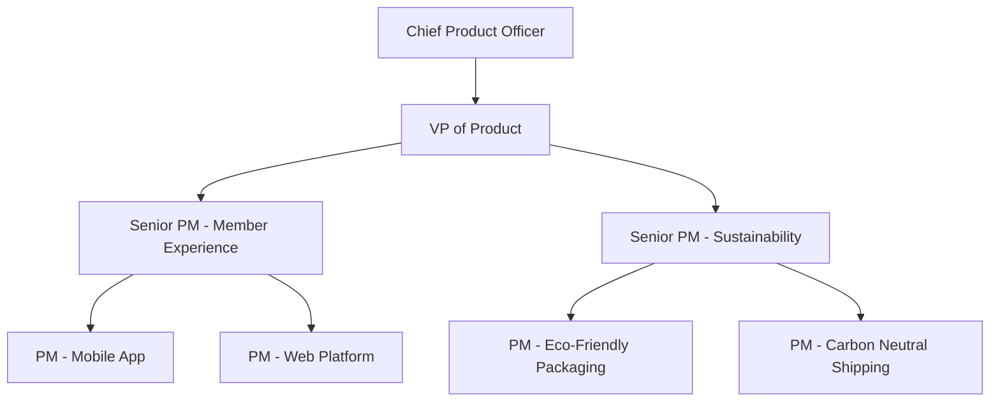
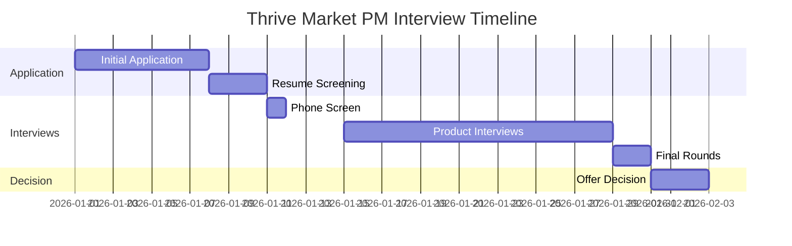

# Thrive Market Product Strategy Guide | Strategic Roadmap

- **Source:** https://nextsprints.com/guide/thrive-market-product-manager-interview-guide

- **Type:** `interview-guide`

- **Updated:** October 31, 2026

---

## Introduction

Thrive Market's product management culture is deeply rooted in its mission to make healthy living easy and affordable for everyone. As a Senior PM at Thrive, I've witnessed firsthand how our product decisions directly impact millions of members' access to organic, non-GMO products. The e-commerce landscape is rapidly evolving, and Thrive Market is at the forefront of combining sustainability with cutting-edge technology.

In 2026, the role of a Product Manager at Thrive Market is more crucial than ever. With the rise of personalized nutrition and eco-conscious consumerism, our PMs are tasked with creating innovative solutions that not only meet customer needs but also align with our environmental values.

| Hiring Metric | 2025 | 2026 (Projected) |
| --- | --- | --- |
| PM Openings | 15 | 25 |
| Applicants | 3000 | 5000 |
| Hire Rate | 0.5% | 0.4% |

> Insider Perspective
> At Thrive Market, we're not just looking for traditional PMs. We seek individuals who can balance data-driven decision-making with a genuine passion for health and sustainability. Our most successful hires have often demonstrated a personal commitment to the lifestyle we promote.

## PM Role

> Thrive Market PM Role
> A Product Manager at Thrive Market leads cross-functional teams to develop and optimize e-commerce solutions that enhance the member experience, drive sustainable practices, and grow our health-conscious community.

Key responsibilities include:

- Defining product strategy aligned with Thrive's mission
- Conducting market research on health food trends and consumer behavior
- Collaborating with sourcing teams to expand our eco-friendly product offerings
- Analyzing user data to personalize the shopping experience
- Implementing features that educate members on sustainable living

| Aspect | Thrive Market | Amazon | Whole Foods |
| --- | --- | --- | --- |
| Focus | Health & Sustainability | General E-commerce | Physical Retail |
| Scale | Niche, Growing | Massive | Large |
| Tech | Custom E-commerce | Advanced AI/ML | Limited E-commerce |

Real Example: Our "Conscious Bundles" feature, which I led, combines AI-driven product recommendations with sustainability metrics, helping members make informed choices that align with their values and health goals.

## Job Requirements

Education:

- Bachelor's degree required, preferably in Computer Science, Business, or related field
- MBA or advanced degree in sustainability a plus

Experience:

- 5+ years of product management experience in e-commerce or health/wellness tech
- Proven track record of launching successful products or features
- Experience with agile methodologies and data-driven decision making

Technical Skills:

- Proficiency in product analytics tools (e.g., Amplitude, Mixpanel)
- Understanding of A/B testing and experimentation frameworks
- Familiarity with e-commerce platforms and inventory management systems

Soft Skills:

- Strong communication and stakeholder management
- Ability to balance business objectives with environmental considerations
- Passion for health, wellness, and sustainable living

| Requirement | Essential | Preferred |
| --- | --- | --- |
| Education | Bachelor's | MBA/Advanced |
| Experience | 5+ years | 7+ years |
| Tech Skills | Analytics | E-commerce Platforms |
| Soft Skills | Communication | Sustainability Passion |

Success Factors:

1. Demonstrated ability to drive growth while maintaining eco-friendly practices
2. Innovative approach to solving e-commerce challenges
3. Strong empathy for health-conscious consumers

> Common Pitfalls
> Many candidates focus solely on growth metrics without considering Thrive's commitment to sustainability. Successful PMs at Thrive Market must show how they can achieve both simultaneously.

> Expert Advice
> Showcase projects where you've balanced business growth with ethical considerations. Thrive values PMs who can think holistically about product impact.

## Interview Process Breakdown

The Thrive Market PM interview process is designed to assess candidates' ability to drive sustainable growth in the health e-commerce space.

Round-by-Round Breakdown:

- Initial Application and Screening:

- Online application submission
- Resume and cover letter review by HR
- Initial phone screen with recruiter (30 minutes)

- Product Interviews:
- Product Sense: Assess ability to design products that balance member needs with sustainability goals.
- Product Execution: Evaluate candidates' approach to implementing eco-friendly features and measuring their impact.
- Product Strategy: Gauge strategic thinking on scaling Thrive's mission and market position.

- Final Rounds:

- Leadership interview with VP of Product or CPO
- Culture fit assessment with team members

| Round | Focus | Duration |
| --- | --- | --- |
| Phone Screen | Background & Motivation | 30 min |
| Product Sense | User-Centric Design | 60 min |
| Product Execution | Implementation & Metrics | 60 min |
| Product Strategy | Long-term Vision | 60 min |
| Leadership | Executive Presence | 45 min |
| Team Fit | Cultural Alignment | 45 min |

Practice Thrive Market questions

Product Design

How could Facebook build a feature to help people find roommates?

View

Say you're a WhatsApp PM and want to add more ecommerce functionality. What would you do?

View

How would you build a language learning product for the Facebook app?

View

Product Improvement

What improvements could Thrive Market make to its mobile app to streamline the shopping experience?

View

In what ways could Thrive Market expand its selection of eco-friendly household products to better serve environmentally conscious consumers?

View

How can Thrive Market enhance its auto-ship subscription service to offer more flexibility for customers?

View

Product Success Metrics

What metrics would you use to evaluate Thrive Market's mobile app shopping experience?

View

How would you measure the success of Thrive Market's auto-ship subscription program?

View

How would you define the success of Thrive Market's clean wine collection?

View

Product Trade-Off

How can Thrive Market balance offering competitive prices on health foods with maintaining high-quality, ethically sourced products?

View

Should Thrive Market prioritize expanding its organic produce selection or focus on increasing the variety of sustainable household products?

View

For Thrive Market's private label products, should we emphasize creating unique, innovative items or replicating popular national brands at lower prices?

View

Product Root Cause Analysis

Why has Thrive Market's organic coconut oil sales dropped by 30% in the past month?

View

What caused the sudden 50% decrease in new member sign-ups for Thrive Market's auto-delivery program last week?

View

Why has Thrive Market's mobile app user engagement declined by 25% since the latest update two weeks ago?

View

## Product Manager Compensation & Levels at Thrive Market

Thrive Market's compensation structure is competitive within the health tech and e-commerce sectors, reflecting our commitment to attracting top talent passionate about our mission.

Level Structure:

- Associate Product Manager (APM)
- Product Manager (PM)
- Senior Product Manager (SPM)
- Principal Product Manager (PPM)
- Director of Product

Salary Ranges (based on level.fyi data):

| Level | Base Salary | Total Compensation |
| --- | --- | --- |
| APM | $90k - $110k | $110k - $140k |
| PM | $120k - $150k | $150k - $200k |
| SPM | $150k - $180k | $200k - $250k |
| PPM | $180k - $220k | $250k - $350k |
| Director | $200k - $250k | $300k - $500k |

Note: These ranges are approximate and may vary based on experience, performance, and market conditions. Thrive Market also offers equity packages and comprehensive benefits focused on health and wellness.

## How to Prepare

Company Leadership Principles:

1. Member-First Mindset: Every decision should enhance our members' journey to healthier living.
2. Sustainable Innovation: Develop solutions that are good for people and the planet.
3. Data-Driven Wellness: Use analytics to personalize and improve health outcomes.
4. Collaborative Impact: Work across teams to maximize our mission's reach.

Tailor Your Resume: Focus on quantifiable achievements that demonstrate your ability to drive growth sustainably. Use the STAR method to highlight projects where you've balanced business objectives with ethical considerations. For expert feedback on your PM resume, consider NextSprints' Resume Review service ([https://nextsprints.com/resume-review](https://nextsprints.com/resume-review)).

Practice Product Cases: Thrive Market cases often involve complex trade-offs between growth, sustainability, and member experience. Practice adapting your frameworks to include environmental impact assessments. NextSprints offers a comprehensive database of Product Manager Interview Questions ([https://nextsprints.com/product-manager-interview-questions](https://nextsprints.com/product-manager-interview-questions)) tailored for mission-driven companies like Thrive.

Practice Mock Interviews: While self-practice is valuable, getting feedback from experienced PMs is crucial. They can help you refine your approach to Thrive's unique challenges. If you don't have access to senior PMs in your network, NextSprints' PM Coaching ([https://nextsprints.com/pm-coaching](https://nextsprints.com/pm-coaching)) provides expert-led mock interviews specific to health tech and e-commerce roles.

## FAQs

### How does Thrive Market's PM role differ from traditional e-commerce companies?

At Thrive, PMs must constantly balance growth objectives with our commitment to sustainability and health. This requires a unique blend of e-commerce expertise, wellness industry knowledge, and environmental consciousness.

### What technical skills are most valued for PMs at Thrive Market?

While we value a range of technical skills, proficiency in data analytics, A/B testing, and familiarity with sustainable supply chain management are particularly important in our environment.

### How does Thrive Market approach product innovation?

We encourage a "test and learn" culture, but with a focus on sustainable practices. PMs are expected to innovate not just in features, but in how we can make our entire product lifecycle more eco-friendly.

### What's the career progression like for PMs at Thrive Market?

PMs at Thrive have opportunities to grow both vertically (to senior and leadership roles) and horizontally (specializing in areas like sustainability tech or personalized nutrition).

### How does Thrive Market support ongoing learning for its PMs?

We offer regular workshops on sustainable tech trends, access to health and wellness conferences, and partnerships with environmental organizations to keep our PMs at the forefront of conscious consumerism.

## Related Guides Section

📖 [Thrive Market Product Strategy Guide](thrive-market-product-strategy-guide) – Deep dive into Thrive Market's product decisions.

📖 [Thrive Market Product Manager Salary Guide](thrive-market-product-manager-salary-guide) – Salary insights & negotiation tips.

📖 [Thrive Market Product Teardown Guide](thrive-market-product-teardown-analysis) – Analysis of Thrive Market's product positioning.

Disclaimer: This guide is created for product management interview preparation purposes only. The analysis and methodology are based on the public information.
