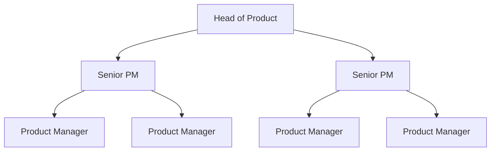

# Thumbtack Product Management Interview Guide | 2026 Insights

- **Source:** https://nextsprints.com/guide/thumbtack-product-manager-interview-guide

- **Type:** `interview-guide`

- **Updated:** October 31, 2026

---

## Introduction

Thumbtack's product management culture is uniquely positioned at the intersection of technology and local services. As a marketplace connecting skilled professionals with customers, our PMs face the exciting challenge of balancing supply and demand while continuously innovating to improve user experiences.

The gig economy and home services market are experiencing rapid growth, with Thumbtack at the forefront. In 2026, product managers play a crucial role in shaping our platform's future, driving user engagement, and optimizing our matching algorithms.

| Metric | Value |
| --- | --- |
| YoY Revenue Growth | 32% |
| Active Professionals | 500,000+ |
| Monthly Active Users | 10M+ |
| PM Team Growth | 25% |

> Expert Insight
> Thumbtack's PM team is evolving rapidly to meet market demands. We're seeing a shift towards more data-driven decision-making and a focus on AI-powered personalization to enhance our marketplace dynamics.

## PM Role

> Thumbtack PM Role
> Thumbtack Product Managers drive the vision, strategy, and execution of features that connect customers with skilled professionals, optimizing the marketplace for both sides of our platform.

Responsibilities:

- Define and prioritize product roadmaps
- Analyze market trends and user behavior
- Collaborate with engineering, design, and marketing teams
- Conduct A/B testing and interpret results
- Optimize user acquisition and retention strategies

| Aspect | Thumbtack PM | Google PM | Amazon PM |
| --- | --- | --- | --- |
| Focus | Marketplace dynamics | Search and ads | E-commerce and logistics |
| Key Metrics | Match rate, pro retention | Search quality, ad revenue | Conversion rate, shipping efficiency |
| Unique Challenge | Balancing local supply/demand | Global scale, privacy concerns | Inventory management, last-mile delivery |

Real Example: Our PMs recently launched an AI-powered instant booking feature, allowing customers to instantly book certain services without waiting for pro responses, significantly improving conversion rates.

## Job Requirements

Education:

- Bachelor's degree required, preferably in Computer Science, Business, or related field
- MBA or advanced degree a plus

Experience:

- 3-5 years of product management experience
- Proven track record in marketplace or two-sided platforms
- Experience with data analysis and A/B testing

Technical Skills:

- Proficiency in SQL and data visualization tools (e.g., Tableau)
- Understanding of machine learning concepts, particularly in matching algorithms
- Familiarity with agile methodologies

Soft Skills:

- Strong communication and stakeholder management
- Analytical thinking and problem-solving
- User empathy and customer-centric mindset

| Requirement | Essential | Preferred |
| --- | --- | --- |
| Education | Bachelor's degree | MBA |
| Experience | 3+ years in PM | 5+ years in marketplace PM |
| Technical | SQL, data analysis | Machine learning |
| Soft Skills | Communication, analytical thinking | Leadership, innovation |

Success Factors:

1. Ability to balance short-term gains with long-term strategy
2. Strong understanding of local services market dynamics
3. Data-driven decision-making skills
4. Collaborative approach to cross-functional teamwork

> Common Pitfalls
> Avoid focusing solely on the customer side of the marketplace. Successful Thumbtack PMs understand and optimize for both pro and customer experiences.

> Expert Tips
> Familiarize yourself with Thumbtack's unique challenges in local services matching. Be prepared to discuss strategies for improving match quality and increasing pro engagement.

## Interview Process Breakdown

Thumbtack's PM interview process is designed to assess candidates' ability to navigate the complexities of our two-sided marketplace. Here's an overview of what to expect:

1. Initial Application and Screening

- Resume review and initial phone screen with recruiter (1-2 weeks)

1. Product Interviews

- Product Sense: Assess your ability to design and improve products for both pros and customers.
- Product Execution: Evaluate your skills in defining metrics and analyzing product performance.
- Product Strategy: Test your strategic thinking and ability to grow Thumbtack's marketplace.

1. Final Rounds

- Leadership and cross-functional interviews
- Possible take-home assignment focused on marketplace optimization

| Round | Focus | Duration |
| --- | --- | --- |
| Phone Screen | Background and motivation | 30 minutes |
| Product Sense | Design and improvement | 45 minutes |
| Product Execution | Metrics and analysis | 45 minutes |
| Product Strategy | Growth and marketplace dynamics | 45 minutes |
| Leadership | Cross-functional collaboration | 30 minutes |
| Take-home (if applicable) | Marketplace optimization | 2-3 hours |

The entire process typically takes 3-4 weeks from initial application to offer.

Practice Thumbtack questions

Product Design

How could Facebook build a feature to help people find roommates?

View

Say you're a WhatsApp PM and want to add more ecommerce functionality. What would you do?

View

How would you build a language learning product for the Facebook app?

View

Product Improvement

What improvements could Thumbtack make to its mobile app to streamline the process of requesting quotes from professionals?

View

How can Thumbtack enhance its pro matching algorithm to better connect clients with the right service providers?

View

How might Thumbtack refine its review system to provide more valuable feedback for both customers and service providers?

View

Product Success Metrics

How would you define the success of Thumbtack's pricing guidance feature for service providers?

View

How would you measure the success of Thumbtack's instant booking feature for home services?

View

What metrics would you use to evaluate Thumbtack's pro finder tool for matching customers with service professionals?

View

Product Trade-Off

How can Thumbtack balance the need for detailed service provider profiles to help customers make informed decisions against the risk of overwhelming new providers during the onboarding process?

View

Should Thumbtack prioritize increasing the number of service providers on the platform or focus on improving the quality of existing providers to enhance user satisfaction?

View

For Thumbtack's instant booking feature, how should we weigh the convenience for customers against potential scheduling conflicts and reduced flexibility for service providers?

View

Product Root Cause Analysis

Why has Thumbtack's Instant Book feature seen a 30% drop in bookings over the past month?

View

What caused the sudden 50% decrease in new pro sign-ups on Thumbtack's mobile app last week?

View

Why has Thumbtack's customer satisfaction score for home cleaning services declined from 4.8 to 4.2 in the past quarter?

View

## Product Manager Compensation & Levels at Thumbtack

Thumbtack's PM levels are structured to provide clear growth paths and competitive compensation:

1. Associate Product Manager (APM)
2. Product Manager (PM)
3. Senior Product Manager (SPM)
4. Group Product Manager (GPM)
5. Director of Product
6. VP of Product

Salary ranges (based on level.fyi data for 2026):

| Level | Base Salary | Total Compensation |
| --- | --- | --- |
| APM | $100,000 - $130,000 | $120,000 - $160,000 |
| PM | $130,000 - $180,000 | $160,000 - $250,000 |
| SPM | $180,000 - $220,000 | $250,000 - $350,000 |
| GPM | $220,000 - $280,000 | $350,000 - $500,000 |

Note: Compensation may vary based on location, experience, and performance. Equity and bonuses are significant components of total compensation at higher levels.

## How to Prepare

Leadership Principles:

1. Customer Obsession: Understand and anticipate the needs of both pros and customers.
2. Data-Driven Innovation: Use metrics to inform product decisions and drive growth.
3. Marketplace Balance: Optimize for both sides of the Thumbtack platform.
4. Local Impact: Think globally, act locally to improve communities through our services.

Tailor Your Resume: Highlight experiences that demonstrate your ability to drive marketplace growth and balance supply and demand. Use the STAR method to showcase your impact, focusing on metrics like user acquisition, retention, and match quality improvements. Our resume review service can help you optimize your application for Thumbtack's specific requirements.

Practice Product Cases: Focus on marketplace-specific scenarios, such as improving pro retention or increasing customer booking rates. Adapt your frameworks to address Thumbtack's unique challenges in local services. Our product manager interview questions database offers a wide range of relevant practice cases.

Mock Interviews: Engage in realistic mock interviews that simulate Thumbtack's process. Practice articulating your thought process clearly and defending your decisions with data. If you don't have access to experienced PMs for feedback, consider our PM coaching service for expert-led mock sessions tailored to Thumbtack's interview style.

## FAQs

### What sets Thumbtack's PM role apart from other tech companies?

Thumbtack PMs uniquely focus on balancing a two-sided marketplace in the local services industry. This requires a deep understanding of both service provider and customer needs, as well as the ability to optimize for local market dynamics across diverse service categories.

### How important is technical background for Thumbtack PM roles?

While a technical background can be beneficial, especially for understanding our matching algorithms, it's not always required. More important is the ability to work effectively with engineering teams and understand the implications of technical decisions on our product strategy.

### What's the most challenging aspect of being a PM at Thumbtack?

Balancing the needs of service professionals and customers while driving overall marketplace growth is often cited as the most challenging aspect. PMs must constantly innovate to improve match quality and user experience on both sides of the platform.

### How does Thumbtack approach product experimentation?

We have a strong culture of A/B testing and data-driven decision making. PMs are expected to design and analyze experiments rigorously, often running multiple tests simultaneously across different user segments and service categories.

### What growth opportunities are available for PMs at Thumbtack?

Thumbtack offers significant growth potential for PMs. As the company expands into new service categories and markets, there are opportunities to take on larger product areas, lead cross-functional initiatives, and eventually move into senior leadership roles overseeing multiple product lines or entire business units.

## Related Guides Section

📖 [Thumbtack Product Strategy Guide](thumbtack-product-strategy-guide) – Deep dive into Thumbtack's product decisions.

📖 [Thumbtack Product Manager Salary Guide](thumbtack-product-manager-salary-guide) – Salary insights & negotiation tips.

📖 [Thumbtack Product Teardown Guide](thumbtack-product-manager-strategy-guide) – Analysis of Thumbtack's product positioning.

Disclaimer: This guide is created for product management interview preparation purposes only. The analysis and methodology are based on the public information.
