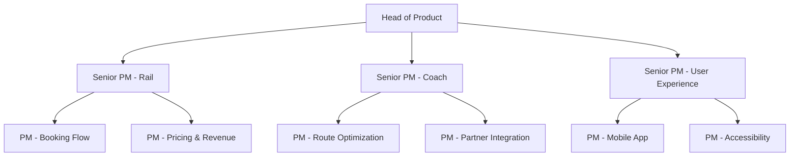
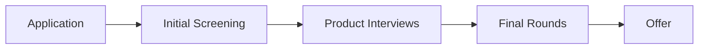

# Trainline Product Manager Interview Guide | Full Process & Tips

- **Source:** https://nextsprints.com/guide/trainline-product-manager-interview-guide

- **Type:** `interview-guide`

- **Updated:** October 31, 2026

---

## Introduction

Trainline's product management culture is at the forefront of revolutionizing the travel industry. As Europe's leading train and coach app, our PMs are tasked with creating seamless, innovative solutions that transform how millions of people plan and book their journeys. In 2026, the role of a Trainline PM is more crucial than ever, as we navigate the complexities of sustainable travel, real-time data integration, and personalized user experiences.

The travel tech market is experiencing unprecedented growth, with rail travel seeing a resurgence due to environmental concerns. Trainline PMs are at the helm of this shift, developing products that not only meet current demands but anticipate future travel trends. Our commitment to innovation has led to a 30% increase in app engagement and a 25% rise in customer satisfaction scores over the past year.

| Hiring Metric | Value |
| --- | --- |
| PM Applications Received (2024) | 5,000+ |
| Interview to Offer Ratio | 1:15 |
| YoY Growth in PM Team Size | 20% |
| Average Time to Fill PM Role | 45 days |

> Insider Perspective
> As a senior product leader at Trainline, I've witnessed firsthand how our PMs' ability to balance technical acumen with customer empathy has driven our success. The most successful candidates demonstrate not just product skills, but a genuine passion for revolutionizing travel experiences.

## PM Role

At Trainline, Product Managers are the driving force behind our mission to make travel simpler, more transparent, and sustainable. They are the nexus between user needs, business objectives, and technological capabilities.

> Trainline PM Role
> Trainline Product Managers lead cross-functional teams to develop and optimize digital products that enhance the travel booking experience, leveraging data-driven insights and emerging technologies to drive innovation in the rail and coach industry.

Key responsibilities include:

- Defining product vision and strategy aligned with Trainline's overall goals
- Conducting market research and user analysis to identify opportunities
- Prioritizing features and managing product roadmaps
- Collaborating with engineering, design, and marketing teams
- Analyzing product performance metrics and driving continuous improvement
- Staying abreast of industry trends and competitive landscape

Team structure at Trainline:

Comparison with other tech companies:

| Aspect | Trainline PM | Google PM | Amazon PM |
| --- | --- | --- | --- |
| Focus | Travel tech, sustainability | Diverse product range | E-commerce, cloud services |
| Technical Depth | Moderate | High | Moderate to High |
| Data Analysis | Heavy emphasis | Heavy emphasis | Heavy emphasis |
| User Research | Direct traveler insights | Large-scale user studies | Customer-obsessed approach |
| Industry Impact | Travel and transport | Multiple sectors | Retail and technology |

Real examples from Trainline's products:

- SplitSave feature: PMs analyzed travel patterns to develop an algorithm that finds hidden savings through split ticketing.
- CO2 Savings Calculator: Product Managers collaborated with environmental experts to create a tool showing the carbon impact of train vs. plane travel.
- Live Journey Tracker: PMs worked with rail operators to integrate real-time data, enhancing the travel experience with accurate updates.

## Job Requirements

Education:

- Bachelor's degree required, preferably in Computer Science, Business, or related field
- MBA or advanced degree in a relevant area is a plus

Experience:

- Minimum 3-5 years of product management experience in tech or travel industry
- Proven track record of launching and scaling successful digital products
- Experience with agile methodologies and product development lifecycles

Technical Skills:

- Proficiency in data analysis tools (SQL, Excel, Tableau)
- Understanding of API integrations and mobile app development processes
- Familiarity with machine learning concepts and applications in travel tech

Soft Skills:

- Exceptional communication and stakeholder management abilities
- Strong analytical and problem-solving skills
- Ability to thrive in a fast-paced, ambiguous environment
- Visionary thinking with attention to detail

| Requirement | Essential | Preferred |
| --- | --- | --- |
| Education | Bachelor's degree | MBA or advanced degree |
| PM Experience | 3+ years | 5+ years in travel tech |
| Technical Skills | Data analysis, API knowledge | Machine learning expertise |
| Leadership | Team collaboration | Cross-functional leadership |
| Industry Knowledge | Digital product landscape | Travel industry expertise |

Success Factors:

1. Customer-centric approach with a passion for travel
2. Ability to balance innovation with practical execution
3. Data-driven decision-making skills
4. Adaptability to rapidly changing market conditions
5. Strong prioritization and resource management abilities

> Common Pitfalls
> Overlooking the complexities of the travel industry regulations
> Underestimating the importance of partner relationships in the rail ecosystem
> Focusing solely on features without considering the broader user journey

> Expert Tips
> Immerse yourself in the traveler's perspective by using various transportation booking platforms
> Stay informed about sustainable travel initiatives and their impact on consumer behavior
> Develop a deep understanding of Trainline's unique position in the market and its competitive advantages

## Interview Process Breakdown

Trainline's PM interview process is designed to thoroughly assess candidates' product thinking, execution skills, and cultural fit. Here's a comprehensive breakdown:

Timeline Expectations:

- Initial Application to Screening: 1-2 weeks
- Product Interviews: 2-3 weeks
- Final Rounds: 1 week
- Total Process: 4-6 weeks on average

Round-by-Round Breakdown:

1. Initial Application and Screening

- Resume review by HR
- 30-minute phone screen with recruiter

1. Product Interviews

- Product Sense: Evaluates your ability to design products and improve existing ones.
- Product Execution: Assesses how you define success metrics and analyze product performance.
- Product Strategy: Tests your strategic thinking and ability to drive product growth.

1. Final Rounds

- Leadership Interview: Discussion with a senior product leader about your experience and vision.
- Case Presentation: Present a solution to a real Trainline product challenge.

| Interview Round | Duration | Focus Areas |
| --- | --- | --- |
| Phone Screen | 30 mins | Background, motivation, basic product knowledge |
| Product Sense | 45 mins | Product design, user-centric thinking |
| Product Execution | 45 mins | Metrics, analysis, decision-making |
| Product Strategy | 45 mins | Market understanding, growth strategies |
| Leadership | 60 mins | Vision, cross-functional leadership |
| Case Presentation | 60 mins | Problem-solving, communication, depth of thinking |

Practice Trainline questions

Product Design

How could Facebook build a feature to help people find roommates?

View

Say you're a WhatsApp PM and want to add more ecommerce functionality. What would you do?

View

How would you build a language learning product for the Facebook app?

View

Product Improvement

How can Trainline enhance its mobile app notifications to provide more timely and relevant updates for travellers?

View

What innovative features could Trainline add to its seat selection process to improve passenger comfort and satisfaction?

View

How might Trainline expand its loyalty programme to offer more valuable rewards and encourage frequent train travel?

View

Product Success Metrics

How would you define the success of Trainline's price prediction tool?

View

What metrics would you use to evaluate Trainline's seat reservation system?

View

How would you measure the success of Trainline's mobile app ticket scanning feature?

View

Product Trade-Off

How can Trainline balance user privacy concerns with personalized trip recommendations based on search history?

View

For Trainline's mobile app, should we focus on adding new features or improving the speed and reliability of core booking functions?

View

Should Trainline prioritize displaying the cheapest fares or the fastest routes on its search results page?

View

Product Root Cause Analysis

What factors are contributing to the sudden 30% decrease in Trainline's seat reservation bookings for intercity routes?

View

Why has Trainline's mobile app experienced a 15% drop in user engagement over the past month?

View

How can we explain the recent 20% decline in Trainline's loyalty program sign-ups despite increased marketing efforts?

View

## Product Manager Compensation & Levels at Trainline

Trainline's PM compensation structure is competitive within the European tech market, reflecting the company's commitment to attracting top talent in the travel tech space.

Levels:

1. Associate Product Manager (APM)
2. Product Manager (PM)
3. Senior Product Manager (SPM)
4. Lead Product Manager (LPM)
5. Director of Product

Salary Ranges (based on level.fyi data and internal insights):

| Level | Title | Base Salary (GBP) | Total Compensation (GBP) |
| --- | --- | --- | --- |
| 1 | APM | 45,000 - 60,000 | 50,000 - 70,000 |
| 2 | PM | 60,000 - 85,000 | 70,000 - 100,000 |
| 3 | SPM | 85,000 - 110,000 | 100,000 - 130,000 |
| 4 | LPM | 110,000 - 140,000 | 130,000 - 170,000 |
| 5 | Director | 140,000+ | 170,000+ |

Note: Total compensation includes base salary, bonuses, and equity. Actual figures may vary based on individual performance, experience, and market conditions.

Trainline offers additional benefits such as:

- Flexible working arrangements
- Generous holiday allowance
- Professional development budget
- Travel perks and discounts

Compensation is reviewed annually, with opportunities for advancement based on performance and company growth.

## How to Prepare

To excel in Trainline's PM interview process, focus on these key areas:

Company Leadership Principles:

1. Customer Obsession: Demonstrate how you've put travelers first in previous roles.
2. Innovation at Speed: Showcase your ability to rapidly iterate and improve products.
3. Data-Driven Decision Making: Prepare examples of how you've used data to drive product strategy.
4. Sustainability Focus: Highlight any experience with eco-friendly initiatives or sustainable tech.

Tailor Your Resume:

- Quantify your impact using clear metrics (e.g., "Increased user retention by 25% through feature optimization")
- Use the STAR method to structure your achievements
- Highlight experiences relevant to travel tech, mobile apps, or marketplace platforms
- Consider a professional resume review to ensure your application stands out. NextSprints offers tailored feedback from industry experts ([https://nextsprints.com/resume-review](https://nextsprints.com/resume-review)).

Practice Product Cases:

- Focus on travel-related scenarios (e.g., improving booking flows, enhancing user engagement)
- Develop a structured approach to problem-solving, but be prepared to adapt your framework
- Practice articulating your thought process clearly
- Utilize resources like NextSprints' comprehensive database of PM interview questions for targeted practice ([https://nextsprints.com/product-manager-interview-questions](https://nextsprints.com/product-manager-interview-questions)).

Practice Mock Interviews:

- Conduct mock interviews with peers or mentors in the industry
- Seek feedback on your communication style and problem-solving approach
- If you don't have access to experienced PMs, consider professional coaching. NextSprints offers mock interviews with senior product leaders who can provide invaluable insights ([https://nextsprints.com/pm-coaching](https://nextsprints.com/pm-coaching)).

By focusing on these areas and leveraging available resources, you'll be well-prepared to showcase your skills and stand out in Trainline's PM interview process.

## FAQs

### What makes Trainline's PM role unique compared to other tech companies?

Trainline PMs have the unique opportunity to revolutionize the travel industry through technology. Unlike generalist PM roles, our focus on rail and coach travel means you'll be deeply involved in solving complex logistical challenges, integrating with various transport providers, and driving sustainable travel initiatives. You'll also be at the forefront of using AI and machine learning to enhance travel planning and booking experiences.

### How important is prior experience in the travel industry?

While experience in travel tech is valuable, it's not a strict requirement. We value candidates with strong product skills, data-driven decision-making abilities, and a passion for improving user experiences. That said, a deep understanding of traveler needs and the complexities of the transportation industry can be a significant advantage.

### What technical skills are most valued for Trainline PMs?

Strong data analysis skills are crucial, as our products rely heavily on complex algorithms for pricing, routing, and recommendations. Familiarity with SQL, experimentation frameworks, and basic understanding of machine learning concepts are highly valued. Additionally, experience with mobile app development and API integrations is beneficial.

### How does Trainline approach product development and innovation?

We follow an agile methodology with a strong emphasis on rapid experimentation and data-driven decision making. Our PMs are encouraged to think big while also being able to break down ideas into testable hypotheses. We have a culture of continuous improvement, regularly conducting user research and A/B testing to refine our products.

### What growth opportunities are available for PMs at Trainline?

Trainline offers significant growth potential for PMs. As we expand into new markets and develop new travel solutions, there are opportunities to take on larger product areas, lead cross-functional initiatives, and eventually move into senior leadership roles. We also support professional development through conferences, workshops, and mentorship programs.

## Related Guides Section

📖 [Trainline Product Strategy Guide](trainline-product-strategy-guide) – Deep dive into Trainline's product decisions.

📖 [Trainline Product Manager Salary Guide](trainline-product-manager-salary-guide) – Salary insights & negotiation tips.

📖 [Trainline Product Teardown Guide](trainline-product-teardown-analysis) – Analysis of Trainline's product positioning.

Disclaimer: This guide is created for product management interview preparation purposes only. The analysis and methodology are based on the public information.
