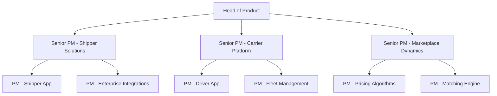
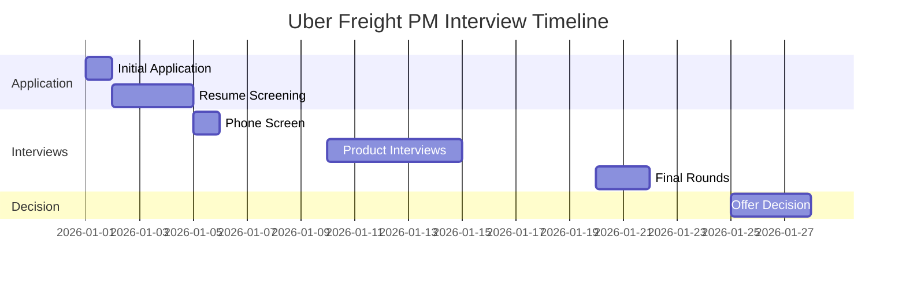

# Uber Freight Product Strategy Guide | PM Insights 2026

- **Source:** https://nextsprints.com/guide/uber-freight-product-manager-interview-guide

- **Type:** `interview-guide`

- **Updated:** October 31, 2026

---

## Introduction

Uber Freight's product management culture is a unique blend of logistics expertise and tech innovation. As a Senior PM who's been with the company for over 5 years, I've witnessed our evolution from a disruptive startup to an industry leader redefining freight transportation.

In 2026, the logistics industry is undergoing rapid transformation. AI-powered route optimization, autonomous trucking, and blockchain for supply chain transparency are no longer buzzwords – they're becoming operational realities. Uber Freight PMs are at the forefront, developing products that leverage these technologies to solve complex shipping challenges.

The role of a Product Manager at Uber Freight has never been more critical. We're not just building features; we're architecting the future of freight. Our PMs need to balance deep industry knowledge with cutting-edge tech savvy, all while maintaining our commitment to both shippers and carriers.

| Hiring Metric | 2025 | 2026 (Projected) |
| --- | --- | --- |
| PM Applications | 15,000+ | 18,000+ |
| Interview Success Rate | 2.5% | 2.2% |
| Time-to-Hire | 45 days | 40 days |

> Insider Perspective
> As someone who's conducted over 200 PM interviews at Uber Freight, I can tell you that we're looking for more than just technical skills. The candidates who truly stand out demonstrate a passion for solving logistics puzzles and can articulate how technology can revolutionize an age-old industry.

## PM Role

At Uber Freight, Product Managers are the driving force behind our mission to simplify the movement of goods and empower businesses of all sizes.

> Uber Freight PM Role
> Uber Freight Product Managers lead cross-functional teams to develop innovative solutions that optimize freight matching, pricing, and transportation logistics. They balance the needs of shippers, carriers, and internal stakeholders while driving business growth and operational efficiency.

Key responsibilities include:

- Defining product strategy and roadmap for specific Uber Freight offerings
- Analyzing market trends and competitor moves in the logistics tech space
- Collaborating with engineering, data science, and operations teams to build and launch new features
- Measuring product performance and iterating based on data-driven insights
- Engaging with customers (both shippers and carriers) to gather feedback and identify pain points

Team structure at Uber Freight:

Comparison with other tech companies:

| Aspect | Uber Freight PM | Amazon PM | Google PM |
| --- | --- | --- | --- |
| Industry Focus | Logistics/Transportation | E-commerce/Cloud | Search/Ads/Cloud |
| Technical Depth | High (logistics algorithms) | Moderate | Very High |
| Business Impact | Direct revenue influence | Varies by team | Often indirect |
| Stakeholder Management | Shippers, Carriers, Internal teams | Mostly internal | Mostly internal |

Real product example: Our "Instant Book" feature allows shippers to secure capacity with guaranteed rates in seconds. PMs worked closely with our pricing team to develop dynamic algorithms that adjust in real-time based on market conditions, carrier availability, and historical data.

## Job Requirements

Education:

- Bachelor's degree required, preferably in Computer Science, Engineering, or a related technical field
- MBA or advanced degree in a relevant field is a plus, but not mandatory

Experience:

- 5+ years of product management experience in a fast-paced tech environment
- Prior experience in logistics, supply chain, or transportation industry is highly valued
- Demonstrated track record of launching and scaling successful products

Technical Skills:

- Strong understanding of software development processes and agile methodologies
- Proficiency in data analysis and SQL
- Familiarity with machine learning concepts, particularly as applied to logistics optimization
- Experience with A/B testing and experimentation frameworks

Soft Skills:

- Exceptional communication and stakeholder management abilities
- Strategic thinking and problem-solving skills
- Ability to thrive in a fast-paced, ambiguous environment
- Strong leadership and team collaboration capabilities

| Requirement | Essential | Preferred |
| --- | --- | --- |
| Technical Degree | ✓ |  |
| MBA |  | ✓ |
| 5+ Years PM Experience | ✓ |  |
| Logistics Industry Experience |  | ✓ |
| Data Analysis Skills | ✓ |  |
| Machine Learning Knowledge |  | ✓ |

Success Factors:

1. Ability to balance technical depth with business acumen
2. Passion for solving complex logistics challenges
3. Data-driven decision-making approach
4. Strong user empathy for both shippers and carriers
5. Adaptability to rapidly changing market conditions

> Common Pitfalls
> Many candidates underestimate the complexity of the freight industry. Successful PMs at Uber Freight need to quickly grasp the intricacies of trucking regulations, carrier operations, and shipper needs. Don't focus solely on the tech – understand the industry you're disrupting.

> Expert Advice
> When preparing for your interview, dig deep into Uber Freight's existing products. Understand our marketplace dynamics and come prepared with ideas on how to improve efficiency or expand our service offerings. Your ability to think strategically about our business will set you apart.

## Interview Process Breakdown

Uber Freight's PM interview process is rigorous and comprehensive, designed to assess candidates across multiple dimensions. Here's an insider's look at what to expect:

1. Initial Application and Screening

- Resume review by HR and hiring manager
- 30-minute phone screen with a recruiter

1. Product Interviews

- Product Sense: Evaluate your ability to design intuitive, impactful products for our complex ecosystem.
- Product Execution: Assess how you approach problem-solving, prioritization, and metrics-driven decision making.
- Product Strategy: Gauge your strategic thinking and ability to drive long-term business growth.

1. Final Rounds

- Leadership and behavioral interview with senior leadership
- Cross-functional panel (often including Engineering and Operations leads)

Timeline expectations:

Round-by-round breakdown:

| Interview Type | Duration | Focus Areas |
| --- | --- | --- |
| Phone Screen | 30 min | Background, motivation, high-level skills |
| Product Sense | 45 min | Product design, user empathy, innovation |
| Product Execution | 45 min | Prioritization, metrics, problem-solving |
| Product Strategy | 45 min | Market analysis, growth strategies, vision |
| Leadership | 30 min | Cross-functional collaboration, communication |
| Panel Interview | 60 min | End-to-end product thinking, cultural fit |

> Insider Tip
> In the Product Strategy round, we often present candidates with real challenges Uber Freight is facing. Come prepared to discuss industry trends like autonomous trucking, last-mile delivery optimization, and sustainability in logistics.

Practice Uber Freight questions

Product Design

How could Facebook build a feature to help people find roommates?

View

Say you're a WhatsApp PM and want to add more ecommerce functionality. What would you do?

View

How would you build a language learning product for the Facebook app?

View

Product Improvement

What improvements could Uber Freight make to its mobile app to streamline the booking process for shippers?

View

How can Uber Freight enhance its load matching algorithm to reduce empty miles for carriers?

View

How might Uber Freight optimize its facility ratings feature to provide more actionable insights for drivers?

View

Product Success Metrics

What metrics would you use to evaluate Uber Freight's facility ratings system?

View

How would you define the success of Uber Freight's real-time tracking functionality?

View

How would you measure the success of Uber Freight's instant load booking feature?

View

Product Trade-Off

How can Uber Freight balance offering competitive rates to shippers while maintaining attractive payouts for carriers on its platform?

View

Should Uber Freight prioritize expanding its carrier network to increase load options or focus on optimizing existing routes for better efficiency and cost savings?

View

For Uber Freight's real-time tracking feature, should we emphasize more frequent updates to improve shipper visibility or limit updates to conserve carrier device battery life?

View

Product Root Cause Analysis

Why has Uber Freight's instant quote feature seen a 15% drop in usage over the past month?

View

How can we explain the declining average load size for Uber Freight's less-than-truckload shipments in the Midwest region since last week?

View

What factors are causing the sudden increase in carrier cancellations for Uber Freight's dedicated freight services this quarter?

View

## Product Manager Compensation & Levels at Uber Freight

Uber Freight offers competitive compensation packages to attract top PM talent. Our level structure aligns with industry standards while reflecting the unique challenges of our industry.

PM Levels at Uber Freight:

- PM1: Entry-level (0-2 years experience)
- PM2: Mid-level (3-5 years experience)
- Senior PM: (6+ years experience)
- Principal PM: (8+ years experience, limited positions)
- Director of Product: (10+ years experience, leadership track)

Salary Ranges (based on level.fyi data, adjusted for 2026 projections):

| Level | Base Salary | Stock (4-year) | Annual Bonus |
| --- | --- | --- | --- |
| PM1 | $120,000 - $140,000 | $80,000 - $120,000 | 10-15% |
| PM2 | $140,000 - $170,000 | $150,000 - $250,000 | 15-20% |
| Senior PM | $170,000 - $220,000 | $300,000 - $500,000 | 20-25% |
| Principal PM | $220,000 - $280,000 | $600,000 - $1,000,000 | 25-30% |

Note: These ranges can vary based on location, performance, and specific role requirements. Uber Freight also offers additional benefits such as health insurance, 401(k) matching, and professional development stipends.

> Negotiation Insight
> As a hiring manager, I've seen candidates successfully negotiate by demonstrating their unique value add to Uber Freight. Highlight specific experiences or skills that align with our strategic priorities, such as expertise in AI-driven logistics optimization or experience scaling marketplace products.

## How to Prepare

To excel in the Uber Freight PM interview process, focus on these key areas:

### Company Leadership Principles

While Uber Freight doesn't publicly list specific leadership principles, our culture is driven by these core values:

1. Customer Obsession: We relentlessly focus on creating value for both shippers and carriers.
2. Innovation at Scale: We leverage technology to solve complex logistics challenges efficiently.
3. Data-Driven Decision Making: We use analytics to inform every aspect of our product development.
4. Operational Excellence: We strive for flawless execution in a high-stakes industry.

In your interview prep, reflect on how these principles have guided your past work and how you'd apply them at Uber Freight.

### Tailor Your Resume

Your resume should clearly demonstrate your impact as a product manager. Use the STAR method (Situation, Task, Action, Result) to structure your bullet points, and quantify your achievements wherever possible.

Example: "Led development of carrier onboarding optimization feature, reducing time-to-first-load by 40% and increasing carrier retention by 25%"

For expert feedback on your PM resume, consider using NextSprints' Resume Review service ([https://nextsprints.com/resume-review](https://nextsprints.com/resume-review)). Their industry experts can help you highlight the experiences most relevant to Uber Freight.

### Practice Product Cases

Uber Freight's product cases often involve complex logistics scenarios. While knowing frameworks is helpful, it's more important to demonstrate adaptability and creative problem-solving.

Key areas to focus on:

- Marketplace dynamics and balancing supply/demand
- Pricing strategies for volatile markets
- Feature prioritization for diverse user groups (shippers vs. carriers)
- Metrics selection for logistics products

To access a comprehensive database of relevant product cases, check out NextSprints' Product Manager Interview Questions ([https://nextsprints.com/product-manager-interview-questions](https://nextsprints.com/product-manager-interview-questions)).

### Practice Mock Interviews

Nothing beats live feedback from experienced PMs. If you don't have access to senior PMs in your network, consider NextSprints' PM Coaching service ([https://nextsprints.com/pm-coaching](https://nextsprints.com/pm-coaching)). Their coaches, many with big tech and startup experience, can provide targeted feedback on your interview performance.

Remember, Uber Freight is looking for PMs who can navigate the complexities of the logistics industry while driving technological innovation. In your mock interviews, practice articulating how you'd approach challenges specific to our space, such as optimizing for both cost and speed in freight matching.

## FAQs

### What sets Uber Freight apart from traditional freight brokers?

Uber Freight leverages technology to bring transparency, efficiency, and reliability to the freight industry. Our platform uses advanced algorithms to match shipments with carriers in real-time, optimizing for factors like route efficiency, carrier preferences, and market dynamics. Unlike traditional brokers, we provide instant pricing and booking, reducing the time and effort required to move freight.

### How technical do I need to be as a PM at Uber Freight?

While you don't need to be a software engineer, a strong technical foundation is crucial. You should be comfortable discussing algorithms, data structures, and system design at a high level. More importantly, you need to understand how technology can be applied to solve logistics challenges. Familiarity with concepts like machine learning, optimization algorithms, and large-scale data processing is highly valuable.

### What's the biggest challenge facing Uber Freight right now?

One of our key challenges is scaling our marketplace efficiently while maintaining quality and reliability. As we expand into new regions and freight types, we need to ensure our platform can handle increased complexity without sacrificing the user experience for shippers and carriers. This requires continuous innovation in our matching algorithms, pricing models, and operational processes.

### How does Uber Freight approach product experimentation?

We have a robust experimentation culture at Uber Freight. We use A/B testing extensively to validate new features and optimizations. Given the real-world impact of our products, we often employ staged rollouts and carefully monitored pilot programs. PMs are expected to design experiments thoughtfully, considering both the potential business impact and the experience of our users.

### What opportunities are there for career growth at Uber Freight?

Uber Freight offers significant growth opportunities for PMs. As we continue to expand our product offerings and global presence, there are paths to take on larger, more complex products or move into leadership roles. We also encourage lateral moves between different product areas to broaden your expertise. Additionally, the skills you develop here – in areas like marketplace dynamics and logistics optimization – are highly transferable within the broader tech industry.

## Related Guides Section

📖 [Uber Freight Product Strategy Guide](uber-freight-product-strategy-guide) – Deep dive into Uber Freight's product decisions.

📖 [Uber Freight Product Manager Salary Guide](uber-freight-product-manager-salary-guide) – Salary insights & negotiation tips.

📖 [Uber Freight Product Teardown Guide](uber-freight-product-teardown-analysis) – Analysis of Uber Freight's product positioning.

Disclaimer: This guide is created for product management interview preparation purposes only. The analysis and methodology are based on the public information.
