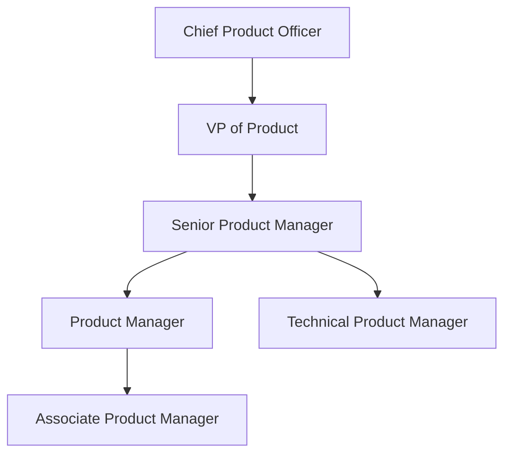
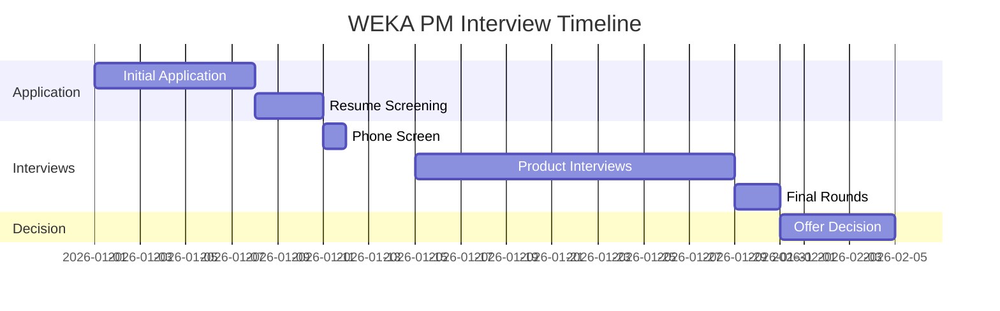

# WEKA Product Manager Interview Guide | Full Process & Tips

- **Source:** https://nextsprints.com/guide/weka-product-manager-interview-guide

- **Type:** `interview-guide`

- **Updated:** October 31, 2026

---

## Introduction

WEKA's product management culture is at the forefront of innovation in the data storage and management industry. As a leader in AI and machine learning infrastructure, WEKA seeks product managers who can navigate the complexities of high-performance computing while delivering intuitive solutions for enterprise customers.

The role of a product manager at WEKA has never been more critical. With the exponential growth of unstructured data and the increasing adoption of AI workloads, WEKA's products are positioned to revolutionize how organizations handle their most demanding computational challenges. This presents a unique opportunity for product managers to shape the future of data infrastructure.

| Hiring Metric | Value |
| --- | --- |
| YoY PM team growth | 30% |
| Avg. time-to-hire | 45 days |
| Retention rate | 92% |

> Insider Perspective
> At WEKA, product managers are expected to have a deep understanding of both technical infrastructure and business strategy. The ability to translate complex technical concepts into clear value propositions for C-level executives is paramount.

## PM Role

> WEKA Product Manager
> A WEKA Product Manager leads the development and execution of product strategies that address the evolving needs of enterprise AI and HPC workloads, balancing technical innovation with market demands.

Key responsibilities include:

- Defining product vision and roadmap for WEKA's data platform solutions
- Collaborating with engineering teams to prioritize features and capabilities
- Conducting market research to identify emerging trends in data management
- Developing go-to-market strategies for new product launches
- Analyzing product performance metrics and customer feedback

Team structure:

| Aspect | WEKA PM | Google PM | Amazon PM |
| --- | --- | --- | --- |
| Focus | Data infrastructure | Consumer software | E-commerce platforms |
| Technical depth | High | Medium | Medium-High |
| Customer interaction | Enterprise-focused | Limited direct | Varied |
| Product lifecycle | Long-term | Rapid iteration | Mixed |

Real-world example: WEKA's product managers recently spearheaded the development of WEKA 4, which introduced features like snap-to-object to streamline data pipeline efficiency for AI workloads.

## Job Requirements

Education:

- Bachelor's degree in Computer Science, Engineering, or related field required
- MBA or advanced degree in a technical field preferred

Experience:

- 5+ years of product management experience in enterprise software or data infrastructure
- Proven track record of successful product launches in the B2B tech space

Technical skills:

- Strong understanding of distributed systems and storage architectures
- Familiarity with AI/ML workflows and data pipeline optimization
- Proficiency in data analysis and SQL
- Experience with agile development methodologies

Soft skills:

- Exceptional communication and presentation abilities
- Strategic thinking and problem-solving aptitude
- Leadership and cross-functional collaboration skills

| Requirement | Essential | Preferred |
| --- | --- | --- |
| Education | Bachelor's in CS/Engineering | MBA or advanced technical degree |
| Experience | 5+ years in PM | 7+ years in data infrastructure PM |
| Technical skills | Distributed systems knowledge | AI/ML expertise |
| Soft skills | Communication, leadership | Negotiation, public speaking |

Success factors:

1. Ability to balance technical depth with business acumen
2. Proactive approach to identifying market opportunities
3. Skill in translating complex technical concepts for diverse audiences
4. Data-driven decision-making capabilities

> Common Pitfalls
> Candidates often underestimate the technical knowledge required for WEKA PM roles. Brush up on your understanding of file systems, object storage, and high-performance computing architectures.

> Expert Advice
> Showcase your ability to think strategically about data infrastructure challenges. Prepare examples of how you've optimized data workflows or improved system performance in previous roles.

## Interview Process Breakdown

WEKA's product manager interview process is designed to assess candidates' technical knowledge, strategic thinking, and cultural fit. Here's an overview of what to expect:

Round-by-round breakdown:

- Initial Application and Screening:

- Online application submission
- Resume review by HR and hiring manager
- Initial phone screen with recruiter (30 minutes)

- Product Interviews:
- Product Sense: Assess your ability to design and improve products that solve real user problems.
- Product Execution: Evaluate your skills in defining metrics, analyzing data, and making trade-off decisions.
- Product Strategy: Test your strategic thinking and ability to develop long-term product visions.

- Final Rounds:

- Leadership interview with senior executives
- Team fit assessment with potential colleagues

| Interview Round | Duration | Focus Areas |
| --- | --- | --- |
| Phone Screen | 30 min | Background, motivation, role fit |
| Product Design | 45 min | User-centric design, problem-solving |
| Product Execution | 45 min | Metrics definition, data analysis |
| Product Strategy | 60 min | Market analysis, long-term planning |
| Leadership | 45 min | Vision alignment, cultural fit |

Practice WEKA questions

Product Design

How could Facebook build a feature to help people find roommates?

View

Say you're a WhatsApp PM and want to add more ecommerce functionality. What would you do?

View

How would you build a language learning product for the Facebook app?

View

Product Improvement

How might WEKA enhance its data analytics capabilities within the Weka Data Platform to provide more actionable insights for users?

View

How can WEKA improve its WekaFS data management system to better handle unstructured data at scale?

View

What features could WEKA add to its cloud file system to increase data protection and security for enterprise customers?

View

Product Success Metrics

What metrics would you use to evaluate WEKA's cloud file system for high-performance computing?

View

How would you measure the success of WEKA's data management platform for AI and GPU workloads?

View

How would you define the success of WEKA's data storage solutions for genomics research?

View

Product Trade-Off

In developing WEKA's data management software, how do we weigh adding advanced AI/ML capabilities against keeping the interface simple for less technical users?

View

How should WEKA balance increasing storage capacity in its DataOps platform versus maintaining fast data access speeds?

View

For WEKA's cloud file system, should we prioritize expanding multi-cloud compatibility or enhancing on-premises integration features?

View

Product Root Cause Analysis

What factors are causing the increased latency in WEKA's cloud data management services during peak usage hours?

View

Why has WEKA's WekaFS file system performance declined by 15% for read operations over the past month?

View

Why has customer adoption of WEKA's data tiering feature dropped significantly in the last quarter compared to previous periods?

View

## Product Manager Compensation & Levels at WEKA

WEKA's product management career ladder reflects the company's commitment to attracting and retaining top talent in the data infrastructure space.

| Level | Title | Total Compensation Range |
| --- | --- | --- |
| L3 | Associate Product Manager | $120,000 - $150,000 |
| L4 | Product Manager | $150,000 - $200,000 |
| L5 | Senior Product Manager | $200,000 - $280,000 |
| L6 | Principal Product Manager | $280,000 - $350,000 |
| L7 | Director of Product | $350,000 - $450,000 |

Note: Compensation ranges are approximate and may vary based on location, experience, and performance. Total compensation includes base salary, bonuses, and equity grants.

WEKA offers competitive packages that often include significant equity components, reflecting the company's growth potential in the AI infrastructure market. As the demand for data management solutions continues to rise, WEKA has shown a willingness to offer attractive compensation to secure top product management talent.

## How to Prepare

Leadership Principles:

1. Customer Obsession: Deeply understand and anticipate the needs of data scientists and IT professionals.
2. Innovation at Scale: Push the boundaries of what's possible in data infrastructure while ensuring enterprise-grade reliability.
3. Bias for Action: Move quickly to capitalize on market opportunities in the fast-paced AI landscape.
4. Ownership: Take full responsibility for product outcomes, from conception to customer success.

Tailor Your Resume: Focus on quantifiable achievements that demonstrate your impact on product success. Use the STAR method to structure your bullet points, emphasizing results that align with WEKA's focus on performance and scalability. Highlight any experience with data-intensive applications or AI/ML workflows. For personalized feedback on your PM resume, consider using NextSprints' resume review service.

Practice Product Cases: Prepare for WEKA's product interviews by practicing a wide range of case types, focusing on data infrastructure challenges. Don't just memorize frameworks; develop the ability to adapt your approach based on the specific problem presented. WEKA's cases often involve technical elements, so brush up on your understanding of storage architectures and data pipelines. To access a comprehensive database of PM interview questions, check out NextSprints' curated collection.

Practice Mock Interviews: While self-practice is valuable, getting feedback from experienced product managers is crucial. Seek out colleagues or mentors in the data infrastructure space for mock interviews. If you don't have access to industry insiders, consider NextSprints' PM coaching service for expert-led mock sessions tailored to WEKA's interview style.

## FAQs

### What sets WEKA's PM role apart from other tech companies?

WEKA PMs need a unique blend of deep technical knowledge in data infrastructure and strategic business acumen. The role involves working on cutting-edge solutions for AI and HPC workloads, requiring a strong understanding of both current and future market needs in this rapidly evolving space.

### How technical do I need to be for a WEKA PM position?

While you don't need to be a software engineer, a solid grasp of distributed systems, storage architectures, and data pipeline optimization is crucial. Familiarity with AI/ML workflows and the ability to discuss technical concepts with engineers and data scientists is expected.

### What's the most challenging aspect of the WEKA PM interview process?

Candidates often find the product strategy round most challenging. It requires not only a deep understanding of WEKA's current market position but also the ability to envision and articulate future directions for data infrastructure products.

### How does WEKA evaluate cultural fit for PM candidates?

WEKA places a high value on innovation, customer focus, and the ability to thrive in a fast-paced environment. During the leadership and team fit interviews, be prepared to discuss how you've demonstrated these qualities in past roles and how you'd apply them at WEKA.

### Can you negotiate the offer if selected for a PM role at WEKA?

Yes, WEKA is open to negotiations, especially for candidates with highly relevant experience in data infrastructure or AI/ML product management. Be prepared to justify your request based on your unique value proposition and market data for similar roles.

## Related Guides Section

📖 [WEKA Product Strategy Guide](weka-product-strategy-guide) – Deep dive into WEKA's product decisions.

📖 [WEKA Product Manager Salary Guide](weka-product-manager-salary-guide) – Salary insights & negotiation tips.

📖 [WEKA Product Teardown Guide](weka-ai-data-platform-product-teardown-analysis) – Analysis of WEKA's product positioning.

Disclaimer: This guide is created for product management interview preparation purposes only. The analysis and methodology are based on the public information.
