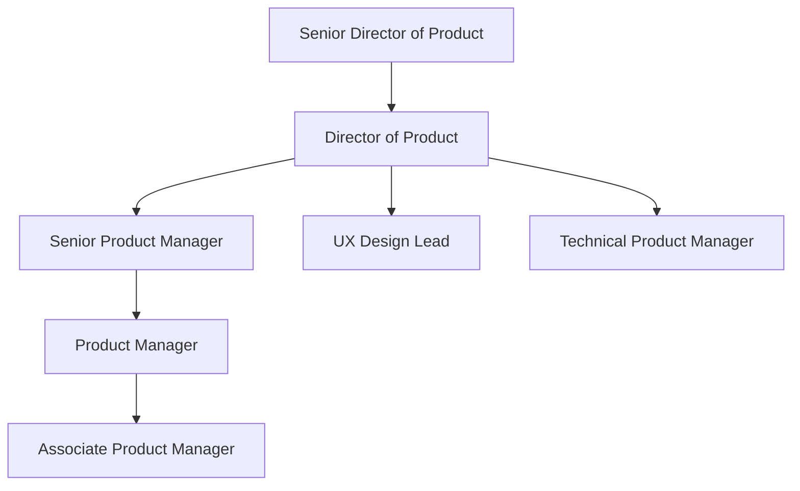
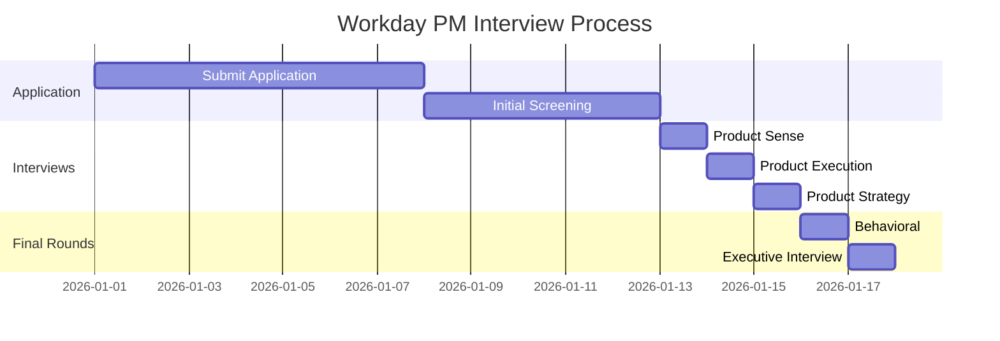

# Workday Product Manager Interview Guide | Full Process & Tips

- **Source:** https://nextsprints.com/guide/workday-product-manager-interview-guide

- **Type:** `interview-guide`

- **Updated:** October 31, 2026

---

## Introduction

Workday's product management culture is a unique blend of enterprise software expertise and cloud-based innovation. As a leader in HR and financial management solutions, Workday PMs are at the forefront of transforming how businesses operate. The role of a Product Manager at Workday has never been more critical, as organizations increasingly seek integrated, adaptable solutions to manage their workforce and finances in a rapidly evolving business landscape.

Market trends indicate a growing demand for cloud-based enterprise solutions, with Workday positioned as a key player. The significance of the PM role at Workday is underscored by the company's continued expansion into new markets and product areas, including analytics, planning, and machine learning applications.

| Hiring Statistic | Value |
| --- | --- |
| YoY PM Hiring Growth | 15% |
| Average Time-to-Hire | 45 days |
| Internal Promotion Rate | 30% |

> Expert Insight
> Workday PMs must balance deep enterprise knowledge with a forward-thinking approach to cloud technology. Success in this role requires a unique combination of technical acumen, business strategy, and a keen understanding of human capital management trends.

## PM Role

> Workday PM Role Definition
> A Workday Product Manager leads the development and execution of product strategies for enterprise cloud applications, focusing on HR, finance, and analytics solutions that drive business transformation for global organizations.

Responsibilities breakdown:

1. Product Strategy: Define long-term vision and roadmap for assigned product areas.
2. Market Research: Analyze industry trends, customer needs, and competitive landscape.
3. Feature Prioritization: Balance customer requests with technical feasibility and business impact.
4. Cross-functional Leadership: Collaborate with engineering, design, sales, and customer success teams.
5. Data-Driven Decision Making: Utilize analytics to inform product decisions and measure success.

Team structure:

Comparison with other top tech companies:

| Aspect | Workday PM | Google PM | Amazon PM |
| --- | --- | --- | --- |
| Focus | Enterprise solutions | Consumer/enterprise products | E-commerce/cloud services |
| Technical Depth | High (cloud, integrations) | Varies by product | High (AWS knowledge) |
| User Base | B2B, large enterprises | B2C and B2B | B2C and B2B |
| Release Cycles | Longer, enterprise-focused | Varies (rapid to long-term) | Frequent iterations |

Real examples from Workday's products:

- Workday Human Capital Management: PMs lead initiatives to enhance workforce planning and talent management features.
- Workday Financial Management: Product managers drive the development of advanced financial reporting and analytics capabilities.
- Workday Prism Analytics: PMs spearhead efforts to integrate machine learning for predictive insights across HR and finance data.

## Job Requirements

Education requirements:

- Bachelor's degree in Computer Science, Business, or related field (required)
- MBA or Master's degree in a technical field (preferred)

Experience levels:

- Entry-level PM: 2-3 years of relevant experience
- Mid-level PM: 4-6 years of product management experience
- Senior PM: 7+ years of experience, including enterprise software

Technical skills:

- Strong understanding of cloud technologies and SaaS models
- Familiarity with HR and financial management processes
- Data analysis and SQL proficiency
- Agile methodologies and project management tools

Soft skills:

- Exceptional communication and presentation abilities
- Strategic thinking and problem-solving aptitude
- Leadership and cross-functional collaboration
- Customer empathy and needs analysis

| Requirement | Entry-level PM | Mid-level PM | Senior PM |
| --- | --- | --- | --- |
| Years of Experience | 2-3 | 4-6 | 7+ |
| Technical Depth | Basic | Intermediate | Advanced |
| Leadership Scope | Team contributor | Feature owner | Product line owner |
| Strategic Input | Limited | Moderate | Significant |

Success factors:

1. Deep understanding of enterprise software landscape
2. Ability to translate complex business needs into product features
3. Strong analytical skills for data-driven decision making
4. Excellent stakeholder management across diverse teams

> Common Pitfalls
> Underestimating the complexity of enterprise integrations
> Neglecting change management aspects of product rollouts
> Focusing too narrowly on features without considering overall solution architecture

> Expert Tips
> Develop a thorough understanding of Workday's platform architecture
> Build relationships with key customers to gain firsthand insights
> Stay updated on emerging technologies in HR and finance domains
> Cultivate a network within Workday to navigate the organization effectively

## Interview Process Breakdown

End-to-end process overview:

1. Initial Application and Screening
2. Product Interviews
3. Final Rounds

Timeline expectations: The entire process typically takes 4-6 weeks from initial application to offer.

Round-by-round breakdown:

- Product Sense: Assesses your ability to identify user needs, design solutions, and improve existing products.

- Product Execution: Evaluates your skills in defining metrics, analyzing data, and making trade-off decisions.

- Product Strategy: Tests your capacity to develop growth strategies, plan product launches, and align with business objectives.

- Behavioral: Explores your cultural fit, leadership potential, and past experiences.

Process timeline diagram:

Round-specific tables:

| Interview Round | Focus Areas | Duration |
| --- | --- | --- |
| Product Sense | User needs, design thinking | 45-60 min |
| Product Execution | Metrics, analysis, prioritization | 45-60 min |
| Product Strategy | Growth, launch planning, business alignment | 45-60 min |
| Behavioral | Leadership, collaboration, culture fit | 45-60 min |
| Executive | Vision alignment, strategic thinking | 30-45 min |

Practice Workday questions

Product Design

How could Facebook build a feature to help people find roommates?

View

Say you're a WhatsApp PM and want to add more ecommerce functionality. What would you do?

View

How would you build a language learning product for the Facebook app?

View

Product Improvement

In what ways can we improve Workday's reporting tools to provide more actionable insights?

View

What features could enhance Workday's time tracking functionality for remote workers?

View

In what ways can we enhance Workday's mobile app to better support remote workers?

View

Product Success Metrics

how would you measure the success of workday's core hr feature?

View

what metrics would you use to evaluate workday's human capital management features?

View

how would you measure the success of workday's workday service?

View

Product Trade-Off

Is it better for Workday to focus on enhancing existing features or developing new modules to attract different market segments?

View

Should Workday prioritize adding more customization options or improving system performance?

View

Is it better for Workday to focus on expanding our enterprise client base or improving small business offerings?

View

Product Root Cause Analysis

Why has the average time to complete employee onboarding using Workday's HR suite doubled in the past month?

View

Why has the adoption rate of Workday's new expense reporting module dropped by 30% in the last quarter?

View

What's causing the sudden increase in customer support tickets related to Workday's payroll processing feature?

View

## Product Manager Compensation & Levels at Workday

Workday's PM level structure aligns with industry standards, offering competitive compensation packages to attract top talent. The levels typically range from Associate Product Manager (APM) to Senior Director of Product.

| Level | Title | Total Compensation Range (USD) |
| --- | --- | --- |
| L3 | Associate Product Manager | $120,000 - $160,000 |
| L4 | Product Manager | $150,000 - $220,000 |
| L5 | Senior Product Manager | $180,000 - $280,000 |
| L6 | Principal Product Manager | $220,000 - $350,000 |
| L7 | Director of Product | $280,000 - $450,000 |
| L8 | Senior Director of Product | $350,000 - $600,000+ |

Note: These ranges are approximations based on data from level.fyi and may vary based on location, experience, and performance. Total compensation includes base salary, bonuses, and equity grants.

Workday offers competitive benefits packages, including health insurance, 401(k) matching, and professional development opportunities. The company also provides unique perks such as volunteer time off and employee stock purchase programs, reflecting its commitment to employee well-being and long-term success.

## How to Prepare

Company Leadership Principles:

1. Customer Success: Prioritize customer outcomes in all product decisions.
2. Innovation: Continuously seek new ways to improve and disrupt the enterprise software landscape.
3. Integrity: Maintain the highest standards of data security and ethical business practices.
4. Collaboration: Foster cross-functional teamwork to deliver integrated solutions.

Tailor Resume: Focus on quantifiable impacts and use the STAR method (Situation, Task, Action, Result) to highlight your achievements. Emphasize experiences that demonstrate your ability to drive product success in complex enterprise environments. Showcase your understanding of cloud technologies and data-driven decision-making. For expert feedback on your PM resume, consider using NextSprints' Resume Review service.

Practice Product Cases: Develop a structured approach to solving product challenges, focusing on Workday's enterprise context. Practice articulating your thought process clearly and concisely. While frameworks are useful, the key is adapting them to Workday's specific product ecosystem. Utilize NextSprints' extensive Product Manager Interview Questions database to hone your skills across various case types.

Practice Mock Interviews: Engage in realistic mock interviews to refine your communication style and build confidence. Seek feedback from experienced PMs, particularly those with enterprise software backgrounds. If you don't have access to such mentors, NextSprints offers PM Coaching sessions with industry veterans who can provide targeted feedback and insider insights.

## FAQs

### What sets Workday's PM role apart from other tech companies?

Workday PMs focus on enterprise-scale solutions, requiring a deep understanding of complex business processes in HR and finance. The role demands a unique blend of technical knowledge, business acumen, and the ability to navigate long sales cycles and implementation timelines typical in enterprise software.

### How technical do I need to be as a Workday PM?

While you don't need to code, a strong technical foundation is crucial. Understanding cloud architectures, data models, and integration patterns is essential. Familiarity with HR and financial systems is a plus. The ability to communicate effectively with engineering teams and translate technical concepts for non-technical stakeholders is key.

### What's the career progression like for PMs at Workday?

Workday offers clear growth paths for PMs. You can progress from APM to Senior PM roles, then move into leadership positions like Director or VP of Product. There are also opportunities to transition into related areas such as Product Marketing or Customer Success, leveraging your product expertise.

### How does Workday approach product innovation?

Innovation at Workday is driven by a combination of customer feedback, market trends, and emerging technologies. PMs play a crucial role in identifying opportunities for AI and machine learning integration, improving user experience, and developing new features that address evolving business needs in the HR and finance domains.

### What's the work culture like for PMs at Workday?

Workday's culture emphasizes collaboration, innovation, and work-life balance. PMs often work in cross-functional teams, with opportunities for remote work and flexible schedules. The company values continuous learning, offering resources for professional development and encouraging PMs to stay at the forefront of enterprise technology trends.

## Related Guides Section

📖 [Workday Product Strategy Guide](workday-product-strategy-guide) – Deep dive into Workday's product decisions.

📖 [Workday Product Manager Salary Guide](workday-product-manager-salary-guide) – Salary insights & negotiation tips.

📖 [Workday Product Teardown Guide](workday-product-teardown-guide) – Analysis of Workday's product positioning.

Disclaimer: This guide is created for product management interview preparation purposes only. The analysis and methodology are based on the public information.
