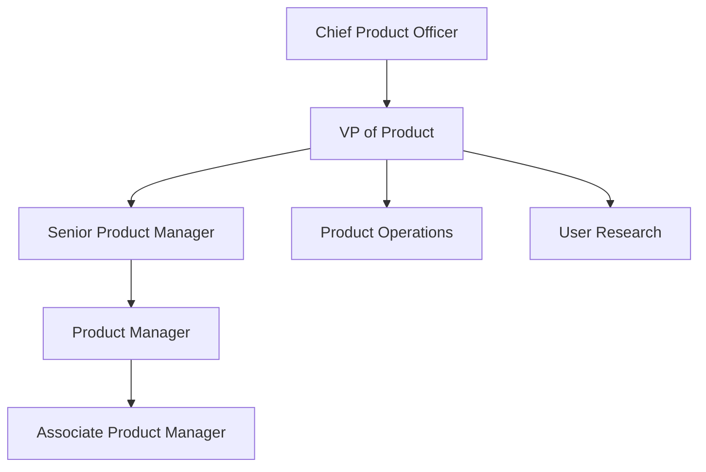

# Yotpo Product Manager Culture Guide | 2026 Insights

- **Source:** https://nextsprints.com/guide/yotpo-product-manager-interview-guide

- **Type:** `interview-guide`

- **Updated:** October 31, 2026

---

## Introduction

Yotpo's product management culture is a unique blend of innovation, customer-centricity, and data-driven decision-making. As an eCommerce marketing platform, Yotpo's PMs are at the forefront of shaping the future of online shopping experiences. The role of a Product Manager at Yotpo has never been more crucial, as the eCommerce landscape continues to evolve rapidly in 2026.

Market trends indicate a growing demand for personalized shopping experiences and advanced analytics in eCommerce. Yotpo's PM team is instrumental in developing solutions that leverage AI and machine learning to meet these evolving needs. The significance of the PM role at Yotpo cannot be overstated – they are the driving force behind products that empower thousands of brands to create loyal customers and drive growth.

| Hiring Metric | Value |
| --- | --- |
| YoY PM team growth | 25% |
| Average time-to-hire | 45 days |
| Retention rate | 92% |

> Expert Insight
> "At Yotpo, we look for PMs who can balance strategic thinking with tactical execution. Our ideal candidates are those who can navigate the complexities of the eCommerce ecosystem while maintaining a laser focus on delivering value to our customers."

## PM Role

> Role Definition
> A Product Manager at Yotpo is responsible for defining and executing the product strategy for one or more of Yotpo's eCommerce marketing solutions. They work closely with engineering, design, and marketing teams to deliver innovative features that drive customer engagement and revenue growth for Yotpo's clients.

Responsibilities of a Yotpo PM include:

1. Conducting market research and competitive analysis
2. Defining product roadmaps and prioritizing features
3. Collaborating with engineering and design teams on product development
4. Analyzing product performance metrics and user feedback
5. Presenting product strategies to leadership and stakeholders
6. Coordinating with sales and marketing teams for product launches

| Aspect | Yotpo PM | Google PM | Amazon PM |
| --- | --- | --- | --- |
| Focus | eCommerce marketing solutions | Diverse product portfolio | Retail and technology products |
| Scale | Mid-size, growing user base | Massive global user base | Large-scale, diverse customer segments |
| Autonomy | High autonomy in feature decisions | Collaborative, matrix organization | Ownership-driven culture |

Real examples from Yotpo's products:

- Reviews & Ratings: PMs led the development of AI-powered review analysis tools, helping brands gain deeper insights from customer feedback.
- Visual Marketing: Product teams innovated on user-generated content curation, significantly increasing engagement rates for Yotpo clients.
- Loyalty & Referrals: PMs spearheaded the integration of predictive analytics into loyalty programs, enabling brands to personalize rewards more effectively.

## Job Requirements

Education Requirements:

- Bachelor's degree in Computer Science, Business, or related field (Master's preferred)
- MBA or advanced degree in a technical field is a plus

Experience Levels:

- Minimum 3-5 years of product management experience
- Prior experience in eCommerce or marketing technology strongly preferred

Technical Skills:

- Proficiency in data analysis and SQL
- Understanding of web technologies and APIs
- Familiarity with agile development methodologies

Soft Skills:

- Excellent communication and presentation abilities
- Strong analytical and problem-solving skills
- Leadership and cross-functional collaboration expertise

| Requirement | Junior PM | Senior PM |
| --- | --- | --- |
| Years of Experience | 1-3 | 5+ |
| Technical Depth | Basic | Advanced |
| Strategic Input | Limited | Significant |
| Team Leadership | Individual Contributor | People Management |

Success Factors:

1. Customer-centric mindset
2. Data-driven decision making
3. Ability to balance short-term gains with long-term vision
4. Adaptability in a fast-paced environment

> Common Pitfalls
> Overlooking the importance of user research in feature prioritization
> Failing to align product decisions with overall business strategy
> Underestimating the complexity of integrations in the eCommerce ecosystem

> Expert Tips
> "Successful PMs at Yotpo demonstrate a deep understanding of eCommerce trends and can translate that knowledge into actionable product strategies. They're not afraid to challenge assumptions and are always looking for ways to innovate within our product suite."

## Interview Process Breakdown

The Yotpo PM interview process is designed to thoroughly assess candidates' product sense, execution skills, and strategic thinking. Here's a breakdown of what to expect:

1. Initial Application and Screening Resume review Phone screen with recruiter (30 minutes) Brief technical assessment
2. Product Interviews Product Sense: Evaluate your ability to design and improve products Product Execution: Assess how you measure success and handle trade-offs Product Strategy: Gauge your strategic thinking and growth planning skills
3. Final Rounds Leadership interview Team fit assessment Possible take-home assignment

| Round | Focus | Duration |
| --- | --- | --- |
| Phone Screen | Background and motivation | 30 min |
| Product Design | User-centric solution creation | 45 min |
| Product Metrics | Data-driven decision making | 45 min |
| Product Strategy | Long-term vision and planning | 60 min |
| Leadership | Cross-functional collaboration | 45 min |

Timeline Expectations:

- From initial application to offer: 4-6 weeks
- 1-2 weeks for initial screening
- 2-3 weeks for core product interviews
- 1 week for final rounds and decision

Practice Yotpo questions

Product Design

How could Facebook build a feature to help people find roommates?

View

Say you're a WhatsApp PM and want to add more ecommerce functionality. What would you do?

View

How would you build a language learning product for the Facebook app?

View

Product Improvement

What improvements could Yotpo make to its loyalty and referral program features to increase customer retention?

View

How might Yotpo refine its review collection and display capabilities to boost conversion rates for e-commerce clients?

View

How can Yotpo enhance its visual user-generated content platform to better showcase customer photos and videos?

View

Product Success Metrics

How would you define the success of Yotpo's Loyalty and Referrals program?

View

What metrics would you use to evaluate Yotpo's SMS Marketing platform?

View

How would you measure the success of Yotpo's Visual User-Generated Content (UGC) feature?

View

Product Trade-Off

How can Yotpo balance the simplicity of its review collection process with the depth of data gathered from customers?

View

Should Yotpo prioritize expanding its visual UGC features or focus on enhancing its loyalty program capabilities to drive customer retention?

View

For Yotpo's SMS marketing tool, should we emphasize increasing message open rates or improving conversion tracking for better ROI measurement?

View

Product Root Cause Analysis

How can we explain the unexpected 40% decline in new sign-ups for Yotpo's Loyalty & Referrals program during Q2?

View

What factors contributed to the sudden 15% decrease in conversion rates for Yotpo's SMS Marketing campaigns last week?

View

Why has Yotpo's Visual UGC feature seen a 30% drop in user engagement over the past month?

View

## Product Manager Compensation & Levels at Yotpo

Yotpo's PM compensation structure is competitive within the eCommerce SaaS industry. While exact figures can vary based on experience and performance, here's a general overview based on data from level.fyi and other industry sources:

| Level | Title | Total Compensation Range (USD) |
| --- | --- | --- |
| L3 | Associate Product Manager | $90,000 - $120,000 |
| L4 | Product Manager | $120,000 - $160,000 |
| L5 | Senior Product Manager | $160,000 - $220,000 |
| L6 | Group Product Manager | $220,000 - $300,000 |
| L7 | Director of Product | $300,000 - $400,000+ |

Note that these ranges include base salary, bonuses, and equity. Yotpo offers a competitive equity package, which can significantly increase total compensation, especially at higher levels.

Factors influencing compensation:

- Years of experience in product management
- Relevant industry expertise (eCommerce, marketing technology)
- Impact on key business metrics
- Leadership and mentorship contributions

Yotpo regularly reviews its compensation structure to remain competitive in the talent market, particularly in tech hubs like Tel Aviv, New York, and London where they have major offices.

## How to Prepare

To excel in Yotpo's PM interview process, focus on these key areas:

Company Leadership Principles: While Yotpo doesn't publicly list official leadership principles, their culture emphasizes:

1. Customer Obsession: Always prioritize the needs of Yotpo's clients and their end-users.
2. Data-Driven Innovation: Use analytics to inform product decisions and drive continuous improvement.
3. Collaborative Problem-Solving: Work effectively across teams to tackle complex eCommerce challenges.
4. Agile Execution: Adapt quickly to market changes and iterate on solutions.

Tailor Your Resume: Highlight experiences that demonstrate your impact on product metrics and business outcomes. Use the STAR method to structure your achievements, focusing on eCommerce or marketing technology wins. Quantify your results wherever possible. For a professional review of your PM resume, consider using NextSprints' resume review service.

Practice Product Cases: Yotpo's product cases often revolve around eCommerce challenges. Practice structuring your thoughts on topics like improving conversion rates, enhancing customer loyalty programs, or integrating user-generated content into marketing strategies. While frameworks are useful, show flexibility in your approach. NextSprints offers a comprehensive database of product manager interview questions that can help you prepare effectively.

Practice Mock Interviews: Nothing beats live feedback from experienced PMs. If you don't have access to senior PMs in your network, consider NextSprints' PM coaching service. Their coaches, many with experience from top tech companies, can provide invaluable insights into your interview performance and help you refine your approach.

## FAQs

### What makes a successful PM at Yotpo?

Successful PMs at Yotpo combine strong analytical skills with a deep understanding of eCommerce trends. They're able to translate complex data into actionable insights and have a knack for identifying features that drive real value for Yotpo's clients.

### How technical do I need to be for a PM role at Yotpo?

While you don't need to be a developer, a solid understanding of web technologies, APIs, and data analysis is crucial. Familiarity with eCommerce platforms and marketing technologies is a significant plus.

### Does Yotpo prefer PMs with startup or big tech experience?

Yotpo values diverse experiences. While startup experience can demonstrate adaptability and ownership, big tech background can bring valuable processes and scale thinking. The key is how you apply your experience to Yotpo's unique challenges.

### How does Yotpo approach product development?

Yotpo follows an agile methodology with a strong emphasis on data-driven decision making. PMs work closely with cross-functional teams and are expected to iterate quickly based on market feedback and performance metrics.

### What growth opportunities are there for PMs at Yotpo?

Yotpo offers significant growth potential for PMs. As the company expands its product suite and enters new markets, there are opportunities to take on larger product areas, mentor junior PMs, and move into strategic leadership roles.

## Related Guides Section

📖 [Yotpo Product Strategy Guide](yotpo-product-strategy-guide) – Deep dive into Yotpo's product decisions.

📖 [Yotpo Product Manager Salary Guide](yotpo-product-manager-salary-guide) – Salary insights & negotiation tips.

📖 [Yotpo Product Teardown Guide](yotpo-product-manager-strategy-guide) – Analysis of Yotpo's product positioning.

Disclaimer: This guide is created for product management interview preparation purposes only. The analysis and methodology are based on the public information.
