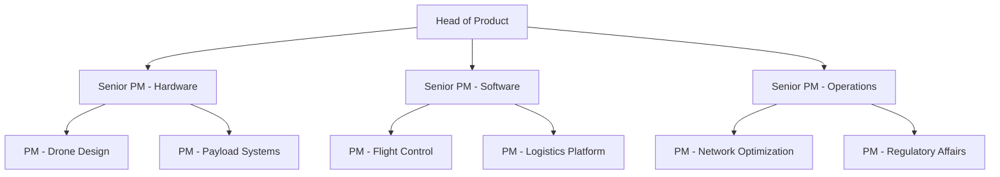

# Zipline Product Manager Culture Guide | PM Insights

- **Source:** https://nextsprints.com/guide/zipline-product-manager-interview-guide

- **Type:** `interview-guide`

- **Updated:** October 31, 2026

---

## Introduction

Zipline's product management culture is uniquely positioned at the intersection of cutting-edge technology and life-saving impact. As a pioneer in drone delivery for medical supplies, our PMs face challenges that blend logistics optimization, healthcare accessibility, and aviation innovation. The role of a Zipline PM has never been more crucial as we expand our reach globally and explore new applications for our technology.

Recent market trends show a surge in demand for drone-based delivery solutions, with the medical supply chain sector leading the charge. Zipline's PM team is at the forefront of this revolution, tasked with developing products that not only meet current needs but anticipate future healthcare delivery challenges.

| Zipline PM Hiring Stats 2026 |  |
| --- | --- |
| Open PM Positions | 15 |
| Avg. Time-to-Hire | 45 days |
| YoY PM Team Growth | 30% |
| Retention Rate | 92% |

> Insider Perspective
> As a senior product leader at Zipline, I've witnessed our PM team evolve from a small group focused on core delivery functionality to a diverse squad tackling complex challenges in AI-driven route optimization, predictive maintenance, and regulatory compliance across multiple countries. The key to success here is the ability to balance humanitarian impact with technological innovation.

## PM Role

> Zipline PM Role
> A Zipline Product Manager leads the development of drone delivery systems and supporting software, balancing technical feasibility, business viability, and social impact to revolutionize access to vital medical supplies globally.

Responsibilities at Zipline extend far beyond traditional PM roles. Our PMs are deeply involved in:

1. Defining product roadmaps for drone hardware and flight control software
2. Collaborating with healthcare partners to optimize delivery protocols
3. Analyzing flight data to improve efficiency and safety
4. Navigating complex regulatory landscapes across different countries
5. Driving innovation in autonomous systems and machine learning algorithms

Team structure at Zipline is designed to foster cross-functional collaboration:

Comparison with other tech companies:

| Aspect | Zipline PM | Big Tech PM |
| --- | --- | --- |
| Product Focus | Hardware + Software | Primarily Software |
| Impact Scope | Direct humanitarian outcomes | User engagement/revenue |
| Technical Depth | Aviation + Software | Primarily Software |
| Regulatory Focus | High (Aviation/Medical) | Varies (often lower) |

Real examples of Zipline PM projects include:

- Developing an AI-powered dispatch system that reduced delivery times by 22%
- Launching a new drone model with 50% increased payload capacity
- Creating a mobile app for health workers to track and request deliveries in real-time

## Job Requirements

Education and Experience:

- Bachelor's degree in Engineering, Computer Science, or related field (Master's preferred)
- 5+ years of product management experience, ideally in hardware/software integration
- Background in aerospace, healthcare logistics, or autonomous systems is highly valued

Technical Skills:

- Strong understanding of drone technology and aviation principles
- Proficiency in data analysis and SQL
- Familiarity with machine learning concepts and applications
- Experience with agile development methodologies

Soft Skills:

- Exceptional problem-solving abilities, especially in resource-constrained environments
- Strong communication skills to bridge technical and non-technical stakeholders
- Ability to navigate ambiguity and make data-driven decisions
- Empathy and cultural sensitivity for working in diverse global contexts

| Requirement Category | Must-Have | Nice-to-Have |
| --- | --- | --- |
| Technical | Drone tech knowledge, Data analysis | Machine learning, Regulatory expertise |
| Experience | 5+ years PM, Hardware/Software integ. | Healthcare or aerospace background |
| Soft Skills | Problem-solving, Communication | Cultural sensitivity, Leadership |

Success Factors:

1. Passion for Zipline's mission and impact-driven approach
2. Ability to think strategically while executing tactically
3. Comfort with rapid iteration and learning from failures
4. Skill in stakeholder management across diverse groups

> Common Pitfalls
> Many candidates underestimate the complexity of working within regulatory constraints or the challenges of hardware development cycles. Be prepared to discuss how you'd approach these unique aspects of Zipline's product development process.

> Expert Advice
> Showcase projects where you've balanced technical constraints with user needs, especially in high-stakes environments. Zipline values PMs who can demonstrate both innovation and pragmatism in their approach to problem-solving.

## Interview Process Breakdown

Zipline's PM interview process is designed to assess candidates' ability to navigate complex, multidisciplinary challenges. Here's a breakdown of what to expect:

Timeline Expectations:

- Initial Application to Offer: 4-6 weeks
- Number of Interview Rounds: 5-7

Round-by-Round Breakdown:

1. Initial Application and Screening

- Resume review and initial phone screen with recruiter (30 minutes)
- Brief technical assessment focused on data analysis and problem-solving

1. Product Interviews

- Product Sense: Evaluate ability to design innovative solutions for Zipline's unique challenges
- Product Execution: Assess skills in defining metrics, analyzing data, and making trade-offs
- Product Strategy: Test strategic thinking and ability to drive growth in new markets

1. Final Rounds

- Leadership and Culture Fit: Discussion with senior leadership about Zipline's mission and values
- Cross-functional Panel: Collaborative problem-solving session with engineering and operations teams

| Interview Round | Focus Areas | Duration |
| --- | --- | --- |
| Initial Screen | Background, motivation | 30 min |
| Product Sense | Design thinking, innovation | 60 min |
| Product Execution | Metrics, analysis, prioritization | 60 min |
| Product Strategy | Market expansion, long-term planning | 60 min |
| Leadership | Cultural alignment, vision | 45 min |
| Panel | Cross-functional collaboration | 90 min |

Practice Zipline questions

Product Design

How could Facebook build a feature to help people find roommates?

View

Say you're a WhatsApp PM and want to add more ecommerce functionality. What would you do?

View

How would you build a language learning product for the Facebook app?

View

Product Improvement

How can Zipline improve its drone delivery speed for medical supplies in remote areas?

View

What features could Zipline add to its autonomous aircraft to increase payload capacity without compromising flight range?

View

How might Zipline enhance its logistics software to optimize route planning and reduce delivery times in challenging weather conditions?

View

Product Success Metrics

What metrics would you use to evaluate Zipline's automated flight control system?

View

How would you measure the success of Zipline's drone delivery service for medical supplies?

View

How would you define the success of Zipline's cold chain management for temperature-sensitive vaccines?

View

Product Trade-Off

How can Zipline balance the need for faster drone delivery times with maintaining high safety standards for its medical supply transport?

View

Should Zipline prioritize expanding its drone delivery network to new countries or focus on increasing delivery frequency in existing service areas?

View

For Zipline's cold chain delivery service, should we invest in developing more advanced temperature-controlled packaging or expanding the range of products that can be delivered?

View

Product Root Cause Analysis

Why has customer satisfaction with Zipline's medical supply deliveries decreased from 95% to 80% in rural Ghana this quarter?

View

What factors are causing the sudden increase in battery failures for Zipline's delivery drones over the last two weeks?

View

Why has Zipline's drone delivery completion rate dropped by 15% in the past month?

View

## Product Manager Compensation & Levels at Zipline

Zipline's PM compensation structure is competitive within the tech industry, with a focus on balancing base salary, equity, and impact-driven bonuses. As of 2026, here's an overview of our levels and compensation ranges:

| Level | Title | Total Compensation Range |
| --- | --- | --- |
| L3 | Product Manager | $130,000 - $180,000 |
| L4 | Senior Product Manager | $160,000 - $240,000 |
| L5 | Lead Product Manager | $200,000 - $300,000 |
| L6 | Director of Product | $250,000 - $400,000 |

Note: These ranges include base salary, target bonus, and annualized equity grants. Actual compensation may vary based on location, experience, and performance.

Zipline offers a unique equity structure that ties a portion of stock grants to the company's social impact metrics, aligning PM incentives with our mission to improve healthcare access globally.

For the most up-to-date and detailed compensation data, candidates are encouraged to refer to external sources like levels.fyi, as Zipline's compensation structure may evolve to remain competitive in the fast-moving tech landscape.

## How to Prepare

Company Leadership Principles:

1. Mission-Driven Innovation: Every product decision should advance our goal of improving healthcare access.
2. Data-Informed Impact: Use metrics to quantify and maximize the real-world effect of our solutions.
3. Collaborative Problem-Solving: Work across disciplines to tackle complex challenges.
4. Continuous Learning: Embrace failures as opportunities to improve our systems and processes.

Tailor Your Resume: Focus on quantifiable impacts, especially those related to hardware-software integration, data-driven decision making, and cross-functional leadership. Use the STAR method to structure your achievements, highlighting how your work led to measurable improvements in product performance or user outcomes. Our NextSprints Resume Review service can help you optimize your resume for maximum impact.

Practice Product Cases: Zipline's product cases often involve unique constraints like limited infrastructure, regulatory hurdles, and life-critical reliability needs. Practice adapting standard frameworks to these scenarios. While memorizing frameworks can be helpful, the key is demonstrating flexible thinking. Our NextSprints Product Manager Interview Questions database offers a wide range of practice scenarios tailored to innovative tech companies like Zipline.

Mock Interviews: Nothing beats real-time feedback from experienced PMs. If you don't have access to Zipline PMs in your network, consider using NextSprints PM Coaching service. Our coaches, many with experience in cutting-edge tech and social impact sectors, can provide invaluable insights into how to approach Zipline's unique interview process.

## FAQs

### What makes Zipline's PM role unique compared to other tech companies?

Zipline PMs work at the intersection of hardware, software, and humanitarian impact. Unlike roles focused purely on digital products, our PMs must consider physical constraints, regulatory environments, and life-critical reliability standards. The opportunity to directly impact healthcare access adds a unique dimension of purpose to the role.

### How technical do I need to be to succeed as a PM at Zipline?

While you don't need to be an engineer, a strong technical foundation is crucial. Understanding of drone technology, data analysis, and basic machine learning concepts is important. More critical is the ability to communicate effectively with highly technical teams and translate complex problems into actionable product strategies.

### What's the most challenging aspect of being a PM at Zipline?

Balancing innovation with reliability in life-critical systems is often the biggest challenge. Our PMs must push the boundaries of what's possible in drone technology while ensuring our systems meet the highest safety and reliability standards. This requires careful risk management and the ability to make tough trade-offs.

### How does Zipline approach product development in diverse global markets?

We employ a localization-first strategy, working closely with healthcare partners and regulatory bodies in each market. PMs often travel to deployment sites to gain firsthand understanding of local needs and constraints. This on-the-ground insight is crucial for developing products that truly serve each community effectively.

### What growth opportunities are available for PMs at Zipline?

Zipline offers rapid growth potential due to our expansion into new markets and technologies. PMs can progress from managing individual features to overseeing entire product lines or expanding into new verticals like non-medical deliveries. There's also opportunity to transition into broader strategic roles as we continue to scale globally.

## Related Guides Section

📖 [Zipline Product Strategy Guide](zipline-product-strategy-guide) – Deep dive into Zipline's product decisions.

📖 [Zipline Product Manager Salary Guide](zipline-product-manager-salary-guide) – Salary insights & negotiation tips.

📖 [Zipline Product Teardown Guide](zipline-drone-delivery-product-teardown-analysis) – Analysis of Zipline's product positioning.

Disclaimer: This guide is created for product management interview preparation purposes only. The analysis and methodology are based on the public information.
