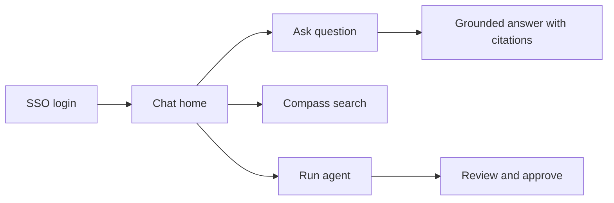

# Cohere North Teardown | Private Agentic AI Workspace

- **Source:** https://nextsprints.com/guide/cohere-north-ai-workspace-product-teardown

- **Type:** `product-teardown`

- **Updated:** October 31, 2026

---

## Executive Summary

North is Cohere's agentic AI workspace for enterprises: a place where employees chat with company knowledge, search across internal systems, generate documents and run agents that complete multi-step work. Three factors drive its appeal: 1) It can run entirely inside the customer's own cloud or data centre, so sensitive data never leaves their control. 2) It is built on Cohere's own retrieval stack (Embed, Rerank and Compass), which produces grounded answers with citations. 3) It ships as a complete product, so customers don't have to assemble models, vector databases and interfaces themselves.

Its unique value proposition is "enterprise AI you can actually deploy in a regulated company." Its main challenges are competing with assistants bundled into tools employees already use (Microsoft 365 Copilot, Google Gemini) and proving measurable productivity gains to sponsors.

This teardown covers North's user journeys, design, features, business model and competition. For interview preparation, see the [Cohere Product Manager Interview Guide](/guide/cohere-product-manager-interview-guide).

## Introduction

Cohere made North generally available in August 2025 after an early-access period with customers in finance, telecom and the public sector. In Canada, Bell offers North through a sovereign AI partnership, and Cohere's planned combination with Aleph Alpha positions North for European public-sector customers.

This teardown looks at the first-time experience, core flows (chat, search, agents and administration), information design, key features, the business model, and competition from bundled assistants, enterprise search tools and do-it-yourself builds on open models.

Our method combines Cohere's public product pages and announcements, press coverage and industry analysis. For Cohere's broader direction, see the [Cohere Product Strategy Guide](/guide/cohere-product-strategy-guide).

> Analyst View
> North's biggest strength is that security teams say yes to it. Its biggest challenge is that employees must choose to open it instead of the assistant already sitting in their email.

## Product Overview

Core value proposition: a secure AI workspace that uses all of a company's knowledge and tools while keeping data inside the company's perimeter.

Target users:

- Knowledge workers in regulated industries (banking, insurance, telecom, government, healthcare)
- Customer service and operations teams who look up procedures
- Analysts and managers who prepare reports and briefs
- IT and security teams who deploy and govern AI

Key use cases:

1. Ask questions grounded in internal documents, with citations
2. Search across SharePoint, Google Drive, Confluence, Salesforce, email and more with Compass
3. Draft documents, summaries and analyses
4. Run agents that complete multi-step tasks across connected tools
5. Administer access, connectors, usage and audit logs

Evolution:

- 2023-2024: Cohere sells models through API and private deployments; Coral and early Compass work explore enterprise assistants and search.
- Early 2025: North launched in early access.
- August 2025: North generally available; Bell partnership announced weeks earlier.
- Late 2025: Model Vault and Command A Reasoning strengthen private deployment and complex tasks.
- 2026: Managed North options, open-weight Command A+, and European expansion via Aleph Alpha.

> Key Takeaway
> North turned Cohere from a supplier of model components into a provider of a finished product, which changes who buys (business leaders, not just developers) and how Cohere is paid (seats and platform, not just tokens).

## User Journey Deep-Dive

First-time experience: Employees log in through their company's single sign-on. They land on a chat-first home screen with suggested prompts and any agents their admins have published. Because North inherits permissions from connected systems, the first answers already reflect documents the employee is allowed to see.

Key flows:

1. Ask and verify: The employee asks a question; North retrieves relevant passages and drafts an answer with inline citations. Clicking a citation opens the source.
2. Search: Compass returns ranked documents across sources, useful when the employee wants the file rather than an answer.
3. Agents: The employee starts an agent (for example "prepare a client brief") that gathers information from several systems, drafts output, and asks for approval before taking actions such as sending email.
4. Administration: IT admins connect data sources, set model and retention policies, publish agents and view usage and audit logs.

Friction points:

- Activation depends on connectors; a deployment with few sources feels empty.
- Employees must switch away from Outlook or Teams unless integrations are configured.
- Agent creation still benefits from technical help in many organisations.

## UX & Design Analysis

Strengths:

- Familiar chat interface reduces training needs.
- Citations are prominent, which builds trust for regulated users.
- Clear separation between suggestions and actions; agents ask before acting.

Weaknesses:

- Discoverability of agents and advanced features is limited for casual users.
- Value depends heavily on admin configuration, so experiences differ widely between customers.
- Answer quality can degrade when many noisy sources are connected without scoping.

| Design dimension | Assessment |
| --- | --- |
| Learnability | High for chat; moderate for agents |
| Trust signals | Strong (citations, permission-aware retrieval) |
| Admin control | Strong (deployment, policies, logs) |
| Personalisation | Moderate; mostly role-based through admins |

> Comparison Insight
> Compared with Microsoft 365 Copilot, North gives admins more control over where models run and which data is used, but is less embedded in the daily tools employees already have open.

## Feature Analysis

1. Grounded chat with citations Differentiation: ⭐⭐⭐⭐ User Impact: ⭐⭐⭐⭐⭐ The core experience. Answers are grounded in company data with traceable sources, which is essential in compliance-heavy work.
2. Compass enterprise search Differentiation: ⭐⭐⭐⭐ User Impact: ⭐⭐⭐⭐ Built on Embed and Rerank, Compass handles documents, slides, spreadsheets and images. Retrieval quality is one of Cohere's clearest strengths.
3. Agents and workflows Differentiation: ⭐⭐⭐ User Impact: ⭐⭐⭐⭐ Agents can work across connected tools and request approval before acting. The category is crowded, so differentiation depends on reliability and governance.
4. Private deployment and Model Vault Differentiation: ⭐⭐⭐⭐⭐ User Impact: ⭐⭐⭐ (for employees) / ⭐⭐⭐⭐⭐ (for buyers) North can run in a customer VPC, on-premises or in a Cohere-managed isolated environment. Employees rarely notice this, but it is often the reason the deal happens.

Underperforming areas:

- Integrations into everyday tools (email, chat) lag bundled competitors.
- Self-serve agent building for non-technical users is still maturing.

## Business Model Analysis

North is sold as an enterprise platform. Revenue streams include:

1. Platform and seat licences for North
2. Private deployment fees and support
3. Model usage inside deployments (Command, Embed, Rerank)
4. Partner channels such as Bell's sovereign offering and cloud marketplaces
5. Professional services and solutions engineering for large deployments

Growth engine: land with one department (often customer service or a knowledge-heavy team), prove time savings, then expand seats and agents across the company. Partnerships extend reach into markets where Cohere has no direct sales presence.

Economics: Customer-hosted deployments shift infrastructure costs to the customer; Cohere-managed deployments are faster to sell but put GPU costs on Cohere, making efficient models important for margins.

> Business Model Insight
> Because North runs on Cohere's own models, every new seat also increases model usage, so the application and model businesses reinforce each other.

## Competitive Analysis

| Feature | Cohere North | Microsoft 365 Copilot | Glean | ChatGPT Enterprise | DIY on open models |
| --- | --- | --- | --- | --- | --- |
| On-premises / customer VPC | ✅ | ❌ | Limited | ❌ | ✅ |
| Own models | ✅ | ❌ (partner models) | ❌ | ✅ | Varies |
| Enterprise search | ✅ | ✅ (Microsoft data) | ✅ | Limited | Build yourself |
| Agents | ✅ | ✅ | ✅ | ✅ | Build yourself |
| Embedded in daily tools | Limited | ✅ | Partial | Partial | ❌ |

Competitive advantages:

- Full stack deployable inside the customer's perimeter
- Strong retrieval and citations
- Sovereign partnerships in Canada and Europe

Market gaps:

- Less presence inside everyday productivity tools
- Smaller brand awareness among business users than OpenAI or Microsoft

> Strategic Position
> North wins where control and compliance decide the deal. It is weaker where convenience and existing bundles decide.

## FAQs

### What makes North different from other AI assistants?

North can be deployed in the customer's own environment, uses Cohere's own models and retrieval stack, and is designed around permission-aware, cited answers. Most competing assistants run only in the vendor's cloud.

### Who uses North?

Large organisations in regulated sectors, such as banks, insurers, telecoms and public-sector agencies, along with partners like Bell, which offers North to Canadian organisations through a sovereign AI platform.

### How does North use Cohere's models?

North uses Command models for generation and reasoning, Embed for search vectors and Rerank to order results. Compass, Cohere's search layer, ties retrieval together so answers are grounded in company data.

### How has North evolved since launch?

It moved from early access in early 2025 to general availability in August 2025, then added stronger deployment tooling, reasoning models, managed hosting options and broader agent capabilities through 2026.

## Related Guides Section

📖 [Cohere Product Manager Interview Guide](/guide/cohere-product-manager-interview-guide) – How North shows up in Cohere PM interviews.

📖 [Cohere Product Strategy Guide](/guide/cohere-product-strategy-guide) – Where Cohere is heading with sovereign and enterprise AI.

📖 [Cohere Product Manager Salary Guide](/guide/cohere-product-manager-salary-guide) – Pay by level in USD and CAD.

Disclaimer: This teardown is created for product management interview preparation purposes only. It is based on public information and industry analysis, not insider knowledge.
