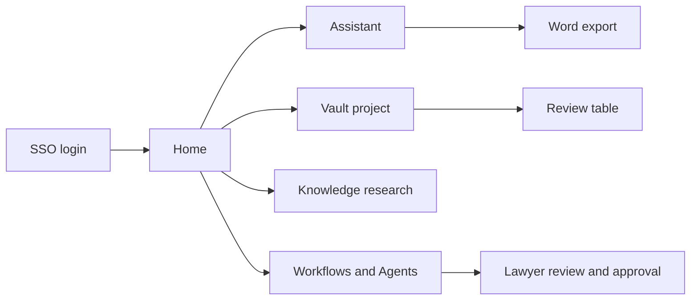

# Harvey Platform Teardown | Legal AI Product Analysis

- **Source:** https://nextsprints.com/guide/harvey-legal-ai-platform-product-teardown

- **Type:** `product-teardown`

- **Updated:** October 31, 2026

---

## Executive Summary

Harvey is an AI platform for legal and professional work, used by law firms, corporate legal teams and professional services firms. Three factors drive its success: 1) Legal-specific products built with lawyers, covering chat (Assistant), bulk document work (Vault), research (Knowledge), repeatable processes (Workflows) and end-to-end task execution (Agents). 2) Enterprise-grade security and confidentiality that large firms require. 3) A strong brand among top law firms, which pulls in their clients and peers.

Its unique value proposition is "AI that lawyers at the best firms trust with real client work." Its main challenges are competing with content-rich incumbents (Thomson Reuters, LexisNexis), fast-moving startups (Legora and others), and bundled general AI tools, while keeping quality high as agents take on more autonomous work.

This teardown covers Harvey's user journeys, design, features, business model and competition. For interview preparation, see the [Harvey Product Manager Interview Guide](/guide/harvey-product-manager-interview-guide).

## Introduction

Harvey launched in 2022 with a small group of law firm partners and grew rapidly. By early 2026 it reported more than 100,000 lawyers across over 1,300 organisations, and customers had built tens of thousands of custom workflows and agents on the platform. Recent additions include deeper Microsoft 365 integration, a Connector Library for firm systems, analytics for Shared Spaces, and the LexisNexis alliance for research content.

This teardown looks at the first-time experience, core flows, design, key features, the business model, and competition. Our method combines Harvey's public product pages, blog and newsroom, press coverage and industry analysis. For Harvey's broader direction, see the [Harvey Product Strategy Guide](/guide/harvey-product-strategy-guide).

> Analyst View
> Harvey's biggest strength is trust among elite firms, which shapes buying decisions across the legal market. Its biggest challenge is staying clearly better than tools that are cheaper, bundled or own the underlying legal content.

## Product Overview

Core value proposition: help lawyers do high-quality legal work faster, securely, within the tools and processes they already use.

Target users:

- Associates and partners at large and mid-size law firms
- In-house counsel and legal operations teams
- Tax and advisory professionals at professional services firms
- Knowledge management and innovation teams that build workflows

Key use cases:

1. Drafting and revising documents with Assistant and the Word add-in
2. Reviewing large document sets in Vault (diligence, discovery, contract portfolios)
3. Researching legal, regulatory and tax questions with Knowledge
4. Running Workflows for repeatable tasks
5. Delegating multi-step tasks to Agents with lawyer review
6. Collaborating with clients in Shared Spaces

Evolution:

- 2022-2023: Assistant launched with select large firms
- 2024: Vault and Workflows expand to bulk analysis and repeatable processes
- 2025: LexisNexis alliance; Workflow Builder and agent capabilities grow; rapid customer expansion
- 2026: Agents executing work end to end, Microsoft 365 integration, Connector Library, Shared Spaces analytics, and new professional services verticals

> Key Takeaway
> Harvey evolved from a chat assistant into a platform, and its custom workflows and agents increasingly encode each firm's own expertise.

## User Journey Deep-Dive

First-time experience: Lawyers sign in through firm single sign-on. Firms often run onboarding with Harvey's legal engineers, introducing practice-specific workflows. Users see Assistant, Vault, Knowledge and Workflows from the home screen.

Key flows:

1. Assistant: Ask a question or upload a document; Harvey drafts, summarises or analyses; the lawyer edits and exports.
2. Vault: Create a project, upload hundreds or thousands of files, ask questions across them or run structured review, and export a table of findings.
3. Knowledge: Ask a research question with jurisdiction filters; receive an answer with citations; open sources.
4. Workflows and Agents: Choose a workflow or agent, provide inputs, review checkpoints, and accept the output.
5. Word add-in: Work with Harvey inside the document being drafted.

Friction points:

- Breadth can overwhelm new users who don't know where to start.
- Value depends on finding practice-specific workflows.
- Trust needs to be earned for research and court-facing work.

## UX & Design Analysis

Strengths:

- Clean, professional interface suited to conservative users.
- Strong emphasis on sources and citations.
- Workflows reduce the need for prompt-writing skills.

Weaknesses:

- Many products in one platform can create navigation complexity.
- Long-running tasks need clearer progress and status.
- Moving between the web app and Word can break flow.

| Design dimension | Assessment |
| --- | --- |
| Learnability | Good for Assistant; moderate for Vault and Workflow Builder |
| Trust signals | Strong (citations, sources, review steps) |
| Customisation | Strong (custom workflows and agents) |
| Integration | Improving (Word, Microsoft 365, connectors) |

> Comparison Insight
> Compared with general AI assistants, Harvey's interface is built around legal tasks and sources rather than open-ended chat, which suits lawyers who need defensible outputs.

## Feature Analysis

1. Vault Differentiation: ⭐⭐⭐⭐⭐ User Impact: ⭐⭐⭐⭐⭐ Bulk analysis of large document sets is where Harvey saves the most hours, especially in diligence and discovery.
2. Workflows and Workflow Builder Differentiation: ⭐⭐⭐⭐ User Impact: ⭐⭐⭐⭐ Firms encode their own processes, making Harvey more useful and harder to replace.
3. Knowledge Differentiation: ⭐⭐⭐ User Impact: ⭐⭐⭐⭐ Research with citations, strengthened by content partnerships. Incumbents with their own content remain strong competitors here.
4. Agents Differentiation: ⭐⭐⭐⭐ User Impact: ⭐⭐⭐⭐ (growing) End-to-end task execution with lawyer review is Harvey's next growth engine.

Underperforming areas:

- Shared Spaces adoption among client users is still developing.
- Mid-size firm onboarding without dedicated innovation teams.

## Business Model Analysis

Harvey sells enterprise subscriptions, mainly priced per seat, with larger deals for firm-wide deployments. Revenue streams include:

1. Seat licences for law firms and legal departments
2. Enterprise agreements with professional services firms
3. Potential usage-based pricing for agent-heavy workloads
4. Expansion through Shared Spaces and new verticals

Growth engine: land with prestige firms, expand firm-wide, and use their brand to win peers and their corporate clients. Annualised revenue was reported at about USD 190 million in January 2026, with later third-party estimates higher.

Economics: AI compute costs rise with agent usage, so pricing must evolve to keep margins healthy as agents do more work.

> Business Model Insight
> Harvey benefits from a "follow the leaders" dynamic: when top firms adopt, peers and clients follow, lowering acquisition costs.

## Competitive Analysis

| Feature | Harvey | Thomson Reuters CoCounsel | Lexis+ AI | Legora | Microsoft Copilot |
| --- | --- | --- | --- | --- | --- |
| Legal-specific workflows | ✅ | ✅ | ✅ | ✅ | ❌ |
| Bulk document review | ✅ | ✅ | Limited | ✅ | ❌ |
| Own legal content | Via partners | ✅ | ✅ | Via partners | ❌ |
| Custom workflow builder | ✅ | Limited | Limited | ✅ | Limited |
| Agents | ✅ | ✅ | ✅ | ✅ | ✅ (general) |

Competitive advantages:

- Brand and adoption among elite firms
- Broad, integrated platform with strong customisation
- Speed of product development

Market gaps:

- Dependence on partners for primary legal content
- Price pressure from bundled tools in mid-size firms

> Strategic Position
> Harvey leads on platform breadth and brand. Incumbents lead on content. The winner may be whoever combines both best.

## FAQs

### What makes Harvey unique?

Harvey combines legal-specific chat, bulk document analysis, research, custom workflows and agents in one secure platform, and it has strong adoption among the world's leading law firms.

### Who uses Harvey?

Large and mid-size law firms, corporate legal departments and professional services firms, reported at more than 100,000 lawyers across over 1,300 organisations in early 2026.

### How does Harvey handle legal research?

Through Knowledge, which answers questions with citations from authoritative sources, strengthened by partnerships such as the LexisNexis alliance.

### How has Harvey evolved?

From a chat assistant for a few firms in 2022-2023 to a platform with Vault, Workflows, Knowledge, Agents, Shared Spaces and Microsoft 365 integration by 2026.

## Related Guides Section

📖 [Harvey Product Manager Interview Guide](/guide/harvey-product-manager-interview-guide) – How Harvey's products show up in PM interviews.

📖 [Harvey Product Strategy Guide](/guide/harvey-product-strategy-guide) – Where Harvey is heading.

📖 [Harvey Product Manager Salary Guide](/guide/harvey-product-manager-salary-guide) – Pay by level in USD.

Disclaimer: This teardown is created for product management interview preparation purposes only. It is based on public information and industry analysis, not insider knowledge.
